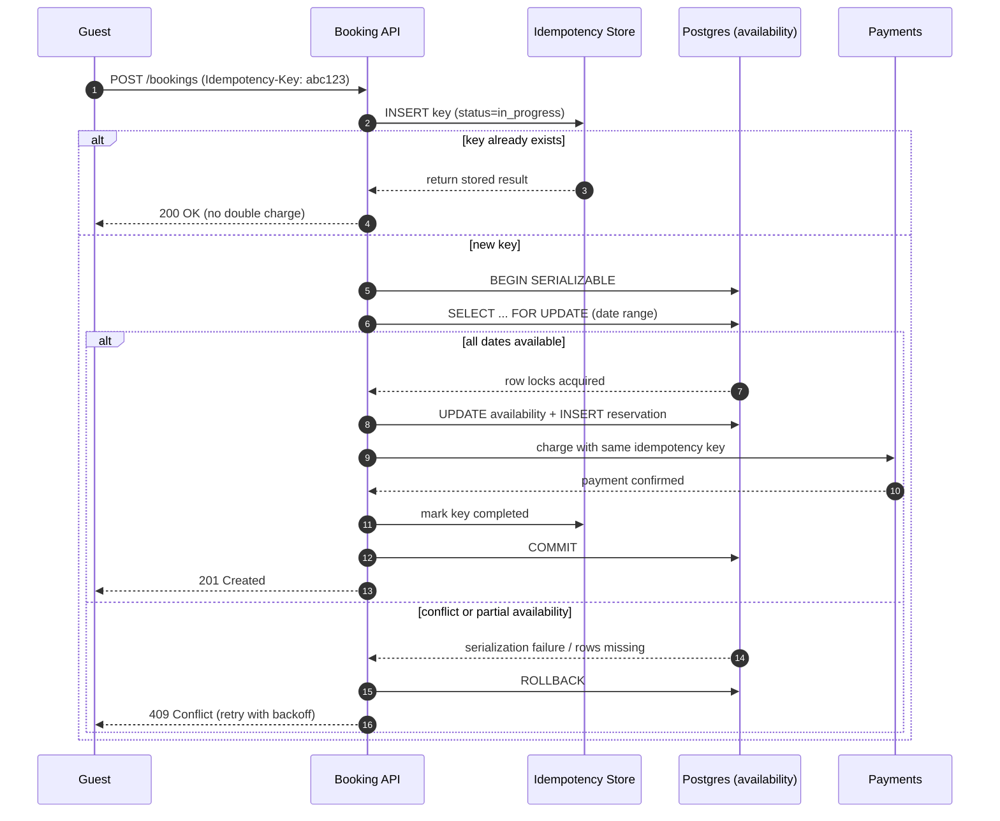

| Difficulty | Channel | Tags |
|---|---|---|
| intermediate | database | acid, isolation-levels, mvcc |

A guest taps "Book" on a beach house in Lisbon. The spinner hangs. They tap again. Behind the scenes, two identical payment requests race toward two different microservices, and only one of them should ever win. Airbnb learned this the hard way while scaling reservation and payments traffic, and the exactly-once fix their engineers shared publicly became a blueprint for safe booking systems everywhere [1].

---

> ### Real-World Case — Airbnb
>
> Airbnb's reservation and payments traffic flows through many microservices. When a guest double-clicked the "Book" button or a client aggressively retried after a network timeout, multiple identical requests could reach the backend simultaneously, creating race conditions that risked charging a guest twice for a single reservation.
>
> | | |
> |---|---|
> | **Challenge** | Guarantee exactly-once semantics for money-moving and booking operations across a growing service-oriented architecture, without every team re-implementing fragile data-integrity logic and without taking the system offline. |
> | **Solution** | Airbnb built Orpheus, a generic idempotency framework: every mutating request carries a unique idempotency key. The framework records and enforces that key and, critically, combines the service's application logic with database instructions into a single ACID database commit, so a retried or racing request returns the original result instead of creating a second booking or charge. |
> | **Outcome** | Idempotency keys made reservation and payment operations safe under double-clicks, network retries, and concurrent requests, eliminating a major source of duplicate payments across Airbnb's payments microservices and giving all engineering teams a shared, reusable exactly-once primitive. |
> | **Lesson** | The reliable way to prevent duplicate bookings is to enforce an atomic exactly-once guarantee at the data layer — a unique idempotency key committed in the same ACID transaction as the booking — rather than trusting an application-level check-then-act that can race. |

---

## Hook — The Two-Tap Problem That Turns a Reservation Into a Refund

Picture the moment every product team dreads: a customer pays, sees an error, pays again, and ends up holding two reservations for the same weekend. Nothing crashed. No alarm fired. The system did exactly what it was told, twice. This is the weird failure mode of distributed booking: the bug is not a broken line of code, it is a duplicate intention arriving from the network. A double-clicked button, an aggressive client retry after a timeout, a load balancer replaying a request — each one looks perfectly legitimate to the backend. Consequently, teams that only test the happy path discover the double-booking problem in production, usually at 3am, usually with a chargeback attached. The stakes are not abstract: an overbooked property means an angry host, a displaced guest, and a refund plus compensation. So the real question is not "how do we make booking faster?" It is "how do we make booking happen exactly once?" Keep that question in mind, because the answer reshapes how you think about transactions, locks, and idempotency.

## Problem — When "Book Now" Means "Maybe Book Twice"

The booking problem is a classic race condition wearing a friendly UX costume. Two guests, or one impatient guest, hit the same property for the same dates at the same millisecond. Both requests read the availability calendar and both see "available." From there, the timeline splits and each request happily writes its own reservation. This is a lost-update and write-skew problem hiding behind a checkout screen [3]. The symptoms developers see first are subtle: intermittent overbookings, support tickets that cannot be reproduced, and logs where every individual request looks correct. Worse, the naive fixes make things fragile. Crank the isolation level to the maximum and throughput collapses under lock contention on hot properties. Add a read-then-write check in application code and you have introduced a time-of-check-to-time-of-use gap wide enough to drive a tour bus through. Load balancers, retries, and mobile networks amplify the danger because they deliberately duplicate requests — that is how they achieve reliability. Therefore the design must assume duplicates are normal, not exceptional. If duplicates are inevitable, the only sane strategy is to make the operation idempotent: performing it twice must produce the same result as performing it once [6].

## Real-World Case — Airbnb's Idempotency Shield

Airbnb ran headfirst into this at scale. Their reservation and payments traffic flows through many microservices, and when a guest double-clicked the "Book" button or a client aggressively retried after a network timeout, multiple identical requests could reach the backend simultaneously. Each request was valid in isolation, yet together they created race conditions that risked charging a guest twice for a single reservation [1]. The engineering team's answer was idempotency keys: a client-generated, unique identifier attached to each logical operation so that the backend can detect and collapse duplicates. If the same key arrives again, the system returns the previously computed result instead of executing the work a second time. The impact was significant. Idempotency keys made reservation and payment operations safe under double-clicks, network retries, and concurrent requests, eliminating a major source of duplicate payments across Airbnb's payments microservices. Crucially, it gave every engineering team a shared, reusable exactly-once primitive rather than a dozen one-off hacks [1]. That is the twist most developers miss: the winning move was not a faster database, it was a contract at the API boundary. Building on that insight, the rest of this article shows how isolation levels, locking, and idempotency fit together.

## Deep Dive — Isolation Levels, MVCC, and the Two Flavors of Concurrency Control

To understand why Airbnb's approach works, you have to separate two concerns that often get mashed together: isolation and idempotency. Isolation is about how concurrent transactions observe each other's writes; idempotency is about whether repeating an operation changes the outcome. Transactions exist to guarantee ACID properties — atomicity, consistency, isolation, and durability — and the "I" is where all the drama lives [2]. Developers typically choose from four isolation levels, and the trade-off is always correctness versus throughput. Read Committed allows non-repeatable reads; Repeatable Read still permits phantom reads in some engines; Serializable prevents anomalies by making concurrent transactions behave as if they ran one after another [3][10]. Under the hood, most production databases use MVCC (multiversion concurrency control), which keeps multiple versions of a row so readers never block writers and writers never block readers [4]. That elegance has a cost: snapshot reads can show a stale "available" state, which is exactly how two bookings slip through. Here is the counterintuitive part — optimistic concurrency control assumes conflicts are rare, lets everyone proceed, and validates at commit time using a version column [5]. Pessimistic locking, by contrast, grabs the lock up front and serializes access. For a hot property on a holiday weekend, optimism can mean endless retries; for a long tail of rarely booked listings, pessimism wastes lock overhead. The mature answer is usually a hybrid: SERIALIZABLE transactions for the critical write, MVCC snapshot reads for cheap availability checks, and row-level locks on the specific date range that is actually being claimed [8][9]. Add an idempotency key on top and duplicates stop being a correctness problem entirely [7].

## Workflow — From Tap to Confirmed Reservation

The sequence below tells the whole story in one picture. A guest submits a booking carrying an Idempotency-Key. The API first tries to insert that key into an idempotency store; if the key already exists, the stored result is returned immediately and no second charge occurs. If the key is new, the API opens a SERIALIZABLE transaction, locks the availability rows for the requested date range with SELECT ... FOR UPDATE [8], and re-validates that every date in the range is still free. When validation passes, it flips the availability rows, writes the reservation, charges the payment provider using the same idempotency key, and finally marks the key complete before committing. The steps, in order: (1) derive or receive an idempotency key; (2) attempt key insertion to detect duplicates; (3) begin a SERIALIZABLE transaction; (4) lock the property's date-range rows; (5) validate the full range atomically; (6) write availability and reservation together; (7) charge with the same key for end-to-end exactly-once semantics; (8) mark the key completed and commit. If any step fails, the transaction rolls back and the caller retries with exponential backoff. This is where the Mermaid diagram earns its keep — it shows both the fast duplicate path and the slow conflict path in a single flow.

## Code Example — A Booking Transaction You Can Actually Ship

Theory is cheap. The code below implements the core booking transaction in Python against PostgreSQL, combining an idempotency store, row-level locking, and retry with exponential backoff. Walk it through once and the whole pattern clicks. First, the idempotency key is derived deterministically from the logical request, so a double-click and a genuine retry produce the same fingerprint. Second, the INSERT ... ON CONFLICT DO NOTHING acts as an atomic duplicate detector: if a row already exists for that key, the function returns the previously stored result and never touches availability or payments. Third, SELECT ... FOR UPDATE locks exactly the rows for the requested date range, which serializes competing bookings without freezing the entire table. Fourth, the length of the returned date set is compared against the expected number of nights, catching partial availability that a naive boolean check would miss. Fifth, availability updates and the reservation insert happen inside the same transaction, so they commit or fail as a unit. Finally, a retry wrapper catches serialization failures and backs off exponentially — the standard response when the database tells you two transactions collided [9][10]. This is not a toy: it mirrors the production patterns teams at Airbnb and elsewhere rely on [1][6].

## Lessons Learned — What to Do Differently Tomorrow

The journey from a double click to a bulletproof booking pipeline teaches a handful of durable lessons. First, treat duplicate requests as a feature of the network, not a bug in the user — design for idempotency from day one and your future self will thank you [7]. Second, do not confuse isolation with idempotency: SERIALIZABLE protects against concurrent anomalies, while idempotency keys protect against repeated intentions, and you usually need both [2][6]. Third, lock the smallest unit possible — the specific date range, not the whole property — so hot listings stay responsive under contention. Fourth, always validate the full range, not a single flag, because partial availability is a silent double-booking factory. Fifth, pair pessimistic row locks with optimistic retry: let the database serialize the critical section, then back off gracefully when it reports a conflict [5][9]. Sixth, expose the same idempotency key to downstream services, especially payments, so exactly-once semantics propagate end to end [1]. Common battle scar: teams add retries for reliability and accidentally multiply duplicate writes; an idempotency key is what makes retries safe. Another: using SKIP LOCKED for availability checks — tempting for throughput, but it lets transactions silently ignore the rows they most need to see. If this all feels like a lot, you are not alone; start with the idempotency store, add row-level locks, then tune isolation. The one insight worth sharing with your team: Airbnb did not fix duplicate payments with a faster database — they fixed it with a contract. Make your operations exactly once, and the race condition stops being your problem.

---

## Booking Transaction Sequence

<strong>Original Interview Question</strong>

**Q:** You're building a booking system for Airbnb where multiple users can reserve the same property simultaneously. How would you design the transaction handling to prevent double bookings while maintaining high availability?

**A:** Use SERIALIZABLE isolation with optimistic concurrency control. Implement row-level locks on property availability tables, use MVCC snapshot reads for checking availability, and apply application-level validation to ensure atomic booking operations.

## Conclusion

The moral of the story is that double bookings are rarely a database speed problem — they are a coordination problem. Airbnb did not make duplicates impossible; they made duplicates harmless by giving every operation an identity [1]. That single shift turns a terrifying race condition into a routine, retryable request. So what should you do tomorrow? Add an idempotency keys table to your booking or payment flow before you touch isolation levels. Then lock the narrowest set of rows you can get away with, validate the full range atomically, and wrap the critical section in a retry with exponential backoff. Sound familiar to something on your backlog? It should be. The team that ships exactly-once semantics sleeps through the night; the team that hopes duplicates never happen meets the pager at 3am. One memorable line to share with your team: make it safe to do twice, and you never have to be afraid of doing it once.

---

## References

1. [Airbnb incident report](https://medium.com/airbnb-engineering/avoiding-double-payments-in-a-distributed-payments-system-2981f6b070bb) — article
2. [ACID — Wikipedia](https://en.wikipedia.org/wiki/ACID) — documentation
3. [Isolation (database systems) — Wikipedia](https://en.wikipedia.org/wiki/Isolation_(database_systems)) — documentation
4. [Multiversion concurrency control — Wikipedia](https://en.wikipedia.org/wiki/Multiversion_concurrency_control) — documentation
5. [Optimistic concurrency control — Wikipedia](https://en.wikipedia.org/wiki/Optimistic_concurrency_control) — documentation
6. [Idempotence — Wikipedia](https://en.wikipedia.org/wiki/Idempotence) — documentation
7. [Idempotent (Glossary) — MDN Web Docs](https://developer.mozilla.org/en-US/docs/Glossary/Idempotent) — documentation
8. [PostgreSQL SELECT — Locking Clause](https://www.postgresql.org/docs/current/sql-select.html) — documentation
9. [PostgreSQL Transaction Isolation](https://www.postgresql.org/docs/current/transaction-iso.html) — documentation
10. [Serializability — Wikipedia](https://en.wikipedia.org/wiki/Serializability) — documentation

---

**Author:** Satishkumar Dhule — [GitHub](https://github.com/satishkumar-dhule) · [LinkedIn](https://linkedin.com/in/satishkumar-dhule) · [Website](https://satishkumar-dhule.github.io)
