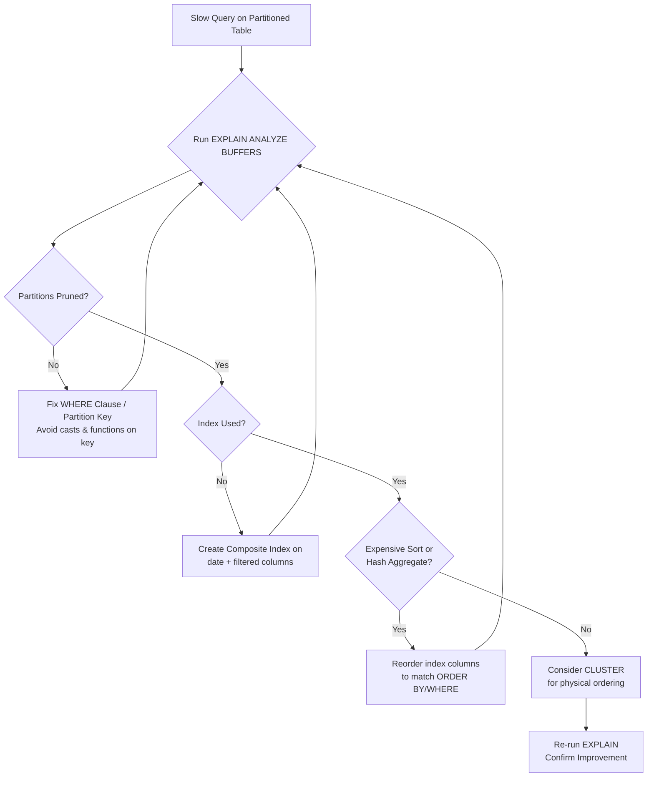
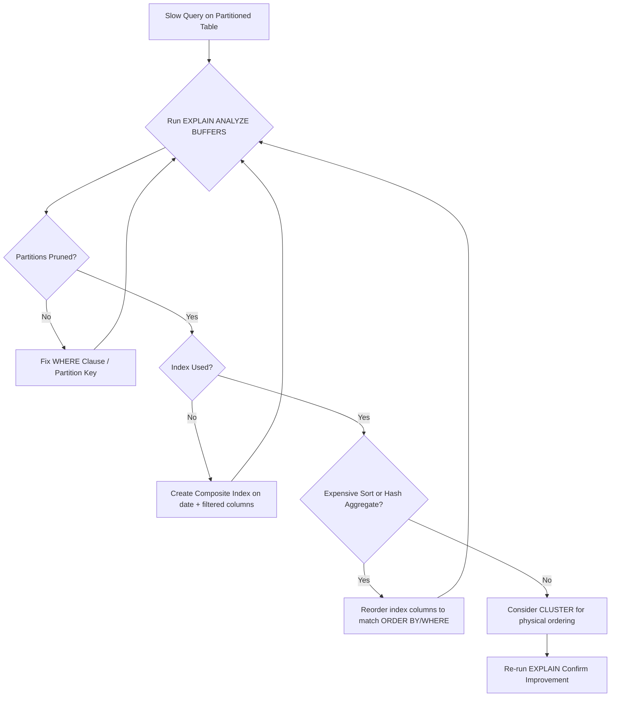

| Difficulty | Channel | Tags |
|---|---|---|
| intermediate | database | explain, query-plan, partitioning |

When CoinGecko's hourly crypto price table crossed 1 terabyte after 8+ years of relentless growth, queries that once felt instant started taking over 30 seconds [1]. Picture the result: p99 response times ballooned to 4.13 seconds, IOPS pressure climbed across every replica, and replication lag turned their read fleet into a house of mirrors [1]. The fix wasn't a bigger server or a shiny new database — it was a precise reading of the query plan and a smarter data layout. This is the journey from a query that crawls to one that flies, told through the lens of a real team that lived the nightmare and engineered their way out.

---

> ### Real-World Case — CoinGecko
>
> CoinGecko stores hourly cryptocurrency price data in PostgreSQL. After 8+ years, one table grew past 1TB and its queries averaged over 30 seconds, causing severe IOPS pressure and replica lag across their API.
>
> | | |
> |---|---|
> | **Challenge** | A date-range query on a huge table was too slow because the working set no longer fit in memory. Simple indexing didn't help because queries filtered on a JSONB column of currency keys, so the team needed the database to scan far less data per query. |
> | **Solution** | They converted the table to a native PostgreSQL range-partitioned table by month, since nearly all queries include a timestamp range and only need the most recent few months. They diagnosed pruning with EXPLAIN, validated partition counts, migrated data via a foreign data wrapper to avoid overloading production IOPS, and prewarmed partitions before cutover. Crucially, they had to fix a query lacking a lower date bound that defeated partition pruning and scanned every (including empty future) partition. |
> | **Outcome** | p99 response time dropped 86% (from 4.13s to 578ms), IOPS fell 20% across multiple replicas (compounding cost savings), and replica lag was eliminated. The same queries ran 6-8x faster after partitioning, and prewarming the partitioned table took only 3 hours versus 10 hours for the original table. |
> | **Lesson** | Partitioning is not a performance feature by itself — pruning is. A partitioned table only pays off when the query actually filters on the partition key with a bounded range; a single query missing the lower date boundary silently scanned all partitions and performed worse than on the unpartitioned table. |

---

## Hook — It Started With a Query That Took 30 Seconds

Imagine a dashboard that once loaded before you could blink, now freezing long enough for you to grab coffee. That's the moment CoinGecko's engineers hit when their hourly price table surpassed 1TB: average query times north of 30 seconds, with p99 latencies hitting 4.13 seconds and replication lag spreading like a stain across their API replicas [1]. 

Here's the terrifying part — nothing in the code changed. The data just kept arriving, hour after hour, and somewhere in that endless accumulation a fundamental law of databases revealed itself. A query filtering on a specific date range should have touched only a sliver of the table. Instead, it was reading everything. 

Sound familiar? If you manage a table that's been growing quietly for years, this story is a mirror. The question isn't whether your query is slow — it's *why* the planner chose the path it did, and whether the data is even organized to help it.

## Problem — When a Billion Rows Won't Cooperate

The core challenge is deceptively simple: you have a PostgreSQL table with 100 million rows partitioned by date, a query filtering on a specific date range, and it's still slow. How is that even possible?

Most developers assume that partitioning solves all performance problems. Partition those tables, and queries magically skip irrelevant data. The reality is that partitioning is a *promise*, and the query planner has to keep that promise for you. If it fails to prune partitions — or does the right pruning but then reads every row inside each partition — you get the worst of both worlds: complexity without speed.

There are three usual suspects:

- **Broken partition pruning** — the WHERE clause doesn't match the partition key in a way the planner can prove, so it scans every partition.
- **Missing or unusable indexes** — sequential scans on each partition burn IOPS and memory bandwidth [2].
- **Expensive sorts and hash aggregates** — even correctly filtered rows get shuffled and sorted in ways that dwarf the read cost.

The stakes compound in production. Every extra second of query time translates into replica lag, elevated IOPS bills, and API latency that users feel directly. For a data-heavy product, that's not a performance problem — it's a growth problem, a trust problem, and eventually a revenue problem.

## Real-World Case — CoinGecko's 1TB Wake-Up Call

CoinGecko didn't stumble into slow queries by accident — they walked straight into them, one hourly price point at a time. After more than 8 years of collecting cryptocurrency price data, a single table crossed the 1TB threshold and started dragging their entire API down [1].

The symptoms were brutal and very public. Queries averaged over 30 seconds. p99 response time sat at 4.13 seconds. IOPS pressure rippled across multiple replicas, and replication lag meant the read replicas served increasingly stale data — a nightmare for a product whose core value is fresh market data [1].

Then came the transformation. By adopting table partitioning, CoinGecko's team achieved jaw-dropping results: **p99 response time dropped 86%, from 4.13s to 578ms.** IOPS fell 20% across multiple replicas, compounding into meaningful cost savings. Replica lag was eliminated entirely. The same queries ran **6-8x faster**. And there was a hidden gem — prewarming the partitioned table took only 3 hours versus 10 hours for the original monolithic table [1].

That last detail is the kind of insight you only get from the trenches. Smaller, time-bounded partitions don't just speed up reads; they make maintenance dramatically cheaper. The lesson? The bottleneck wasn't PostgreSQL. It was the shape of the data.

## Deep Dive — Reading the Plan Like a Detective

Building on CoinGecko's story, the crucial skill isn't memorizing optimizations — it's diagnosing where the time actually goes. The query plan is your crime scene, and `EXPLAIN (ANALYZE, BUFFERS)` is your magnifying glass [3].

Four things deserve your scrutiny:

- **Partition pruning effectiveness.** Look for how many partitions appear in the plan. If you filter on a single month and the plan shows every partition, pruning failed. This usually happens because the partition key is wrapped in a function, cast, or implicit type conversion the planner can't reason about. 
- **Index usage vs. sequential scans.** A `Seq Scan` on a huge partition is a red flag [2]. Watch for bitmap scans too — they're fine for moderate selectivity but can fall apart when a partition is enormous.
- **Expensive sorts and hash aggregates.** A `Sort` with a large memory footprint or a `Sort Method: external merge Disk` means data spilled to disk. That's I/O you didn't plan for.
- **Row estimate versus reality.** When `rows` estimated is 100 but actual is 5 million, the planner is flying blind and making terrible decisions [3].

Here's a plot twist that trips up many developers: adding an index doesn't automatically mean it gets used. A composite index on `(event_date, status)` only helps if the query's predicates align with the leading column(s) and the planner *believes* the index is cheaper than scanning [2]. Statistics matter. Stale `ANALYZE` data can make a good index invisible. 

Moreover, the ordering of columns in a composite index is not arbitrary. The leading column should be the most selective or most commonly filtered. Get that wrong, and you've built a beautiful index that sits unused while your queries grind.

## Workflow — From Slow Query to Fast Response

So how do you move from diagnosis to transformation? The workflow follows a clear, repeatable loop. The diagram below tells the visual story of that journey.



Step by step:

- **Step 1: Measure honestly.** Never guess. Run `EXPLAIN (ANALYZE, BUFFERS)` and read actual timings, buffers, and row counts [3].
- **Step 2: Verify pruning first.** Before touching indexes, confirm the planner is skipping partitions. This is the cheapest, highest-impact win.
- **Step 3: Inspect scan types.** Identify sequential scans on large partitions and ask why the index was bypassed [2].
- **Step 4: Attack the sorts.** If sorting dominates, the index order itself can satisfy the ORDER BY and eliminate the sort entirely.
- **Step 5: Consider physical clustering.** `CLUSTER` physically reorders rows to match an index, which is exactly the technique that unlocked CoinGecko's gains [1][6].
- **Step 6: Re-measure and compare.** Optimization without measurement is just superstition.

This loop is iterative. Fix pruning, re-run the plan, then move to indexes, then clustering. Each pass reveals the next bottleneck.

## Code Example — Diagnosing and Fixing the Query

Enough theory. Here's a production-style bash script that runs the diagnostic SQL against psql, checks pruning, adds a composite index safely, and clusters the table. Each block maps directly to a step in the workflow above.

```bash
#!/usr/bin/env bash
set -euo pipefail

PSQL="psql -d crypto -v ON_ERROR_STOP=1"

# Step 1: Look at the real plan with runtime stats and buffer usage.
# 'partitions' output reveals whether pruning actually happened.
$PSQL -c "
EXPLAIN (ANALYZE, BUFFERS, FORMAT TEXT)
SELECT * FROM events
WHERE event_date BETWEEN '2024-01-01' AND '2024-01-31'
  AND status = 'completed';
"

# Step 2: Confirm which partitions exist and their sizes.
# If the query filters one month but many partitions show up, pruning failed.
$PSQL -c "
SELECT tableoid::regclass AS partition,
       pg_size_pretty(pg_total_relation_size(tableoid)) AS size
FROM events
WHERE event_date BETWEEN '2024-01-01' AND '2024-01-31'
GROUP BY 1, 2 ORDER BY 2 DESC;
"

# Step 3: Build a composite index on (date, filtered_column).
# CONCURRENTLY avoids locking writes on a live, high-traffic table.
$PSQL -c "
CREATE INDEX CONCURRENTLY IF NOT EXISTS idx_events_date_status
ON events (event_date, status);
"

# Step 4: Refresh statistics so the planner trusts the new index.
$PSQL -c "ANALYZE events;"

# Step 5: Physically reorder rows to match the index to boost locality.
# CLUSTER is a one-time, lock-heavy operation - run during low traffic.
$PSQL -c "CLUSTER events USING idx_events_date_status;"

# Step 6: Re-run the plan and compare timings and buffer counts.
$PSQL -c "
EXPLAIN (ANALYZE, BUFFERS)
SELECT * FROM events
WHERE event_date BETWEEN '2024-01-01' AND '2024-01-31'
  AND status = 'completed';
"
```

**Why this works, line by line:**

- The first `EXPLAIN (ANALYZE, BUFFERS)` gives you ground truth — actual time, rows, and how many blocks were read from cache versus disk [3]. If buffers stay low but time is high, you have a CPU/sort problem, not an I/O one.
- The partition-size query surfaces pruning failures immediately. Seeing partitions outside January in the result is your smoking gun.
- `CREATE INDEX CONCURRENTLY` is the production-safe choice: it builds the index without blocking inserts, which matters enormously on a write-heavy price table.
- `ANALYZE events` is the underrated hero. Without fresh statistics, the planner may still opt for a sequential scan because it *thinks* the index is more expensive [3].
- `CLUSTER` physically orders rows by the index, improving page locality so range scans read fewer pages — the same lever CoinGecko pulled [1][6].
- The final `EXPLAIN` closes the loop, proving the improvement with numbers rather than hope.

## Lessons Learned — What to Do Differently Tomorrow

The journey from a 30-second query to a 578ms p99 isn't magic — it's discipline. Here's what to carry forward.

- **Measure before you optimize.** `EXPLAIN (ANALYZE, BUFFERS)` is non-negotiable [3]. Guessing wastes cycles and often makes things worse.
- **Verify pruning before anything else.** It's the cheapest win. If partitions aren't being pruned, no index will save you.
- **Design composite indexes around your access pattern.** Leading column = the one you filter or sort by most. Order matters more than people expect [2].
- **Keep statistics fresh.** A brilliant index that the planner distrusts is dead weight [3].
- **Physical layout is a real lever.** `CLUSTER` reorders data for locality, and CoinGecko's prewarming drop from 10 hours to 3 hours proves the maintenance payoff [1][6].
- **Watch the hidden costs.** IOPS and replica lag are where slow queries quietly tax your budget and your users.

⚠️ **Watch out:** `CREATE INDEX CONCURRENTLY` cannot run inside a transaction block, and `CLUSTER` takes an exclusive lock. Schedule both carefully on production systems.

🔥 **Hot take:** Partitioning alone rarely fixes a slow query. It's the *combination* of correct pruning, the right composite index, and aligned physical layout that turns a crawl into a sprint.

The memorable insight to share with your team: **your query plan is the source of truth. Everything else is a hypothesis until the planner confirms it.**

So tomorrow, before you provision a bigger instance, open the plan. The answer is usually already written there — you just have to read it.

---

## Query Optimization Workflow



<details>
<summary><strong>Original Interview Question</strong></summary>

**Q:** You have a PostgreSQL table with 100M rows partitioned by date. A query filtering on a specific date range is still slow. What would you check in the EXPLAIN plan and how would you optimize it?

**A:** Check partition pruning effectiveness, index utilization patterns, and expensive sort operations. Create composite indexes on (date, filtered_columns) and evaluate clustering strategies for optimal data access.

</details>

## Conclusion

The moral of CoinGecko's story is that scale doesn't break databases — it exposes weak data layouts [1]. A 1TB table that took 30 seconds per query became one that answered in under a second, not because of exotic hardware, but because the team read the query plan and reshaped the data to match how it was actually accessed. So here's your call to action: before you add another replica or upgrade an instance, open EXPLAIN (ANALYZE, BUFFERS) and read it like a detective. Verify pruning, align your composite indexes with your access patterns, keep statistics fresh, and consider physical clustering where it counts. The one insight worth taping to your monitor: your query plan is the source of truth — everything else is a hypothesis until the planner agrees.

---

## References

1. [CoinGecko incident report](https://dev.to/coingecko/scaling-postgresql-performance-with-table-partitioning-136o) — article
2. [PostgreSQL Documentation — Table Partitioning](https://www.postgresql.org/docs/current/ddl-partitioning.html) — documentation
3. [PostgreSQL Documentation — EXPLAIN](https://www.postgresql.org/docs/current/sql-explain.html) — documentation
4. [PostgreSQL Documentation — Indexes](https://www.postgresql.org/docs/current/indexes.html) — documentation
5. [Wikipedia — Database Index](https://en.wikipedia.org/wiki/Database_index) — article
6. [PostgreSQL Documentation — CLUSTER](https://www.postgresql.org/docs/current/sql-cluster.html) — documentation
7. [PostgreSQL Documentation — Performance Tips](https://www.postgresql.org/docs/current/performance-tips.html) — documentation
8. [Wikipedia — B-tree](https://en.wikipedia.org/wiki/B-tree) — article
9. [PostgreSQL Documentation — Routine Vacuuming and ANALYZE](https://www.postgresql.org/docs/current/routine-vacuuming.html) — documentation

---

**Author:** Satishkumar Dhule — [GitHub](https://github.com/satishkumar-dhule) · [LinkedIn](https://linkedin.com/in/satishkumar-dhule) · [Website](https://satishkumar-dhule.github.io)
