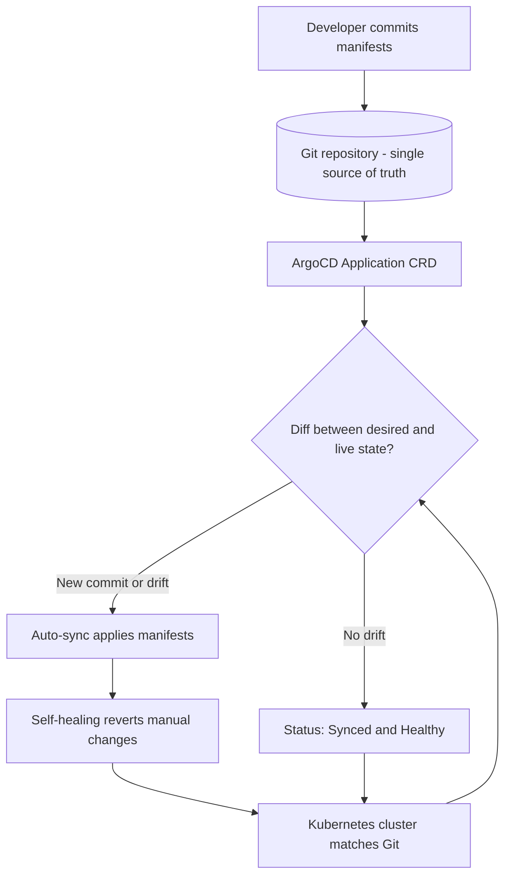

| Difficulty | Channel | Tags |
|---|---|---|
| beginner | devops | argocd, flux, declarative |

Uber's microservices platform runs thousands of services across multiple regions and ships hundreds of deployments a day — yet every single release was paying a brutal tax: 45 minutes per service and a 12% failure rate that put reliability at risk at massive scale [1]. When that tax was finally removed, deployment times fell 73%, failures dropped to 2%, and Mean Time to Recovery collapsed from 38 minutes to 4 [1]. The tool behind that transformation was not a clever script or a faster pipeline — it was a change in who owns the truth about your cluster. This is the story of GitOps, the Git-vs-cluster reconciliation loop that powers ArgoCD, and the declarative mindset that separates teams who sleep through the night from teams who don't.

---

> ### Real-World Case — Uber
>
> Uber's microservices platform spans thousands of services across multiple regions, handling hundreds of deployments per day. They were facing deployment bottlenecks with deployments averaging 45 minutes per service and a 12% failure rate, creating reliability risks at massive scale.
>
> | | |
> |---|---|
> | **Challenge** | Traditional deployment workflows relied heavily on manual intervention, leading to slow release cycles, high failure rates, and lengthy recovery times during incidents. |
> | **Solution** | Uber adopted a GitOps model with ArgoCD to automatically sync changes from Git repositories to Kubernetes clusters. By eliminating manual kubectl commands and continuously reconciling the declarative desired state in Git with the actual cluster state, ArgoCD provided a single source of truth. They paired this with progressive delivery via feature flags for additional safety. |
> | **Outcome** | Deployment times dropped by 73% (45 minutes to 12 minutes), failed deployments fell from 12% to 2%, Mean Time to Recovery dropped from 38 minutes to 4 minutes, and deployment frequency increased from 3 to 15 daily deployments per service. Human error was reduced by 89%. |
> | **Lesson** | GitOps with ArgoCD shifts teams from an imperative model (manual kubectl commands, hard to audit) to a declarative model where Git is the single source of truth—enabling automation, self-healing, faster rollbacks, and dramatically improved reliability at scale. |

---

## Hook — It Was 45 Minutes, and It Still Broke

Picture this: it's 11pm, a hotfix is ready, and your deploy job has been grinding for 45 minutes. The CI logs look green, the rollout looks fine — and then a 12% failure curve catches up with you. That was the daily reality for teams running platform-scale microservices, where a single service deploy was measured in coffee breaks and every third or fourth release quietly broke something in production [1].

The instinct is to blame the pipeline. Add more stages, more checks, more people clicking approve. But here is the twist that surprises most developers: the slowest part was never the build — it was the fact that nobody could say with certainty what the cluster *should* look like. The desired state lived in Kubernetes, in someone's terminal history, in a half-finished runbook, and in a Helm values file that three people had edited by hand.

That uncertainty is the real cost. It makes rollbacks scary, drift invisible, and recovery slow. So before reaching for ArgoCD or Flux, you have to answer one uncomfortable question: if your cluster burned down right now, could you rebuild it exactly from a single repository? If the answer is 'sort of,' keep reading.

## Problem — When Your Cluster and Your Git Repo Stop Agreeing

The core pain point is configuration drift. In an imperative world, someone runs `kubectl edit`, `kubectl scale`, or `kubectl apply` and the cluster changes — but the repository does not. Over weeks, the live cluster silently diverges from what the team believes is deployed. The Git history says one thing; production says another.

Why does this matter so much at scale? Because drift compounds. A manual hotfix during an incident becomes an undocumented dependency. A temporary replica bump becomes permanent. A namespace created by hand never makes it into version control. Then the next deploy overwrites the hotfix, the service goes down, and the team spends 38 minutes figuring out that reality and expectation never matched [1].

Consider the forces working against you:

- **Multiple environments** — staging, production, and per-region clusters drift independently, so a change that works in staging fails in production.
- **Humans under pressure** — during an incident, the fastest fix is always a direct kubectl command, which is exactly the command that bypasses your audit trail.
- **No reliable rollback** — without a declared desired state, 'rolling back' means guessing which manual changes to undo.
- **Collaboration collapse** — reviewers cannot review what was never committed.

The stakes are not abstract. Deployment frequency stalls at 3 per day per service, human error creeps toward 89% of incidents, and MTTR balloons because the team is debugging uncertainty instead of the actual bug [1]. Sound familiar? Here is the thing though — the fix is not more automation on top of imperative commands. The fix is inverting the direction of control.

## Real-World Case — Uber's Deployment Bottleneck

Uber's microservices platform spans thousands of services across multiple regions and handles hundreds of deployments every single day. With those numbers, even a small inefficiency becomes a reliability hazard. The platform was averaging 45 minutes per service deployment and a 12% failure rate, creating real risk at massive scale [1].

Building on the drift problem described above, Uber's challenge was not raw compute — it was coordination. Every deploy required reconciling what teams thought was running with what was actually running, and that reconciliation cost time and introduced human error. The turning point came from treating a Git repository as the single source of truth and letting a controller continuously reconcile the cluster against it, rather than trusting humans to run commands in the right order [1].

The quantified results were dramatic:

| Metric | Before | After | Change |
| --- | --- | --- | --- |
| Deployment time | 45 min | 12 min | −73% |
| Failed deployments | 12% | 2% | −83% |
| Mean Time to Recovery | 38 min | 4 min | −89% |
| Deployments per service/day | 3 | 15 | +400% |
| Human-error contribution | — | — | −89% |

🎯 **Key Point:** Notice which metric improved the most — MTTR, not just deploy speed. When the desired state is declared in Git, recovery becomes 'revert the commit and let the controller reconcile,' which is a fundamentally faster and safer operation than hand-diagnosing a drifting cluster. Uber's numbers are the clearest evidence that GitOps is a reliability strategy disguised as a deployment tool [1].

## Deep Dive — Declarative vs Imperative, and Why the Difference Is Everything

This leads to the heart of the matter: the difference between declarative and imperative approaches. Kubernetes itself is built around a reconciliation loop — you declare the desired state, and controllers work continuously to make reality match [4]. GitOps extends that same idea one layer up, moving the source of truth out of the cluster and into Git [3].

The distinction sounds academic until you see what it changes:

**Declarative approach** — you define the complete desired state in version control as YAML manifests, Helm charts, or Kustomize overlays [7][8]. ArgoCD or Flux then continuously compares the live cluster against that declaration and reconciles any difference. Every change flows through a commit, which means every change is reviewable, auditable, and reversible. The cluster is a projection of Git, never the other way around.

**Imperative approach** — you execute `kubectl` commands that mutate the cluster directly. The change happens immediately and only in the running cluster [4]. There is no record, no review, no automatic rollback. During an emergency this feels fast, but the speed is borrowed against future debugging time.

| Dimension | Declarative | Imperative |
| --- | --- | --- |
| Source of truth | Git repository [3] | Live cluster state |
| Change mechanism | Commit + reconcile | Direct kubectl mutation [4] |
| Auditability | Full history | None |
| Rollback | Revert commit | Manual reconstruction |
| Drift handling | Self-healing [6] | Silent divergence |
| Review | Pull request | None |
| Best for | Production, multi-env | One-off debugging |

💡 **Insight:** Imperative commands are not evil — they are perfect for exploration and debugging ('what does this object look like right now?'). The mistake is letting them become a delivery mechanism. The reconciliation loop is what turns a one-time declaration into a continuously enforced contract [4][6].

Here is the plot twist that catches many developers off guard: declarative does not mean you stop writing kubectl. It means kubectl becomes a read tool, not a write tool. You inspect and debug with it; you change the world through Git. ArgoCD closes the loop by watching the repository and applying diffs automatically, and with self-healing enabled it also reverts unauthorized manual changes [5][6]. That is the mechanism that made Uber's MTTR plummet — the system, not the on-call engineer, restores the known-good state [1].

## Workflow — The Reconciliation Loop, Step by Step

Consequently, the mental model shifts from 'run the deploy' to 'declare the target and let the controller converge.' The workflow below is the loop ArgoCD runs continuously, and it is the same loop Flux implements [9].

1. **Commit the desired state.** A developer opens a pull request against the GitOps repository containing manifests, Helm charts, or Kustomize overlays. The cluster is untouched at this point — the change exists only as a proposal.
2. **Review and merge.** Teammates review the diff like any code change. Merging to the tracking branch is the deploy trigger.
3. **ArgoCD detects the new revision.** The Application controller watches the repository and notices the commit.
4. **Compute the diff.** ArgoCD compares the desired manifests against the live cluster objects and renders a precise difference.
5. **Auto-sync applies the diff.** With automated sync enabled, ArgoCD applies only what changed — no human runs kubectl [5].
6. **Self-healing enforces the contract.** If anyone edits the cluster manually afterward, the controller detects the drift and reverts it automatically [6].
7. **Health checks confirm convergence.** ArgoCD continuously evaluates resource health and reports Synced, OutOfSync, Healthy, or Degraded — typically on a 3-minute cadence. This is exactly how deployments compressed from 45 to 12 minutes and MTTR from 38 to 4 [1].

The diagram below shows this loop as a continuously cycling flow — note that it never terminates, because reconciliation is a permanent process, not a one-shot event.

## Code Example — Bootstrapping a Self-Healing ArgoCD Application

Specifically, the following shell walkthrough shows the entire declarative setup: a GitOps repository as the source of truth, an ArgoCD Application CRD that points at it, and the commands that verify the loop is working. The key detail is that the Application object itself is applied declaratively — even your GitOps controller is managed as code.

## Lessons Learned — What to Do Differently Tomorrow

The journey from 45-minute, error-prone deploys to a self-healing GitOps loop comes down to a handful of hard-won lessons. The moral is not 'install ArgoCD' — it is 'decide who owns the truth, then enforce it continuously.'

- **Start with the source of truth, not the tool.** Before ArgoCD or Flux, make sure every object your cluster needs is committed. A controller reconciling an incomplete repository just automates your gaps [3][4].
- **Turn on self-healing deliberately.** Auto-sync without self-heal still lets manual changes win; combined, they make the repository authoritative [6].
- **Treat kubectl as read-only in production.** Debug with it, never deliver with it. Every emergency hotfix should end as a commit, not a surviving live edit.
- **Set a realistic sync interval.** A 3-minute health check is a common sweet spot — fast enough to catch drift, calm enough to avoid thrash [5].

⚠️ **Watch Out:** The two most common battle scars are `prune: true` combined with an incomplete repo (ArgoCD dutifully deletes things you forgot to commit) and enabling self-heal before the team understands that their manual changes will now be reverted. Test on a non-production cluster first, and always review the diff ArgoCD shows before enabling automation.

🔥 **Hot Take:** GitOps is not really a deployment technique — it is a reliability technique. The Uber numbers prove it: the biggest win was the 38-to-4-minute MTTR, not the deploy speed [1]. When recovery is 'revert a commit,' on-call stops being a detective novel.

🎯 **Key Point to share with your team:** Declarative means the cluster is a projection of Git, and any deviation is automatically corrected. That single sentence is the whole philosophy — and it is why teams that adopt it ship 5x more often while breaking far less [1][3].

---

## GitOps Reconciliation Loop

<strong>Original Interview Question</strong>

**Q:** You're setting up GitOps for a microservices deployment. How would you configure ArgoCD to automatically sync changes from your Git repository to Kubernetes, and what's the difference between declarative and imperative approaches in this context?

**A:** I'd configure ArgoCD by setting up a Git repository containing Kubernetes manifests or Helm charts, creating an Application CRD that points to the Git repository, enabling auto-sync with a health check interval of 3 minutes, and implementing self-healing to automatically revert any manual changes. The declarative approach involves defining the desired state in Git through YAML manifests, Helm charts, or Kustomize configurations, where ArgoCD continuously reconciles the actual state with the desired state. In contrast, the imperative approach uses kubectl commands to make direct changes to the cluster, bypassing the Git repository as the single source of truth.

## Conclusion

The story of Uber's deployment bottleneck and its 73% speed-up is really the story of a philosophical shift: stop running commands at your cluster and start declaring what it should be [1]. Git becomes the single source of truth, ArgoCD becomes the tireless reconciler, and self-healing turns recovery into a non-event [3][6]. Tomorrow, the concrete move is simple — inventory every object in production and confirm it exists in a repository. If it doesn't, that gap is future downtime. Then register that repository with an ArgoCD Application, enable auto-sync with self-healing, and watch the diff shrink to only intentional changes. The one insight worth repeating to your team: your cluster should be a projection of Git, and anything that deviates should be corrected automatically. Ship the declaration, not the command.

---

## References

1. [Uber incident report](https://drcodes.com/posts/how-uber-achieved-73-faster-deployments-with-gitops-argocd) — article
2. [Argo CD Official Documentation](https://argo-cd.readthedocs.io/en/stable/) — documentation
3. [GitOps — Wikipedia](https://en.wikipedia.org/wiki/GitOps) — documentation
4. [Managing Kubernetes Objects Using Declarative Configuration](https://kubernetes.io/docs/tasks/manage-kubernetes-objects/declarative-config/) — documentation
5. [Argo CD Automated Sync Policy](https://argo-cd.readthedocs.io/en/stable/user-guide/auto_sync/) — documentation
6. [Argo CD Sync Options and Self-Healing](https://argo-cd.readthedocs.io/en/stable/user-guide/sync-options/) — documentation
7. [Helm Documentation](https://helm.sh/docs/) — documentation
8. [Declarative Management of Kubernetes Objects Using Kustomize](https://kubernetes.io/docs/tasks/manage-kubernetes-objects/kustomization/) — documentation
9. [Flux — The GitOps Toolkit](https://fluxcd.io/flux/) — documentation
10. [Kubernetes Objects Overview](https://kubernetes.io/docs/concepts/overview/working-with-objects/kubernetes-objects/) — documentation

---

**Author:** Satishkumar Dhule — [GitHub](https://github.com/satishkumar-dhule) · [LinkedIn](https://linkedin.com/in/satishkumar-dhule) · [Website](https://satishkumar-dhule.github.io)
