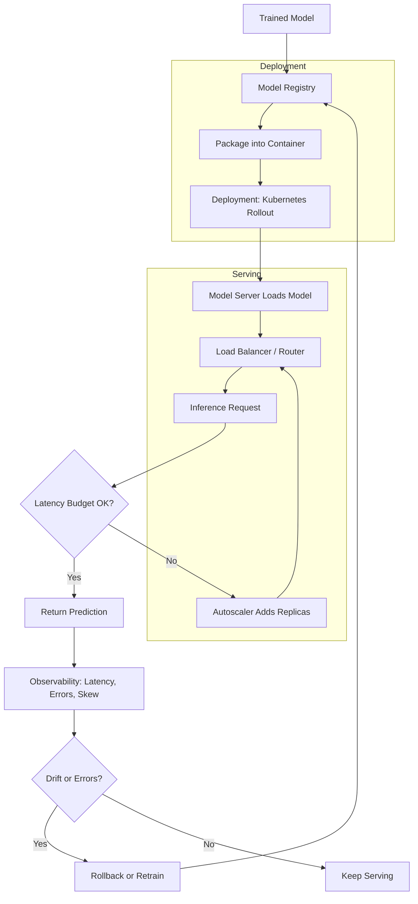

| Difficulty | Channel | Tags |
|---|---|---|
| beginner | devops | mlops, deployment |

In 2015, Uber had dozens of teams building machine learning models — ETAs, UberEATS delivery times, fraud detection, search ranking — yet most of them either hand-rolled their own production serving container or simply could not ship at all. There was no standard path from a trained model to a production prediction endpoint, and no guarantee that the features computed at training time matched those computed at inference time [1]. Uber's answer, Michelangelo, became the de-facto ML platform that ended up serving thousands of production models at 250,000+ predictions per second [1]. Their story is the perfect lens for one of the most misunderstood distinctions in modern ML engineering: deployment is not serving, and confusing the two is how great models die in notebooks.

---

> ### Real-World Case — Uber
>
> In 2015 Uber had dozens of teams building ML models (ETAs, UberEATS delivery times, fraud, search ranking), but each team either hand-built its own production serving container or couldn't ship at all. There was no standard path from a trained model to a production prediction endpoint, and no consistency guarantee that features computed at training time matched those computed at inference time.
>
> | | |
> |---|---|
> | **Challenge** | Uber needed to separate the 'deployment' lifecycle (packaging, versioning, provisioning, A/B rollout, rollback of models) from the 'serving' runtime (low-latency, high-QPS RPC prediction), while keeping the two tightly consistent. The core tension: they wanted to reuse their Spark training pipelines for serving to guarantee train/serve parity, but Spark's Dataset/Catalyst query planner added massive per-request overhead that was incompatible with millisecond p99 latency SLAs. |
> | **Solution** | Michelangelo decoupled the layers: a management plane handled deployment (model repository in Cassandra, ZIP-packaged artifacts pushed via Uber's code-deploy infra, deploy modes for offline/batch, online RPC containers, and in-process library, plus UUID/tag referencing for atomic swaps and A/B traffic splitting). For serving, they replaced the custom protobuf representation with native Spark ML pipeline serialization and added an OnlineTransformer trait with a lightweight scoreInstance(Map) API that bypasses the Catalyst optimizer, plus I/O tuning (direct Parquet/Java I/O instead of sc.textFile and distributed read/select). Models later integrated with TensorFlow Serving and a Python (PyML) path, with a shared Feature Store backing both batch and online feature fetching from Cassandra. |
> | **Outcome** | Michelangelo became the de-facto ML platform serving thousands of production models. Online models without Cassandra feature lookups hit P95 latency under 5ms; models needing Cassandra features stayed under 10ms. The highest-traffic models served 250,000+ predictions per second. Tuning cut native Spark model load time from 8x-44x slower than custom protobuf down to just 2x-3x (a 4x-15x speedup), making standard model representation viable for online serving. The Feature Store grew to ~10,000 shared features. |
> | **Lesson** | Deployment and serving are genuinely different engineering problems with different constraints: deployment optimizes for reproducibility, versioning, and safe rollout, while serving optimizes for p99 latency at high QPS. Reusing one toolchain (Spark) for both is tempting for train/serve consistency, but you must measure and engineer around the runtime overhead — here by keeping a standard representation for the pipeline while adding a lightweight single-row scoring path and packaging the entire transformation pipeline (not just the model), since preprocessing must ship with the model. |

---

## Hook — The Model That Worked Everywhere Except Production

Picture the scene: a data scientist trains a fraud model that hits 98% precision in a notebook. The demo is jaw-dropping. Leadership applauds. Then someone asks the only question that matters — "how do we get this in front of real users?" — and the room goes quiet. That silence is where the deployment-versus-serving confusion lives.

Here is the thing though: training a model is the easy part. The hard part is everything that happens after the last epoch finishes. You need to package it, ship it, expose it behind an API, route traffic to it, version it, monitor it, and roll it back when it misbehaves at 3am. Teams that treat "deployment" and "serving" as synonyms end up building fragile Franken-systems that collapse under their first real traffic spike.

Ever wondered why so many impressive ML demos never become production features? It is almost never the model's fault. It is the missing bridge between two completely different engineering disciplines. Let's walk across that bridge.

## Problem — The Gap Nobody Warns You About

The core challenge is that deployment and serving are two distinct lifecycles with different owners, different failure modes, and different scaling rules — yet they get lumped together in most job descriptions and tutorials.

Deployment is about the question: "How does this artifact get from a developer's machine to a runtime environment safely and repeatably?" It covers infrastructure provisioning, CI/CD pipelines, configuration management, monitoring hooks, and rollback strategies [9]. Think Kubernetes manifests, Terraform modules, MLflow model registries, and SageMaker pipelines.

Serving is about a completely different question: "How does a live request get a fast, correct prediction, right now, for a real user?" It covers runtime inference APIs, request routing, model loading, batching, autoscaling, and response optimization. Think TensorFlow Serving, TorchServe, BentoML, and gRPC endpoints [3][4][5].

Why does conflating them hurt? Because you end up optimizing the wrong layer. A team might spend weeks perfecting their CI/CD pipeline while their inference endpoint silently adds 400ms of preprocessing latency per request. Conversely, a team might hand-tune a blazing-fast model server that nobody can safely update because there's no versioned deployment path. Both are expensive, invisible failures.

Consequently, the pain is rarely a single dramatic outage. It is the slow accumulation of inconsistency: features drift between training and inference, model versions get overwritten without warning, and nobody remembers which replica is serving which artifact. Sound familiar?

## Real-World Case — Uber and the Michelangelo Platform

Uber in 2015 was the textbook example of this problem at scale. Dozens of internal teams — pricing, ETAs, UberEATS delivery estimates, fraud, and search ranking — were each building ML models, but there was no consistent production path. Teams either hand-assembled their own serving containers or never shipped at all, and critically, there was no guarantee that the features computed during training matched those computed during inference [1].

That last point is the silent killer. When training and serving feature logic diverge, you get training-serving skew — a model that looks brilliant offline and behaves erratically online. It is perhaps the most common and most under-diagnosed failure in production ML.

Uber's response was Michelangelo, an internal ML platform that standardized the entire journey from data to deployed prediction. The results were concrete and impressive [1]:

- Online models without Cassandra feature lookups hit P95 latency under 5ms
- Models needing Cassandra features stayed under 10ms P95
- The highest-traffic models served 250,000+ predictions per second
- A shared Feature Store grew to roughly 10,000 features, ensuring identical feature logic at training and serving time
- Tuning reduced native Spark model load time from 8x-44x slower than custom protobuf down to just 2x-3x — a 4x-15x speedup — making a standard model representation viable for online serving

⚠️ Watch Out: The lesson here is subtle. Michelangelo did not win because it had the world's fastest model server. It won because it unified the deployment lifecycle (a standard path to production) and the serving lifecycle (consistent features, consistent representation, predictable latency). The platform treated both worlds as first-class citizens rather than pretending they were the same thing.

## Deep Dive — Two Lifecycles, One Nervous System

Let's dissect the trade-offs that separate these two worlds. The table below is the comparison most engineers wish they had before their first production ML project.

| Dimension | Deployment | Serving |
|-----------|-----------|---------|
| Core question | How does the artifact reach runtime safely? | How does a request get a fast prediction? |
| Primary tools | Kubernetes, Terraform, MLflow, SageMaker, GitHub Actions | TensorFlow Serving, TorchServe, BentoML, FastAPI, Envoy |
| Unit of change | Model version, config, infra | Request, batch, response |
| Failure mode | Bad rollout, broken rollback, config drift | High latency, cold starts, skew |
| Scaling lever | Pod replicas, node pools | Batching, concurrency, GPU allocation |
| Success metric | Reproducibility, safety, MTTR | Latency (P95/P99), throughput (QPS) |

🎯 Key Point: Deployment is a "change-managed" discipline — it cares about moving from state A to state B without breaking things. Serving is a "steady-state" discipline — it cares about handling enormous volumes of requests with low variance. You need both muscles, and they are trained differently.

Now the trade-offs. Latency versus throughput is the classic tension: larger batch sizes improve throughput but increase per-request latency. Real-time systems often target P95 under 100ms, while batch inference can tolerate seconds or minutes [6]. Horizontal scaling adds replicas for concurrency; vertical scaling adds GPU memory and CPU for capability. A/B testing and canary rollouts live at the boundary — they are deployment mechanisms (traffic splitting) that depend on serving infrastructure (routing) to execute [7].

🔥 Hot Take: Most "ML latency" problems are actually serving architecture problems, not model problems. A 20ms model behind a 300ms synchronous feature-fetch chain is a 320ms experience. Uber's sub-10ms Cassandra-backed lookups show what disciplined serving architecture buys you [1].

## Workflow — From Trained Artifact to Live Endpoint

Here is the mental model that ties both worlds together. The deployment pipeline prepares and validates the artifact, then hands it to the serving layer, which owns request-time behavior. Monitoring closes the loop back into deployment, triggering rollbacks or retraining.

The Mermaid diagram above traces this flow: a model is registered in a model registry, packaged into a container, deployed via orchestration, and then served through a runtime that handles routing, batching, and autoscaling. Observability wraps the whole thing.

Step by step:

1. **Train and register** — The model is trained and logged with metadata (MLflow or SageMaker Model Registry) [2][9].
2. **Package** — Model plus dependencies are baked into a container image for reproducibility.
3. **Deploy** — Kubernetes applies the deployment manifest, rolling out replicas gradually [2].
4. **Expose** — A model server (TorchServe, TensorFlow Serving, or BentoML) loads the model and exposes an inference API [3][4][5].
5. **Route** — A load balancer like Envoy or NGINX distributes requests and enables canary splits [8].
6. **Scale** — The Horizontal Pod Autoscaler adds replicas based on CPU, memory, or custom latency metrics [7].
7. **Observe** — Latency, error rate, throughput, and prediction drift feed back into deployment decisions [1].

💡 Insight: Notice that steps 1-3 are deployment and steps 4-6 are serving. Step 7 is the nervous system that binds them. Teams that instrument all three layers catch problems before users do.

## Code Example — A Versioned Model Server That Doesn't Lie About Latency

The following Python snippet uses FastAPI and a lightweight model registry pattern to serve multiple model versions behind versioned routes. It demonstrates the serving-layer concerns that Uber's Michelangelo had to solve: explicit versioning, health checks, warm loading, and per-request latency tracking. Run it with `uvicorn server:app`.

```python
import time
from typing import Dict

from fastapi import FastAPI, HTTPException, Response
from pydantic import BaseModel
import numpy as np

app = FastAPI(title="Mini Model Server")

# Simple in-memory registry: version -> model object.
# In production, this would be backed by MLflow or SageMaker.
MODEL_REGISTRY: Dict[str, object] = {}
DEFAULT_VERSION = "v2"

class PredictRequest(BaseModel):
    features: list[float]

class PredictResponse(BaseModel):
    version: str
    prediction: float
    latency_ms: float

def load_model(version: str):
    """Load a model into memory. Simulated here; swap for real artifact loading."""
    # Warm-load at startup so the first real request is not a cold start.
    time.sleep(0.01)
    return {"weights": np.array([0.5, -0.3, 0.8]), "version": version}

@app.on_event("startup")
def warm_up():
    """Pre-load the default model so traffic never hits a cold cache."""
    MODEL_REGISTRY[DEFAULT_VERSION] = load_model(DEFAULT_VERSION)

@app.get("/healthz")
def health():
    """Liveness/readiness probe for Kubernetes orchestration."""
    if DEFAULT_VERSION not in MODEL_REGISTRY:
        raise HTTPException(status_code=503, detail="model not loaded")
    return {"status": "ok", "loaded": list(MODEL_REGISTRY.keys())}

@app.post("/predict", response_model=PredictResponse)
def predict(req: PredictRequest, response: Response):
    """Serve a prediction and report true server-side latency."""
    start = time.perf_counter()

    model = MODEL_REGISTRY.get(DEFAULT_VERSION)
    if model is None:
        raise HTTPException(status_code=503, detail="model unavailable")

    weights = model["weights"]
    feats = np.asarray(req.features, dtype=float)
    if feats.shape[0] != weights.shape[0]:
        raise HTTPException(status_code=422, detail="feature dimension mismatch")

    prediction = float(np.dot(feats, weights))
    latency_ms = (time.perf_counter() - start) * 1000

    # Expose latency as a header so clients and load balancers can observe it.
    response.headers["X-Model-Version"] = model["version"]
    response.headers["X-Inference-Latency-Ms"] = f"{latency_ms:.2f}"

    return PredictResponse(
        version=model["version"],
        prediction=prediction,
        latency_ms=latency_ms,
    )
```

**Explanation — walking through the layers:**

- The `MODEL_REGISTRY` dict models the separation between artifact storage (deployment's job) and runtime lookup (serving's job). In a real system, this registry is populated by MLflow or SageMaker when a new version is promoted [2][9].
- `@app.on_event("startup")` warm-loads the default model. This directly addresses cold start latency — one of the serving-layer optimizations Uber called out when tuning load times down to 2x-3x of custom protobuf [1][6].
- The `/healthz` endpoint exists specifically so Kubernetes can decide whether a pod is ready to receive traffic, which is a deployment-level concern surfaced through a serving-level API [2].
- The `/predict` handler measures true server-side latency with `time.perf_counter()` and returns it both in the body and as headers. This is the observability bridge: deployment decisions (rollback, scale) depend on serving telemetry.
- Feature dimension validation prevents silent training-serving skew — the class of bug that motivated Uber's shared Feature Store [1].

⚠️ Watch Out: This is a teaching skeleton, not a production server. Real systems need batching, authentication, GPU-aware scheduling, and proper model lifecycle management. But the structural separation — registry, warm load, health probe, latency instrumentation — is exactly the pattern that scales.

## Lessons Learned — What Survivors of Production ML Know

The journey from that quiet room in the hook to a reliable endpoint comes down to a handful of hard-won lessons.

- **Deployment and serving are different jobs.** Deployment moves artifacts safely; serving handles requests fast. Optimize them separately or you will optimize neither.
- **Training-serving skew is the real villain.** A great offline model with divergent feature logic is a liability. Shared feature computation, as Uber's Feature Store demonstrated with ~10,000 features, is the fix [1].
- **Cold starts are a design decision, not an accident.** Warm loading, model caching, and keeping representations lightweight are the difference between a 5ms and a 500ms first request [6].
- **Instrument before you optimize.** You cannot tune latency you cannot measure. Track P95/P99 latency, throughput, and skew per version [7][8].
- **Make rollback boring.** Versioned deployments with gradual rollouts turn a crisis into a one-line config change.

So what should you do differently tomorrow? Audit your own pipeline and label each component as either deployment or serving. If you cannot tell which layer a component belongs to, that ambiguity is probably where your next incident is hiding. Leave your team with this one-sentence takeaway: a model is not deployed until it is served, and it is not served safely until you can roll it back.

---

## Deployment vs Serving Lifecycle



<details>
<summary><strong>Original Interview Question</strong></summary>

**Q:** Explain the key differences between model serving and model deployment in ML systems, including specific technologies, scaling considerations, and real-world implementation patterns?

**A:** Deployment encompasses CI/CD pipelines, infrastructure setup, and monitoring using tools like Kubernetes, MLflow, and SageMaker. Serving focuses on runtime inference APIs with frameworks like TensorFlow Serving, TorchServe, or BentoML, handling request routing, model versioning, and autoscaling. Key trade-offs include latency vs throughput, batch vs real-time inference, and cold start optimization.

</details>

## Conclusion

Uber's quiet-room problem in 2015 is the same one most teams face today: a brilliant model with no safe, fast path to production. The fix is not a single tool but a mindset — treat deployment (safe, reproducible change) and serving (fast, consistent runtime) as two disciplines that must talk to each other. Tomorrow, label every piece of your ML pipeline as deployment or serving, instrument the boundary between them, and make rollback boring. Do that, and you will never be the one whose model works everywhere except production.

---

## References

1. [Uber incident report](https://www.uber.com/blog/michelangelo-machine-learning-platform/) — article
2. [Kubernetes Deployments](https://kubernetes.io/docs/concepts/workloads/controllers/deployment/) — documentation
3. [TensorFlow Serving](https://github.com/tensorflow/serving) — documentation
4. [TorchServe](https://github.com/pytorch/serve) — documentation
5. [BentoML](https://github.com/bentoml/BentoML) — documentation
6. [MLOps](https://en.wikipedia.org/wiki/MLOps) — article
7. [Horizontal Pod Autoscaler](https://kubernetes.io/docs/tasks/run-application/horizontal-pod-autoscale/) — documentation
8. [Envoy Proxy](https://github.com/envoyproxy/envoy) — documentation
9. [MLflow](https://github.com/mlflow/mlflow) — documentation
10. [Amazon SageMaker Developer Guide](https://docs.aws.amazon.com/sagemaker/) — documentation

---

**Author:** Satishkumar Dhule — [GitHub](https://github.com/satishkumar-dhule) · [LinkedIn](https://linkedin.com/in/satishkumar-dhule) · [Website](https://satishkumar-dhule.github.io)
