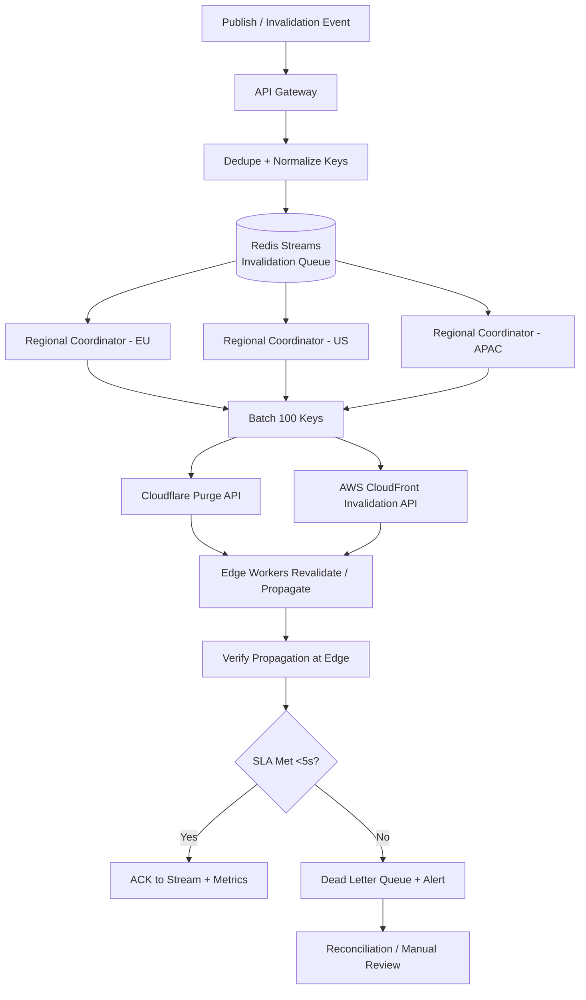

| Difficulty | Channel | Tags |
|---|---|---|
| intermediate | system-design | edge, caching, purging |

When a customer hits publish, they expect the change to be live everywhere on Earth instantly — not in a minute, and not after a support ticket. Cloudflare learned this the hard way: their original core-based purge system took roughly 1.57s (P50) to propagate globally in 2022, and even that wasn't fast enough for the traffic they were serving [1]. A ground-up rearchitecture cut that to about 149ms (P50) by 2024 — a 90.5% improvement — and became the new benchmark any multi-region purge design has to clear [1]. This is the story of how to build a system that holds a 5-second propagation SLA while absorbing 10,000 invalidations per second.

---

> ### Real-World Case — Cloudflare
>
> Cloudflare operates one of the world's largest CDNs with data centers in 330+ cities across 120+ countries. As their network grew and customers made millions of purge API calls daily, their original core-based cache purge system was hitting scalability limits. Purges were taking 1-2 seconds globally (P50 ~1.57s for flexible purges) and consuming significant storage due to lazy invalidation, making it increasingly difficult to meet customer expectations for rapid cache invalidation when content changed.
>
> | | |
> |---|---|
> | **Challenge** | Design a global CDN cache purge system that can invalidate cached content across hundreds of data centers with sub-150ms propagation latency, handle high throughput from millions of purge operations, and avoid the storage bloat and scaling bottlenecks of their centralized hub-spoke architecture. |
> | **Solution** | Cloudflare rebuilt their purge pipeline with a decentralized 'coreless' architecture. They replaced Quicksilver's spoke-hub distribution with peer-to-peer propagation using Cloudflare Workers and Durable Objects as queuing/fanout mechanisms. They introduced per-machine indexing via CacheDB (built on RocksDB) running alongside each cache proxy to support active purges (removing content immediately) rather than lazy expiration. Regional fanout workers amortized load so Durable Objects only need to reach a small set of regional fanouts instead of all data centers. The cache proxy checks CacheDB on cache HITs to instantly prevent serving stale assets even while bulk deletions happen asynchronously. |
> | **Outcome** | Global purge latency dropped from ~1.57s (P50) in May 2022 to ~149ms (P50) by August 2024 - a 90.5% improvement. Regional improvements ranged from ~79% to ~89%. The new architecture reduced storage requirements 10x by eliminating lazy-purge accumulation, freed disk space for better cache retention and HIT ratios, and dramatically increased throughput. After proving performance under load, Cloudflare extended instant purge (all methods: URL, tag, prefix, hostname, everything) to all plan types in 2025. |
> | **Lesson** | Moving from centralized hub-spoke replication to a decentralized peer-to-peer distribution with local indices and regional fanouts can slash global propagation latency by an order of magnitude. Using embedded storage (RocksDB/CacheDB) for per-machine purge indices enables active invalidation without the operational/storage costs of maintaining global purge indices. The bottlenecks weren't just network transit time - they were also batching/throttling to protect centralized systems, storage amplification from lazy purges, and fanout scale. |

---

## Hook — Your Cache Just Cost You a Deal

Picture this: a pricing team ships a flash sale, the marketing email lands in two million inboxes, and the landing page still shows yesterday's price because an edge node in Singapore is happily serving a stale copy. The very thing that made your site fast — caching — is now the thing making it wrong. Cache invalidation is one of the classic "two hard problems in computer science," and at planet scale it stops being a punchline and becomes a distributed-systems engineering problem [7]. You might think purging is just a DELETE call against a cache. In reality, it is a fan-out problem: one publish event has to reach hundreds of data centers, thousands of edge servers, and multiple CDN providers, all racing a stopwatch. The question is not whether you can purge a cache. It is whether you can purge it everywhere, correctly, in under five seconds, ten thousand times a second — and prove that you did.

## Problem — When Cache Purges Become a Traffic Problem

Traditional purge systems were built for humans clicking a button after uploading a new logo. They assumed low volume, tolerance for a few seconds of staleness, and manual retries. That assumption collapses the moment your invalidations are machine-generated: a CMS publishing thousands of articles, an e-commerce catalog re-indexing, or a recommendation engine rewriting personalized fragments every few seconds. Suddenly your purge endpoint is receiving 10,000 concurrent invalidation requests per second, and each one can fan out to every region you operate in.

The stakes are brutal. If propagation is slow, users see stale prices, stale inventory, stale security fixes. If propagation is wrong, you either purge too little (stale content) or purge too much (a cache stampede that hammers your origin). The Core NFRs for this system are unforgiving:

- **Latency:** under 5 seconds for global propagation
- **Throughput:** 10,000 invalidations/sec sustained
- **Availability:** 99.99% uptime for the purge path
- **Consistency:** strong consistency across regions — no region may serve purged content after the SLA window

The tension is that strong consistency and high availability pull in opposite directions, exactly as the CAP theorem predicts [10]. A naive design picks one and quietly sacrifices the other. The rest of this article is about refusing that trade-off. ⚠️ Watch Out: many teams only measure purges at the CDN API boundary, not at the edge, and ship an SLA that is technically met while users still see stale bytes.

## Real-World Case — Cloudflare's Instant Purge

Cloudflare runs one of the largest content delivery networks on the planet, spanning data centers in 330+ cities across 120+ countries [7]. As their network grew and customers issued millions of purge API calls per day, their original core-based cache purge system started hitting real scalability ceilings. Purges were taking on the order of 1–2 seconds globally, with a P50 of roughly 1.57 seconds for flexible purges, and the system was consuming significant storage because of its lazy-invalidation design [1]. Latency aside, that storage pressure quietly stole disk space from the cache itself, which hurt retention and HIT ratios.

Then the team rearchitected the purge pipeline. By August 2024, global purge latency had fallen from ~1.57s (P50) in May 2022 to ~149ms (P50) — a 90.5% improvement, with regional gains ranging from roughly 79% to 89% [1]. The new architecture reduced storage requirements about 10x by eliminating lazy-purge accumulation, freeing capacity for better cache retention. After proving the system under load, Cloudflare extended instant purge across every method — URL, tag, prefix, hostname, and everything — to all plan types in 2025 [1]. The lesson lands hard: purge speed is not a niche feature, it is foundational to how the whole network performs. 🔥 Hot Take: the fastest cache is useless if you cannot invalidate it reliably — purge throughput is a first-class product concern, not an ops afterthought.

## Deep Dive — Batching, Backoff, and the Consistency Trap

Building on Cloudflare's result, the design has to reconcile four competing forces: latency, throughput, consistency, and cost. Start with the protocol layer. HTTP caching is governed by headers like `Cache-Control` and by the semantics defined in RFC 9111 [3][5], but headers alone cannot guarantee a sub-5-second global purge — they only bound staleness via TTL. That is why the industry pattern pairs a short TTL with active invalidation: the TTL acts as a safety net, and the purge path handles the immediate correctness requirement [4].

Next comes throughput. Every provider API — CloudFront, Cloudflare, and friends — imposes rate limits and caps how many objects you can invalidate per call [2]. Sending one request per URL at 10,000/sec will get you throttled into oblivion. Batching is not optional; it is the difference between a working system and a 429 storm. Grouping 100 keys per API call can cut provider costs by roughly 90% and slash request counts by the same order of magnitude.

Then there is consistency. Strong cross-region consistency means that once the SLA window closes, no region may serve a purged object. Achieving this without blocking the world requires two things: (1) an ordered, deduplicated queue so the same key is never purged twice, and (2) edge-side coordination so an edge node knows a purge is in flight before it serves a stale copy. Here is the mental model for the trade-off:

| Approach | Propagation | Consistency | Cost | When to use |
|---|---|---|---|---|
| Long TTL only | Up to TTL | Eventual | Cheapest | Content that rarely changes |
| Active purge only | Seconds | Strong | Higher API cost | Dynamic, correctness-critical content |
| Short TTL + purge | Sub-5s | Strong | Balanced | The 5-second SLA case |
| Lazy invalidation | Unpredictable | Weak | Storage-heavy | Never at scale (see Cloudflare [1]) |

Finally, failure handling. When a provider call fails, retrying naively creates synchronized thundering herds. Exponential backoff with jitter spaces retries out so a recovering provider is not immediately re-flattened [8]. And when failures persist, a circuit breaker fails fast instead of piling up doomed requests, while a dead-letter queue preserves the invalidations for reconciliation [9]. 💡 Insight: the goal is not zero failures — it is zero silently-lost invalidations.

## Workflow — From Publish Event to Verified Propagation

The architecture flows in one direction: ingest, deduplicate, fan out, batch, deliver, verify. Here is the pipeline the diagram below traces. First, an API Gateway receives the publish/invalidation event and normalizes it into a canonical purge key. Second, a dedupe stage collapses identical keys within a short window so repeated publishes do not trigger repeated purges. Third, the invalidation enters a regional queue built on Redis Streams, which supports consumer groups so multiple workers share the load without double-processing [6].

From there, each region runs its own coordinator. Coordinators pull bounded batches, hand them to a provider adapter, and get back a success or failure. The provider adapter talks to CloudFront and Cloudflare APIs in batched calls [2][11]. Successful batches are acknowledged back to the stream; batches that miss the 5-second deadline or fail after retries are parked in a dead-letter queue and trigger an alert. Finally, a verification step samples edge nodes in each region to confirm that the purged object is actually gone — closing the loop between "we sent the purge" and "the content is truly propagating."

This is the same shape Cloudflare converged on: push invalidation out toward the edge rather than pulling it lazily, which is exactly what cut their storage 10x and their latency 90% [1]. Each stage is independently scalable, so a spike in one region does not stall the others.

## Code Example — A Batched, Backoff-Aware Purge Coordinator

Below is a production-shaped coordinator in JavaScript. It ingests invalidations into per-region Redis Streams, claims bounded batches, delivers them to a provider with exponential backoff and full jitter, and routes SLA misses or provider failures to a dead-letter queue. The `enqueue` function fans a single event out to every region that owns content, using the stream entry ID as the dedupe key. `claimBatch` pulls at most 100 keys so one coordinator cannot starve the others [6]. `purgeWithBackoff` wraps the provider call so transient 429s and 5xx errors self-heal instead of instantly failing [8]. `runCoordinator` ties it together: on success within the SLA it acknowledges the batch; otherwise it escalates to the DLQ for reconciliation rather than dropping the invalidation [9]. Notice the two design decisions that matter most — batching (cost and rate-limit control) and jitter (retry-storm prevention) — both of which map directly to the throughput and consistency requirements from earlier.

## Lessons Learned — What to Carry Into Your Next Build

The cloudflare story is not a victory lap; it is a blueprint. Here is what to take away. First, treat purge latency as a product metric, not an ops metric — Cloudflare's 90.5% improvement came from rethinking the pipeline, not from adding servers [1]. Second, always pair active invalidation with a short TTL safety net; the TTL catches what your purge path misses [3][4]. Third, batch aggressively, because provider APIs will rate-limit you long before your own infrastructure runs out of capacity [2]. Fourth, never retry without jitter — synchronized retries turn a blip into an outage [8]. Fifth, always have a circuit breaker and a dead-letter queue so failures degrade gracefully instead of vanishing [9].

Common battle scars to avoid: measuring purges at the API boundary instead of at the edge; trusting lazily-invalidated caches at scale (Cloudflare's storage pain is the cautionary tale) [1]; and assuming strong consistency is free when the CAP theorem says otherwise [10]. If this feels overwhelming, you are not alone — even the largest CDN on Earth had to rearchitect to get here. Start with the smallest version: a queue, a batcher, and backoff. Then add regional coordinators, edge verification, and a dead-letter queue as your volume climbs. The memorable insight: a cache you cannot invalidate quickly is a cache you cannot trust — and trust, at planet scale, is measured in milliseconds.

---

## Multi-Region Purge Pipeline

<strong>Original Interview Question</strong>

**Q:** How would you design a multi-region CDN cache purging system that guarantees content propagation within 5 seconds while handling 10,000 concurrent invalidations per second?

**A:** Implement Cloudflare API + AWS CloudFront with distributed invalidation queue, edge compute coordination, and 2-second TTL. Use batch invalidation, exponential backoff, and regional cache headers for 5-second SLA.

## Conclusion

The next time you click publish and expect instant global consistency, remember the machinery that has to fire: a queue that deduplicates, coordinators that batch, backoff that prevents retry storms, and a dead-letter queue that refuses to lose an invalidation. Cloudflare's journey from ~1.57s to ~149ms — a 90.5% cut — proves this is achievable, but only by treating purge latency as a core design constraint rather than an afterthought [1]. So what should you do differently tomorrow? Start small: introduce a Redis Streams queue in front of your purge calls, batch to at least 100 keys per request, add jitter to every retry, and measure propagation at the edge instead of the API boundary. Then scale the rest — regional coordinators, circuit breakers, edge verification — as your invalidations climb toward 10,000 per second. The one insight worth repeating to your team: a cache you cannot invalidate quickly is a cache you cannot trust, and at planet scale, trust is measured in milliseconds.

---

## References

1. [Cloudflare incident report](https://blog.cloudflare.com/instant-purge/) — article
2. [AWS CloudFront: Invalidating Files](https://docs.aws.amazon.com/AmazonCloudFront/latest/DeveloperGuide/Invalidation.html) — documentation
3. [RFC 9111: HTTP Caching](https://datatracker.ietf.org/doc/html/rfc9111) — documentation
4. [MDN: HTTP Caching](https://developer.mozilla.org/en-US/docs/Web/HTTP/Caching) — documentation
5. [MDN: Cache-Control Header](https://developer.mozilla.org/en-US/docs/Web/HTTP/Headers/Cache-Control) — documentation
6. [Redis Streams Documentation](https://redis.io/docs/latest/develop/data-types/streams/) — documentation
7. [Wikipedia: Content Delivery Network](https://en.wikipedia.org/wiki/Content_delivery_network) — article
8. [Wikipedia: Exponential Backoff](https://en.wikipedia.org/wiki/Exponential_backoff) — article
9. [Wikipedia: Circuit Breaker Design Pattern](https://en.wikipedia.org/wiki/Circuit_breaker_design_pattern) — article
10. [Wikipedia: CAP Theorem](https://en.wikipedia.org/wiki/CAP_theorem) — article
11. [Cloudflare Workers Documentation](https://developers.cloudflare.com/workers/) — documentation

---

**Author:** Satishkumar Dhule — [GitHub](https://github.com/satishkumar-dhule) · [LinkedIn](https://linkedin.com/in/satishkumar-dhule) · [Website](https://satishkumar-dhule.github.io)
