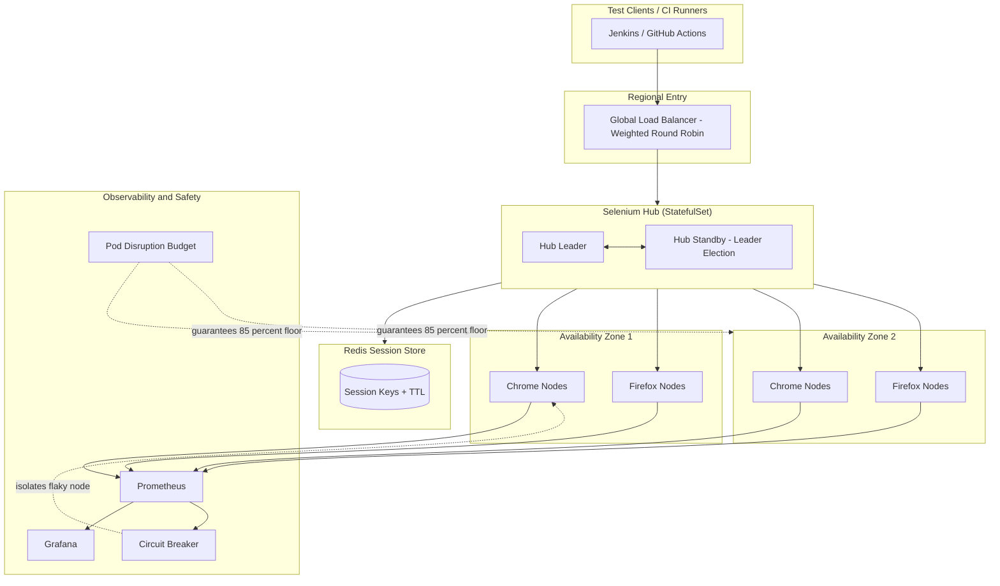

| Difficulty | Channel | Tags |
|---|---|---|
| advanced | system-design | selenium, webdriver, grid |

Picture a CI pipeline where every commit fires off a test suite that grinds along for three hours — long enough for developers to context-switch, forget what they changed, and merge broken code anyway. That was the daily reality at HackerEarth, whose growing Selenium suite strangled deploy feedback until a rebuild cut end-to-end time from roughly three hours to about three minutes [1]. Now multiply that pressure to ten thousand concurrent browser sessions, spread them across multiple data centers, and promise 99.9% uptime, and you arrive at the architecture problem this article dissects. The stakes are simple: when your grid leaks memory or a node dies silently, every pipeline in the company stalls with it.

---

> ### Real-World Case — HackerEarth
>
> HackerEarth, a developer-assessment platform with a 4M+ developer community, deploys multiple times a day and gate every commit with a growing suite of Selenium UI tests. The suite expanded into the hundreds of tests and took close to 3 hours to run, killing CI feedback speed.
>
> | | |
> |---|---|
> | **Challenge** | They needed massive parallel Selenium execution without the cost, maintenance, and reliability burden of a large, long-lived grid of browser nodes. Splitting tests across two Jenkins nodes only cut runtime to ~1.5 hours, and adding more nodes was too expensive and left persistent processes that could exhaust memory. |
> | **Solution** | Instead of building a bigger Selenium Grid, they inverted the architecture: they packaged a Lambda-compatible headless Chromium and ChromeDriver into AWS Lambda layers and ran each UI test as an independent asynchronous Lambda invocation (deployed via the Serverless framework). Each test got a fresh, disposable sandbox that was torn down automatically, with screenshots in S3 and execution records in DynamoDB for reporting. |
> | **Outcome** | End-to-end suite time dropped from roughly 3 hours to about 3 minutes. Two Jenkins nodes were decommissioned, saving hundreds of dollars per month, and they achieved effectively 'infinite scaling' — execution time stays constant no matter how many tests are added. |
> | **Lesson** | The strongest form of session lifecycle management is making every session disposable: an ephemeral, isolated browser environment that is created per test and destroyed immediately eliminates the memory leaks and state drift that plague long-lived grid nodes. The same principle now underpins modern containerized grids (Zalenium, Kubernetes + KEDA autoscaled nodes with drain-and-recreate). |

---

## Hook — The 3 A.M. Deploy That Never Finished

It is 3 a.m. and the release train is stuck. The dashboard shows 4,000 Selenium sessions queued, browser nodes green in the UI, yet nothing is progressing. Sound familiar? The problem is that a naive Selenium Grid treats every browser as immortal: a session starts, and if nothing kills it, that Chrome process sits there eating RAM until the pod gets OOM-killed. Multiply that by thousands of leaks and the grid doesn't fail loudly — it fails silently, degrading until throughput collapses [2]. Here is the thing though: the same suite that takes three hours on a single Jenkins node can finish in three minutes when the execution model changes from 'one machine, many tests' to 'many machines, one test each' [1]. That shift is not just about buying more hardware. It forces you to answer harder questions: how do you track sessions across regions, how do you know a node is truly dead versus just slow, and how do you stop one poisoned node from poisoning the queue? The rest of this journey answers each of those in turn — and it starts by understanding why the obvious approach fails.

## Problem — Why 10,000 Sessions Breaks the Naive Grid

Most teams start with a single Selenium Hub and a handful of nodes, which works fine until test volume grows. Then three failure modes appear at once. First, resource unpredictability: a headless Chrome instance can balloon from 200MB to over 1GB under a heavy page, and without hard memory limits one runaway test starves its neighbors. Second, session leakage: when a test crashes mid-run, its browser session is orphaned, and nothing reclaims it unless you build explicit lifecycle management. Third, cascading failure: if a node half-dies — accepting connections but never responding — the hub keeps routing work to it, and queue depth explodes. Consequently, capacity planning becomes guesswork. Developers commonly assume the fix is 'just add more nodes,' but the math says otherwise. At roughly 50 sessions per node, 10,000 concurrent sessions demand a minimum of 200 nodes, and at 2GB RAM each that is 400GB of baseline memory before you even add a 30% safety buffer — landing you near 520GB of cluster RAM. That scale cannot be managed by hand. It needs autoscaling driven by queue depth, memory limits enforced per pod, and a session store that expires keys automatically. In other words, the grid must become a distributed system with real observability, not a pet server you SSH into.

## Real-World Case — HackerEarth Goes from 3 Hours to 3 Minutes

HackerEarth operates a developer-assessment platform with a community of 4M+ developers and ships multiple times a day [1]. Every commit was gated by a growing Selenium UI suite that had swelled into the hundreds of tests. The suite took close to three hours to run, which meant CI feedback was effectively useless — by the time results landed, the developer had moved on. Picture the pain: a one-line CSS fix forced a three-hour wait, and a flaky test could invalidate the whole run. Rather than scale Jenkins horizontally and babysit more browser instances, the team reworked execution so that tests ran as independent, on-demand functions instead of long-lived browser processes [1]. The results were dramatic: end-to-end suite time dropped from roughly three hours to about three minutes, two Jenkins nodes were decommissioned for hundreds of dollars of monthly savings, and — the part that matters most for architects — they achieved effectively 'infinite scaling,' where execution time stays roughly constant no matter how many tests are added [1]. The lesson is not 'use a specific cloud product.' The lesson is that decoupling test execution from long-lived browser state removes the ceiling entirely.

## Deep Dive — Sessions, Memory, and the Trade-offs Nobody Warns You About

Building on HackerEarth's insight, the core architectural decision is where session state lives and how it dies. The Hub-Node pattern remains the backbone: a central hub orchestrates, while browser nodes execute [2]. But the naive hub is stateful and fragile, so production systems move session metadata into a shared store — typically a Redis cluster where every session key gets a time-to-live [3]. Redis EXPIRE is the quiet hero here: because the store deletes keys on its own, a crashed test cannot leave a permanent ghost entry, and cleanup scans become a safety net rather than the primary mechanism [3]. However, TTL alone is not enough. You need it paired with per-pod CPU and memory limits, because Kubernetes only enforces the boundary you declare. Here is where the trade-offs get real. Aggressive memory limits kill nodes faster and cause more session retries, while generous limits waste expensive capacity and invite noisy-neighbor starvation. That tension is exactly why horizontal pod autoscaling based on queue depth beats autoscaling on CPU [4]: CPU stays low while sessions wait in a queue, so CPU-driven scaling reacts too late. Observability closes the loop. Prometheus scrapes node and session metrics, and Grafana renders the memory trends that reveal leaks before they cascade [5]. The counterintuitive part? Many teams instrument throughput first, but memory is the leading indicator — leak rate is what actually predicts your next outage. When a node does misbehave, a circuit breaker isolates it for a fixed recovery window instead of hammering it with retries [6][7]. And to keep the fleet from all dying at once during maintenance, Pod Disruption Budgets guarantee a minimum capacity floor, commonly around 85% [8]. Each of these pieces is simple alone; the craft is in how they interlock.

## Workflow — Wiring the Grid Step by Step

This leads to the operational workflow that ties the pieces together. The system flows like this: CI runners submit sessions to a regional load balancer, which routes by weighted round-robin to a hub leader elected via StatefulSet ordering [9]. The hub writes each session to Redis with a TTL, then dispatches it to a browser node in one of several availability zones. Every node exposes a /status endpoint probed on a 10-second cadence; three consecutive failures trip the circuit breaker and isolate the node for a 30-second recovery window [7][8]. Meanwhile, Prometheus scrapes memory and session-duration metrics, Grafana surfaces trends, and a control loop reaps orphaned sessions whose Redis keys have already expired [3][5]. The Mermaid diagram below maps this topology — note how the circuit breaker only ever touches individual nodes, never the hub, which is precisely what prevents blast-radius failures. Follow these steps to stand it up:

1. Deploy the hub as a StatefulSet with leader election for split-brain protection.
2. Attach a Redis cluster and enforce a TTL on every session key [3].
3. Define per-pod resource quotas (for example, 2GB RAM and 1 CPU per browser node).
4. Configure horizontal pod autoscaling keyed to queue depth, not CPU [4].
5. Add liveness and readiness probes on a 10-second interval [8].
6. Wire Prometheus and Grafana dashboards for memory and session metrics [5].
7. Set Pod Disruption Budgets to hold at least 85% capacity during rolling updates [8].
8. Roll out new node versions with canary traffic splitting.

Each step builds on the last, and skipping one is how grids develop the 3 a.m. failure from the opening.

## Code Example — A Session Lifecycle Control Loop

The diagram is only half the story; the behavior lives in the control loop. The Python snippet below implements the watchdog that keeps sessions honest: it registers sessions in Redis with a TTL, reaps orphans whose keys have expired, isolates flaky nodes with a circuit breaker, and drains nodes whose memory crosses the high-water mark. Read it as production pseudocode — it directly addresses the leakage and cascading-failure problems from the Problem section, and the reconcile() function is the heartbeat that runs every 10 seconds to match the probe cadence. The key insight is that cleanup is decentralized: Redis expires the session, and the loop merely reconciles reality with that truth.

## Lessons Learned — What to Do Differently Tomorrow

So what is the moral of this journey? HackerEarth proved that execution time stays roughly constant no matter how many tests you add, once you stop binding tests to long-lived browser processes [1]. But 'infinite scaling' is not free — it is the reward for getting session lifecycle, memory control, and failure isolation right. Here are the battle scars worth carrying forward. First, never let a session outlive its TTL; orphaned browsers are the number one silent killer of grid throughput [3]. Second, autoscale on queue depth, not CPU, or you will always react one step too late [4]. Third, instrument memory before throughput — leaks are your leading indicator [5]. Fourth, isolate failures locally with circuit breakers so one bad node cannot take down the hub [7]. Fifth, use Pod Disruption Budgets to keep a capacity floor during updates, and canary new node versions instead of betting the fleet [8]. Finally, embrace multi-AZ placement with leader election; a single-region grid is a single point of failure wearing a costume [9]. Tomorrow, pick one node in your grid and ask three questions: does its session have a hard TTL, does it have a hard memory limit, and will the system notice within 30 seconds if it dies? If the answer to any is no, you now know exactly where to start. The teams that build grids around ephemeral, self-cleaning sessions do not just run tests faster — they stop treating infrastructure like a pet and start treating it like a fleet.

---

## Multi-AZ Selenium Grid Architecture

<strong>Original Interview Question</strong>

**Q:** Design a scalable Selenium Grid architecture to handle 10,000 concurrent test sessions with 99.9% uptime, ensuring zero memory leaks through automatic session lifecycle management, real-time monitoring, and graceful node failure recovery across multiple data centers?

**A:** Deploy Kubernetes cluster with auto-scaling node pools, Redis session store with TTL policies, Prometheus metrics for memory monitoring, circuit breakers for node isolation, and sidecar containers for session cleanup. Implement health checks, resource quotas, and rolling updates.

## Conclusion

The journey from a three-hour suite to a three-minute one is not a story about buying faster machines — it is a story about making sessions ephemeral, failures local, and memory observable. HackerEarth showed that decoupling test execution from long-lived browser state removes the scaling ceiling entirely [1], and the architecture above shows how to do the same at ten thousand concurrent sessions without drowning in chaos. Start small: give every session a TTL, give every node a hard memory limit and a health probe, and build a control loop that reconciles reality every ten seconds. Do those three things and you convert a fragile pet grid into a self-healing fleet — the kind that quietly keeps shipping while everyone sleeps through the night.

---

## References

1. [HackerEarth incident report](https://aws.amazon.com/blogs/startups/infinite-scaling-of-selenium-ui-tests-using-aws-lambda) — article
2. [Selenium Grid Documentation](https://www.selenium.dev/documentation/grid/) — documentation
3. [Redis EXPIRE command and TTL semantics](https://redis.io/docs/latest/commands/expire/) — documentation
4. [Kubernetes Horizontal Pod Autoscaling](https://kubernetes.io/docs/tasks/run-application/horizontal-pod-autoscale/) — documentation
5. [Prometheus Overview](https://prometheus.io/docs/introduction/overview/) — documentation
6. [Circuit Breaker Pattern — Martin Fowler](https://martinfowler.com/bliki/CircuitBreaker.html) — blog
7. [Kubernetes: Configure Liveness, Readiness and Startup Probes](https://kubernetes.io/docs/tasks/configure-pod-container/configure-liveness-readiness-startup-probes/) — documentation
8. [Kubernetes Pod Disruption Budgets](https://kubernetes.io/docs/tasks/run-application/configure-pdb/) — documentation
9. [Kubernetes StatefulSets](https://kubernetes.io/docs/concepts/workloads/controllers/statefulset/) — documentation
10. [Selenium (software) — Wikipedia](https://en.wikipedia.org/wiki/Selenium_(software)) — documentation
11. [AWS Well-Architected Framework — Reliability Pillar](https://docs.aws.amazon.com/wellarchitected/latest/reliability-pillar/welcome.html) — documentation

---

**Author:** Satishkumar Dhule — [GitHub](https://github.com/satishkumar-dhule) · [LinkedIn](https://linkedin.com/in/satishkumar-dhule) · [Website](https://satishkumar-dhule.github.io)
