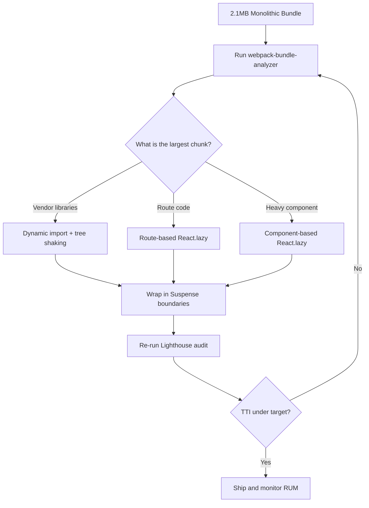

| Difficulty | Channel | Tags |
|---|---|---|
| intermediate | frontend | lighthouse, bundle, lazy-loading |

Picture a developer in Jakarta opening your React app on a $60 Android phone over a shaky 3G connection, watching a spinner crawl while 2.1MB of JavaScript downloads before a single pixel becomes interactive. That is not a hypothetical — it is exactly the trap Twitter fell into when its web app shipped more than 1MB of JavaScript (420KB gzipped) in just three files, forcing users to download code for screens they would never visit [1]. By the end of this story, you will know how to take a React app stuck at a Lighthouse score of 65 with a 4.2s Time to Interactive and systematically engineer it past 90 — using the same techniques that cut Twitter Lite's 99th-percentile TTI roughly in half [1].

---

> ### Real-World Case — Twitter
>
> Twitter set out to build Twitter Lite, a Progressive Web App for the millions of users in emerging markets accessing Twitter over slow 2G/3G connections on low-end Android devices. The React app's JavaScript had been bundled into just three files totaling over 1MB (420KB gzipped), forcing users to download everything — including code for screens they'd never visit — before the app became interactive.
>
> | | |
> |---|---|
> | **Challenge** | The monolithic bundle caused Time to Interactive to exceed 5 seconds on simulated 3G, tanking Google Lighthouse scores and making the web experience uncompetitive with the native app on slow networks. They needed to slash initial JS payload and time-to-interactive for one of the world's largest React apps without breaking 40+ distinct views. |
> | **Solution** | The team implemented granular, route-based code splitting with Webpack's CommonsChunkPlugin, breaking the monolith into ~40 on-demand chunks lazy-loaded via the PRPL pattern and only fetching what a given view needed. They split a shared vendor chunk, inlined the webpack runtime to avoid an extra round trip, used shouldComponentUpdate and Normalizr/combineReducers to prevent re-renders, served smaller optimized images from their CDN, and layered in service worker caching for instant repeat visits. |
> | **Outcome** | Initial main-bundle load dropped from over 5 seconds to barely 3 seconds on simulated 3G, and Lighthouse TTI was cut roughly in half. Users saw a 50% reduction in 99th-percentile Time to Interactive and a 30% reduction in average load time, with the full Lite payload (600KB) versus 23.5MB for the native Android app. Engagement metrics jumped: 65% more pages per session, 75% more Tweets sent, and a 20% lower bounce rate. |
> | **Lesson** | Counterintuitively, splitting the bundle into 40 chunks actually increased the app's total size — but it traded upfront payload for on-demand loading that amortizes across the session, so the initial experience got dramatically faster. The biggest Lighthouse wins often come from shipping less JavaScript on first load, not optimizing the code you already ship. |

---

## Hook — The 5-Second Tax Your Users Pay Before They See Anything

Here is the moment that should make you sweat: your app is not slow because your code is bad. It is slow because your users are downloading code they will never run. A monolithic bundle does not care that 80% of your visitors only ever open the dashboard — it ships the analytics suite, the admin panel, the settings screens, and every charting library along for the ride. On a fast office connection, that 2.1MB bundle downloads in a blink, so nobody notices. On a mobile network, it becomes a five-second tax charged before your app even has a chance to impress anyone. That is the cruel asymmetry of frontend performance: your team develops on fiber, your users live on cellular. And every kilobyte of unused JavaScript is a debt you are forcing them to pay at compound interest. Sound familiar? Good — because the fix is more systematic than most developers expect, and it starts with admitting the bundle has a leak.

## Problem — When a 2.1MB Bundle Quietly Caps Your Lighthouse Score

Lighthouse is not punishing you arbitrarily. It is measuring a story about how your app arrives: how much JavaScript blocks the main thread, how long until the browser can respond to a tap, and how many bytes a user must fetch before anything interactive appears. A bundle of 2.1MB with a 4.2s Time to Interactive (TTI) is a classic symptom of one root cause — the entire application is one eager dependency graph that must be fully parsed and executed before the first screen becomes usable [6].

The stakes are not abstract. Every second of delay measurably increases bounce and reduces conversion, which is why performance budgets exist in the first place. But here is the trap: teams often chase the score itself — tweaking image sizes, adding a preconnect — while ignoring the elephant in the bundle. That is like repainting a car with a broken engine. To move from 65 to 90+, you have to attack the JavaScript payload directly, and that means three questions:

- What is actually inside the 2.1MB, and which chunk is the heaviest?
- Which parts of the app does a given user never need?
- How do you defer everything that is not required for the first meaningful paint?

Answer those, and the score follows. Ignore them, and you will spend weeks micro-optimizing trivia. The good news? A major consumer platform already ran this exact playbook at a scale most teams will never face.

## Real-World Case — Twitter Lite and the 3G Wake-Up Call

In 2017, Twitter set out to build Twitter Lite, a Progressive Web App for millions of users in emerging markets who accessed Twitter over slow 2G/3G connections on low-end Android devices [1]. The existing React app had been bundled into just three files totaling over 1MB (roughly 420KB gzipped), which meant a user had to download the entire application — including code for screens they would never visit — before anything became interactive [1].

That is the nightmare scenario every performance engineer fears: an eager bundle that makes the app wait on itself. So the team did the unglamorous work. They introduced route-based code splitting with React.lazy so each screen loaded only its own chunk, deferred non-critical features behind dynamic imports, and configured proper tree shaking and ES modules so unused exports were stripped from production builds [2][4]. They also shipped a service worker to cache assets and serve what was already downloaded instantly on repeat visits [7].

The results were not subtle. The initial main-bundle load dropped from over five seconds to barely three seconds on simulated 3G, and Lighthouse TTI was cut roughly in half [1]. At the user level, Twitter reported a 50% reduction in 99th-percentile Time to Interactive and a 30% reduction in average load time, with the full Lite payload landing around 600KB versus 23.5MB for the native Android app [1]. Engagement followed the physics: 65% more pages per session, 75% more Tweets sent, and a 20% lower bounce rate [1].

Here is the twist that should reframe how you think about optimization: the win did not come from clever algorithms. It came from not sending what users did not need. 💡 Insight: performance is often subtraction, not addition.

## Deep Dive — Code Splitting, Tree Shaking, and the Real Trade-offs

Building on Twitter's experience, it helps to separate the techniques into two families: shrinking what you ship, and deferring what you ship. Code splitting addresses deferral; tree shaking addresses shrinkage. Most teams need both, and confusing them is where bundles go to die.

Code splitting is the practice of breaking one giant bundle into smaller chunks that load on demand [8]. React gives you two natural seams for this. Route-based splitting, powered by React.lazy and Suspense, loads a chunk only when the user navigates to that route [2]. Component-based splitting defers a single heavy component — say a charting library or a rich text editor — until it is actually rendered. The trade-off is a new kind of cost: more requests and potential loading states. On HTTP/2, where many small requests multiplex over a single connection, this is usually a great deal [9], but on HTTP/1.1 you must be more careful about request overhead.

Tree shaking is how modern bundlers like webpack eliminate dead code by analyzing ES module imports and dropping exports nothing references [3][4]. ⚠️ Watch Out: tree shaking quietly fails when libraries ship as CommonJS or when your code has side effects the bundler cannot prove are safe. That means the "unused" dependency you thought was stripped may still be riding along in your bundle.

Here is the honest comparison most tutorials skip:

| Approach | What it fixes | Hidden cost |
|---|---|---|
| Route-based splitting | Large initial bundle | Loading flicker between routes |
| Component-based splitting | Heavy widgets below the fold | Deferred SREs and error handling |
| Tree shaking | Unused exports in deps | Breaks on CJS or side effects |
| Dynamic import of vendors | Third-party weight | Version duplication across chunks |
| Service worker caching | Repeat-visit speed | Stale-asset invalidation bugs |

🔥 Hot Take: Switching to ES modules and correct sideEffects flags often recovers more bytes than any refactor — and it takes fifteen minutes. Before chasing the score, make sure the bundler is not sabotaging you in silence [4].

## Workflow — A Repeatable Path From 65 to 90+

This leads to a workflow you can run on any React app. It is a feedback loop, not a checklist, and the diagram below captures the logic:



The steps break down like this:

1. **Measure before you touch anything.** Run webpack-bundle-analyzer to turn your bundle into a treemap and find the single largest offender [5]. Guessing is how teams spend a sprint optimizing a dependency that was never the problem.
2. **Fix tree shaking first.** Verify ES module builds, add sideEffects: false where honest, and re-analyze. This is the cheapest, highest-leverage change [4].
3. **Split by route.** Convert top-level routes to React.lazy with a shared Suspense fallback so users load only the screen they asked for [2].
4. **Defer heavy components.** Reach for dynamic imports on charts, editors, and anything below the fold [6].
5. **Optimize third-party weight.** Audit icon packs and utility libraries; import only the functions you use rather than the whole barrel file.
6. **Add a caching layer.** A service worker makes repeat visits nearly instant and protects the gains you just won [7].
7. **Re-audit and set a budget.** Wire Lighthouse into CI so the bundle cannot silently regrow. A score without a guardrail is a score you will lose.

Specific, measurable, reversible — that is the loop. Each pass should move a number, and if it does not, the analyzer tells you why.

## Code Example — Splitting Routes and Heavy Components in Practice

Here is what the Twitter-inspired pattern looks like in production React. The key idea is that nothing beyond the shell loads eagerly, and every deferred piece has a graceful fallback and a safety net:

```javascript
import React, { Suspense, lazy } from 'react';
import { Routes, Route } from 'react-router-dom';

// Route-based splitting: each screen becomes its own chunk.
const Dashboard = lazy(() => import('./routes/Dashboard'));
const Analytics = lazy(() => import('./routes/Analytics'));
const AdminPanel = lazy(() => import('./routes/AdminPanel'));

// Component-based splitting: heavy widgets load only when rendered.
const HeavyChart = lazy(() => import('./components/HeavyChart'));

// A small error boundary prevents one failed chunk from killing the app.
class ChunkBoundary extends React.Component {
  state = { hasError: false };
  static getDerivedStateFromError() {
    return { hasError: true };
  }
  render() {
    if (this.state.hasError) {
      return <p>Something went wrong loading this section.</p>;
    }
    return this.props.children;
  }
}

function App() {
  return (
    <ChunkBoundary>
      {/* One shared fallback until the requested route resolves. */}
      <Suspense fallback={<LoadingSpinner />}>
        <Routes>
          <Route path="/dashboard" element={<Dashboard />} />
          <Route path="/analytics" element={<Analytics />} />
          <Route path="/admin" element={<AdminPanel />} />
        </Routes>
      </Suspense>
    </ChunkBoundary>
  );
}

// Defer a heavy chart until it is actually on screen.
function ReportPage() {
  return (
    <Suspense fallback={<SkeletonChart />}>
      <HeavyChart />
    </Suspense>
  );
}

export default App;
```

The explanation walks through the decisions. First, `lazy(() => import(...))` tells the bundler to emit a separate chunk for each module and fetch it only when the component first renders [2]. This is what removes the admin panel from a dashboard user's download. Second, the shared `Suspense` fallback ensures users see intentional loading UI instead of a blank screen while the chunk arrives. Third, `ChunkBoundary` is the battle scar: deferred code can fail to load on flaky networks, and without an error boundary a single rejected chunk promise can blank the whole app. Finally, the component-level `HeavyChart` demonstrates the nuanced case — you do not want to split everything, only what is genuinely optional for first paint. Split too aggressively and you trade one big request for a waterfall of tiny ones, which is a real regression on slow connections [6][9].

## Lessons Learned — What to Take Into Your Codebase Tomorrow

The moral of Twitter Lite's story is not that code splitting is magic. It is that most performance problems are distribution problems: you are sending the wrong bytes to the wrong user at the wrong time [1]. Fix the distribution, and the metrics bend toward you. Tying the journey back to where you started, that 2.1MB bundle stuck at a Lighthouse 65 was never a mystery — it was an eager load waiting to be split.

Here are the durable takeaways:

- 🎯 Key Point: Measure with a real analyzer before optimizing anything [5]. Opinion is the enemy of the performance budget.
- 💡 Insight: Fix tree shaking and ES modules before you restructure components — the cheapest bytes are the ones you never ship [4].
- ⚠️ Watch Out: Deferred chunks need error boundaries and mindful HTTP/2 assumptions, or you trade speed for blank screens [9].
- 🔥 Hot Take: A performance score without a CI-enforced budget is a score you will lose within two sprints.

Many developers treat lazy loading as a checkbox. The nuance is deciding what deserves to be split. If this feels overwhelming, start with a single measurement pass — the analyzer will point at your worst offender within minutes, and that one fix is often worth several Lighthouse points. Commit the change, re-run the audit, and celebrate the jump. Then guard it.

---

## Bundle Optimization Flow


<details>
<summary><strong>Original Interview Question</strong></summary>

**Q:** You're tasked with improving a React app's Lighthouse performance score from 65 to 90+. The bundle size is 2.1MB and Time to Interactive is 4.2s. What specific steps would you take to optimize the bundle and implement lazy loading?

**A:** Implement code splitting with React.lazy() and Suspense, analyze bundle composition with webpack-bundle-analyzer to identify largest chunks, remove unused dependencies and optimize imports, add dynamic imports for heavy components and third-party libraries, implement route-based splitting for better initial load times, and utilize tree shaking with proper ES module configuration.

</details>

## Conclusion

The 4.2-second Time to Interactive and the 65 Lighthouse score were never mysteries — they were the predictable cost of shipping one eager, oversized bundle to every user. Twitter Lite proved the fix scales: measure the bundle, strip the unused bytes, split by route, defer the heavy parts, and guard the gain with a CI budget [1][5]. So the question for your team tomorrow is simple: do you actually know what is in your 2.1MB bundle? Open webpack-bundle-analyzer, find the largest chunk, and split it. The first fix is usually the biggest, and the metric — like Twitter's TTI — often halves before you have finished the sprint. Ship less, wait less, and share the insight that performance is subtraction.

---

## References

1. [Twitter incident report](https://paularmstrong.dev/blog/2017/04/11/twitter-lite-and-high-performance-react-progressive-web-apps-at-scale) — article
2. [React Documentation: lazy](https://react.dev/reference/react/lazy) — documentation
3. [MDN: JavaScript modules](https://developer.mozilla.org/en-US/docs/Web/JavaScript/Guide/Modules) — documentation
4. [webpack: Tree Shaking guide](https://webpack.js.org/guides/tree-shaking/) — documentation
5. [webpack-bundle-analyzer](https://github.com/webpack-contrib/webpack-bundle-analyzer) — documentation
6. [MDN: Lazy loading](https://developer.mozilla.org/en-US/docs/Web/Performance/Lazy_loading) — documentation
7. [web.dev: Reduce JavaScript payloads with code splitting](https://web.dev/articles/reduce-javascript-payloads-with-code-splitting) — blog
8. [Wikipedia: Code splitting](https://en.wikipedia.org/wiki/Code_splitting) — article
9. [RFC 7540: HTTP/2](https://datatracker.ietf.org/doc/html/rfc7540) — documentation

---

**Author:** Satishkumar Dhule — [GitHub](https://github.com/satishkumar-dhule) · [LinkedIn](https://linkedin.com/in/satishkumar-dhule) · [Website](https://satishkumar-dhule.github.io)
