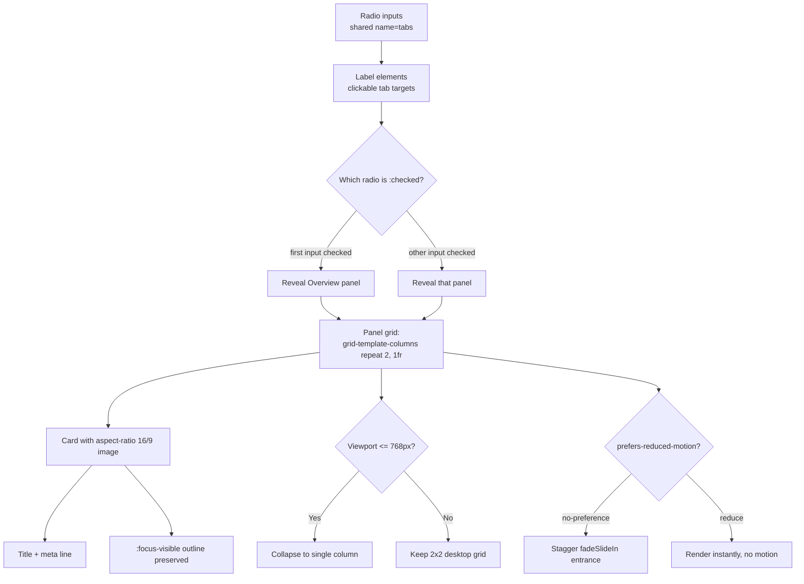

| Difficulty | Channel | Tags |
|---|---|---|
| beginner | frontend | css, flexbox, grid, animations |

Design systems spend years optimizing what ships to the browser, then quietly surrender those gains to styling that only runs in JavaScript. GitHub learned this the hard way: after scaling Primer across github.com, its styled-components runtime became a measurable tax on server-side rendering, and a migration to CSS Modules cut SSR time by 55% [1]. That result is a reminder that the most powerful UI interactivity often needs no runtime at all. The CSS-only tab panel is a tiny, perfect proof of that idea — tabs, responsive card grids, and tasteful motion with nothing but radio inputs and modern CSS.

---

> ### Real-World Case — GitHub
>
> GitHub's Primer design system powered nearly every surface of github.com, but by 2023 pages had grown dense with components and the CSS-in-JS runtime (styled-components) that generated all styling in JavaScript began to surface as a real performance tax. Styles were initialized on the client, style collection slowed server-side rendering, and updates grew harder to contain as component counts exploded.
>
> | | |
> |---|---|
> | **Challenge** | The team needed to eliminate the client and server cost of computing CSS in JavaScript without breaking one of the most heavily used sites on the web, and they had thousands of components and the widely used `sx` inline-style prop already baked into the codebase. |
> | **Solution** | They migrated every component to CSS Modules: plain, native CSS files colocated with each component, no runtime on the client or server, classes scoped locally by default, and stylesheets shipped alongside the HTML. The migration ran incrementally behind feature flags with visual-regression snapshots, then they systematically eliminated the ~7,760 `sx` props and decoupled theming from styled-components. |
> | **Outcome** | By December 2024 all Primer components were on CSS Modules, cutting server-side render time by 55% and component initialization time by 25%. By June 2026 github.com ran on 100% CSS Modules with `sx`, styled-components, and styled-system fully removed, all without breaking the product. |
> | **Lesson** | The best JavaScript is the JavaScript that never runs. CSS has matured (native nesting, :has(), cascade layers, container queries, custom properties) to the point where static CSS compiled at build time can do what teams once reached for runtime libraries to do — and the cost of doing styling in JS compounds as a product grows. |

---

## Hook — The Invoice Nobody Sends for Client-Side Styling

Here is the uncomfortable truth about most design systems: the cost of a component is not what it looks like, it is what it takes to render it. A button that paints in one millisecond can still drag a page down if every style it needs must first be assembled in JavaScript, serialized, and hydrated in the browser. That hidden invoice shows up as slower first paint, longer server renders, and a style layer that only a handful of engineers dare to touch.

Now zoom into the smallest possible unit of that problem: a tab panel. On a docs page, it is the thing users click to flip between "Overview," "Guides," and "Examples." In a JavaScript-first codebase, that innocent widget pulls in a state hook, an effect, a re-render, and possibly an entire accessibility library — before the first pixel appears. The question worth asking is brutal in its simplicity: *does switching a tab really require a programming language at all?* The answer, it turns out, is no — and the same principle that made GitHub faster lives inside that answer.

## Problem — When Interactivity Becomes an Infrastructure Cost

Most teams reach for JavaScript because it is the path of least resistance, not because it is the right tool. State lives in a hook, visibility is toggled with a class, and the pattern gets copied into every new component. Individually, none of those choices is catastrophic. Collectively, they create a compounding problem that is hard to see until it is expensive to fix.

Consider what breaks down:

- **Render cost stacks up.** Every stateful tab component adds work to the critical path, and that work multiplies across hundreds of instances on a page [2].
- **Hydration tax.** Server-rendered markup must be matched and re-attached on the client, so what looked fast on the server can feel slow in the browser.
- **Accessibility drifts.** Custom tab widgets frequently forget `role="tablist"`, arrow-key navigation, and visible focus, because none of it is free when you build state by hand [8].
- **Motion ignores users.** Entrance animations are added for polish, then never gated behind `prefers-reduced-motion`, leaving motion-sensitive users without an escape hatch [4].

The stakes are simple. If the platform already knows how to toggle content — and it does, via form controls — then re-implementing that in JavaScript is duplicated effort that you will pay for forever. The real problem is not "how do we make tabs work?" It is "how do we make tabs work while removing an entire category of runtime cost?"

## Real-World Case — GitHub's Primer Design System

GitHub's Primer design system powered nearly every surface of github.com. By 2023, pages had grown dense with components, and the CSS-in-JS runtime (styled-components) that generated all styling in JavaScript began to surface as a real performance tax. Styles were initialized on the client, style collection slowed server-side rendering, and the styling layer grew harder to contain as component counts exploded [1].

The migration was deliberate, not a rewrite-and-hope. By December 2024, all Primer components ran on CSS Modules, cutting server-side render time by 55% and component initialization time by 25% [1]. The work continued: by June 2026, github.com ran on 100% CSS Modules, with `sx`, styled-components, and styled-system fully removed — all without breaking the product [1].

The lesson lands hard for anyone building UI: shifting styling work out of the runtime and into something the browser natively understands paid off in cold, measured numbers. GitHub did not make the product simpler or quieter; it made the *machinery behind the product* disappear. The CSS-only tab pattern is the same philosophy applied at component scale — move logic the browser already understands out of your JavaScript, and the savings follow.

## Deep Dive — The Mechanics of a JavaScript-Free Tab

The whole trick rests on a CSS feature that predates every framework: the relationship between a form control and its siblings. Radio inputs sharing the same `name` behave as a single-select group — the browser enforces that exactly one is checked at a time, which is precisely the semantics a tab list needs. Because CSS can select the `:checked` state of an input and reach its following siblings, you can reveal one panel and hide the rest without a single line of scripting [3].

The moving parts are deceptively small:

| Piece | Role | Why it matters |
| --- | --- | --- |
| `` | Holds the selected state | Single-selection is enforced natively [8] |
| `` | The clickable tab | Gives keyboard and pointer users the same target |
| `input:not(:checked) ~ .panel` | Hides inactive panels | Adjacent sibling selector does the "switching" [3] |
| `display: grid` with `repeat(2, 1fr)` | 2×2 desktop grid | Responsive layout without media-query gymnastics [2] |
| `aspect-ratio: 16 / 9` | Fixed image box | Prevents layout shift before images load [5] |

Two details separate a demo from production. First, `:focus-visible` must be preserved so keyboard users can see where they are — removing focus outlines is the accessibility equivalent of removing the brake lights [6]. Second, motion must be opt-out. Wrapping the entrance animation in `@media (prefers-reduced-motion: no-preference)` means the sparkle is a bonus, never a barrier [4]. You might think a CSS-only pattern gives up control; in practice it gives up *maintenance*, and that is the better trade.

## Workflow — From Radio to Reveal in Five Steps

Building this is less about cleverness and more about ordering. Each step removes a reason for JavaScript to exist, and the diagram below shows how state flows from an invisible input to a visible panel.

1. **Group the state.** Create one `` per tab, all sharing `name="tabs"`, with the first marked `checked` so the page has a sane default.
2. **Build the labels.** Pair each input with a `` so clicking the tab text toggles the radio natively — no click handler required.
3. **Wire the panels.** Place each panel as a following sibling of the inputs, then hide inactive ones with `input:not(:checked) ~ .panel { display: none; }` [3].
4. **Lay out the cards.** Give each panel `display: grid; grid-template-columns: repeat(2, 1fr)` for the desktop 2×2, then collapse to `1fr` under 768px [2].
5. **Add motion with a guardrail.** Animate cards with a stagger only inside `prefers-reduced-motion: no-preference`, and keep `:focus-visible` outlines intact [4][6].

The sequence mirrors GitHub's broader lesson: identify logic the platform already provides, route it through native mechanisms, and reserve JavaScript for the things only JavaScript can do.

## Code Example — Implementing the Pattern

The markup and CSS carry the core interaction. Note how the panels are siblings of the inputs, which is what lets the adjacent sibling selector see the `:checked` state. The animation is fenced behind a motion preference, and every card gets a fixed 16:9 image box so the grid never jumps.

```html
<div class="tabs">
  <input type="radio" id="tab-overview" name="tabs" checked>
  <label for="tab-overview">Overview</label>
  <input type="radio" id="tab-guides" name="tabs">
  <label for="tab-guides">Guides</label>

  <section class="panel" aria-labelledby="tab-overview">
    <article class="card">
      <div class="card__image"></div>
      <h3 class="card__title">Getting Started</h3>
      <p class="card__meta">5 min read</p>
    </article>
    <!-- repeat 3 more cards for a 2x2 grid -->
  </section>
</div>
```

```css
/* Hide inactive panels; the checked input reveals its sibling panel. */
.tabs input:not(:checked) ~ .panel { display: none; }

.tabs .panel {
  display: grid;
  grid-template-columns: repeat(2, 1fr); /* desktop 2x2 */
  gap: 1.5rem;
}

@media (max-width: 768px) {
  .tabs .panel { grid-template-columns: 1fr; } /* mobile single column */
}

.card__image {
  aspect-ratio: 16 / 9; /* reserve space, prevent layout shift */
  background: #eee;
}

/* Motion is opt-in: only animate when the user has not asked to reduce motion. */
@media (prefers-reduced-motion: no-preference) {
  .card {
    animation: fadeSlideIn 0.3s ease-out backwards;
    animation-delay: var(--enter-delay, 0ms); /* set per-card for stagger */
  }
}

@keyframes fadeSlideIn {
  from { opacity: 0; transform: translateY(10px); }
  to   { opacity: 1; transform: translateY(0); }
}

/* Never remove focus outlines; make them clear instead. */
:focus-visible { outline: 2px solid currentColor; outline-offset: 2px; }
```

The JavaScript below is optional and never load-bearing. It only enhances the pattern — it does not create it — so the tabs keep working with scripting disabled.

## Lessons Learned — What to Carry Into Your Own Codebase

The most valuable takeaway is not "use radio buttons for tabs." It is the habit of asking whether a runtime is required before adding one. GitHub proved the point at scale by removing an entire styling runtime and cutting SSR time by 55% [1]; the same reasoning shrinks to a single component.

- **Let the platform hold state when it can.** Radio groups give you single-selection for free [8].
- **Reserve JavaScript for behavior it uniquely enables.** Progressive enhancement layers on top; it never becomes the foundation [9].
- **Treat motion as an accessibility feature, not decoration.** `prefers-reduced-motion` is not optional polish [4].
- **Preserve focus visibility.** Keyboard users navigate by focus; `:focus-visible` is table stakes [6].
- **Stabilize layout with `aspect-ratio`.** Fixed media boxes prevent the cumulative layout shift that tanks your Core Web Vitals [5].

A common battle scar: developers hide panels with `visibility: hidden` or `opacity: 0` and accidentally leave them keyboard-focusable, so tabbing into a "hidden" card. If you keep content in the DOM for animation, add `inert` or manage `visibility` so hidden content cannot be reached. Another: hard-coding `nth-child` delays, which silently break the moment a card is added — use a CSS custom property and set it once [10].

So what should you do differently tomorrow? Before your next stateful component, ask the platform question first. When the answer is "CSS already does this," you have just removed a little runtime cost from every page that will ever render that component — and those little removals are exactly how a site like GitHub gets 55% faster.

---

## CSS-Only Tab State Flow



<details>
<summary><strong>Original Interview Question</strong></summary>

**Q:** Build a CSS-only tab panel for a design-system docs page. Use radio inputs to switch tabs (no JavaScript). Desktop: a 2x2 grid of cards under each tab; mobile: single column. Each card has a fixed 16:9 image area, a title, and a short meta line. Add a subtle entrance animation with a stagger and keep focus-visible outlines; ensure prefers-reduced-motion is respected?

**A:** Use a set of radio inputs with a shared `name` attribute and corresponding `` elements for each tab section. The `:checked` state of each radio controls visibility of its associated panel via adjacent sibling selectors. Each panel renders a 2×2 card grid on desktop and collapses to a single column on mobile. Cards use `aspect-ratio: 16/9` for fixed image containers, with a title and meta line below.

</details>

## Conclusion

The journey from "tabs need JavaScript" to "tabs need a radio input and a selector" is the same journey GitHub took at the scale of an entire design system, and it ended in a 55% faster server render [1]. The moral is not that JavaScript is bad — it is that JavaScript should be the last resort, not the default reflex. Carve out the interactions your platform already understands, gate your motion behind a user preference, keep your focus outlines, and reserve scripting for what only scripting can do. Do that one component at a time, and the savings compound across every page that renders it. Share this with your team the next time someone reaches for a state hook to build a tab: ask the platform question first.

---

## References

1. [GitHub incident report](https://github.blog/engineering/architecture-optimization/improving-site-performance-by-shipping-more-css/) — article
2. [CSS Grid Layout — MDN Web Docs](https://developer.mozilla.org/en-US/docs/Web/CSS/CSS_grid_layout) — documentation
3. [:checked — CSS | MDN Web Docs](https://developer.mozilla.org/en-US/docs/Web/CSS/:checked) — documentation
4. [prefers-reduced-motion — MDN Web Docs](https://developer.mozilla.org/en-US/docs/Web/CSS/@media/prefers-reduced-motion) — documentation
5. [aspect-ratio — MDN Web Docs](https://developer.mozilla.org/en-US/docs/Web/CSS/aspect-ratio) — documentation
6. [:focus-visible — MDN Web Docs](https://developer.mozilla.org/en-US/docs/Web/CSS/:focus-visible) — documentation
7. [Primer CSS — GitHub](https://github.com/primer/css) — documentation
8. [<input type="radio"> — MDN Web Docs](https://developer.mozilla.org/en-US/docs/Web/HTML/Element/input/radio) — documentation
9. [CSS — Wikipedia](https://en.wikipedia.org/wiki/CSS) — documentation
10. [Using CSS custom properties — MDN Web Docs](https://developer.mozilla.org/en-US/docs/Web/CSS/Using_CSS_custom_properties) — documentation

---

**Author:** Satishkumar Dhule — [GitHub](https://github.com/satishkumar-dhule) · [LinkedIn](https://linkedin.com/in/satishkumar-dhule) · [Website](https://satishkumar-dhule.github.io)
