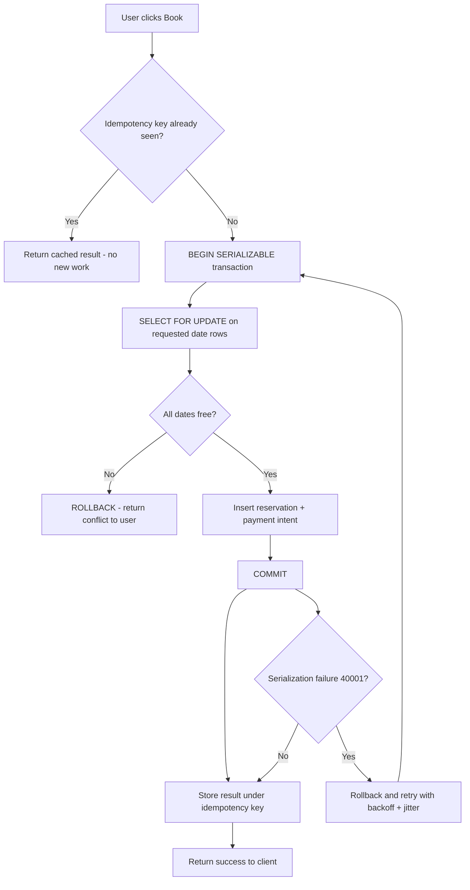

| Difficulty | Channel | Tags |
|---|---|---|
| intermediate | database | acid, isolation-levels, mvcc |

In 2021, Airbnb's engineering team discovered that a single 'Book' tap could fan out into a dozen downstream service calls, and a dropped response or an impatient double-click was enough to produce duplicate reservations and double payments [1]. That realization sparked a company-wide rethink of transactions — and it is the exact scenario you will face the moment two guests race for the same villa at midnight. This is the story of how distributed systems break naive booking logic, and how isolation levels, row locks, and idempotency put the pieces back together.

---

> ### Real-World Case — Airbnb
>
> As Airbnb migrated from its Rails monolith to a service-oriented architecture, a single 'Book' action became a chain of API calls fanning out to multiple downstream services, each mutating state and producing side effects — effectively a distributed transaction. Network timeouts, dropped responses, and users double-clicking 'Book' created race conditions that could produce duplicate reservations and double payments.
>
> | | |
> |---|---|
> | **Challenge** | Maintain data integrity and eventual consistency across independently-failing services without a distributed two-phase commit protocol, while making every write safely retryable so a user is never charged or booked twice — and do it without forcing every product team to become an expert in consistency, all while scaling the idempotency store as payment volume grew. |
> | **Solution** | Airbnb built 'Orpheus', a generic idempotency framework used across its Payments SOA. Every client request carries an idempotency key, and the service acquires a row-level lock on that key in the database — granting a time-limited lease — before proceeding. Requests are split into Pre-RPC, RPC, and Post-RPC phases so that all database commits are wrapped in atomic transactions and kept strictly separate from the unreliable network calls (RPCs). Crucially, idempotency records are always read and written from the sharded master database, never a replica, and the store is sharded by the high-cardinality idempotency key to scale. |
> | **Outcome** | Orpheus provided a reusable idempotency solution across Airbnb's payments services, shielding product developers from consistency bugs and sharding the idempotency records so the system could scale with volume. It made retries and double-clicked 'Book' requests safe by construction, eliminating a class of duplicate-payment and double-booking race conditions. |
> | **Lesson** | Using a read replica for idempotency/consistency-critical records is a trap: even a few seconds of replication lag can make a retried request look like a brand-new one and trigger a duplicate payment or booking. Idempotency keys plus a row-level lock on the master database let clients safely repeat the same request while the check and the write remain atomic — the same 'lock the contended row inside one transaction' principle that prevents two guests booking the same dates. |

---

## Hook — Two Guests, One Villa, and a Race You Cannot See

Picture this: it is 11:59 PM on New Year's Eve and 40,000 users refresh a destination page at the same second. Two of them tap 'Book' on the same beachfront property within 80 milliseconds of each other. Both requests check availability, both see the same empty calendar, both write a reservation, and both get a confirmation email. Your dashboard shows one property, two paying guests, and a check-in date that is now physically impossible. Nobody wrote a bug in the traditional sense — the code did exactly what it was told. The failure lives in the space between two concurrent reads and one write, and that space is where transactional thinking becomes non-negotiable. Sound familiar? It should, because this is the exact class of failure that humbles teams the first time they scale a marketplace.

## Problem — When 'Check Then Act' Meets Real Concurrency

The naive booking flow reads availability, checks it in application code, then writes a reservation. Under concurrency, that check-then-act sequence is a time bomb. Between the read and the write, another transaction can slip in, and the isolation level of your transaction determines how much of that interference you tolerate [2]. At READ COMMITTED — the default in PostgreSQL and many engines — each statement sees a fresh snapshot, so two transactions can both observe an empty calendar and both commit. This is the classic lost-update and phantom-read problem, and it scales exactly proportional to your popularity: the more users hit a hot property, the more collisions occur. The pain is not just technical. Overbookings mean refunds, angry guests, support tickets, host churn, and a trust deficit that a marketplace can rarely afford. The core challenge, therefore, is to make 'reserve this property for these dates' a single atomic decision — even when the request originates from a chain of microservices, retries, and duplicate triggers.

## Real-World Case — Airbnb and the Distributed Booking Nightmare

As Airbnb migrated from its Rails monolith to a service-oriented architecture, a single 'Book' action stopped being one database write and became a chain of API calls fanning out to multiple downstream services, each mutating state and producing side effects — effectively a distributed transaction [1]. Network timeouts, dropped responses, and users double-clicking 'Book' created race conditions that could produce duplicate reservations and double payments. The fix was Orpheus, a reusable idempotency layer shared across Airbnb's payments services. Orpheus shielded product developers from consistency bugs and sharded its idempotency records so the system could scale with volume [1]. The key insight was profound: retries and double-clicked requests became safe by construction. Rather than asking every product team to reinvent concurrency control, Airbnb centralized the guarantee — every request carried a key, and the second arrival of that key returned the original result instead of repeating the side effect. That single architectural decision eliminated an entire class of duplicate-payment and double-booking race conditions across the platform.

## Deep Dive — Isolation Levels, MVCC, and the Locking Trade-off

To reason about booking safety, you need a mental model of how databases actually isolate transactions. PostgreSQL uses Multiversion Concurrency Control (MVCC), where readers never block writers and writers never block readers because each transaction sees a consistent snapshot of the data [4][9]. That is fantastic for throughput — availability checks run at full speed — but it also means your snapshot can go stale the instant it is taken. This is why the ANSI isolation hierarchy exists: READ COMMITTED permits non-repeatable reads, REPEATABLE READ prevents them but can still allow phantoms without extra care, and SERIALIZABLE guarantees that concurrent transactions produce a result equivalent to some serial order [2][3]. Here is the twist many developers miss: SERIALIZABLE in PostgreSQL is optimistic, not pessimistic. It does not take heavy locks up front; it detects dangerous interleavings at commit time and aborts one transaction with a serialization failure [3]. That means your application must be prepared to retry. Row-level locking is the complementary pessimistic tool — SELECT ... FOR UPDATE forces a transaction to wait for conflicting rows to be released, guaranteeing that the second booking sees the first one's committed state [5]. Tables help frame the real trade-off:

| Strategy | Guarantee | Cost | Best Used When |
|---|---|---|---|
| READ COMMITTED + app checks | Weak | Cheapest | Low-contention reads |
| Row lock (SELECT FOR UPDATE) | Strong for targeted rows | Lock waits, deadlock risk | Hot, narrow ranges (dates) |
| SERIALIZABLE (optimistic) | Strong, whole transaction | Abort + retry | Complex multi-row invariants |
| Advisory locks | App-defined | Manual, easy to misuse | Custom critical sections |

The mature answer is rarely 'pick one.' It is a layered design: MVCC snapshot reads for fast availability display, row-level locks on the specific date range for the actual commit, SERIALIZABLE for multi-service invariants, and idempotency keys to make retries harmless [5][6]. Each layer covers a different failure mode.

## Workflow — A Booking Transaction That Refuses to Double-Book

Building on the layering idea, here is the step-by-step flow that survives double-clicks, retries, and network timeouts. The Mermaid diagram below tells the visual story, and each step maps to a concrete guarantee:

1. Client generates a unique idempotency key and sends it with the booking request. Retries reuse the same key.
2. The service attempts to insert that key into an idempotency table with a UNIQUE constraint. If the key already exists, it returns the stored result instead of re-running the booking [7][8].
3. Inside a SERIALIZABLE transaction, the service locks the relevant rows in the availability calendar with SELECT ... FOR UPDATE, scoped to the requested date range [5].
4. It inserts the reservation and the payment intent, then commits. If two transactions interleave dangerously, PostgreSQL aborts one with a serialization error.
5. The application retries aborted transactions with exponential backoff plus jitter, and finally stores the result back under the idempotency key.

Consequently, a double-click becomes one booking, and a network retry becomes a cache hit rather than a second charge. The diagram makes the branch explicit — notice how the very first decision point short-circuits duplicate work before any locking or payment happens.

## Code Example — Idempotent, Row-Locked Booking in Python

Enough theory — here is what the guardrails look like in production-shaped Python. The function combines an idempotency key (to make retries safe), a row-level lock on the availability window (to serialize competing bookings), and a bounded retry loop (to survive serialization aborts). Read the inline comments to trace each guarantee.

```python
import psycopg2
import time
import random

SERIALIZATION_FAILURE = "40001"  # Postgres SQLSTATE for serialization failure

def reserve_property(conn, idempotency_key, property_id, check_in, check_out, guest_id):
    """Reserve a property atomically. Safe against double-clicks and retries."""

    # 1) Idempotency gate: the UNIQUE constraint means only the FIRST
    #    request with this key proceeds. Competitors get a fast no-op.
    with conn.cursor() as cur:
        cur.execute(
            """INSERT INTO idempotency (key, status)
               VALUES (%s, 'processing')
               ON CONFLICT (key) DO NOTHING
               RETURNING id""",
            (idempotency_key,),
        )
        inserted = cur.fetchone()
    conn.commit()

    if inserted is None:
        # Already seen this key -> return the previously stored answer.
        return load_cached_result(conn, idempotency_key)

    # 2) Bounded retry loop for optimistic (SERIALIZABLE) aborts.
    for attempt in range(5):
        try:
            # SERIALIZABLE makes the whole transaction appear atomic.
            conn.set_session(isolation_level="SERIALIZABLE")
            with conn.cursor() as cur:
                # Row-lock ONLY the days being booked, not the whole table.
                cur.execute(
                    """SELECT 1 FROM availability
                       WHERE property_id = %s
                         AND day >= %s AND day < %s
                       FOR UPDATE""",
                    (property_id, check_in, check_out),
                )
                locked_days = cur.fetchall()

                # If any requested day is missing/blocked, refuse cleanly.
                expected = (check_out - check_in).days
                if len(locked_days) < expected:
                    raise ValueError("Dates unavailable")

                # Safe now: insert reservation + payment in one commit.
                cur.execute(
                    """INSERT INTO reservations
                       (property_id, guest_id, check_in, check_out)
                       VALUES (%s, %s, %s, %s) RETURNING id""",
                    (property_id, guest_id, check_in, check_out),
                )
                reservation_id = cur.fetchone()[0]

                # Flip the idempotency row to 'done' with the final answer.
                cur.execute(
                    """UPDATE idempotency
                       SET status = 'done', result = %s
                       WHERE key = %s""",
                    (reservation_id, idempotency_key),
                )
            conn.commit()
            return reservation_id

        except psycopg2.OperationalError as exc:
            if exc.pgcode != SERIALIZATION_FAILURE or attempt == 4:
                raise
            conn.rollback()
            # Exponential backoff + jitter prevents thundering-herd retries.
            time.sleep((2 ** attempt) * 0.05 + random.random() * 0.05)
```

The explanation walks the critical path: the idempotency insert is the cheapest possible gate and runs before any expensive work, so duplicate traffic is dropped in microseconds. The SELECT ... FOR UPDATE scopes locks to exactly the requested days, which keeps contention low even for a wildly popular property. Raising a clean error when the count of locked days is short translates 'someone else won' into a friendly conflict rather than a corrupt write. Finally, catching SQLSTATE 40001 and retrying with jitter handles SERIALIZABLE's optimistic aborts without hammering the database — a pattern that is mandatory once you rely on serialization rather than manual locking.

## Lessons Learned — Battle Scars, Pro Tips, and What to Do Tomorrow

First, respect the fundamental rule: never trust a check-then-act sequence outside a transaction that the database can enforce. Application-level validation is a convenience, not a guarantee — the database is the only place where two concurrent writers truly serialize [6]. Second, beware the false sense of safety that READ COMMITTED provides; it is fast, but it will happily let two transactions book the same dates [2]. Third, understand that SERIALIZABLE in PostgreSQL is optimistic, so every serializable code path needs a retry loop or it will fail under load [3]. Watch out for these common battle scars:

- ⚠️ Locking an entire calendar table 'just to be safe' instead of the specific date range, which turns a hot property into a global bottleneck.
- ⚠️ Forgetting the UNIQUE constraint on the idempotency key, which silently defeats the whole retry-safety design [7].
- ⚠️ Retrying without jitter, which creates synchronized retry storms exactly when the system is already stressed.
- ⚠️ Holding a lock across an external payment call, which extends lock waits to network latency.

💡 Insight: Airbnb's Orpheus succeeded not by inventing exotic algorithms but by centralizing a boring guarantee — idempotency — so that hundreds of developers could not get it wrong [1]. 🔥 Hot Take: the most valuable 'distributed transaction' skill is not writing a saga; it is designing so that duplicate requests are harmless. 🎯 Key Point: combine fast MVCC snapshot reads for display, row-level locks for commits, and idempotency for retries, and you get high availability without giving up correctness. If this feels overwhelming, you are not alone — teams everywhere have been paged at 2 AM by a double-booking. Start small tomorrow: add an idempotency key to one write endpoint, scope your locks to the smallest possible range, and write down your retry policy before you need it. That single habit prevents the next 'two guests, one villa' headline.

---

## Idempotent Booking Flow



<details>
<summary><strong>Original Interview Question</strong></summary>

**Q:** You're building a booking system for Airbnb where multiple users can reserve the same property simultaneously. How would you design the transaction handling to prevent double bookings while maintaining high availability?

**A:** Use SERIALIZABLE isolation with optimistic concurrency control. Implement row-level locks on property availability tables, use MVCC snapshot reads for checking availability, and apply application-level validation to ensure atomic booking operations.

</details>

## Conclusion

The moral of the story is simple: correctness under concurrency is not a feature you add later — it is a property you design in from the first 'Book' button. Airbnb learned this the hard way when a monolith became a distributed system and retries started duplicating payments [1], and their answer was not heroics but a reusable, centralized idempotency guarantee. Your version of that lesson is a stack of three cheap layers: fast MVCC snapshot reads for availability, tightly scoped row-level locks for the commit, and idempotency keys plus retry-with-jitter for everything that can be retried. Do one thing tomorrow: pick your most dangerous write endpoint and add an idempotency key with a UNIQUE constraint. It costs an afternoon and buys you the kind of sleep that only comes from knowing a double-click can never double-charge again.

---

## References

1. [Airbnb incident report](https://medium.com/airbnb-engineering/avoiding-double-payments-in-a-distributed-payments-system-2981f6b070bb) — article
2. [Isolation (database systems) — Wikipedia](https://en.wikipedia.org/wiki/Isolation_(database_systems)) — documentation
3. [PostgreSQL: Transaction Isolation](https://www.postgresql.org/docs/current/transaction-iso.html) — documentation
4. [Multiversion concurrency control — Wikipedia](https://en.wikipedia.org/wiki/Multiversion_concurrency_control) — documentation
5. [PostgreSQL: Explicit Locking](https://www.postgresql.org/docs/current/explicit-locking.html) — documentation
6. [Optimistic concurrency control — Wikipedia](https://en.wikipedia.org/wiki/Optimistic_concurrency_control) — documentation
7. [RFC 7231: HTTP/1.1 Semantics and Content (idempotent methods)](https://datatracker.ietf.org/doc/html/rfc7231) — documentation
8. [Idempotence — Wikipedia](https://en.wikipedia.org/wiki/Idempotence) — documentation
9. [PostgreSQL: Concurrency Control (MVCC)](https://www.postgresql.org/docs/current/mvcc.html) — documentation
10. [Two-phase commit protocol — Wikipedia](https://en.wikipedia.org/wiki/Two-phase_commit_protocol) — documentation

---

**Author:** Satishkumar Dhule — [GitHub](https://github.com/satishkumar-dhule) · [LinkedIn](https://linkedin.com/in/satishkumar-dhule) · [Website](https://satishkumar-dhule.github.io)
