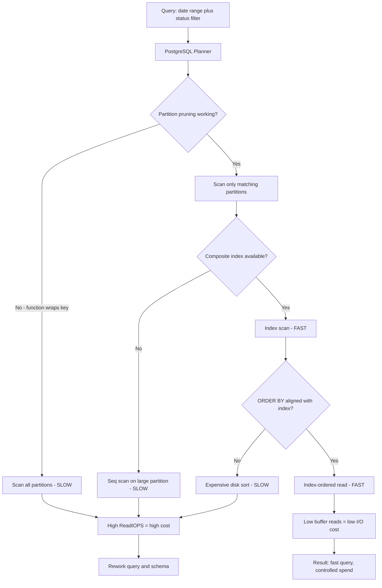

| Difficulty | Channel | Tags |
|---|---|---|
| intermediate | database | explain, query-plan, partitioning |

Picture a PostgreSQL time-series table that has swollen to 33 TB while ingesting 46 GB of fresh data every single day. Every query that filters a date range drags a mountain of data up from storage, and because Aurora bills per I/O operation, those scans quietly burn money by the hour. This is exactly the scenario AWS database engineers benchmarked on Aurora PostgreSQL, and what they discovered reshaped how teams think about range partitioning [1]. By the end of this journey, you will know how to read an EXPLAIN plan like a detective and turn a sluggish 100M-row partition into a query that flies.

---

> ### Real-World Case — Amazon Web Services (AWS) - Aurora PostgreSQL
>
> AWS database engineers benchmarked a production-scale ordering system whose PostgreSQL time-series table had grown to 33 TB while ingesting 46 GB per day (1,000 writes/sec and 10,000 reads/sec). Queries scanning this monolithic table had to pull huge amounts of data from storage, and because Aurora bills per I/O operation, the ReadIOPS were driving up costs dramatically.
>
> | | |
> |---|---|
> | **Challenge** | The single giant table's working set no longer fit in the buffer cache, so every query touched disk and paid per-I/O. They needed to reduce read I/O without a heavy migration or downtime, and crucially had to ensure the query planner could actually skip irrelevant data rather than scanning the whole table. |
> | **Solution** | They converted the table to native PostgreSQL range partitioning on created_at using pg_partman, with both monthly and daily partition policies, using an in-place migration that kept the app online (adding created_at to the primary key since PostgreSQL requires the partition key in unique constraints). This enabled partition pruning so date-range queries only touched the relevant partitions, keeping the working set in memory. They also flagged that partition pruning silently fails if you wrap the partition column in a function, and recommended checking EXPLAIN plans to confirm pruning and index use. |
> | **Outcome** | db.IO.blks_read spikes fell from 600,000 blocks/sec to 25,000 blocks/sec (daily partitioning), while buffer-cache hits rose from ~600,000 to 1.5 million blocks/sec. ReadIOPS on the writer dropped from 100,000/sec to 40,000/sec. Storage I/O cost fell from $17,676.81/week to $5,608.33/week — up to 40% savings with monthly partitioning and 60% with daily partitioning |
> | **Lesson** | Partitioning only pays off when queries actually filter on the partition key so the planner can prune partitions — a function applied to the partition column, or a query that omits the key, forces a scan of every partition and makes things worse. Always verify pruning in EXPLAIN before assuming it's happening. |

---

## Hook — The Night the ReadIOPS Bill Went Vertical

It is 2 a.m. and the pager fires: your API latency has tripled. You check the dashboards and nothing looks broken — no crashes, no obvious errors. But then you notice the number that makes your stomach drop: `db.IO.blks_read` is hammering 600,000 blocks per second, and the storage bill is climbing in lockstep. Sound familiar? Many developers assume that once a table is partitioned, performance is solved and costs are under control. Then reality arrives. The hard truth is that partitioning is only the beginning of the story — the planner still has to prune, indexes still have to be chosen, and data still has to be laid out on disk in a way that respects how you actually query it. What follows is the journey from a monolithic table bleeding money to a partitioned, indexed, clustered schema that runs leaner and cheaper.

## Problem — Why a Partitioned Table Can Still Crawl

Here is the thing though: a partitioned table can behave exactly like an unpartitioned one if the query planner never prunes the partitions it does not need. Picture a 100M-row `events` table partitioned by `event_date`. You run a query filtering a single month and a status value, and it still takes 40 seconds. Why? Three culprits hide in plain sight. First, partition pruning may silently fail — for example, when the filter wraps the partition key in a function like `date_trunc('month', event_date)`, the planner cannot map the predicate to partitions, so it scans them all [2]. Second, even when pruning works, each surviving partition may lack an index on the filtered columns, forcing sequential scans across millions of rows. Third, expensive sorts and hash aggregates pile on top, spilling to disk and multiplying I/O. The stakes are real: degraded latency, angry users, and — on metered platforms like Aurora — a bill that grows with every wasted block read. The problem is never just "the table is big." The problem is that the access path does not match the query pattern.

## Real-World Case — AWS Aurora PostgreSQL Proves the Point

This is where the numbers get sobering. AWS database engineers benchmarked a production-scale ordering system whose PostgreSQL time-series table had reached 33 TB, ingesting 46 GB per day at roughly 1,000 writes/sec and 10,000 reads/sec [1]. Because the workload hit one giant monolithic table, scans pulled enormous volumes of data from storage, and Aurora's per-I/O billing turned those reads into a financial hemorrhage. Then the team introduced range partitioning. With monthly partitioning, db.IO.blks_read spikes fell dramatically; with daily partitioning, they dropped from 600,000 blocks/sec to just 25,000 blocks/sec, while buffer-cache hits rose from around 600,000 to 1.5 million blocks/sec [1]. ReadIOPS on the writer plunged from 100,000/sec to 40,000/sec. The bottom line: storage I/O cost fell from $17,676.81 per week to $5,608.33 per week — up to 40% savings with monthly partitioning and 60% with daily partitioning [1]. Same data, same queries, radically different economics. The lesson is unmistakable: how you physically slice a table determines how much you pay to read it.

## Deep Dive — Reading EXPLAIN Like a Detective

Building on that result, the question becomes: how do you know which lever to pull? You start with the EXPLAIN plan, specifically `EXPLAIN (ANALYZE, BUFFERS)`, which shows not just the plan but real execution timing and buffer usage [3]. Four signals matter most. First, look at the partition count in the plan: if you asked for one month but the plan scans 60 partitions, pruning has failed [2]. Second, inspect scan nodes — `Seq Scan` on a large partition where you expected an `Index Scan` is a red flag. Third, hunt for `Sort` and `HashAggregate` nodes with high `external` memory usage, which means work spilled to disk [3]. Fourth, check `shared read` versus `shared hit` in the BUFFERS output: high reads mean storage I/O, exactly what drives cost on Aurora. From there, the toolkit branches. Composite indexes on `(event_date, status)` give the planner a covering path for the common filter combination [4]. Clustering — physically reordering rows via `CLUSTER` or, better, using a clustered index — improves locality so sequential scans touch fewer pages [5]. Now for the plot twist many developers miss: partitioning and indexes are not competitors. Partitioning narrows the search space to the right chunk of data, and indexing makes reading that chunk cheap. You need both, and the choice of partition granularity (daily versus monthly) is a trade-off between query pruning and the overhead of managing many small partitions [2].

## Workflow — From Slow Scan to Pruned, Indexed Query

This leads to a repeatable diagnostic workflow. Start by measuring, because guesses are expensive. The steps below walk you from a bloated scan to a tuned query, and the accompanying Mermaid flowchart visualizes the decision path the planner follows at each stage. Many teams discover that a single fix — usually the composite index — is not enough, and that partitioning plus indexing plus clustering together produce the dramatic results.

- **Step 1: Capture the baseline.** Run `EXPLAIN (ANALYZE, BUFFERS)` on the slow query and record rows scanned, buffer reads, and total time [3].
- **Step 2: Verify pruning.** Confirm the plan touches only the partitions matching your date range; if not, rewrite the predicate to reference the partition key directly [2].
- **Step 3: Inspect scan types.** Replace sequential scans with index scans by adding composite indexes that cover the WHERE clause columns [4].
- **Step 4: Eliminate expensive sorts.** Align index column order with `ORDER BY` clauses so the planner can walk the index instead of sorting [5].
- **Step 5: Evaluate clustering.** For range-heavy scans, cluster on the most selective ordering to improve physical locality [5].
- **Step 6: Re-measure and compare.** Diff the new plan against the baseline to confirm buffer reads and execution time actually dropped.

The flowchart below shows how pruning, index selection, and scan strategy interact — each yes/no gate is a place where a poorly written query silently falls off a performance cliff.

## Code Example — Diagnosing and Fixing the Query in Python

Here is how to automate the diagnosis. The Python script below connects to PostgreSQL, runs an EXPLAIN ANALYZE, parses the plan for the warning signs described above, and applies the composite index fix. The explanation breaks down each stage.

## Lessons Learned — What to Carry Into Your Next Query

The journey from a 33 TB table to a lean partitioned schema teaches a handful of durable lessons. First, measure before you optimize: EXPLAIN (ANALYZE, BUFFERS) is your ground truth, and buffer reads map directly to cost on metered platforms like Aurora [1][3]. Second, partitioning only pays off when pruning actually happens — verify it every time, because a function-wrapped partition key defeats the entire strategy [2]. Third, composite indexes and partitioning are teammates, not alternatives; use `(partition_key, filter_column)` ordering to serve both pruning and filtering [4]. Fourth, physical layout matters: clustering or choosing the right partition granularity trades management overhead for locality, and daily partitioning delivered the biggest AWS savings (60%) while monthly captured most of the benefit with less overhead [1][5]. Finally, avoid the classic battle scars: don't index every column "just in case," don't forget that `CREATE INDEX CONCURRENTLY` avoids locking a live table, and don't assume a fresh index will be used without running ANALYZE to refresh statistics [4]. Run the workflow once, and it becomes a habit you apply to every slow query.

---

## Partition Pruning Decision Flow

<strong>Original Interview Question</strong>

**Q:** You have a PostgreSQL table with 100M rows partitioned by date. A query filtering on a specific date range is still slow. What would you check in the EXPLAIN plan and how would you optimize it?

**A:** Check partition pruning effectiveness, index utilization patterns, and expensive sort operations. Create composite indexes on (date, filtered_columns) and evaluate clustering strategies for optimal data access.

## Conclusion

The moral of this story is that a big table is not inherently a slow table — a poorly aligned access path is. AWS's 33 TB ordering system did not get faster because someone added a single magic index; it got faster because range partitioning, correct pruning, composite indexing, and physical layout worked together to slash storage I/O by up to 60% and cut $12,000 per week off the bill [1]. So here is what to do differently tomorrow: before you touch a slow query, run EXPLAIN (ANALYZE, BUFFERS), count the partitions being scanned, and check whether buffer reads or disk spills are your real enemy. Then fix the access path to match the query. One memorable insight to share with your team: partitioning decides how much data you are allowed to touch, and indexing decides how cheaply you touch it — get both right and the database rewards you twice.

---

## References

1. [Amazon Web Services (AWS) - Aurora PostgreSQL incident report](https://aws.amazon.com/blogs/database/reduce-read-i-o-cost-of-your-amazon-aurora-postgresql-database-with-range-partitioning/) — article
2. [PostgreSQL Documentation: Table Partitioning](https://www.postgresql.org/docs/current/ddl-partitioning.html) — documentation
3. [PostgreSQL Documentation: EXPLAIN](https://www.postgresql.org/docs/current/sql-explain.html) — documentation
4. [PostgreSQL Documentation: Indexes](https://www.postgresql.org/docs/current/indexes.html) — documentation
5. [PostgreSQL Documentation: CLUSTER](https://www.postgresql.org/docs/current/sql-cluster.html) — documentation
6. [Wikipedia: Partition (database)](https://en.wikipedia.org/wiki/Partition_(database)) — documentation
7. [Wikipedia: Query plan](https://en.wikipedia.org/wiki/Query_plan) — documentation
8. [Amazon Aurora PostgreSQL Documentation](https://docs.aws.amazon.com/AmazonRDS/latest/AuroraUserGuide/CHAP_AuroraPostgreSQL.html) — documentation

---

**Author:** Satishkumar Dhule — [GitHub](https://github.com/satishkumar-dhule) · [LinkedIn](https://linkedin.com/in/satishkumar-dhule) · [Website](https://satishkumar-dhule.github.io)
