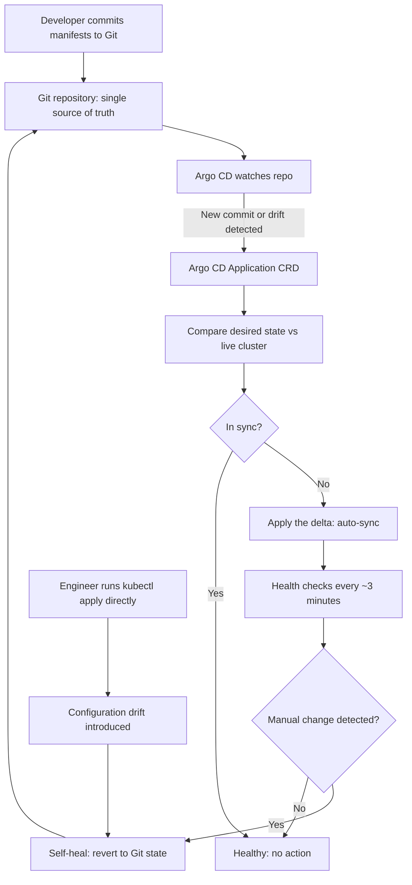

| Difficulty | Channel | Tags |
|---|---|---|
| beginner | devops | argocd, flux, declarative |

Picture a company where dozens of development teams need to ship hundreds of microservices to production, yet almost none of the engineers are Kubernetes experts [1]. That was Intuit as it moved to the cloud, and its existing CI/CD pipelines and manual kubectl-and-Helm workflows simply could not keep up with the scale, governance, and audit requirements the business demanded [1]. The fix was not a bigger ops team or a stricter change-approval process — it was a fundamental shift in how the desired state of the entire system was defined and enforced. Here is the story of how one team's internal tool became the de-facto industry standard for GitOps, and what it means for your next deployment.

---

> ### Real-World Case — Intuit
>
> As Intuit moved to the cloud and adopted containers and Kubernetes, dozens of development teams needed a safe, auditable, and fast way to ship hundreds of microservices to production without becoming Kubernetes experts. Existing CI/CD and manual kubectl/Helm workflows could not keep up with the scale, governance, and compliance requirements of the company.
>
> | | |
> |---|---|
> | **Challenge** | There was no purpose-built enterprise GitOps continuous-delivery tool for Kubernetes, and Intuit's own initial Argo CD implementation only worked well for a couple of clusters and a few dozen applications. As Kubernetes adoption exploded, the Application Controller reconciliation loop was taking minutes per cycle and began failing at scale, threatening deployment reliability. |
> | **Solution** | Intuit built Argo CD as an internal declarative GitOps tool and then open-sourced it. Argo CD's Application Controller continuously compares live cluster state against the desired state declared in Git (YAML, Helm, Kustomize) and auto-syncs and self-heals drift. To scale, Intuit's engineers added in-memory manifest caching in the Repository Service, redesigned the controller to use the informers framework, and eliminated query bottlenecks. |
> | **Outcome** | Argo CD scaled to manage hundreds of applications across dozens of Kubernetes clusters at Intuit, with reconciliation time reduced from minutes to seconds (~150 applications reconciled in under 5 seconds). The project was open-sourced and became the de-facto industry standard GitOps tool, adopted by companies including Red Hat (a major contributor) and thousands of others. |
> | **Lesson** | GitOps as a concept is easy to describe but brutally hard to operate at scale — the naive reconcile-everything loop collapses once you pass a few dozen apps. Intuit's fix (caching rendered manifests and using informer-based queries) shows that declarative reconciliation must be engineered for performance, and it reveals a deeper truth: Argo CD was born from a real internal pain, which is exactly why it resonated with the entire industry. |

---

## Hook — When Your Deploy Tool Becomes the Bottleneck

It is the kind of pressure that builds slowly and then all at once. A platform team builds a golden path for developers: commit code, let CI build an image, let CD roll it out. At ten services, it hums. At a hundred services across dozens of clusters, it groans. Every engineer needed cluster credentials. Every rollback required someone to remember which kubectl apply they ran last Tuesday. Every audit asked for a history that simply did not exist in a meaningful form. The uncomfortable truth is that most deployment systems are designed around the happy path — the first deploy, the clean release — and silently break under the weight of day-two operations. So if your team is standing at the edge of that cliff right now, you are in good company. The question that changed everything for Intuit was deceptively simple: what if the cluster could be forced to always match Git, automatically, with no human in the loop [1]?

## Problem — Why Manual Sync and Imperative Deploys Break at Scale

The core problem is a mismatch between how teams describe intent and how the cluster gets changed. In an imperative workflow, engineers run kubectl commands or one-off Helm installs that mutate the live cluster directly [2]. Each command is a momentary truth, but nothing records the accumulated result as a reviewable artifact. Consequently, configuration drift creeps in, environments diverge, and the famous 'it works in staging' gap widens. Moreover, rollbacks become archaeology: you must reconstruct what the cluster looked like before a change, because nobody versioned the delta. Security and compliance teams hate this too, since there is no single auditable ledger of who changed what and why. The pain compounds with headcount: the more teams you have, the more humans can touch the cluster, and the more non-deterministic the whole system becomes. What if the desired end state could live in one place, be reviewed like code, and be enforced continuously rather than applied once [3]?

## Real-World Case — Intuit and Argo CD at Scale

Intuit did not set out to invent an industry standard. As the company moved to the cloud and adopted containers and Kubernetes, dozens of development teams needed a safe, auditable, and fast way to ship hundreds of microservices without every developer becoming a Kubernetes expert [1]. Their existing CI/CD and manual kubectl/Helm workflows could not satisfy the governance and compliance bar, and the velocity hit was becoming unacceptable. The answer began as an internal project and grew into Argo CD, a declarative GitOps controller that continuously reconciles cluster state with Git. The results were striking: Argo CD scaled to manage hundreds of applications across dozens of Kubernetes clusters at Intuit, with reconciliation time dropping from minutes to seconds — roughly 150 applications reconciled in under five seconds [1]. The project was open-sourced and became the de-facto GitOps tool, adopted by Red Hat (a major contributor) and thousands of other organizations [1]. The lesson: a well-designed control loop beats a bigger ops team every time.

## Deep Dive — Declarative vs Imperative, and Why the Difference Actually Matters

At the heart of GitOps is a deceptively simple distinction between two ways of changing a system. The imperative approach executes commands: you tell Kubernetes what to do, step by step, and you are responsible for the order, idempotency, and history of those steps [2]. The declarative approach instead describes the complete desired end state in version control — YAML manifests, Helm charts, or Kustomize overlays — and lets a controller figure out how to get there [4]. This matters because declarative state is diffable, reviewable, and reversible. When Git is the single source of truth, every change becomes a pull request, which means code review, approvals, and a complete audit trail come for free [1]. Argo CD adds the missing piece: a continuous reconciliation loop that compares the live cluster against the declared state and corrects any divergence [3]. In effect, the cluster stops being a mutable pet and becomes a reconciled copy of a repository you can reason about offline. Many developers assume the declarative path is slower or more rigid. In practice, the opposite is true: because the controller only applies what is missing, the median change is faster and far less error-prone than a sequence of hand-run commands. The table below summarizes the real trade-offs you should weigh before choosing.

## Workflow — From Git Commit to Self-Healed Cluster

Building on the declarative model, the GitOps workflow is a closed loop rather than a one-way push. First, the team stores Kubernetes manifests, Helm charts, or Kustomize configs in a Git repository that acts as the source of truth [4]. Second, an Argo CD Application custom resource points at that repository, path, and target cluster [3]. Third, auto-sync is enabled so Argo CD polls or is triggered by webhooks, detects any difference between desired and live state, and applies the delta. Fourth, a health check interval — commonly around three minutes, though the range is often one to five — keeps the loop honest and surfaces unhealthy workloads quickly [3]. Finally, self-healing closes the door on drift: if someone runs a manual kubectl change, Argo CD reverts it to match Git [3]. The diagram above traces this journey end to end, including the tempting shortcut that self-healing quietly defeats.

## Code Example — Declaring the Application and Letting Git Drive

The following script is the practical distillation of everything above. It creates an Argo CD Application that points at a Git repository, enables automated sync with pruning and self-healing, and verifies the reconciliation. Notice how the entire desired end state lives in one reviewable manifest, which is the declarative promise in miniature.

## Lessons Learned — What to Take to Your Next Deploy

The Intuit story ends not with a clever algorithm but with a habit: make Git the only path to production, and let a controller enforce it [1]. Start small — one application, one repository, auto-sync on — and let the loop earn trust before you point it at a hundred clusters. Resist the urge to grant kubectl access for 'quick fixes'; every bypass is a leak in the single source of truth, and self-healing will either erase it or reveal it. Keep a human in the merge, not in the deploy: approvals belong on pull requests, not on live clusters [2]. Finally, measure reconciliation time as a first-class metric; if Intuit can reconcile roughly 150 applications in under five seconds [1], your platform has no excuse for multi-minute stale state. Do one thing differently tomorrow: take the next change you would have kubectl-applied and commit it instead.

---

## GitOps Reconciliation Loop

<strong>Original Interview Question</strong>

**Q:** You're setting up GitOps for a microservices deployment. How would you configure ArgoCD to automatically sync changes from your Git repository to Kubernetes, and what's the difference between declarative and imperative approaches in this context?

**A:** I'd configure ArgoCD by setting up a Git repository containing Kubernetes manifests or Helm charts, creating an Application CRD that points to the Git repository, enabling auto-sync with a health check interval of 3 minutes, and implementing self-healing to automatically revert any manual changes. The declarative approach involves defining the desired state in Git through YAML manifests, Helm charts, or Kustomize configurations, where ArgoCD continuously reconciles the actual state with the desired state. In contrast, the imperative approach uses kubectl commands to make direct changes to the cluster, bypassing the Git repository as the single source of truth.

## Conclusion

The moral of the story is that reliability at scale comes from a control loop, not from heroics. Intuit's journey from fragile manual workflows to a controller reconciling roughly 150 applications in under five seconds shows that the hard part of GitOps is not tooling — it is committing to Git as the only path to production. So take one application, put its manifests in a repository, enable auto-sync with self-healing, and watch drift become a thing of the past. The insight worth sharing with your team is this: if the cluster can heal itself from Git, the scariest deploy becomes the most boring, repeatable part of your week.

---

## References

1. [Intuit incident report](https://blog.argoproj.io/doing-gitops-at-scale-6313f5889775) — article
2. [Kubernetes Documentation: Managing Kubernetes Objects Imperatively](https://kubernetes.io/docs/tasks/manage-kubernetes-objects/imperative-command/) — documentation
3. [Argo CD Documentation: Automated Sync Policy and Self-Healing](https://argo-cd.readthedocs.io/en/stable/user-guide/auto_sync/) — documentation
4. [Kubernetes Documentation: Managing Kubernetes Objects Declaratively](https://kubernetes.io/docs/tasks/manage-kubernetes-objects/declarative-config/) — documentation
5. [Argo CD on GitHub](https://github.com/argoproj/argo-cd) — documentation
6. [GitOps — Wikipedia](https://en.wikipedia.org/wiki/GitOps) — documentation
7. [Kubernetes Documentation: Declarative Management of Kubernetes Objects Using Kustomize](https://kubernetes.io/docs/tasks/manage-kubernetes-objects/kustomization/) — documentation
8. [Helm Documentation](https://helm.sh/docs/) — documentation
9. [Flux Documentation](https://fluxcd.io/docs/) — documentation
10. [kubectl Reference Documentation](https://kubernetes.io/docs/reference/kubectl/) — documentation

---

**Author:** Satishkumar Dhule — [GitHub](https://github.com/satishkumar-dhule) · [LinkedIn](https://linkedin.com/in/satishkumar-dhule) · [Website](https://satishkumar-dhule.github.io)
