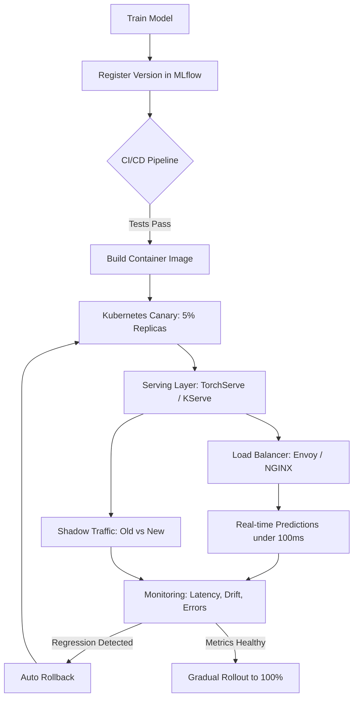

| Difficulty | Channel | Tags |
|---|---|---|
| beginner | devops | mlops, deployment |

It was 5 AM when the dashboards lit up — small offline metric regressions that had slipped through an otherwise green deployment pipeline, now quietly spreading across every downstream service that depended on a single model. Most teams assume that if a model trains well and the CI pipeline passes, production is safe. Uber learned that this assumption breaks at scale, running more than 400 active ML use cases and over 20,000 training jobs per month while its Michelangelo platform serves over 15 million real-time predictions per second at peak [1]. This is the story of why deploying a model and serving a model are two very different disciplines — and what happens when you confuse them.

---

> ### Real-World Case — Uber
>
> Uber runs machine learning at a scale where over 400 active use cases execute more than 20,000 training jobs per month, and its Michelangelo platform serves over 15 million real-time predictions per second at peak. As ML adoption exploded, the company discovered that offline model quality did not guarantee safe behavior in production, and small regressions could spread across dependent systems within minutes.
>
> | | |
> |---|---|
> | **Challenge** | Uber had to separate two concerns that are easy to conflate: the deployment control plane (packaging, validation, staged rollout, rollback, monitoring) and the serving data plane (real-time inference, request routing, feature fetch, and multi-model containers). Because multiple models often share the same serving container, a single bad model uploaded through the deployment pipeline could cause prediction failures that disrupted other live models, and probabilistic models coupled to volatile data evaded static tests. |
> | **Solution** | Uber built an end-to-end ML safety framework spanning both planes. On the deployment side they added artifact validation, model compilation into self-contained packages, serving validation with example data, standardized model reports, shadow testing, traffic-sliced gradual rollouts, and automatic rollback to the last known good version. On the serving side they integrated dynamic model loading into their Thrift-based real-time prediction fleet, real-time feature-health and drift monitoring via the Hue observability stack (Flink + Pinot), and online-offline feature parity checks that feed CI/CD gates. A transparent Model Safety Score measures shadow-deployment, unit-test, offline-evaluation, and monitoring coverage. |
> | **Outcome** | Today Michelangelo supports 400+ active use cases, 20,000+ monthly training jobs, and 15M+ real-time predictions per second at peak with P95 prediction latency under 10ms for Cassandra-backed features. Shadow testing became part of over 75% of critical online use cases (targeting 100%), over 75% of critical models reached the Intermediate safety level by mid-2025, and regressions that previously lingered for days now surface within hours. |
> | **Lesson** | Deployment and serving are not the same discipline: deployment is about safely getting a probabilistic artifact into production and being able to roll it back, while serving is about executing it reliably at scale. Because models are data-coupled and can silently drift, the deployment pipeline must treat serving validation, shadow traffic, and online-offline parity as first-class gates—and sharing serving containers for efficiency means one bad model can become a fleet-wide outage, so blast-radius control is essential. |

---

## Hook — The Green Pipeline That Lies to You

Picture a deployment dashboard full of green checkmarks. Your tests passed, your model registered in MLflow, and your Kubernetes rollout completed without a single pod crash. Everything looks perfect. Then a downstream team messages you: their recommendations just went stale, and nobody knows why. This is the trap that catches almost every ML team — treating deployment success as proof of serving safety. Deploying a model means shipping an artifact into infrastructure; serving a model means that artifact answers real requests, at real latency budgets, under real traffic, for real users. Uber's engineering team discovered this distinction the expensive way: offline model quality, measured on a static dataset, simply does not guarantee safe behavior in production, and small regressions could propagate across dependent systems within minutes [1]. The pipeline was green. Production was not. Sound familiar?

## Problem — Why Deployment and Serving Get Conflated

The confusion is understandable because the two words sound interchangeable. In practice they live in different worlds with different failure modes. Deployment is the world of CI/CD, infrastructure-as-code, container orchestration, and rollback strategy — it answers the question, 'Can we reliably get this artifact into an environment?' Serving is the world of runtime inference, request routing, model loading, batching, and response optimization — it answers the question, 'Can this model answer traffic correctly and fast enough, right now?' A team can have a flawless deployment process and a broken serving layer, or vice versa. The stakes are asymmetric: a deployment bug means a model does not ship, but a serving bug means users get wrong answers at high volume before anyone notices. This matters most for developers who inherit an ML system and assume the hard part — training — is done. It is not. The hard part starts the moment the first real request arrives, because that is when latency budgets, cold starts, throughput ceilings, and version mismatches all become someone's 3 AM problem. To understand why this is so consequential, look at what a company running ML at extreme scale actually experienced.

## Real-World Case — Uber's Michelangelo Platform

Uber's Michelangelo platform is one of the largest ML systems in the world, and its operators learned that scale amplifies every subtle serving mistake. The platform supports over 400 active use cases, executes more than 20,000 training jobs per month, and serves over 15 million real-time predictions per second at peak — with P95 prediction latency under 10 milliseconds for Cassandra-backed features [1]. At that volume, a regression is not a single bad prediction; it is a firehose of them. The core problem Uber identified was that strong offline evaluation gave teams false confidence: a model could look excellent in notebooks and validation sets yet behave unsafely under live, shifting traffic, with ripple effects reaching dependent systems in minutes. The fix was architectural, not just procedural. Uber introduced shadow testing so new models could run alongside production models on live traffic without influencing responses — a pattern deployed in over 75% of critical online use cases, with a target of 100%. They also built graded safety levels, with over 75% of critical models reaching the 'Intermediate' safety tier by mid-2025. The result: regressions that once lingered for days now surface within hours [1]. Uber did not get safer by training better models. They got safer by treating serving as its own first-class engineering problem.

## Deep Dive — The Trade-offs That Actually Bite

Now that Uber's experience shows what is at stake, it is worth unpacking the technical decisions that separate a stable serving system from a fragile one. The first axis is latency versus throughput — the single most misunderstood trade-off in ML serving. Real-time inference typically targets sub-100ms responses, while batch inference can tolerate seconds to minutes [1]. If you optimize purely for throughput with large batches, you inflate tail latency; if you optimize for latency with batch size one, you waste GPU capacity. The second axis is model loading and cold starts: a serving replica that lazily loads a multi-gigabyte model will time out its first requests, so production servers warm up models at startup rather than on first call. The third axis is versioning and routing, because serving must answer the question 'which model answered this request?' — a concern deployment alone never solves. Here is a comparison teams reach for constantly:

| Concern | Deployment | Serving |
| --- | --- | --- |
| Primary goal | Reliably ship artifacts | Answer requests fast and correctly |
| Core tools | Kubernetes, Docker, Terraform, MLflow, SageMaker [5][7][8] | TorchServe, TF Serving, BentoML, KServe [3][4][6] |
| Scaling unit | Pods, replicas, nodes | QPS, concurrency, batch size |
| Failure mode | Rollout fails, artifact missing | Wrong answers, latency spikes |
| Key metric | Deploy success rate | P95/P99 latency, error rate |

💡 Insight: Many developers think a model server is just a web server with a model bolted on. In reality, the model server is where latency budgets, autoscaling signals, and version routing all collide [3][4]. Once you see serving as its own system, the next question becomes practical: what does the end-to-end path actually look like?

## Workflow — From Commit to Prediction

Building on the trade-offs above, the real journey of a model is a pipeline with two distinct halves, and the diagram below traces it end to end. The first half is the deployment world: a data scientist trains a model, registers a version in a model registry such as MLflow [5], and a CI/CD pipeline validates and builds a container image. Kubernetes then schedules that image and manages replica scaling [2][7]. The second half is the serving world: a model server loads the artifact and exposes an inference API, a load balancer routes requests, and a monitoring layer watches latency, drift, and error rates. Crucially, the two halves connect through feedback — canary traffic, shadow predictions, and automatic rollback. The workflow proceeds like this:

1. Train and register the model version in a registry [5].
2. Build and test a container image in CI/CD [9].
3. Deploy a canary replica set (for example, 5% of pods) via Kubernetes [2].
4. Warm up models in the serving process before accepting traffic [6].
5. Route a slice of live traffic to the new version and shadow it against the incumbent [1].
6. Compare latency, error, and quality metrics against thresholds [1].
7. Promote to 100% or automatically roll back on regression.

⚠️ Watch Out: Skipping the warmup and shadow steps is the most common shortcut, and it is exactly what turns a clean deploy into a silent incident [1][6]. The diagram is abstract, so the next section makes it concrete with code you can actually adapt.

## Code Example — A Serving Endpoint With Versioning, Warmup, and Shadow Traffic

This Python example uses FastAPI to expose a prediction endpoint that reflects the production patterns above: models warm up at startup to avoid cold-start timeouts, every request is tagged with a version, latency is measured per version, and challenger models run as shadow traffic without affecting the response. It is deliberately framework-light so the ideas transfer to TorchServe or KServe [3][6].

## Lessons Learned — What to Do Differently Tomorrow

The journey from Uber's 15 million predictions per second back down to a single endpoint leaves a handful of durable lessons. First, treat deployment and serving as two systems with two vocabularies: a green pipeline proves you can ship, never that you can serve [1]. Second, never let a model accept first traffic without warmup — cold starts are invisible in staging and brutal in production [6]. Third, make shadow testing the default for anything critical, because it is the only way to see how a challenger behaves on real traffic before it can hurt users [1]. Fourth, instrument everything: P95/P99 latency, per-version error rates, and drift are the metrics that catch regressions hours earlier [1]. Fifth, design rollback as a first-class path, wired into monitoring rather than into a runbook nobody reads at 3 AM. 🎯 Key Point: The teams that stay safe at scale are not the ones with the best models — they are the ones who stopped assuming a good model is a safe model and built serving as its own discipline. Pick one thing from this list and ship it this week; shadow testing or automatic rollback are the highest-leverage starting points.

---

## Deployment to Serving Flow

<strong>Original Interview Question</strong>

**Q:** Explain the key differences between model serving and model deployment in ML systems, including specific technologies, scaling considerations, and real-world implementation patterns?

**A:** Deployment encompasses CI/CD pipelines, infrastructure setup, and monitoring using tools like Kubernetes, MLflow, and SageMaker. Serving focuses on runtime inference APIs with frameworks like TensorFlow Serving, TorchServe, or BentoML, handling request routing, model versioning, and autoscaling. Key trade-offs include latency vs throughput, batch vs real-time inference, and cold start optimization.

## Conclusion

Deploying a model gets it into the building; serving a model is what happens when the doors open and thousands of requests walk in. Uber's Michelangelo platform — 400+ use cases, 20,000+ monthly training jobs, and 15 million predictions per second — proves that the difference between those two ideas is measured in production incidents [1]. The next time a green pipeline tells you everything is fine, remember that green means shipped, not safe. Start small: add shadow testing to your next rollout, wire your latency histograms into your alerting, and make rollback a button, not a ritual. Here is the insight worth sharing with your team — a model that trains well and a model that serves safely are not the same model, and only one of them shows up in your pipeline's green checkmarks.

---

## References

1. [Uber incident report](https://www.uber.com/us/en/blog/raising-the-bar-on-ml-model-deployment-safety/) — article
2. [Kubernetes Documentation: Deployments](https://kubernetes.io/docs/concepts/workloads/controllers/deployment/) — documentation
3. [TorchServe: Model Serving Framework for PyTorch](https://github.com/pytorch/serve) — documentation
4. [TensorFlow Serving](https://github.com/tensorflow/serving) — documentation
5. [MLflow: An Open Source Platform for the Machine Learning Lifecycle](https://github.com/mlflow/mlflow) — documentation
6. [KServe: Standardized Serverless ML Inference Platform on Kubernetes](https://github.com/kserve/kserve) — documentation
7. [Kubernetes Documentation: Horizontal Pod Autoscaling](https://kubernetes.io/docs/tasks/run-application/horizontal-pod-autoscale/) — documentation
8. [Amazon SageMaker Developer Guide](https://docs.aws.amazon.com/sagemaker/) — documentation
9. [MLOps](https://en.wikipedia.org/wiki/MLOps) — article
10. [Envoy Proxy](https://github.com/envoyproxy/envoy) — documentation

---

**Author:** Satishkumar Dhule — [GitHub](https://github.com/satishkumar-dhule) · [LinkedIn](https://linkedin.com/in/satishkumar-dhule) · [Website](https://satishkumar-dhule.github.io)
