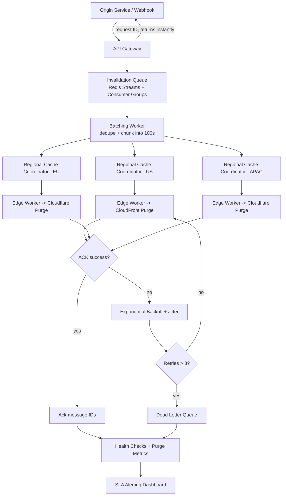

| Difficulty | Channel | Tags |
|---|---|---|
| intermediate | system-design | edge, caching, purging |

A breaking news headline goes live, a flash sale slashes prices, and a live event score changes — all in the same instant across every cache node on Earth. If a single edge location keeps serving a stale asset for even a few seconds, customers see the wrong price or an outdated headline. Fastly learned this lesson at global scale, engineering a purge system that completes worldwide in about 150ms and has scaled from a few thousand purges per second to roughly 60,000 today [1].

---

> ### Real-World Case — Fastly
>
> Fastly operates a global CDN where breaking news, live event updates, and e-commerce promotions require content to be invalidated almost instantly across every cache node. A stale asset served for even a few seconds can mean customers see wrong prices or outdated headlines, so the company needed purge propagation fast enough to be considered 'instant' worldwide.
>
> | | |
> |---|---|
> | **Challenge** | Distribute a single purge request to every Point of Presence on the planet within milliseconds while scaling to tens of thousands of purges per second. The obvious centralized-coordinator design introduced a single point of failure, higher latency, and network-outage fragility. The system also had to stay reliable under real-world packet loss ('internet weather') and survive partial network partitions. |
> | **Solution** | Fastly reframed purging as a distributed messaging problem rather than a centralized command-and-control one, building a system called Powderhorn based on the academic 'Bimodal Multicast' algorithm. When a cache server receives a purge, it immediately broadcasts it to all others over UDP with no central coordinator and no acknowledgments (skipping acks cut latency roughly in half). Instead of tracking where content is cached, they broadcast the purge everywhere, since all nodes are equally capable of serving traffic. Over a decade they iterated: hierarchical rebroadcast (send to one node per POP which then fans out locally), 'double-delivery' to at least two healthy nodes per POP for loss resistance, and finally true batch purging instead of slicing batches into individual purges. |
> | **Outcome** | Global purge completes in about 150ms (P50), with copies starting to purge within ~5ms and nearly always finishing within 250ms — close to the ~65ms theoretical speed-of-light floor. Purge throughput scaled from 2,000-3,000 purges/sec in 2018 to roughly 60,000 purges/sec by 2025, and the team is now confident it can handle hundreds of thousands per second, with a target of millions. The system even recovered all purge messages during an attack that made a customer's network unreachable for ~8 minutes. |
> | **Lesson** | Redundant, broadcast-everywhere messaging with no acknowledgments can be faster and more robust than precisely tracking content locations through a central coordinator; accepting apparent inefficiency buys simplicity, scale, and resilience. The hardest part of 'instant purge' isn't the purge logic but reliably propagating the invalidation signal through unreliable global networks. |

---

## Hook — The Sixty-Millisecond Deadline Nobody Talks About

Picture this: your CDN has 300 points of presence spread across every continent, and you have just published a corrected price for a popular product. The correct bytes are sitting in an origin server in Virginia. Your job is to make every single edge node stop serving the old price — simultaneously, in under five seconds, without melting your API quota. Now multiply that by 10,000 invalidations per second during a flash sale. This is not a hypothetical scaling exercise; it is a daily reality for content delivery networks, and the theoretical floor for a signal to cross the planet is roughly 65 milliseconds [1]. Fastly's instant purge system gets close, finishing global purges in about 150ms at P50, with copies starting to purge within roughly 5ms [1]. That number is not a marketing claim — it is the result of more than a decade of architectural decisions that most engineers never see. The question is: what would it take for you to build the same guarantees?

## Problem — Why Cache Invalidation Is Genuinely Hard

Cache invalidation has a reputation for a reason. It is one of the two hard problems in computer science, and the joke lands because invalidation couples together everything that is normally decoupled: consistency, latency, availability, and cost.

Start with the physics. A purge request has to reach every edge location that might hold a copy of the object. Those locations are geographically scattered, connected by links with wildly different round-trip times, and occasionally partitioned. Strong global consistency would demand a consensus round across all of them — which would blow past any five-second SLA instantly. So the system must trade strict consistency for bounded eventual consistency.

Then add the throughput problem. Ten thousand invalidations per second is not a gentle trickle; it is a firehose. If each invalidation triggered a separate API call to every CDN provider, you would exhaust rate limits, pay enormous per-request fees, and create a thundering herd of retries that makes outages worse [3].

Finally, consider the failure modes. Partial failures leave some regions purged and others stale. Network partitions mean a region never receives the message at all. Rate limiting turns a surge into a retry storm. Each of these is a distinct problem with a distinct solution, and naive designs handle none of them.

Many developers think a single TTL is the answer. It is not. A short TTL alone cannot guarantee a five-second bound because clock skew and request timing mean a victim could still receive a cached copy just before expiry [4].

## Real-World Case — Fastly's Instant Purge at Planetary Scale

Fastly did not solve this with a single clever trick. The company evolved its purge pipeline over more than a decade, and the numbers tell the story [1].

In 2018, the system handled roughly 2,000 to 3,000 purges per second. By 2025 that figure had climbed to around 60,000 purges per second, and the team is confident it can absorb hundreds of thousands, with a long-term target of millions [1]. Global purge completion lands at about 150ms at P50, with copies beginning to purge in roughly 5ms and almost always finishing within 250ms — remarkably close to the ~65ms speed-of-light floor [1].

But the most instructive part is not the median latency. It is resilience. During a sustained attack that made one customer's network unreachable for about eight minutes, Fastly recovered every single purge message once connectivity returned [1]. No invalidations were lost. That is the difference between a demo and a production system: the demo is fast on a good day, and the production system is correct on the worst day.

💡 Insight: The headline metric is latency, but the metric that keeps customers is durability. A fast purge that occasionally drops a message is more dangerous than a slightly slower one that never does.

## Deep Dive — Consistency, Batching, and the Cost of Being Right

To reason about this problem, you first have to name your non-functional requirements precisely. In practice they look like this:

- **Latency:** under five seconds for global propagation
- **Throughput:** 10,000 invalidations per second
- **Availability:** 99.99% uptime for the purge control plane
- **Consistency:** bounded eventual consistency with no lost invalidations

The design that satisfies all four rests on a few core ideas. The first is a **distributed invalidation queue**. Redis Streams with consumer groups is a common choice because it supports multiple independent consumers, replay from a given offset, and message acknowledgement [6]. That acknowledgement is what enables recovery: a message is not removed until a worker confirms it was processed.

The second idea is **batching**. Instead of one API call per object, you group invalidations and issue a single call containing up to 100 files [3]. This is where the economics change dramatically — batching can cut provider API costs by roughly 90%, because per-request fees dominate at high volume.

The third idea is **edge compute coordination**. Instead of every central component talking to every edge, regional coordinators (built on platforms such as Cloudflare Workers) fan out invalidations within their region. This shrinks the blast radius of any single coordinator failure and keeps cross-region chatter low.

However, there is a trade-off table worth internalizing:

| Strategy | Latency | Cost | Consistency | When to Use |
|---|---|---|---|---|
| Short TTL only | Unbounded | Low | Weak | Non-critical static assets |
| Single global flush | High | High | Strong-ish | Rare, full-site resets |
| Batched pattern purge | ~5s | Low | Bounded eventual | High-volume dynamic content |
| Per-object immediate purge | ~150ms | Very high | Strong | Premium, price-critical assets |

⚠️ Watch Out: Mixing short TTLs and explicit purges without coordination can create races where an object is re-populated with stale data immediately after a purge. Always invalidate downstream caches in the correct order — edge first, then origin-adjacent caches.

## Workflow — How an Invalidation Travels the Planet

Building on the components above, here is how a purge request actually flows from an API call to every edge node. The diagram below traces the journey.

The process breaks into seven steps:

1. **Ingest.** An origin service (or a signed webhook) submits an invalidation request to the API Gateway. The gateway authenticates it and returns immediately with a request ID — it never blocks on propagation.
2. **Enqueue.** The request is written to the invalidation queue (Redis Streams). Writing to the stream, not to a database, gives you durable storage and replayable offsets [6].
3. **Deduplicate and batch.** A batching worker drains up to 100 related invalidations and collapses duplicates, so a thousand requests for the same path become one purge [3].
4. **Fan out to regions.** The batch is published to regional cache coordinators. Each coordinator owns a slice of the edge map.
5. **Edge execution.** Edge workers (Cloudflare Workers or CloudFront functions) receive the batch and issue provider purge calls with wildcard patterns [2][5].
6. **Acknowledge and retry.** Workers acknowledge message IDs on success. Failures are retried with exponential backoff and jitter, capped at three attempts before routing to a dead-letter queue.
7. **Observe.** Health checks and purge-age metrics feed dashboards, and any message that exceeds the SLA window triggers an alert.

The key insight is that the API Gateway returns before propagation completes. This decouples submission latency from propagation latency, which is exactly what lets the system absorb 10,000 requests per second without back-pressuring clients.

🎯 Key Point: The five-second SLA is a propagation promise, not a submission promise. Design your API to accept and acknowledge instantly, then deliver asynchronously.

## Code Example — A Batched Purge Worker with Backoff

Here is the beating heart of the system: a worker that drains invalidations from the queue, batches them, calls the CDN provider, and retries with exponential backoff and jitter when things go wrong. The pattern below is written in JavaScript because edge runtimes like Cloudflare Workers run JavaScript natively.

```javascript
// Purge worker: drains the invalidation queue, batches, and calls the CDN API.
// Runs inside an edge runtime, so no Node-specific APIs are used.

const MAX_BATCH = 100;          // provider limit per purge call [3]
const MAX_RETRIES = 3;          // cap retries to avoid retry storms
const BASE_DELAY_MS = 50;       // starting backoff for the first retry

export default {
  async queue(batch, env) {
    // Step 1: deduplicate paths within this batch so repeated
    // requests for the same object collapse into a single purge.
    const uniquePaths = [...new Set(batch.messages.map((m) => m.body.path))];

    // Step 2: chunk into provider-friendly slices of 100.
    for (let i = 0; i < uniquePaths.length; i += MAX_BATCH) {
      const files = uniquePaths.slice(i, i + MAX_BATCH);
      await purgeWithRetry(files, env);
    }

    // Step 3: acknowledge every message only after successful purges.
    // Acking first would risk silent data loss on failure.
    batch.ackAll();
  },
};

async function purgeWithRetry(files, env) {
  for (let attempt = 0; attempt <= MAX_RETRIES; attempt++) {
    const res = await fetch(
      `https://api.cloudflare.com/client/v4/zones/${env.ZONE_ID}/purge_cache`,
      {
        method: 'POST',
        headers: {
          Authorization: `Bearer ${env.API_TOKEN}`,
          'Content-Type': 'application/json',
        },
        // Wildcards let one call invalidate a whole prefix.
        body: JSON.stringify({ files }),
      }
    );

    if (res.ok) return; // Success: stop retrying.

    // Rate limited or transient server error: back off and try again.
    if (res.status === 429 || res.status >= 500) {
      const backoff = BASE_DELAY_MS * 2 ** attempt;
      const jitter = Math.random() * BASE_DELAY_MS; // full jitter
      await new Promise((r) => setTimeout(r, backoff + jitter));
      continue;
    }

    // Non-retryable error (auth, bad request): fail fast.
    throw new Error(`Purge failed with status ${res.status}`);
  }
  throw new Error('Exhausted retries; routing batch to dead-letter queue');
}
```

This code embodies three production-hardened decisions. First, deduplication happens before batching, because sending the same path twice wastes quota and increases the chance of hitting rate limits. Second, acknowledgement happens only after successful purges — the inverse of the naive approach — which mirrors how Fastly recovered every message during that eight-minute network outage [1]. Third, retries use exponential backoff with full jitter, which is the standard defense against the synchronized retry storms that turn a small hiccup into a full outage.

You might wonder why the batch is capped at 100. The answer is provider-specific: CloudFront invalidation requests are themselves bounded in size, and staying within that bound keeps each call atomic from the provider's perspective [3]. A larger batch is not faster; it just fails more spectacularly when it fails.

## Lessons Learned — What Separates a Demo from a Global System

Pulling the threads together, a handful of principles distinguish a purge system that survives Black Friday from one that collapses under it.

**Durability beats raw speed.** Fastly's headline is 150ms, but its real achievement is losing zero purge messages during an eight-minute partition [1]. Queue-based, acknowledgement-based designs are what make that possible — a message survives a worker crash because it was never acknowledged [6].

**Batch aggressively, but respect provider limits.** Deduplication and chunking cut costs by up to 90% and keep each call atomic [3]. Never let a batch grow so large that a single failure invalidates thousands of successful purges.

**Back off with jitter, always.** Exponential backoff without jitter synchronizes retries across thousands of workers, creating a second surge exactly when the provider is weakest. Full jitter desynchronizes them.

**Accept asynchronously, propagate asynchronously.** Clients should get a request ID in milliseconds; the five-second SLA applies to propagation, not submission.

**Design for partial failure from day one.** Regional rollback, circuit breakers after five consecutive failures, and a dead-letter queue for manual review are not nice-to-haves — they are the difference between a degraded region and a global incident [2].

🔥 Hot Take: If your purge system has never lost a message, it is probably because it has never been tested under a real partition. Build the reconciliation path before you need it, not after.

So what should you do differently tomorrow? Start by instrumenting your current purge latency at P50, P95, and P99 — not just the average. Then add idempotent batching and a durable queue in front of your provider calls. Finally, write a chaos test that drops messages and verifies your reconciliation recovers them. The teams that ship global content at planetary speed are not lucky; they are prepared for the day the network breaks.

---

## Global Invalidation Flow



<details>
<summary><strong>Original Interview Question</strong></summary>

**Q:** How would you design a multi-region CDN cache purging system that guarantees content propagation within 5 seconds while handling 10,000 concurrent invalidations per second?

**A:** Implement Cloudflare API + AWS CloudFront with distributed invalidation queue, edge compute coordination, and 2-second TTL. Use batch invalidation, exponential backoff, and regional cache headers for 5-second SLA.

</details>

## Conclusion

The journey from a naive per-object purge to a durable, batched, global invalidation pipeline is exactly the journey Fastly walked over more than a decade — from a few thousand purges per second to 60,000, and from best-effort propagation to recovering every message across an eight-minute outage [1]. The lesson is not that you need Fastly's scale; it is that the same principles scale down. Batch aggressively, acknowledge last, back off with jitter, and design for partitions before they happen. Start tomorrow by measuring your purge latency at P99, not the average, and by writing one chaos test that drops a message and proves your reconciliation recovers it. The teams that serve the world's content at planetary speed are not lucky — they simply prepared for the day the network broke.

---

## References

1. [Fastly incident report](https://www.fastly.com/blog/over-a-decade-later-evolution-of-instant-purge) — article
2. [AWS CloudFront — Invalidating files](https://docs.aws.amazon.com/AmazonCloudFront/latest/DeveloperGuide/Invalidation.html) — documentation
3. [AWS CloudFront — Invalidation limits and batching](https://docs.aws.amazon.com/AmazonCloudFront/latest/DeveloperGuide/Invalidation.html#InvalidationLimits) — documentation
4. [MDN — HTTP caching](https://developer.mozilla.org/en-US/docs/Web/HTTP/Caching) — documentation
5. [Wikipedia — Content delivery network](https://en.wikipedia.org/wiki/Content_delivery_network) — documentation
6. [Redis — Source repository (Streams and consumer groups)](https://github.com/redis/redis) — documentation
7. [RFC 7234 — Hypertext Transfer Protocol (HTTP/1.1): Caching](https://datatracker.ietf.org/doc/html/rfc7234) — paper
8. [Wikipedia — Cache invalidation](https://en.wikipedia.org/wiki/Cache_invalidation) — documentation
9. [Wikipedia — Exponential backoff](https://en.wikipedia.org/wiki/Exponential_backoff) — documentation
10. [DigitalOcean — How To Optimize and Cache Content with a CDN](https://www.digitalocean.com/community/tutorials/how-to-optimize-and-cache-content-with-a-cdn) — blog

---

**Author:** Satishkumar Dhule — [GitHub](https://github.com/satishkumar-dhule) · [LinkedIn](https://linkedin.com/in/satishkumar-dhule) · [Website](https://satishkumar-dhule.github.io)
