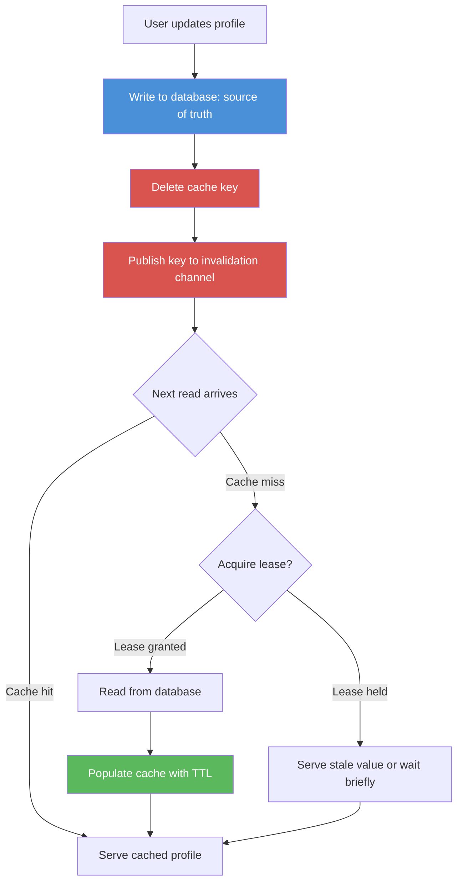

| Difficulty | Channel | Tags |
|---|---|---|
| beginner | backend | redis, memcached, cache-invalidation |

Most developers think of a cache as a speed boost bolted onto a database — a nice-to-have layer that makes reads fast. Then Meta's engineers discovered something unsettling: their Memcached tier had quietly morphed into the de-facto primary datastore, holding trillions of items and serving billions of requests per second for over a billion users [1]. When a cache carries that much traffic, a single stale key or an invalidation race stops being a performance footnote and becomes an outage waiting to happen. This is the story of how modern teams learned to invalidate caches without breaking the systems that depend on them.

---

> ### Real-World Case — Meta (Facebook)
>
> Facebook's social graph is extremely read-heavy, with users' friends, posts, likes, and comments accessed constantly. To serve this at scale they built a distributed key-value cache on top of Memcached holding trillions of items and handling billions of requests per second, making the cache the de-facto primary data store rather than just an optimization.
>
> | | |
> |---|---|
> | **Challenge** | With millions of profile/graph updates happening constantly, they had to keep cached data fresh across multiple front-end clusters and regions. Naive write-invalidate ('delete on DB update') caused two nasty failure modes: 'stale sets' (concurrent reordered writes leaving permanently wrong data in cache) and 'thundering herds' (a hot key being invalidated repeatedly, sending a flood of identical queries to the database). |
> | **Solution** | Facebook extended Memcached with a mechanism called 'leases.' On a cache miss, the server hands the client a 64-bit lease token bound to that key; a set is only accepted if the token is still valid, and a delete invalidates outstanding tokens, preventing stale sets. Throttling leases (one token per key per ~10s) also arbitrates concurrent misses so only one client queries the database while others wait and retry — directly mitigating thundering herds. They preferred deletes over sets for invalidation and pushed consistency logic into the client. |
> | **Outcome** | Leases cut the peak database query rate for thundering-herd-prone keys from 17K/s to 1.3K/s, and reduced stale sets from 6% to 0.3% of requests without hurting the hit rate. The system scaled to trillions of cached items and billions of requests per second serving over a billion users. |
> | **Lesson** | Cache invalidation at scale is far subtler than 'delete the key on update' — races between concurrent reads/writes and hot-key invalidations require server-side coordination (leases) to guarantee correctness while protecting the database. It also shows that Memcached's simplicity can be extended with client-side and protocol-level logic to solve problems Redis would handle out of the box. |

---

## Hook — The Night the Cache Answered a Question Nobody Asked

Picture a user profile page that renders a friend's name from memory in under a millisecond. Now picture that same page confidently serving a name the user deleted six hours ago. Nothing is down, no metric is red, and yet the data is wrong — and wrong data at scale is often worse than no data at all. Cache invalidation has earned its reputation as one of the two hard problems in computer science precisely because it fails silently [2]. The system stays fast, the dashboards stay green, and the bug hides in plain sight until a customer notices a stale avatar, a revoked permission, or a deleted comment that refuses to die.

## Problem — Why a Fast Cache Is a Dangerous One

The core tension is simple to state and brutal to solve: a cache exists to avoid reading the source of truth, but the moment the source of truth changes, every cached copy becomes a liability [3].

Consider a user profile service. Reads vastly outnumber writes — often hundreds to one — so caching is an obvious win. But every profile update must reconcile three moving parts: the database row, the cache entry, and every in-flight request that may be reading the old value right now. Get the ordering wrong and you get classic failure modes:

- **Stale reads**: an update writes the database but the cache keeps serving the old value until TTL expiry.
- **Lost updates**: a slow read repopulates the cache with data older than a concurrent write.
- **Thundering herd**: a popular key expires and thousands of requests stampede the database at once [5].
- **Split brain across nodes**: a key is invalidated on one cache server while replicas still hold the stale copy.

Sound familiar? Most teams hit at least three of these in production. The question is not whether you need invalidation — it is whether your invalidation strategy survives the moment traffic spikes and clocks disagree.

## Real-World Case — Meta (Facebook) Turns Memcached into a Real Datastore

Meta did not set out to build a database out of Memcached. The company's social graph — friends, posts, likes, comments — is relentlessly read-heavy, so teams built a distributed key-value cache on top of Memcached to absorb the load. Then something surprising happened: the cache grew to hold trillions of items and handle billions of requests per second, becoming the de-facto primary data store rather than a mere optimization [1].

The engineering team documented this at NSDI '13. The headline problem was the thundering herd: when a hot key expired, a flood of requests would all miss at once and slam the underlying databases. Their fix was the **lease** mechanism — instead of blindly refetching on a miss, the cache hands out a short-lived lease token to a single request and forces the rest to wait or serve a slightly stale value. The results were dramatic: peak database query rate for thundering-herd-prone keys dropped from roughly 17K/s to 1.3K/s, and stale sets fell from 6% to 0.3% of requests — all without sacrificing the hit rate [1].

💡 **Insight**: Meta didn't just make Memcached faster. They added coordination logic on top to make invalidation *safe*, proving that the cache layer is where correctness lives.

## Deep Dive — Redis vs. Memcached and the Real Trade-offs

Building on Meta's experience, the natural question becomes: which cache engine do you build on? Memcached and Redis both speak simple key-value semantics, but they diverge sharply the moment invalidation and durability enter the picture [4][6].

| Dimension | Redis | Memcached |
|---|---|---|
| **Invalidation** | Built-in pub/sub lets every node react to a key change automatically [4] | No native broadcast — you must fan out invalidation yourself |
| **Persistence** | Optional RDB snapshots and AOF logs survive restarts [7] | In-memory only; a restart means an empty cache |
| **Data structures** | Strings, hashes, sets, sorted sets, streams | Strings and opaque blobs only |
| **Memory overhead** | Higher per-key due to metadata | Lower and more predictable |
| **Scaling model** | Cluster with sharding + replication | Simple horizontal sharding across nodes |
| **Best fit** | Complex invalidation, durability, rich operations | Pure high-throughput caching where memory is king |

The trade-off is not "which is faster." For raw GET/SET throughput, Memcached is lean and predictable. The trade-off is **coordination**: Redis gives you pub/sub so a single profile update can delete the key everywhere at once, whereas Memcached forces you to build that fan-out yourself [4]. Consistent hashing determines which node owns a key, and any invalidation scheme has to respect that ownership or risk missing the replica holding the stale copy [6].

⚠️ **Watch Out**: Deleting a key is not the same as updating it. A "delete on write" policy is safer than "overwrite on write" because overwriting can race with a concurrent read that repopulates the cache with older data — a subtle bug that shows up only under load.

## Workflow — A Write-Through + Invalidate Pipeline

So how do you stitch this together safely? The pattern that scales is **write-through on the database, invalidate on write, cache-aside on read**, with a lease-style guard against stampedes [1][3].

The flow looks like this:

1. **Write to the source of truth first.** Persist the profile change to the database. The database is canonical; the cache is disposable.
2. **Delete the cache key.** Deletion, not overwrite, avoids the stale-read race described above.
3. **Fan out invalidation.** In Redis, publish the key to a pub/sub channel so every app node drops its local awareness [4]. In Memcached, emit the same event through your own message bus.
4. **On the next read, use cache-aside.** Try the cache; on a miss, read the database and repopulate with a bounded TTL [8].
5. **Guard hot keys with a lease.** Let one request refill while others briefly serve stale data or wait, collapsing the thundering herd [5].
6. **Cap staleness with TTL.** A 5–30 minute TTL is a safety net, not the primary strategy — it bounds how long a missed invalidation can hurt [8].

The diagram below tells the visual story of this read/write split.

After this flow is in place, the cache stops being a passive optimization and becomes a coordinated participant in correctness — which is exactly the leap Meta made.

## Code Example — Write-Through Invalidation in Python

Theory is cheap; the race conditions are in the details. The snippet below implements the workflow in Python using Redis, with a defensive delete-on-write, TTL-based expiry, and a lightweight lease to collapse thundering herds [1][4].

```python
import json
import time
import redis

CACHE_TTL_SECONDS = 900          # 15 minutes: bounds worst-case staleness
LEASE_SECONDS = 5                # how long a refill lease is held
PROFILE_PREFIX = "profile:"

r = redis.Redis(host="cache.internal", port=6379, decode_responses=True)

def _key(user_id: str) -> str:
    return f"{PROFILE_PREFIX}{user_id}"

def get_profile(db, user_id: str):
    key = _key(user_id)
    cached = r.get(key)
    if cached is not None:
        return json.loads(cached)          # fast path: serve from cache

    # Thundering-herd guard: only one request may rebuild the key.
    lease_key = f"lease:{key}"
    got_lease = r.set(lease_key, "1", nx=True, ex=LEASE_SECONDS)
    if not got_lease:
        time.sleep(0.02)
        cached = r.get(key)                # maybe the leaseholder finished
        if cached is not None:
            return json.loads(cached)

    profile = db.fetch_profile(user_id)    # source of truth
    r.set(key, json.dumps(profile), ex=CACHE_TTL_SECONDS)
    r.delete(lease_key)                    # release the lease
    return profile

def update_profile(db, user_id: str, patch: dict):
    key = _key(user_id)
    db.update_profile(user_id, patch)      # 1. persist to the database first
    r.delete(key)                          # 2. invalidate, do NOT overwrite
    r.publish("profile-invalidations", key)  # 3. tell every node to drop it
```

**Why these choices matter.** Writing to the database before touching the cache keeps the source of truth ahead of any read. Deleting rather than overwriting the key sidesteps the classic race where a slow read repopulates stale data after a write [3]. The `nx=True` lease flag borrows Meta's idea directly: on a cache miss, exactly one caller rebuilds the value while everyone else either gets the fresh copy or waits briefly, which is what drove their database query rate down by an order of magnitude [1]. Finally, `r.publish` is what makes invalidation *distributed* — every node subscribed to `profile-invalidations` can drop any local copy, a coordination primitive Memcached simply does not provide [4]. If you migrate this to Memcached, you would replace the `publish` call with your own message bus and carry the same key-deletion semantics across shards [6].

## Lessons Learned — What to Do Differently Tomorrow

The journey from "add a cache for speed" to "treat the cache as a correctness-critical system" is the same one Meta walked years ago [1]. Here is the payoff, distilled.

- **Delete, don't overwrite.** Overwriting a cache key invites races with concurrent reads. A delete forces the next read to fetch fresh data [3].
- **Write the database first, always.** The cache is disposable; the database is canonical. Ordering writes this way makes recovery trivial.
- **TTL is a safety net, not a strategy.** A 5–30 minute TTL bounds the damage of a missed invalidation but should never be your primary mechanism [8].
- **Choose your engine for coordination, not raw speed.** Redis's pub/sub [4] makes distributed invalidation dramatically simpler than hand-rolling it on Memcached [6].
- **Assume you will be stampeded.** Leases collapse thundering herds — Meta cut peak database queries by ~92% on hot keys using exactly this idea [1][5].
- **Measure hit rate AND staleness.** A 99% hit rate is useless if 1% of served values are wrong [1].

If there is one insight to bring back to your team, it is this: **a cache with weak invalidation is not an optimization, it is a future outage that runs fast until it doesn't.** Design the invalidation path with the same care you give the read path, and your cache will earn its keep without ever lying to your users.

---

## Write-Through Invalidation and Read Flow



<details>
<summary><strong>Original Interview Question</strong></summary>

**Q:** You're building a user profile service that caches frequently accessed profiles. How would you implement cache invalidation when a user updates their profile, and what trade-offs would you consider between Redis and Memcached?

**A:** Implement write-through caching with TTL-based expiration. On profile update, invalidate the cache by deleting the key and writing new data to both the database and cache. Redis offers pub/sub for automatic distributed invalidation, while Memcached requires manual coordination across nodes.

</details>

## Conclusion

The cache-invalidation story ends where it began: with a system that must tell the truth, fast. Meta learned the hard way that once a cache carries trillions of items and billions of requests per second, it is no longer an optimization — it is infrastructure that demands coordination [1]. You do not need Meta's scale to apply the same lesson. Delete instead of overwrite, write the database first, use TTLs as a safety net, pick an engine based on how it helps you coordinate invalidation, and guard hot keys with leases before the herd finds them. Do that tomorrow, and your cache becomes a quiet asset instead of a loud incident. The memorable takeaway to share with your team: a cache is only as good as the invalidation that keeps it honest.

---

## References

1. [Meta (Facebook) incident report](https://www.usenix.org/conference/nsdi13/technical-sessions/presentation/nishtala) — paper
2. [Cache invalidation — Wikipedia](https://en.wikipedia.org/wiki/Cache_invalidation) — documentation
3. [Cache (computing) — Wikipedia](https://en.wikipedia.org/wiki/Cache_(computing)) — documentation
4. [Redis Pub/Sub documentation](https://redis.io/docs/latest/commands/subscribe/) — documentation
5. [Thundering herd problem — Wikipedia](https://en.wikipedia.org/wiki/Thundering_herd_problem) — documentation
6. [Consistent hashing — Wikipedia](https://en.wikipedia.org/wiki/Consistent_hashing) — documentation
7. [Redis persistence documentation](https://redis.io/docs/latest/operate/oss_and_stack/management/persistence/) — documentation
8. [Time to live (TTL) — Wikipedia](https://en.wikipedia.org/wiki/Time_to_live) — documentation
9. [Memcached — Wikipedia](https://en.wikipedia.org/wiki/Memcached) — documentation
10. [Redis — Wikipedia](https://en.wikipedia.org/wiki/Redis) — documentation

---

**Author:** Satishkumar Dhule — [GitHub](https://github.com/satishkumar-dhule) · [LinkedIn](https://linkedin.com/in/satishkumar-dhule) · [Website](https://satishkumar-dhule.github.io)
