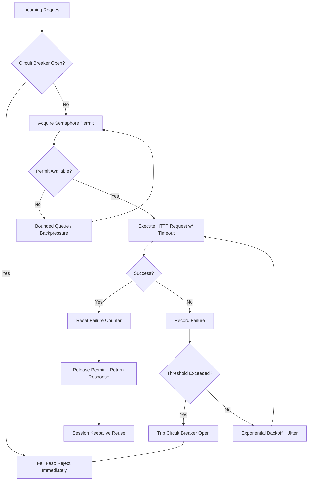

| Difficulty | Channel | Tags |
|---|---|---|
| advanced | backend | asyncio, aiohttp, concurrency |

Imagine a fleet of Python asyncio pods humming along at 70 million requests per second for over a billion weekly users — and then, one day, a subset of them simply refuses to recover. That is exactly what happened to OpenAI's Habitat storage service, which grew to become its second-largest service by core count, spanning roughly 500 petabytes across 40 regions [1]. Here is the twist: when a burst of traffic hit, some pods began serving 5-10x the concurrent requests of the average pod, and they kept degrading even after the offending client was stopped — only a full restart cleared them [1]. That haunting detail is the entire reason connection pool management is not a footnote in your aiohttp codebase; it is the difference between a system that bends and one that breaks.

---

> ### Real-World Case — OpenAI
>
> OpenAI's Habitat storage service grew to be its second-largest service by core count, handling 70 million requests per second (~500 PB, ~40 regions) for over a billion weekly ChatGPT users after three years of 10x growth. During a burst of requests, a subset of Python/asyncio pods began serving 5-10x the concurrent requests of the average pod and kept degrading even after the offending client was stopped — only a restart cleared it.
>
> | | |
> |---|---|
> | **Challenge** | A self-reinforcing metastable failure in the client-side connection pool: aiohttp's TCPConnector defaults to LIFO connection reuse, so the most recently returned connection is handed to the next request. Slower, already-overloaded pods returned their connections later, making those connections the most recently available and therefore selected most frequently — feeding more traffic back onto the pods least able to handle it. |
> | **Solution** | OpenAI diagnosed the issue by capping max connection reuse duration (which limited the degradation and confirmed the hypothesis), then patched the connection pool to use FIFO reuse instead of LIFO, breaking the feedback loop. They later moved to Istio/Envoy for centralized connection pooling, server-load-aware balancing, HTTP/2 multiplexing, rate limits, and circuit breakers to avoid the problem class entirely. |
> | **Outcome** | Switching to FIFO broke the connection-reuse feedback loop and also reduced steady-state request variance. The service now sustains 70M+ requests per second for 1B+ weekly users across ~40 regions. A later Rust rewrite (by 2 engineers) serving 95% of traffic delivered 6x CPU and 15x memory efficiency gains; the pool fix was applied before that migration. |
> | **Lesson** | Your connection pool's reuse order is a load-balancing policy whether you think about it or not. The same LIFO default that is optimal for connection-lifetime management is pathological for load distribution — and nothing in the API warns you. Under partial degradation it can produce a metastable failure where removing the original trigger does not restore health. Chaos-test with one deliberately slowed replica: if traffic concentrates on it instead of shedding away, you have the bug. |

---

## Hook — The Pool That Kept Getting Sicker

The deploy looked fine. The dashboards were green for hours. Then a client traffic spike rolled in, and something strange began to unfold across a subset of pods. Instead of shedding load, they hoarded it. Each of these unlucky pods started serving 5-10x the concurrent requests of the average pod, and once they crossed that threshold, they never came back down on their own [1]. Engineers stopped the offending client, expecting the fleet to breathe again. It did not. The only thing that cleared the degradation was a hard restart. Sound familiar? This is the nightmare scenario every team running asyncio at scale eventually brushes against: a system that develops a feedback loop where pressure creates more pressure. The stakes could not be higher — OpenAI's Habitat was handling 70 million requests per second for more than a billion weekly users [1]. When your connection pool misbehaves at that altitude, there is no hiding behind a cache or a CDN. You fix the pool, or you page the whole company.

## Problem — Why Naive Concurrency Quietly Turns Against You

Here is the thing though: a semaphore is supposed to protect you, not haunt you. The appeal of `asyncio.Semaphore(max_connections)` is obvious — cap the number of concurrent connections and downstream services stay safe. But many developers discover the hard way that a semaphore only limits *concurrency*; it says nothing about *latency*, *retries*, or *health*. When a downstream slows down, requests pile up waiting on permits, and every retry re-enters the same queue, amplifying the very congestion you were trying to prevent. This is the connection-reuse feedback loop: a slow response holds a connection longer, which starves other callers, which triggers retries, which starves the pool further [1]. Consequently, the pool becomes a magnifier of failure rather than a buffer against it. The problem has three faces. First, throughput collapses non-linearly as utilization approaches saturation — this is Little's Law catching up with you, where latency directly drives the number of in-flight requests [8]. Second, timeout handling is deceptively easy to get wrong: a total timeout that is too generous lets zombies accumulate, while one that is too aggressive guarantees retry storms. Third, and most insidious, there is no memory of failure. Without a circuit breaker, a caller will keep hammering a service that is already down, turning a partial outage into a total one. If this feels overwhelming, you are not alone — even teams operating at the frontier of scale have been bitten by exactly this [1].

## Real-World Case — OpenAI's Habitat and the 5-10x Pod Overload

OpenAI's Habitat storage service is the cautionary tale that makes this concrete. Over three years, it grew roughly 10x to serve more than a billion weekly ChatGPT users, reaching roughly 70 million requests per second, about 500 petabytes of data, and nearly 40 regions — making it the company's second-largest service by core count at the time [1]. The architecture leaned on Python and asyncio, with connection pools whose reuse behavior was, by design, cheap and elegant. Then came the burst. A subset of pods started accepting 5-10x the concurrent requests of the average pod, and their health kept sliding even after the misbehaving client was stopped [1]. The fix reads like a plot twist: switching to a first-in, first-out (FIFO) request ordering broke the connection-reuse feedback loop, and as a bonus it reduced steady-state request variance across the fleet [1]. In other words, the ordering policy — not the pool size, not a magic number — was the villain. The impact of solving it was enormous: Habitat went on to sustain 70M+ requests per second for 1B+ weekly users across ~40 regions, and a later Rust rewrite serving 95% of traffic delivered 6x CPU and 15x memory efficiency gains [1]. Notice the sequencing: the pool fix came first, and it stabilized the system before the language migration even began. Stability, it turns out, is a prerequisite for performance. Ever wondered why the biggest shops obsess over request ordering? Now you know.

## Deep Dive — The Four Pillars of a Resilient Pool

Building on that story, the lesson is that resilience is not one technique; it is a set of interlocking mechanisms, each solving a distinct failure mode. The first pillar is bounded concurrency via a semaphore, which protects downstream capacity [6]. The second is exponential backoff with jitter, which spaces out retries so a recovering service is not immediately re-flattened [5]. The third is the circuit breaker, a state machine that trips open after repeated failures, fails fast while open, and probes cautiously in a half-open state [4]. The fourth is deterministic cleanup — closing sessions, releasing permits in `finally` blocks, and shutting down on application exit so connections are not leaked. The real trade-off lives in choosing *what* to bound and *how*. A fixed semaphore is simple but ignores per-host variance. A per-host limiter is fairer but more complex. FIFO ordering, as OpenAI found, reduces variance but can head-of-line-block a fast request behind a slow one if timeouts are not tuned correctly [1]. So the tension is always: fairness versus throughput, and safety versus latency. Here is the counterintuitive part many engineers miss — a *smaller* pool with a *shorter* timeout and an *open* breaker often outperforms a large pool under stress, because it fails fast instead of thrashing. That feels wrong until you watch a big pool melt down. Therefore, the goal is not maximum concurrency; it is maximum *recoverable* concurrency.

## Workflow — How a Request Moves Through the Pool

So how do these pillars come together in the request lifecycle? Picture a request arriving at the pool manager. It first checks the circuit breaker: if the breaker is open, the request is rejected immediately, sparing the downstream and returning control to the caller fast [4]. If the breaker is closed, the request tries to acquire a semaphore permit [6]. If no permit is available, it waits in a bounded queue — and if that queue is full, it is backpressured rather than allowed to grow unbounded; this is where Little's Law warns you that latency is about to spike [8]. Once a permit is granted, the HTTP request executes with an explicit timeout. On success, the failure counter resets and the permit is released. On failure, the manager records the error; if failures cross a threshold within a time window, the breaker trips open [4]. Otherwise, the request is retried with exponential backoff and jitter [5]. The diagram below traces this exact flow, and it is worth studying because the ordering of these checks — breaker first, then semaphore, then timeout — is what prevents cascade failures. For example, if you acquire the semaphore *before* checking the breaker, a tripped breaker still burns permits, and that is precisely the kind of subtle inversion that turns a safeguard into a bottleneck. ⚠️ Watch Out: this ordering is not cosmetic; it is load-bearing.

## Code Example — A Production-Grade Connection Pool Manager

This leads to the implementation. The class below combines bounded concurrency, a three-state circuit breaker, and exponential backoff with jitter into a single manager. Notice how the circuit breaker check happens *before* the semaphore is acquired — that ordering is what makes degradation graceful. Also notice the `finally` block guaranteeing permit release and the explicit `close()` method for clean shutdown, both of which prevent the connection leaks that plague long-running asyncio services. The retry loop doubles the delay on each attempt and adds jitter so that many callers do not synchronize their retries into a thundering herd. Every line earns its place: the timeout bounds worst-case latency, the breaker bounds repeated pain, and the semaphore bounds resource usage. 💡 Insight: the smallest change with the biggest safety payoff is almost always adding the breaker *before* the concurrency gate, not enlarging the gate.

## Lessons Learned — What to Do Differently Tomorrow

Stepping back, the journey from OpenAI's ailing pods to a stable 70M requests/second service yields a handful of transferable lessons [1]. First, ordering matters more than sizing: FIFO request handling broke the feedback loop, which means the *policy* between your gates can matter more than the gates themselves [1]. Second, bound everything — concurrency, queue depth, retries, and timeouts — because an unbounded system is a delayed outage. Third, check the breaker before you spend a permit, or your safety mechanism becomes the bottleneck. Fourth, always release resources in `finally` and shut down sessions explicitly; leaked connections are silent killers. Fifth, measure variance, not just averages, since OpenAI's fix reduced steady-state request variance as a bonus [1]. Here is the memorable insight to bring back to your team: a resilient pool is not the one that accepts the most requests — it is the one that knows when to say no. Do that, and you will spend your nights sleeping instead of restarting pods. 🎯 Key Point: graceful degradation is a design decision you make before the incident, not a debugging skill you develop during it.

---

## Connection Pool Request Lifecycle

<strong>Original Interview Question</strong>

**Q:** How would you implement a connection pool manager for aiohttp that handles graceful degradation under high load and connection timeouts?

**A:** Implement a connection pool manager for aiohttp using a semaphore to limit concurrent connections, exponential backoff for retrying failed requests, and circuit breaker pattern to gracefully degrade under high load and connection timeouts.

## Conclusion

The story of OpenAI's Habitat is a reminder that scale does not forgive silent design flaws — it exposes them [1]. A connection pool that does not know when to say no will eventually say yes to its own collapse. So what should you do tomorrow? Audit your pool for four things: bounded concurrency, timeouts on every call, a circuit breaker checked before you spend a permit, and deterministic cleanup in `finally` blocks. Then measure variance, not just averages, and consider whether request ordering — the very lever OpenAI pulled — is quietly working against you [1]. The one insight worth sharing with your team: resilience is not about surviving peak load; it is about recovering from it without a restart.

---

## References

1. [OpenAI incident report](https://openai.com/index/scaling-storage-one-billion-users-part-one/) — article
2. [Python asyncio Documentation](https://docs.python.org/3/library/asyncio.html) — documentation
3. [aiohttp GitHub Repository](https://github.com/aio-libs/aiohttp) — documentation
4. [Circuit Breaker Design Pattern](https://en.wikipedia.org/wiki/Circuit_breaker_design_pattern) — documentation
5. [Exponential Backoff](https://en.wikipedia.org/wiki/Exponential_backoff) — documentation
6. [Synchronization Primitives — asyncio.Semaphore](https://docs.python.org/3/library/asyncio-sync.html) — documentation
7. [Introducing Asynchronous JavaScript](https://developer.mozilla.org/en-US/docs/Learn_web_development/Extensions/Async_JS/Introducing) — documentation
8. [Little's Law](https://en.wikipedia.org/wiki/Little%27s_law) — documentation
9. [RFC 7540: HTTP/2](https://datatracker.ietf.org/doc/html/rfc7540) — documentation

---

**Author:** Satishkumar Dhule — [GitHub](https://github.com/satishkumar-dhule) · [LinkedIn](https://linkedin.com/in/satishkumar-dhule) · [Website](https://satishkumar-dhule.github.io)
