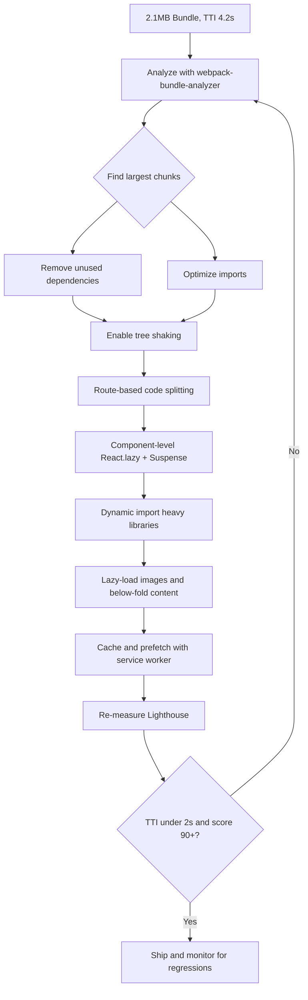

| Difficulty | Channel | Tags |
|---|---|---|
| intermediate | frontend | lighthouse, bundle, lazy-loading |

Picture a developer in 2017 watching a simulated 3G connection crawl through Twitter Lite's main JavaScript bundle — over five agonizing seconds before the app became usable. Twitter had built a modern React Progressive Web App for the roughly 80% of its users on mobile networks, yet three giant JavaScript assets totaling more than 1MB stood between those users and a single tweet [1]. That gap between a modern stack and a fast experience is exactly where bundle optimization lives, and it is the same wall you will hit when Lighthouse hands you a 65 and Time to Interactive reads 4.2 seconds.

---

> ### Real-World Case — Twitter (Twitter Lite PWA)
>
> In 2016-2017 Twitter built Twitter Lite, a React-based Progressive Web App, to deliver a usable experience over 2G/3G networks to the ~80% of its users on mobile. Despite using a modern stack, the app shipped as only 3 giant JavaScript assets totaling over 1MB (420KB gzipped), and the main bundle took more than 5 seconds just to load on a simulated 3G connection—a serious bottleneck for time-to-interactive.
>
> | | |
> |---|---|
> | **Challenge** | The monolithic bundle meant every user downloaded and parsed the entire app before seeing anything, even though they only needed the code for the visible screen. The team also fought Webpack's CommonsChunkPlugin, which interacted badly with circular code dependencies, blocking granular splitting. |
> | **Solution** | They split code by routes into separate chunks using Webpack's CommonsChunkPlugin (later SplitChunksPlugin), producing roughly 40 on-demand chunks lazy-loaded with the PRPL (Push, Render, Pre-cache, Lazy-load) pattern. Critical shared code (runtime, vendor, shared, main, i18n) was grouped into baseline chunks while page- and view-specific code stayed separate, combined with service worker pre-caching and aggressively optimized images. |
> | **Outcome** | Main bundle load time on simulated 3G dropped from over 5 seconds to about 3 seconds, and Time to Interactive as measured by Lighthouse was cut to almost half its previous value. Across Twitter Lite overall, users saw a 50% reduction in 99th-percentile TTI and a 30% reduction in average load time for logged-in users, alongside 65% more pages per session, 75% more Tweets sent, and a 20% lower bounce rate. |
> | **Lesson** | Code splitting trades total application size for perceived performance: Twitter Lite actually got bigger overall, but spreading code across 40 on-demand chunks amortized over a session made first load and interaction dramatically faster. Bundle size and perceived speed are not the same metric—optimize what the user waits on first. |

---

## Hook — The 4.2-Second Silence

You have felt it. You ship a React app, run Lighthouse, and the score comes back at 65. The bundle weighs 2.1MB, Time to Interactive sits at 4.2 seconds, and somewhere a product manager is asking why the app 'feels slow' on a mid-tier Android phone. Here is the uncomfortable truth: your code probably is not slow. Your *shipping strategy* is. Every dependency you import — even the one function you actually call — can drag kilobytes of code the browser must download, parse, and execute before a single pixel responds to a tap. The stakes are concrete: on slow networks, every extra second of interactivity costs users, sessions, and revenue. Twitter discovered this at planetary scale, and the fix they applied is the same playbook available to any team willing to treat the bundle as a first-class product.

## Problem — Why Modern React Apps Get Bloated

The core problem is that bundlers are generous by default. When you write `import { debounce } from 'lodash'` without proper ES module configuration, you may pull in the entire lodash library rather than one function. When you import a charting library at the top of your app, the browser downloads charting code before the login screen even paints. Three forces compound the damage:

- **Monolithic chunks** — everything lands in one or two bundles, so the initial load carries code for routes the user may never visit.
- **Weak tree shaking** — CommonJS dependencies and side effects prevent dead-code elimination, leaving unused branches in the output [2].
- **Eager third-party libraries** — analytics, date pickers, rich-text editors, and map SDKs all load up front, even when they sit behind a click.

The consequence is a bundle that grows faster than your feature list, and a Time to Interactive metric that quietly drifts from 2s to 4s to worse. Many developers assume a slow Lighthouse score means they need to rewrite components. More often, they need to change *when* and *how* code reaches the browser. This is precisely the gap between a bundle of 2.1MB and a target score of 90+.

## Real-World Case — Twitter Lite's Bundle Reckoning

Twitter Lite is the canonical case study for bundle discipline. In 2016–2017, Twitter built a React-based Progressive Web App to deliver a usable experience over 2G and 3G networks to the approximately 80% of its user base on mobile [1]. The app was modern by every measure — React, a service worker, a thoughtfully designed interface — yet it shipped as only three giant JavaScript assets totaling more than 1MB (roughly 420KB gzipped). On a simulated 3G connection, the main bundle alone took over five seconds to load, a brutal bottleneck for interactivity [1].

The engineering team's response was not a rewrite; it was a systematic attack on bundle composition and delivery. They split assets, deferred non-critical code, and let the browser fetch what a given screen actually needed. The results were dramatic: main bundle load time on simulated 3G dropped from over five seconds to about three seconds, and Lighthouse Time to Interactive was cut to almost half [1]. Across Twitter Lite overall, the team reported a 50% reduction in 99th-percentile TTI and a 30% reduction in average load time for logged-in users — alongside 65% more pages per session, 75% more Tweets sent, and a 20% lower bounce rate [1].

The lesson is uncomfortable and liberating at once: the biggest performance wins rarely come from cleverer algorithms. They come from shipping less code, later.

## Deep Dive — Code Splitting, Tree Shaking, and the Trade-offs Nobody Mentions

Before reaching for tools, it helps to understand the mechanisms. Code splitting breaks a single bundle into multiple chunks that the browser can load on demand [3]. React surfaces this through `React.lazy()` and `Suspense`, which let you define a component whose code is fetched only when it renders [2]. Meanwhile, tree shaking is the process of eliminating unused exports, and it works reliably only when your dependency graph uses static ES module syntax with no side effects [4].

Here is where the nuance bites. Code splitting is not free — each chunk introduces an extra network round trip, and over-splitting can make navigation feel *slower* than one warm bundle. Tree shaking is not automatic — it depends on how a library is published, and a single `require()` or side-effectful import can defeat it. And dynamic imports add a loading state you must handle with a meaningful fallback, or users see a blank flash [5].

| Strategy | Best For | Real Trade-off |
|---|---|---|
| Route-based splitting | Multi-page apps, dashboards | Slight delay on first navigation to each route |
| Component-based splitting | Heavy widgets (charts, editors) | Needs error boundaries + loading fallbacks |
| Dynamic third-party imports | Maps, analytics, payments | Must handle failure and retries gracefully |
| Tree shaking | Every app with ES modules | Breaks silently with CommonJS or side effects [4] |

The mental model to carry: split along *user intent*, not file boundaries. A user who lands on the dashboard should never download the analytics bundle. That single principle drove Twitter Lite's biggest wins.

## Workflow — From 65 to 90+ in Seven Steps

Optimization is a loop, not a checklist you run once. The workflow below mirrors how teams move a Lighthouse score from 65 to 90+ while keeping the gains durable. Refer to the flowchart diagram for the full decision path.

1. **Measure first.** Run Lighthouse and record the baseline: bundle size (2.1MB), TTI (4.2s), and the largest chunks. Optimization without measurement is guesswork.
2. **Analyze composition.** Feed your build into tools like webpack-bundle-analyzer to see exactly what is inside the bundle and which dependencies dominate [6].
3. **Remove and replace.** Delete unused dependencies, swap heavyweight libraries for lighter alternatives, and import only the functions you use.
4. **Enable tree shaking.** Ensure ES module output (`sideEffects: false` where valid) so unused code is eliminated at build time [4].
5. **Split by route.** Convert top-level routes to lazy-loaded components so the initial download covers only the landing experience [3].
6. **Defer the heavy stuff.** Dynamic-import charts, editors, maps, and analytics so they arrive on demand, wrapped in `Suspense` with a skeleton fallback [2][5].
7. **Lazy-load media and re-measure.** Defer below-the-fold images [7] and iterate until the metrics stabilize — then repeat the loop, because bundles regrow.

Each pass should make the initial payload smaller and the interactivity sooner. The magic is not any single step; it is the compounding effect of doing all seven consistently.

## Code Example — Route-Based Splitting with Dynamic Imports

The snippet in the codeExample field shows a production-shaped version of the Twitter Lite approach: routes are split so the initial bundle stays lean, a heavy chart widget loads only when needed, and dynamic imports target a third-party analytics library. Notice the use of `Suspense` fallbacks, an error boundary for resilience, and a `webpackChunkName` hint that makes bundle names readable in analysis reports. The `import()` expressions signal to the bundler that these modules should live in separate chunks [5], while the static ES module imports elsewhere let tree shaking do its job [4]. Copy the pattern, replace the placeholders with your real routes, and verify the win in your next Lighthouse run.

## Lessons Learned — What to Do Differently Tomorrow

The Twitter Lite story ends with a transformation: faster loads, more engagement, lower bounce — not because the team wrote smarter algorithms, but because they *shipped less code later* [1]. Here are the takeaways worth carrying into your next sprint.

- **Bundle size is a product metric, not a build detail.** Track it in CI and fail the build when it regresses.
- **Split along user intent.** Route-based splitting is the highest-leverage first move for most apps [3].
- **Tree shaking needs the right conditions.** Audit for CommonJS dependencies and side effects that silently defeat it [4].
- **Always pair dynamic imports with a fallback.** `Suspense` plus an error boundary keeps the UX graceful [2][5].
- **Re-measure or it will regrow.** Every new dependency is a potential regression; the loop never truly ends.

⚠️ **Watch Out:** Chasing a perfect score by over-splitting can add round trips that hurt real-world navigation. Measure with throttled network conditions, mirroring how Twitter Lite tested on simulated 3G [1].

🔥 **Hot Take:** If your bundle is over 1MB gzipped, you do not have a performance problem — you have a packaging problem. Fix the packaging first.

The one memorable insight to share with your team: *speed is not something you add at the end; it is something you refuse to ship in the beginning.*

---

## Bundle Optimization Workflow

<strong>Original Interview Question</strong>

**Q:** You're tasked with improving a React app's Lighthouse performance score from 65 to 90+. The bundle size is 2.1MB and Time to Interactive is 4.2s. What specific steps would you take to optimize the bundle and implement lazy loading?

**A:** Implement code splitting with React.lazy() and Suspense, analyze bundle composition with webpack-bundle-analyzer to identify largest chunks, remove unused dependencies and optimize imports, add dynamic imports for heavy components and third-party libraries, implement route-based splitting for better initial load times, and utilize tree shaking with proper ES module configuration.

## Conclusion

Twitter Lite did not win by rewriting its components — it won by refusing to ship code the user did not need yet [1]. Your 2.1MB bundle and 4.2-second TTI are not a verdict; they are a baseline. Start tomorrow by running webpack-bundle-analyzer, finding the single largest chunk, and splitting one route behind `React.lazy()` and `Suspense` [2][6]. Measure again, repeat the loop, and add a CI check so the bundle never silently regrows. The teams that treat bundle size as a product metric are the ones whose apps feel instant — and that feeling is what users remember.

---

## References

1. [Twitter (Twitter Lite PWA) incident report](https://medium.com/@paularmstrong/twitter-lite-and-high-performance-react-progressive-web-apps-at-scale-d28a00e780a3) — article
2. [React Documentation — lazy](https://react.dev/reference/react/lazy) — documentation
3. [webpack — Code Splitting](https://webpack.js.org/guides/code-splitting/) — documentation
4. [webpack — Tree Shaking](https://webpack.js.org/guides/tree-shaking/) — documentation
5. [MDN — Dynamic import()](https://developer.mozilla.org/en-US/docs/Web/JavaScript/Reference/Operators/import) — documentation
6. [webpack-bundle-analyzer](https://github.com/webpack-contrib/webpack-bundle-analyzer) — documentation
7. [MDN — Lazy loading](https://developer.mozilla.org/en-US/docs/Web/Performance/Lazy_loading) — documentation
8. [Wikipedia — Code splitting](https://en.wikipedia.org/wiki/Code_splitting) — article
9. [Wikipedia — Progressive web app](https://en.wikipedia.org/wiki/Progressive_web_app) — article
10. [Wikipedia — Tree shaking](https://en.wikipedia.org/wiki/Tree_shaking) — article

---

**Author:** Satishkumar Dhule — [GitHub](https://github.com/satishkumar-dhule) · [LinkedIn](https://linkedin.com/in/satishkumar-dhule) · [Website](https://satishkumar-dhule.github.io)
