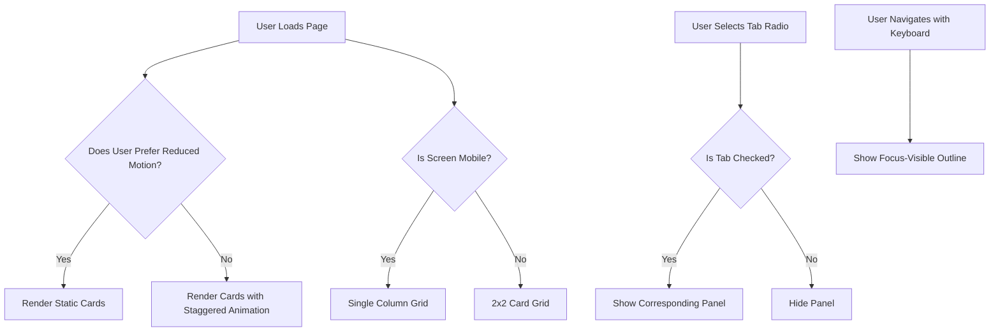

| Difficulty | Channel | Tags |
|---|---|---|
| beginner | frontend | css, flexbox, grid, animations |

In September 2013, Apple's release of iOS 7 was met with immense praise for its bold, flat redesign. However, behind the glossy parallax effects and fluid transitions lurked an unintended consequence. Within days, users began reporting nausea, vertigo, and headaches from the very animations designed to delight them [1]. This raises a crucial question: how far should you go to craft a "delightful" interface at the cost of your users' wellbeing? The answer lies in respecting accessibility, starting with something as simple as the `prefers-reduced-motion` media query.

---

> ### Real-World Case — Apple
>
> When Apple shipped iOS 7 in September 2013, it introduced a complete visual redesign featuring a parallax home-screen effect (icons appearing to float above the wallpaper as the device tilts) and pervasive zoom/slide transitions for opening apps, folders, and multitasking. Within days of release, hundreds of users flooded Apple's support forums reporting motion sickness, vertigo, nausea, and headaches. At least 200 million people had downloaded the OS by that point.
>
> | | |
> |---|---|
> | **Challenge** | Apple had built a highly animated interface that caused genuine physical discomfort for users with vestibular disorders and motion sensitivity. The OS previously offered only a limited toggle that disabled the parallax effect but left the disorienting zoom animations running, so users had no way to suppress the full set of non-essential motion. |
> | **Solution** | Apple introduced and expanded an OS-level "Reduce Motion" accessibility setting: enabling it replaced zoom/slide transitions with a cross-dissolve and disabled the parallax effect. This system preference became the origin of the motion-preference signal that browsers later standardized as the CSS `prefers-reduced-motion` media query, letting stylesheets gate entrance animations, parallax, and transitions for users who request reduced motion. |
> | **Outcome** | The Reduce Motion setting shipped in iOS 7 and was refined in iOS 7.1 to also reduce zoom animations. The concept spread platform-wide (macOS, Android's "Remove animations," and later the W3C/WCAG technique C39) and was codified into the CSS `prefers-reduced-motion` media feature, now supported across all major browsers since ~January 2020. |
> | **Lesson** | Motion is not purely aesthetic — for some users it triggers real vestibular symptoms, so systems must expose a preference and designers must honor it. `prefers-reduced-motion` is the direct descendant of Apple's incident: treat it as a hard requirement (gate non-essential animation behind `prefers-reduced-motion: no-preference`) rather than an optional nicety. |

---

## Hook — The Price of Motion

It only takes one small detail to turn an amazing user experience into a painful one. For millions of iOS 7 users, that detail was motion [1]. What was intended to create depth and fluidity instead triggered motion sickness and dizziness. This is a stark reminder that not every user experiences your interface the same way. As developers, your goal shouldn't be to impress users at any cost, but to create experiences that work for everyone. This leads to one of the most overlooked responsibilities in front-end development: accessibility.

## Problem — When Delight Becomes Discomfort

You might think animations are harmless, adding polish and feedback to your applications. However, for users with vestibular disorders, epilepsy, or even general sensitivity, excessive motion can be disorienting and, in some cases, debilitating [2]. This isn't a niche concern either. The World Wide Web Consortium (W3C) estimates that a significant portion of users benefit from reduced motion, leading to the codification of accessibility guidelines to combat this [2]. The challenge then becomes: how can you still add subtle, engaging animations without excluding these users? The answer isn't to abandon motion entirely, but to implement it responsibly.

## Real-World Case — Apple

When Apple shipped iOS 7 in September 2013, it introduced a parallax home-screen effect alongside zoom and slide transitions for apps, folders, and multitasking. Within days, hundreds of users flooded Apple's support forums, reporting motion sickness, vertigo, nausea, and headaches. At least 200 million people had downloaded iOS 7 by that time. In response, Apple shipped the 'Reduce Motion' setting in iOS 7 and refined it in iOS 7.1. This concept would later spread to macOS, Android's 'Remove animations' setting, and eventually be codified into the CSS `prefers-reduced-motion` media feature, now supported across all major browsers since ~January 2020 [1].

## Deep Dive — The Power of CSS-Only Interactivity

With the stakes now clear, how can you build interactive components without sacrificing accessibility? For many UI patterns, such as tab panels, CSS alone is more than capable of getting the job done. By utilizing radio inputs with a shared `name` and leveraging the `:checked` pseudo-class alongside adjacent sibling combinators, you can toggle visibility without a single line of JavaScript [3]. This not only reduces your bundle size, but also improves resilience for users with JavaScript disabled. However, interactivity without JS doesn't mean interactivity without responsibility. Many developers focus solely on the toggle logic, forgetting about keyboard accessibility and motion sensitivity. For keyboard users, `:focus-visible` provides clear, intentional outlines without ruining the aesthetics for mouse users [4]. Moreover, for users who opt into reduced motion, the `prefers-reduced-motion` media query allows you to disable or tone down animations entirely [5]. These seemingly small details are what separate a "good-looking" component from an inclusive one.

## Workflow — Building an Accessible, CSS-Only Tab Panel

Now that the theory is solid, it's time to put it into practice. Building this component is a journey of layering concerns, rather than hacking them together. Follow these steps to achieve the desired result: 1) **Structure semantically.** Utilize radio inputs as the source of truth for state, pairing each with a `` for accessibility. 2) **Toggle with CSS.** Use the `:checked` state alongside `~` (general sibling) selectors to show and hide the corresponding panels [3]. 3) **Layout responsively.** Utilize CSS Grid with `repeat(2, 1fr)` for a 2x2 desktop layout, and collapse to `1fr` on mobile with a media query [6]. 4) **Polish with motion.** Add a subtle `fadeSlideIn` animation with a staggered delay for each card, but only when `prefers-reduced-motion: no-preference` is active [5][7]. 5) **Prioritize accessibility.** Ensure clear `:focus-visible` outlines for keyboard navigation [4]. As illustrated below, each of these layers work in harmony to create a component that is performant, responsive, and inclusive.

## Code Example — Putting It All Together

With the workflow established, let's examine a production-ready implementation that checks every box from the interview prompt. The following code showcases the semantic HTML structure, responsive grid, CSS-only toggling, staggered entrance animation, reduced motion respect, and focus outlines. Each piece has been carefully layered to avoid the pitfalls that plagued interfaces like iOS 7, all whilst keeping the implementation lean and maintainable.

## Lessons Learned — Motion With Empathy

Looking back at our journey, the story comes full circle. The same technology that brought delight to so many also brought discomfort to those who needed accessibility the most. This is a lesson that extends far beyond animations. For your next project, remember these key takeaways: **Empathy comes first.** Always design with edge cases in mind. What delights one user may harm another [1][2]. **CSS is powerful.** You don't always need JavaScript for interactivity. Utilizing native HTML elements and CSS pseudo-classes can lead to more resilient and performant components [3]. **Progressive enhancement is non-negotiable.** Respect user preferences. Features such as `prefers-reduced-motion` and `:focus-visible` should be the default, not an afterthought [4][5]. **Small details scale.** A single media query can drastically improve the experience for millions of users, just as its omission once harmed them [1]. So, the next time you're tempted to add that "extra bit of flair", ask yourself: am I adding delight, or am I removing accessibility? That single question may be the most impactful one you ask as a developer.

---

## Accessible CSS-Only Tab Panel Flow

<strong>Original Interview Question</strong>

**Q:** Build a CSS-only tab panel for a design-system docs page. Use radio inputs to switch tabs (no JavaScript). Desktop: a 2x2 grid of cards under each tab; mobile: single column. Each card has a fixed 16:9 image area, a title, and a short meta line. Add a subtle entrance animation with a stagger and keep focus-visible outlines; ensure prefers-reduced-motion is respected?

**A:** Use a set of radio inputs with a shared `name` attribute and corresponding `` elements for each tab section. The `:checked` state of each radio controls visibility of its associated panel via adjacent sibling selectors. Each panel renders a 2×2 card grid on desktop and collapses to a single column on mobile. Cards use `aspect-ratio: 16/9` for fixed image containers, with a title and meta line below.

## Conclusion

The story of iOS 7 serves as a powerful reminder: the smallest details can have the largest impact. What was designed to create delight ended up causing harm for a subset of users. However, this failure led to one of the most impactful accessibility features in modern CSS. As developers, you have the power to avoid repeating history. By utilizing semantic HTML, CSS-only interactivity, responsive layouts, and respecting user preferences through `prefers-reduced-motion` and `:focus-visible`, you can create interfaces that are not only beautiful, but inclusive. The next time you're building a component, don't just ask if it's visually polished. Ask if it's accessible to everyone. That single question will transform the way you code, and the experiences that you ship.

---

## References

1. [Apple incident report - iOS 7](https://en.wikipedia.org/wiki/IOS_7) — article
2. [Understanding Success Criterion 2.3.3: Animation from Interactions](https://www.w3.org/WAI/WCAG21/Understanding/animation-from-interactions.html) — documentation
3. [Radio Button - MDN Web Docs](https://developer.mozilla.org/en-US/docs/Web/HTML/Element/input/radio) — documentation
4. [:focus-visible - MDN Web Docs](https://developer.mozilla.org/en-US/docs/Web/CSS/:focus-visible) — documentation
5. [prefers-reduced-motion - MDN Web Docs](https://developer.mozilla.org/en-US/docs/Web/CSS/@media/prefers-reduced-motion) — documentation
6. [CSS Grid Layout - MDN Web Docs](https://developer.mozilla.org/en-US/docs/Web/CSS/CSS_grid_layout) — documentation
7. [@keyframes - MDN Web Docs](https://developer.mozilla.org/en-US/docs/Web/CSS/@keyframes) — documentation
8. [CSS Aspect Ratio - MDN Web Docs](https://developer.mozilla.org/en-US/docs/Web/CSS/aspect-ratio) — documentation

---

**Author:** Satishkumar Dhule — [GitHub](https://github.com/satishkumar-dhule) · [LinkedIn](https://linkedin.com/in/satishkumar-dhule) · [Website](https://satishkumar-dhule.github.io)
