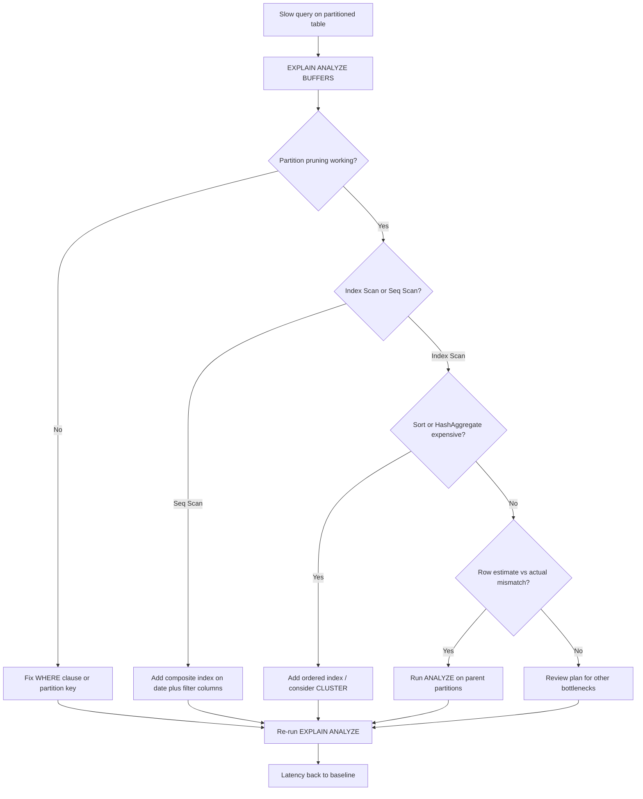

| Difficulty | Channel | Tags |
|---|---|---|
| intermediate | database | explain, query-plan, partitioning |

Hatchet, an open-source durable task queue built on Postgres, did everything by the book: when its single tasks table ballooned past 200 million rows and started choking on index bloat and unmanageable chunked deletes, the team migrated everything to daily rolling date-range partitions [1]. The rollout went smoothly, and everyone breathed a sigh of relief. Then, within days, production queries on those shiny new partitioned tables started getting slower — and slower — until they were 10× worse than before. This is the story of a partitioning win that quietly turned into a trap, and the surprising one-line fix that undid it.

---

> ### Real-World Case — Hatchet
>
> Hatchet, an open-source durable task queue built on Postgres (YC W24), migrated its v1_task and v1_task_event tables to daily rolling date-range partitions after their single tasks table hit ~200 million rows and suffered index/table bloat plus unmanageable chunked deletes. The partitioning rollout initially went smoothly, but within days production queries on the partitioned tables became progressively slower.
>
> | | |
> |---|---|
> | **Challenge** | Queries hitting the partitioned tables ran up to 10× slower than expected (from a few milliseconds to >20ms), causing massive spikes in active sessions and CPU even under moderate load. The degrade was specific to queries that JOINed partitioned tables and selected many rows by compound primary key. Even after forcing partition pruning, the plans remained suboptimal. |
> | **Solution** | The team reproduced the issue locally with 14 daily partitions of 1M rows each and ran EXPLAIN ANALYZE on a JOIN query, discovering the row estimate was off by a factor of 6,100,000×. After consulting Postgres expert Laurenz Albe, they found the culprit in the docs: partitioned parent tables do not directly store tuples and are not processed by autovacuum, so ANALYZE never ran on the parent, leaving stale planner statistics. Manually running ANALYZE on the parent partitioned tables immediately fixed the plans. |
> | **Outcome** | Production queries went from ~10× slower (>20ms vs. a few ms) back to expected latency, and the spikes in active sessions and CPU were resolved. The fix was a code path that manually runs ANALYZE on the parent partition tables on a schedule; the team also adopted DETACH PARTITION CONCURRENTLY and DETACH PARTITION FINALIZE for partition cleanup. |
> | **Lesson** | Partitioning by date is not automatically a performance feature — pruning and good plans depend on accurate statistics. Autovacuum does not ANALYZE partitioned parent tables, so their statistics go stale, producing wildly wrong row estimates and suboptimal plans. Always read the EXPLAIN plan (checking the Append node, estimated vs. actual rows) and manually ANALYZE parent partitioned tables. |

---

## Hook — The Partition That Made Things Worse

Picture the moment the monitoring dashboard goes red. You have just shipped a big migration. Your team is celebrating because you replaced one bloated 200-million-row table with a fleet of tidy, daily date-range partitions. Deletes are cheap. Maintenance is trivial. Everything is textbook. Then the pager goes off. Active sessions spike, CPU climbs, and queries that used to return in a few milliseconds are now hauling back at more than 20ms — a full 10× regression that customers can feel. Nothing in the code changed. Nothing in the data changed. Only the layout on disk did. That is exactly the situation Hatchet found itself in [1], and it is the canary for one of the most misunderstood realities in database engineering: partitioning is not an optimization you install and forget. It is a contract with the query planner, and if you break your end of the bargain, the planner silently bills you for it. The stakes are real — slow queries on a task queue mean delayed jobs, backed-up workflows, and in the worst case, a system that stops processing work entirely. So before you reach for CLUSTER or rewrite your WHERE clause, you need to know what to actually look for. Stay with this, because the answer is counterintuitive.

## Problem — Why a Correct Partition Scheme Still Runs Slow

Here is the thing that trips up even experienced engineers: adding partitions does not automatically make queries faster. Partitioning is fundamentally a data-management feature that *can* improve query performance — it is not a performance feature by itself [6]. The planner only wins if it can throw away entire tables before touching a single row, an operation called partition pruning. If pruning fails, the database may scan every partition, and now you are paying overhead for a feature that is supposed to save you time. Even when pruning works perfectly, a second trap waits downstream: the query may still be doing a sequential scan inside the surviving partition, or performing an expensive sort or hash aggregate that has nothing to do with how the table was split. Many developers discover that their partitioning migration moved the bottleneck rather than removing it. When a query filtering on a specific date range is still slow despite daily partitions, the problem usually lives in one of three places: pruning that is not happening, indexes that are not being chosen, or expensive post-filter operations like sorts. Each one has a distinct fingerprint in the query plan, and learning to read those fingerprints is the entire game. This is what separates engineers who guess from engineers who diagnose.

## Real-World Case — Hatchet's 200-Million-Row Wake-Up Call

Hatchet runs a durable task queue on top of Postgres, and as an early-stage company shipping fast, it had accumulated roughly 200 million rows across its `v1_task` and `v1_task_event` tables [1]. The symptoms were classic single-table-scale pain: index and table bloat, plus a chunked-delete routine that had become genuinely unmanageable. The fix looked obvious — migrate to daily rolling date-range partitions with a background job that creates new partitions ahead of time and drops old ones cleanly. The migration landed without drama. But within days, production queries on the partitioned tables started creeping slower, and the team watched active sessions and CPU climb alongside latency. Queries that used to complete in a few milliseconds were now taking more than 20ms — a 10× regression on a system where throughput mattered. The culprit was not the partitions themselves, nor the indexes, nor even the query text. It was statistics. The parent partitioned tables were not getting a fresh ANALYZE, so the planner had no good row estimates for the partition hierarchy and started making poor choices. The fix was elegantly unglamorous: a scheduled code path that manually runs `ANALYZE` on the parent partition tables. Latency snapped back to expected levels, active sessions stabilized, and CPU spikes vanished [1]. Hatchet also adopted `DETACH PARTITION CONCURRENTLY` and `DETACH PARTITION FINALIZE` for safer partition cleanup [1], but the headline lesson is that statistics hygiene — not schema cleverness — was the real fix. A 10× slowdown, undone by a maintenance job most teams never think to schedule.

## Deep Dive — Reading the Plan, From Pruning to Sorting

When a date-range query is slow on a partitioned table, you run `EXPLAIN (ANALYZE, BUFFERS)` and read it like a detective reads a crime scene [3]. The first question is whether partition pruning fired. In the plan, you should see the planner scanning only the partitions that overlap your date range — if the `Append` or `Merge Append` node lists every partition, pruning failed and you are scanning the world. This often happens when the filter is on an expression the planner cannot prove is a constant at plan time, when the partition key is not the column being filtered, or when generic vs. custom plans are involved [2]. The second question is what happens inside the surviving partition. Look for `Seq Scan` where you expected an `Index Scan`, and watch the `rows` estimate versus the `actual rows` — a large mismatch screams bad statistics, which is precisely what bit Hatchet [1]. This is where the composite index enters the picture. A composite index on `(date, filtered_columns)` — or, more precisely, on the partition key plus the columns in your frequent WHERE clauses — lets the planner satisfy both the range filter and the equality filter from one index, and even supply rows in sorted order to avoid a separate sort [4]. That last point matters because `Sort` and `HashAggregate` nodes are where latency quietly hides. If a plan shows a large sort, an index ordered correctly can turn an O(n log n) sort into a free by-product of the index walk. Clustering — physically reordering a table by an index via `CLUSTER` — can further improve locality by co-locating related rows on the same pages, reducing the number of buffers read [5]. But beware: clustering takes an exclusive lock and is a one-time reordering, not a permanent property, so it is a scalpel, never a habit. Frequently, the outcome is a rich plan where pruning, index usage, ordering, and statistics all have to line up before latency drops.

## Workflow — A Repeatable Diagnostic Loop

Building on the fingerprints above, here is the process that turns a slow partitioned query from a mystery into a checklist. Start by capturing a real plan with `EXPLAIN (ANALYZE, BUFFERS)`, not just `EXPLAIN` — you need actual timings and buffer counts to know where time truly goes [3]. Then walk the decision tree below: check pruning, then index usage, then expensive sorts and aggregates, then statistics freshness. Crucially, always re-measure after each change, because a fix that helps one node can regress another. The diagram maps the path the Hatchet team, and any team facing this pattern, should follow.



The most important branch here is the one most engineers skip: the statistics check. You can have perfect pruning and a perfect composite index and still get a bad plan if the planner thinks a partition holds 10 rows when it actually holds 10 million. That is why the workflow treats ANALYZE as a first-class diagnostic step, not an afterthought.

## Code Example — Instrumenting the Diagnosis in a Script

Reading plans by hand is fine for one query, but production systems need repeatable instrumentation. The following `bash` script uses `psql` to time a representative query, capture its plan with buffers, check the freshness of table statistics, refresh them on the parent partition table, and verify the improvement. Run it as part of your incident runbook whenever a partitioned table regresses.

```bash
#!/usr/bin/env bash
set -euo pipefail

DB="${DATABASE_URL:?set DATABASE_URL}"
QUERY="SELECT count(*) FROM events WHERE event_date BETWEEN '2024-01-01' AND '2024-01-31' AND status = 'completed';"

# 1. Capture the actual plan with buffers and timing so you can see
#    whether pruning fired, which scan type was chosen, and where time goes.
psql "$DB" -c "EXPLAIN (ANALYZE, BUFFERS, VERBOSE) $QUERY"

# 2. Inspect how stale the planner statistics are on the parent table.
#    A large n_mod_since_analyze on a parent partitioned table is a red flag.
psql "$DB" -c "
  SELECT relname, n_live_tup, n_mod_since_analyze, last_analyze
  FROM pg_stat_user_tables
  WHERE relname = 'events';
"

# 3. Refresh statistics on the PARENT partition table. This is the Hatchet fix:
#    the planner needs row estimates at the partitioned-parent level to prune well.
psql "$DB" -c "ANALYZE VERBOSE events;"

# 4. Add a composite index covering the range key and the equality filter,
#    built CONCURRENTLY so writes are not blocked in production.
psql "$DB" -c "
  CREATE INDEX CONCURRENTLY IF NOT EXISTS idx_events_date_status
  ON events (event_date, status);
"

# 5. Re-run the plan and diff timings against step 1 to confirm the fix landed.
psql "$DB" -c "EXPLAIN (ANALYZE, BUFFERS) $QUERY"
```

## Lessons Learned — Statistics Are the Silent Variable

The Hatchet story is a masterclass in a lesson that is easy to learn and hard to remember: on partitioned tables, the query planner's quality depends on statistics that do not maintain themselves the way you assume they do [1][7]. Looking back at the journey — a textbook migration, a 10× latency regression, a hunt through pruning and indexes, and finally a scheduled `ANALYZE` — the plot twist is that the fix had nothing to do with the schema everyone was staring at. Before closing, here are the battle scars worth carrying forward. First, always read `EXPLAIN (ANALYZE, BUFFERS)`, because estimates lie and actuals do not [3]. Second, verify pruning before anything else, since no index can save a query that scans every partition [2]. Third, pair a range filter with a composite index on the partition key plus your equality columns so the planner can prune and filter in one pass [4]. Fourth, treat `ANALYZE` cadence as a production concern, not a DBA footnote — schedule it on parent partitions after bulk loads and migrations [7]. Fifth, remember that `CLUSTER` is a one-time locality win that requires an exclusive lock, so use it deliberately [5]. And finally, prefer `CREATE INDEX CONCURRENTLY` [4] and `DETACH PARTITION CONCURRENTLY` [1] for zero-downtime operations. The memorable insight worth sharing with your team is this: partitioning does not make queries fast; it makes them fast *only when the planner can reason about them* — and the planner reasons with statistics you have to keep fresh.

---

## Query Optimization Workflow


<details>
<summary><strong>Original Interview Question</strong></summary>

**Q:** You have a PostgreSQL table with 100M rows partitioned by date. A query filtering on a specific date range is still slow. What would you check in the EXPLAIN plan and how would you optimize it?

**A:** Check partition pruning effectiveness, index utilization patterns, and expensive sort operations. Create composite indexes on (date, filtered_columns) and evaluate clustering strategies for optimal data access.

</details>

## Conclusion

Here is the moral of Hatchet's story: partitioning is a data-management win that only becomes a performance win when the planner can reason about it, and it reasons with statistics that do not stay fresh on their own [1][7]. So what should you do differently tomorrow? Add a scheduled ANALYZE on your parent partition tables, make EXPLAIN (ANALYZE, BUFFERS) your first reflex when latency regresses, and design composite indexes around your real WHERE clauses before reaching for heavier tools like CLUSTER. The one insight worth pinning to your team's runbook: a 10× slowdown is not always a schema problem — sometimes it is just a planner working blind. Do not touch the schema until you have checked the stats, because the cheapest fix is often the one nobody thinks to run.

---

## References

1. [Hatchet incident report](https://hatchet.run/blog/postgres-partitioning) — article
2. [PostgreSQL Documentation: Table Partitioning](https://www.postgresql.org/docs/current/ddl-partitioning.html) — documentation
3. [PostgreSQL Documentation: Using EXPLAIN](https://www.postgresql.org/docs/current/using-explain.html) — documentation
4. [PostgreSQL Documentation: CREATE INDEX](https://www.postgresql.org/docs/current/sql-createindex.html) — documentation
5. [PostgreSQL Documentation: CLUSTER](https://www.postgresql.org/docs/current/sql-cluster.html) — documentation
6. [Wikipedia: Partition (database)](https://en.wikipedia.org/wiki/Partition_(database)) — documentation
7. [PostgreSQL Documentation: ANALYZE](https://www.postgresql.org/docs/current/sql-analyze.html) — documentation
8. [PostgreSQL Documentation: ALTER TABLE (DETACH PARTITION)](https://www.postgresql.org/docs/current/sql-altertable.html) — documentation
9. [DigitalOcean: How to Use EXPLAIN to Profile SQL Queries in PostgreSQL](https://www.digitalocean.com/community/tutorials/how-to-use-explain-to-profile-sql-queries-in-postgresql) — blog

---

**Author:** Satishkumar Dhule — [GitHub](https://github.com/satishkumar-dhule) · [LinkedIn](https://linkedin.com/in/satishkumar-dhule) · [Website](https://satishkumar-dhule.github.io)
