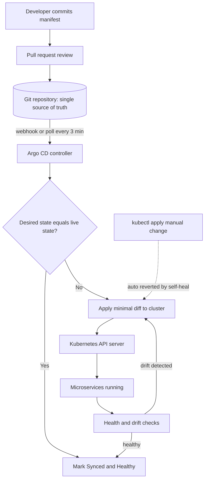

| Difficulty | Channel | Tags |
|---|---|---|
| beginner | devops | argocd, flux, declarative |

Around 2018, Intuit had pushed TurboTax, QuickBooks, and Mint onto Kubernetes, running hundreds of microservices across dozens of clusters for more than 4,000 developers [1]. Their existing continuous-delivery tools simply buckled: the team needed Git to be the single source of truth for both application code and environment configuration, with deployments that were Kubernetes-native, declarative, and fully auditable [1]. The answer they landed on eventually reconciled changes in seconds and grew to 3,000+ managed applications across 130+ clusters [1]. Here is the journey of how a simple git push became the most powerful deploy button in the world.

---

> ### Real-World Case — Intuit
>
> Around 2018, Intuit had moved its financial products (TurboTax, QuickBooks, Mint) onto Kubernetes, running hundreds of microservices across dozens of clusters for its 4,000+ developers. Existing continuous-delivery tools didn't fit: they needed Git to be the single source of truth for both application code AND environment configuration, with Kubernetes-native, declarative, auditable deployments.
>
> | | |
> |---|---|
> | **Challenge** | They needed a declarative GitOps control plane that could continuously reconcile the live cluster state against desired state in Git — but their own first implementation only worked for 'a couple clusters and a few dozen applications.' Simply generating YAML (kustomize build, Helm templating) and diffing against the cluster became a scalability bottleneck, with reconciliation times measured in minutes and thousands of apps to manage. |
> | **Solution** | Intuit built Argo CD internally as a Kubernetes-native declarative CD tool, then open-sourced it. The core is the Application Controller, which continuously compares live state to the desired manifests in Git and powers automated sync and self-healing (reverting manual kubectl drift). They redesigned the controller, added aggressive in-memory manifest caching in the Repository Service, and resolved ambiguous Git revisions (HEAD, master, v1.0) into concrete SHAs for cache keys. Ironically, despite Argo CD's pull-based GitOps model, Intuit ran it in the push model, invoking Argo CD from Jenkins for security and compliance reasons. |
> | **Outcome** | Reconciliation time dropped from minutes to seconds. Argo CD at Intuit reached 3,000+ managed applications across 130+ Kubernetes clusters, 3,500+ namespaces, and 4,000+ nodes, driven by 12,000+ Jenkins jobs per day, with 1,000 developers onboarded. The project was donated to the CNCF, became an incubator project in 2020, and is now the de facto Kubernetes GitOps standard used by 110+ orgs including Adobe, Google, GitHub, IBM, NVIDIA, SAP, Tesla, and Volvo. |
> | **Lesson** | GitOps only delivers on its self-healing, single-source-of-truth promise if the reconciliation loop itself scales — the declarative-vs-imperative win is real, but naive diffing across thousands of apps and clusters becomes the new bottleneck. Caching, efficient revision resolution, and controller redesign were as important as the GitOps philosophy itself. |

---

## Hook — The Deploy Button Everyone Was Afraid to Press

Imagine being on call the night after a big release. A well-meaning engineer opens a terminal, runs a handful of kubectl apply commands against production, and everything works. Two weeks later, nobody remembers those commands existed, but the cluster does. The running state has quietly diverged from anything stored in Git, and the next deploy wipes out the manual fix, or worse, resurrects a bug that was never supposed to ship. This is configuration drift, and it is the silent killer of microservice fleets.

Sound familiar? Almost every team that runs Kubernetes at scale eventually hits this wall. The cluster becomes a pet you hand-tune instead of a herd you manage. The moment that realization lands, engineers start searching for a system that treats Git not as documentation but as the actual control plane. That search is where GitOps begins, and it is exactly the road Intuit walked [1].

💡 Insight: The pain is rarely the deploy itself. The pain is that nobody can answer the question — what is actually running in production right now, and who changed it?

## Problem — When Your Cluster and Your Git Repo Stop Talking

Traditional CI/CD pipelines push artifacts into a cluster and then walk away. The pipeline knows how to deliver a container, but it has no memory of what the cluster should look like afterward. Consequently, three problems compound over time.

First, there is no verifiable source of truth. Changes arrive through pipelines, hotfixes, console edits, and ad-hoc kubectl sessions. Developers cannot diff reality against intent because intent lives in too many heads. Second, rollbacks are terrifying. Without a versioned record of desired state, restoring a healthy configuration means reverse-engineering what changed, often while customers are staring at 500 errors. Third, drift multiplies across environments. Staging and production slowly diverge until a bug that only exists in prod becomes impossible to reproduce.

Moreover, the scale problem is brutal. A single misconfigured manifest is survivable; hundreds of microservices across dozens of clusters is not. You need a reconciliation loop that constantly asks one question: does the live cluster match what Git declares? If it does, stay quiet. If it does not, fix it automatically. That loop is the beating heart of GitOps, and it is why declarative tooling exists at all [8].

## Real-World Case — Intuit

By 2018, Intuit was migrating its core financial products — TurboTax, QuickBooks, and Mint — onto Kubernetes, scaling to hundreds of microservices across dozens of clusters serving 4,000+ developers [1]. Their existing continuous-delivery tooling, built around traditional push-style pipelines, could not satisfy a simple-sounding but demanding requirement: Git had to be the single source of truth for both application code and environment configuration, with Kubernetes-native deployments that were declarative and auditable [1].

The breakthrough came when Intuit adopted Argo CD, an open-source declarative GitOps controller. Instead of pipelines pushing changes, an in-cluster agent pulled the desired state from Git and continuously reconciled the live cluster toward it. The results were dramatic. Reconciliation time dropped from minutes to seconds, and the footprint grew to 3,000+ managed applications spanning 130+ Kubernetes clusters, 3,500+ namespaces, and 4,000+ nodes — all driven by 12,000+ Jenkins jobs per day with 1,000 developers onboarded [1].

The war story here is not a single outage; it is the quiet elimination of an entire class of outages. By making Git the authority, manual kubectl edits became self-correcting, rollbacks became git revert, and audit trails came for free. Intuit later donated the project to the CNCF, where Argo became an incubator project in 2020 and matured into the de facto Kubernetes GitOps standard, used by 110+ organizations including Adobe, Google, GitHub, IBM, NVIDIA, SAP, Tesla, and Volvo [7].

## Deep Dive — Declarative vs Imperative, and Why It Changes Everything

The heart of GitOps is a philosophical split between two ways of telling Kubernetes what to do. The imperative approach issues commands: create this pod, scale that deployment, patch this service. The declarative approach describes the end state: here is what the system should look like, now make it so [4]. Kubernetes itself is fundamentally declarative — every object is a desired-state record that controllers work to realize [9].

In the declarative GitOps model, developers commit YAML manifests, Helm charts, or Kustomize overlays to a Git repository [5][6]. Argo CD then runs a continuous reconciliation loop that compares the desired state in Git against the actual state in the cluster, and whenever they differ, it applies the difference [3]. Because every change flows through a commit, you get pull requests, code review, blame history, and instant rollbacks — all the things Git already gives you for source code.

The imperative model is not evil; it is just dangerously convenient. Running kubectl apply directly against a cluster is fine for a quick experiment, but in production it bypasses the single source of truth entirely. Changes leave no trail, drift accumulates, and the cluster becomes impossible to reconstruct from code. The table below captures the real tradeoff.

🔥 Hot Take: If a change did not go through Git, it did not happen. Treat every manual kubectl session against production as technical debt you are about to pay interest on.

## Workflow — How the Reconciliation Loop Actually Runs

Building on the declarative mindset, the practical workflow has a rhythm you can memorize. It moves in five beats.

1. **Commit** — A developer opens a pull request against the environment repository, changing a manifest, chart value, or Kustomize overlay.
2. **Merge** — The change lands on the tracked branch only after review, making Git history the audit log.
3. **Detect** — Argo CD notices the new commit, either through a webhook or a polling interval you configure (commonly one to five minutes, often set to three) [2].
4. **Diff and sync** — The controller compares the desired state with the live cluster and applies the minimal changes to close the gap.
5. **Self-heal** — If anyone edits the cluster manually, the next reconciliation reverts it, restoring the declared truth [3].

The diagram below visualizes the full loop, including the plot twist: a manual kubectl change that gets silently and automatically undone.

## Code Example — Wiring Up Auto-Sync and Self-Healing

Here is where theory meets a terminal. The script below installs Argo CD, registers a Git repository, and defines the Application custom resource that turns on automatic synchronization and self-healing. It is deliberately production-shaped rather than a toy sample.

## Lessons Learned — What to Do Differently Tomorrow

The Intuit story is not really about Argo CD; it is about surrendering control in exchange for consistency [1]. Teams that succeed with GitOps internalize a few hard-won lessons.

- **Make Git the only door to production.** The moment kubectl access to prod becomes normal, your single source of truth is a fiction. Restrict direct write access and let the controller reconcile.
- **Turn on self-heal early, not later.** Drift is quiet until it is expensive. Self-healing converts a future 3 AM incident into a non-event [3].
- **Separate application code from environment config.** Different repos, different lifecycles, different reviewers. This is the pattern that let Intuit scale to 3,000+ apps without a human bottleneck [1].
- **Review the diff, not the pipeline.** In a declarative world, the pull request is the deploy review. Read it like one.
- **Expect the learning curve.** Many developers assume GitOps is just another CI tool and get surprised when reconciler permissions, secrets management, and repo structure demand real design work [6].

If this feels overwhelming, you are not alone — the first migration is always the hardest. The payoff is a cluster that remembers exactly what it should be, every single second.

---

## GitOps Reconciliation Flow

<strong>Original Interview Question</strong>

**Q:** You're setting up GitOps for a microservices deployment. How would you configure ArgoCD to automatically sync changes from your Git repository to Kubernetes, and what's the difference between declarative and imperative approaches in this context?

**A:** I'd configure ArgoCD by setting up a Git repository containing Kubernetes manifests or Helm charts, creating an Application CRD that points to the Git repository, enabling auto-sync with a health check interval of 3 minutes, and implementing self-healing to automatically revert any manual changes. The declarative approach involves defining the desired state in Git through YAML manifests, Helm charts, or Kustomize configurations, where ArgoCD continuously reconciles the actual state with the desired state. In contrast, the imperative approach uses kubectl commands to make direct changes to the cluster, bypassing the Git repository as the single source of truth.

## Conclusion

The lesson from Intuit is deceptively simple: stop pushing changes and start declaring them. When Git becomes the single source of truth and a controller continuously reconciles reality toward it, drift stops being an incident and becomes a no-op. Tomorrow, pick one service, move its manifests into a dedicated environment repository, and switch on auto-sync with self-healing. You will not just deploy faster — you will finally be able to answer the one question that used to haunt every on-call rotation: what is actually running in production, and who changed it?

---

## References

1. [Intuit incident report](https://blog.argoproj.io/doing-gitops-at-scale-6313f5889775) — blog
2. [Argo CD GitHub Repository](https://github.com/argoproj/argo-cd) — documentation
3. [Argo CD Documentation](https://argo-cd.readthedocs.io/en/stable/) — documentation
4. [Kubernetes Declarative Management of Kubernetes Objects](https://kubernetes.io/docs/tasks/manage-kubernetes-objects/declarative-config/) — documentation
5. [Helm Documentation](https://helm.sh/docs/) — documentation
6. [Kubernetes Managing Kubernetes Objects Using Kustomize](https://kubernetes.io/docs/tasks/manage-kubernetes-objects/kustomization/) — documentation
7. [CNCF Argo Project](https://www.cncf.io/projects/argo/) — documentation
8. [GitOps](https://en.wikipedia.org/wiki/GitOps) — documentation
9. [Kubernetes Controllers](https://kubernetes.io/docs/concepts/architecture/controller/) — documentation

---

**Author:** Satishkumar Dhule — [GitHub](https://github.com/satishkumar-dhule) · [LinkedIn](https://linkedin.com/in/satishkumar-dhule) · [Website](https://satishkumar-dhule.github.io)
