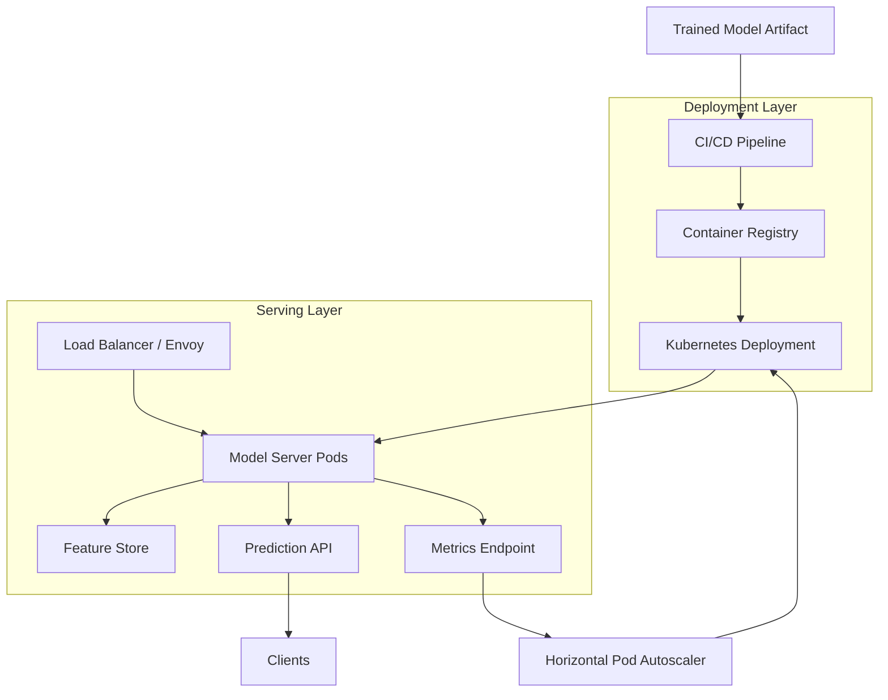

| Difficulty | Channel | Tags |
|---|---|---|
| beginner | devops | mlops, deployment |

In 2015, Uber had dozens of data scientists shipping brilliant models in R, scikit-learn, and custom code — and almost none of it reached production quickly. Every launch meant an engineering team hand-building a bespoke serving container from scratch, because there was no standard path from a trained model to a low-latency prediction endpoint [1]. That single missing abstraction capped the company's entire ML impact. What Uber learned the hard way is the exact distinction most developers blur together: deployment and serving are two different jobs, with different tools, different failure modes, and different scaling math.

---

> ### Real-World Case — Uber
>
> By 2015 Uber had dozens of data scientists building models in R, scikit-learn and custom code, but every production deployment required the owning engineering team to hand-build a bespoke serving container. There was no standard path from a trained model to a low-latency prediction endpoint, so ML impact was capped by how fast a few teams could reinvent deployment plumbing.
>
> | | |
> |---|---|
> | **Challenge** | Bridge the gap between model deployment (the reproducible build/train/package/deploy pipeline) and model serving (a high-scale, low-latency online prediction runtime) across dozens of teams and use cases like UberEATS delivery-time prediction — without creating a self-service platform that was too rigid to support new frameworks. |
> | **Solution** | Uber built Michelangelo, an end-to-end ML platform that cleanly separates the two layers. Deployment is managed via a model repository in Cassandra, a Feature Store of ~10,000 shared features, and a workflow/orchestration tier that packages model artifacts (metadata, params, compiled DSL) into a ZIP and ships them to hosts. Serving is a stateless online prediction service cluster (hundreds of machines behind a load balancer) reached via Thrift RPC, with three deployment modes (offline Spark batch, online RPC, embedded library). Critically, they unified offline and online feature pipelines so the identical DSL/data pipeline runs at training and prediction time, and they load models from memory/Cassandra to keep latency low. |
> | **Outcome** | The highest-traffic models served more than 250,000 predictions/second with P95 latency under 5ms (under 10ms when Cassandra feature-store lookups were required). The platform became Uber's de-facto ML system across dozens of teams and data centers, later scaling to thousands of production models and millions of predictions per second. |
> | **Lesson** | In production ML the hard part is almost never the model math — it is the deployment/serving plumbing. Separating a reproducible deployment pipeline from a stateless, horizontally scalable serving runtime, while forcing train/serve feature consistency, eliminated training-serving skew and turned model rollout into a commodity operation. |

---

## Hook — The Model Worked, But Nobody Could Ship It

Picture a data scientist who just squeezed another 4% of accuracy out of a fraud-detection model. The notebook runs perfectly. The metrics look great. And then the work stops dead — because turning that artifact into a production API means writing HTTP handlers, wiring up a versioned endpoint, configuring autoscaling, and praying the whole thing survives a traffic spike.

That gap is not a data science problem. It is an operations problem, and it silently throttles almost every ML organization. Uber felt it acutely: by 2015, every production deployment required the owning engineering team to hand-build a bespoke serving container [1]. No standard path existed from a trained model to a low-latency endpoint.

The result? ML impact became a function of how fast a few teams could reinvent deployment plumbing — over and over again. Sound familiar?

💡 Insight: Deployment and serving sound like synonyms in a job description. In production, they are two distinct disciplines that fail in completely different ways.

## Problem — Two Jobs Masquerading as One

Many developers treat 'deploy the model' as a single checkbox. In reality, two very different responsibilities are hiding inside that phrase.

Deployment is the logistics layer. It answers: how does a trained artifact travel from a notebook to a running environment, safely, repeatably, and with a rollback plan? That means CI/CD pipelines, infrastructure as code, containerization, and monitoring hooks.

Serving is the runtime layer. It answers: once the model is live, how does it handle 10,000 requests per second without melting? That means inference APIs, request routing, model loading, versioning, and autoscaling.

When teams collapse these together, three predictable disasters follow:

- **A model that trains fine but cannot be rolled back** — because nobody versioned the artifact or the endpoint.
- **A perfect pipeline that serves slowly** — because CI/CD and inference latency are unrelated concerns.
- **Costs that explode silently** — a GPU pod idling for a request every ten minutes still bills every hour.

⚠️ Watch Out: If your mental model is 'deployment = getting it live' and 'serving = the thing that's live,' you are missing the fact that serving itself is a system with its own scaling, caching, and cold-start problems. The stakes are latency and money — often millions of them.

## Real-World Case — Uber and the Michelangelo Platform

Uber's problem was structural, not technical talent. Dozens of data scientists were building models in R, scikit-learn, and custom code, but every production deployment required the owning engineering team to hand-build a bespoke serving container [1]. There was no standard path from a trained model to a low-latency prediction endpoint, so ML impact was capped by how fast a few teams could reinvent deployment plumbing.

Uber's answer was Michelangelo — an internal platform that separated the deployment workflow from the serving runtime. Data scientists defined features and models; the platform handled the unglamorous parts: packaging, deployment, versioning, and a shared serving stack.

The numbers tell the story. The highest-traffic models served more than 250,000 predictions per second with P95 latency under 5ms — and under 10ms when Cassandra feature-store lookups were required. The platform became Uber's de-facto ML system across dozens of teams and data centers, later scaling to thousands of production models and millions of predictions per second [1].

🎯 Key Point: Notice what Uber standardized. Not the model — the path to production, and the endpoint that serves it. Those are two separate products, and treating them as one is exactly what blocked scale.

## Deep Dive — Where the Trade-offs Actually Live

Building on Uber's lesson, it helps to see deployment and serving as two columns with different owners, tools, and constraints. Kubernetes manages deployments declaratively through ReplicaSets, enabling rolling updates and rollbacks [2], while its Horizontal Pod Autoscaler adjusts replica counts from observed metrics [3]. On the serving side, dedicated model servers such as TensorFlow Serving [4], TorchServe [5], and BentoML [6] handle the mechanics of loading models, batching requests, and exposing inference APIs.

The real friction appears in the trade-offs, and they almost always pull in opposite directions.

| Dimension | Deployment Concerns | Serving Concerns |
|---|---|---|
| Primary goal | Safe, repeatable releases | Low-latency, high-throughput inference |
| Key tools | Kubernetes, MLflow, Terraform, GitHub Actions | TF Serving, TorchServe, BentoML, Envoy |
| Failure mode | Bad rollout, no rollback | Cold start, overload, high P99 latency |
| Scaling axis | Release frequency | Requests per second |
| Metric that matters | Deploy success rate, MTTR | P95/P99 latency, cost per prediction |

Two counterintuitive truths tend to surprise teams:

1. **Latency and throughput are not the same goal.** Batching requests raises throughput but adds queueing delay, which hurts latency. You cannot maximize both without knowing which one your users feel. HTTP/2-based transports like gRPC reduce overhead versus text protocols [8], but the batching decision usually dominates.
2. **Cold starts are a serving problem with a deployment fix.** Keeping a warm pool of replicas is a deployment topology choice that directly determines your P99 latency. The layers are separate, but they are not independent.

🔥 Hot Take: 'Real-time' is a business statement, not a latency number. A 100ms recommendation API and a 5ms fraud check live in completely different serving designs — even if the pipeline that ships them is identical.

## Workflow — From Trained Artifact to Autoscaled Endpoint

So how do the two layers connect in practice? The thread is simple: deployment produces a versioned, reproducible artifact; serving turns that artifact into a scalable runtime. Here is the end-to-end flow.

1. **Train and register.** A model finishes training and is logged as a versioned artifact in a registry such as MLflow [7], capturing metrics, parameters, and the exact code version.
2. **Package.** CI/CD promotes the artifact into a container image with its serving dependencies pinned.
3. **Deploy.** Kubernetes applies the image as a Deployment, creating ReplicaSets that support rolling updates and one-command rollbacks [2].
4. **Route.** A load balancer such as Envoy distributes traffic across replicas and enables traffic splitting for A/B tests [10].
5. **Serve.** Model-server pods load the artifact, batch requests, and expose an inference API [4][5][6].
6. **Observe and scale.** Metrics feed the Horizontal Pod Autoscaler, which adjusts replica count to match demand [3].

The Mermaid diagram below traces that journey — and notice that 'deployment' and 'serving' are visibly distinct stages, not one blurry blob.

## Code Example — A Serving Endpoint That Won't Embarrass You

Here is where theory meets the pager. The snippet below is a production-flavored FastAPI serving layer that handles the things toy examples skip: versioned model loading, a readiness probe that reflects real model state, simple in-process request batching, and Prometheus-style metrics for autoscaling decisions.

Key design decisions worth noting:

- **Lazy, explicit model loading at startup** means the readiness probe only goes green when the model is actually usable — preventing Kubernetes from routing traffic to a cold pod [2].
- **Micro-batching with `asyncio`** trades a few milliseconds of queueing delay for a large throughput gain, exactly the trade-off discussed in the Deep Dive.
- **A `/metrics` endpoint** feeds the autoscaler, closing the loop between serving load and deployment scaling [3].
- **The `MODEL_VERSION` env var** makes each deployment a distinct, rollback-able artifact rather than a mystery blob.

The explanation field walks through each block line by line.

## Lessons Learned — Separate the Layers, Own the Trade-offs

The journey from Uber's 'bespoke serving containers every time' to a platform serving 250,000+ predictions per second under 5ms [1] is really a story about naming the right abstraction. Once deployment and serving were treated as distinct concerns, both got dramatically better.

Here is what to carry into tomorrow:

- **Draw the line explicitly.** Deployment owns the path to production (CI/CD, registries, rollback). Serving owns the runtime (APIs, batching, routing, autoscaling). Confusing them hides bugs in both.
- **Version everything, always.** A model endpoint without a versioned artifact is a rollback waiting to fail [7].
- **Make readiness real.** A health check that returns 200 before the model is loaded is worse than no check at all.
- **Match the serving design to the SLA.** Sub-50ms real-time and 1s batch inference are different systems. Decide which you are building before you pick a model server.
- **Let metrics drive scaling.** Autoscaling on CPU alone will betray you when the bottleneck is GPU memory or feature-store lookups [3].

Many developers think the hard part of MLOps is the model. More often, the hard part is the plumbing around it — and the plumbing is where the real wins live.

---

## Deployment vs. Serving System Flow

<strong>Original Interview Question</strong>

**Q:** Explain the key differences between model serving and model deployment in ML systems, including specific technologies, scaling considerations, and real-world implementation patterns?

**A:** Deployment encompasses CI/CD pipelines, infrastructure setup, and monitoring using tools like Kubernetes, MLflow, and SageMaker. Serving focuses on runtime inference APIs with frameworks like TensorFlow Serving, TorchServe, or BentoML, handling request routing, model versioning, and autoscaling. Key trade-offs include latency vs throughput, batch vs real-time inference, and cold start optimization.

## Conclusion

Uber did not fix ML at scale by hiring better data scientists — it fixed it by separating deployment from serving and giving each layer a standard, boring, reliable path [1]. The same lesson applies to your team today. Start by drawing the line explicitly: one workflow ships artifacts, another runs endpoints. Version everything, make readiness honest, match your serving design to a real latency SLA, and let metrics — not guesses — drive scaling. Do that, and you stop reinventing plumbing and start shipping models. The one insight worth sharing with your team: deployment is how models travel; serving is how they live. Confuse the two, and neither works.

---

## References

1. [Uber incident report](https://www.uber.com/us/en/blog/michelangelo-machine-learning-platform/) — article
2. [Kubernetes Documentation: Deployments](https://kubernetes.io/docs/concepts/workloads/controllers/deployment/) — documentation
3. [Kubernetes Documentation: Horizontal Pod Autoscaling](https://kubernetes.io/docs/tasks/run-application/horizontal-pod-autoscale/) — documentation
4. [TensorFlow Serving (GitHub)](https://github.com/tensorflow/serving) — documentation
5. [TorchServe (GitHub)](https://github.com/pytorch/serve) — documentation
6. [BentoML (GitHub)](https://github.com/bentoml/BentoML) — documentation
7. [MLflow (GitHub)](https://github.com/mlflow/mlflow) — documentation
8. [RFC 7540: Hypertext Transfer Protocol Version 2 (HTTP/2)](https://datatracker.ietf.org/doc/html/rfc7540) — documentation
9. [Wikipedia: MLOps](https://en.wikipedia.org/wiki/MLOps) — blog
10. [Envoy Proxy (GitHub)](https://github.com/envoyproxy/envoy) — documentation
11. [Wikipedia: CI/CD](https://en.wikipedia.org/wiki/CI/CD) — blog

---

**Author:** Satishkumar Dhule — [GitHub](https://github.com/satishkumar-dhule) · [LinkedIn](https://linkedin.com/in/satishkumar-dhule) · [Website](https://satishkumar-dhule.github.io)
