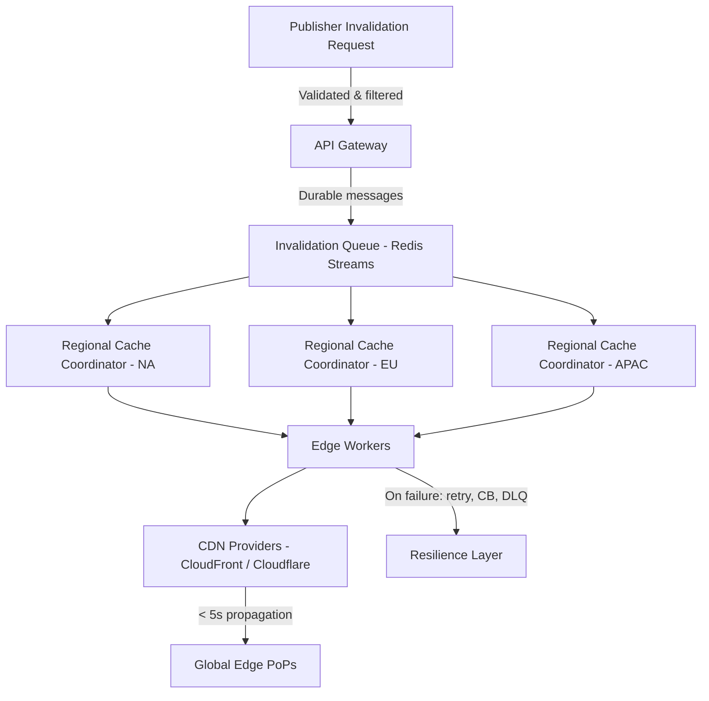

| Difficulty | Channel | Tags |
|---|---|---|
| intermediate | system-design | edge, caching, purging |

What if pressing the 'refresh' button for the entire internet took a second and a half? For Cloudflare, that was not a thought experiment, but an operational reality. As their global network ballooned to hundreds of data centers, every single cache purge had to be funneled through centralized 'core' data centers before being distributed, leading to ballooning global purge latency and wasted disk space [1]. The stakes were enormous: in a world of real-time releases, a stale asset can mean broken checkouts, leaked builds, or a very angry social post going viral. For developers and teams building multi-region platforms, the question is no longer 'if' you will need to invalidate caches at scale, but 'how fast can you do it without breaking the bank?'.

---

> ### Real-World Case — Cloudflare
>
> Cloudflare's original cache purge system routed every invalidation request through centralized 'core' data centers, which then fanned it out to the rest of its network via the Quicksilver configuration-distribution system. As the network grew to hundreds of data centers and customers began issuing millions of purges per day, purge latency ballooned (up to ~1.5s globally) and the need to store purge history on every machine ate into the disk space reserved for cached content.
>
> | | |
> |---|---|
> | **Challenge** | Guarantee fast, consistent propagation of cache invalidations across 330+ cities and 120+ countries without a central bottleneck, while dealing with three compounding problems: (1) latency proportional to a customer's distance from the centralized ingest point (e.g., an Australian purge had to cross the Pacific and back), (2) a write-throughput ceiling at that central ingest point, and (3) storage costs that scaled linearly with purge traffic because each machine had to keep purge history longer than the max cache eviction age. |
> | **Solution** | They rebuilt the system as a 'coreless' purge architecture: Workers and Durable Objects at the edge ingest and locally validate purges (filtering out uncacheable URLs and generating the cache key once to broadcast), then peer-to-peer fan out region-by-region through Purge Fanout workers. For flexible purges (by tag/hostname/prefix), they replaced the spoke-hub Quicksilver dependency with CacheDB — a per-machine sidecar written in Rust on RocksDB that indexes cached files by URL, hostname, and cache-tag. CacheDB maintains a local queue so the cache proxy can force a MISS the instant a purge arrives, then deletes matching files from disk in the background, turning 'lazy purge' into immediate active purge. |
> | **Outcome** | Global purge latency for tag/hostname/prefix purges dropped to under 150ms P50 (149ms global), a ~90% improvement over the ~1.5s core-based system (e.g., WNAM 1,000ms→115ms, ENAM 1,080ms→119ms, APAC 1,300ms→199ms, Africa 1,420ms→303ms). The new approach cut purge storage needs by 10x, freeing disk for cache retention, and let Cloudflare open advanced purge methods to Free/Pro/Business plans. Notably, they discovered over 50% of purge requests targeted URLs that were never cacheable by the requesting zone and were being wastefully broadcast. |
> | **Lesson** | Cache invalidation at global scale isn't solved by throwing a fast centralized system at it — the centralized fan-out was itself the bottleneck. Moving intelligence to the edge (workers + a per-machine index) and re-examining an old assumption ('active purge is too expensive') unlocked both a 90% latency win and 10x storage savings. Also: a huge fraction of 'work' can be garbage — filtering invalid requests before broadcast freed resources for legitimate purges. |

---

## Hook — The Hidden Cost of 'Stale'

Speed is addictive. Modern deployment pipelines ship to production dozens, if not hundreds, of times a day. However, as soon as a developer overwrites an asset, that new build must reach every edge that previously served the old version. Many developers think that setting a short TTL is enough to solve this problem. Until they learn that a TTL alone is a ticking clock: you cannot unsend a cached response that is still within its lifetime. The 1.5 second purge latency experienced by Cloudflare [1] may not sound catastrophic at first glance, but at internet scale, a 90th percentile regression of over a full second is the difference between a smooth deploy and a flood of support tickets. If this feels overwhelming, you are not alone — performance cliffs like this are one of the first rites of passage for global scale.

## Problem — The Tradeoff Between Speed, Consistency, and Cost

Here is the thing though: the technical problem is deceptively simple. Given a change to an object (or a set of objects), remove all cached copies from every point of presence on the planet. The reality, however, creates brutal tradeoffs. First, the number of edge locations is large and geographically dispersed, meaning any form of synchronous fan-out from a single origin will be bottlenecked by network distance and control plane contention. Second, consistency becomes a concern — if you eagerly return success to a publisher, but some regions fail to purge, readers can be served a mix of old and new content. Third, with APIs charging per invalidation call, broadcasting millions of purges per day can be ruinously expensive. HTTP caching semantics [2] and CDN invalidation models [3][4] both dictate that purging is a control plane operation, not a cache hit path. These constraints are exactly why 'just call the API for every URL' falls apart the moment throughput approaches 10,000 invalidations per second with a sub-5 second SLA.

## Real-World Case — Cloudflare

Cloudflare's engineering team lived this exact dilemma. Their original architecture routed every invalidation through a set of centralized 'core' data centers, which then distributed the work via their Quicksilver configuration-distribution system. As their network grew to hundreds of data centers and customers began issuing millions of purges per day, global purge latency ballooned to approximately 1.5 seconds. Furthermore, the requirement to store purge history on every machine was eating into the disk space that was reserved for cached content — a direct hit to cache hit ratio and retention [1]. Rather than throwing more hardware at the core, they decentralized the control plane. The result was dramatic: global purge latency for tag, hostname, and prefix purges dropped to under 150 ms P50 (a ~90% reduction), freeing up disk space by a factor of 10x and allowing advanced purge methods to be opened up to Free, Pro, and Business plans. Perhaps most notably, they discovered that over 50% of purge requests were targeting URLs that were never cacheable by the requesting zone, allowing for wasteful broadcasts to be cut entirely. This is a textbook example of letting telemetry, not assumptions, drive the architecture.

## Deep Dive — Designing for the Unhappy Path

Building on this decentralized mindset, you need to solve for scale without sacrificing correctness. The first pillar is batching: most CDN APIs allow purging multiple files or patterns in a single call, drastically cutting API egress and cost [3][4]. The second is asynchrony: a durable queue (such as Redis Streams with consumer groups) decouples ingestion from execution, absorbing traffic spikes far beyond what synchronous workers could handle [5]. The third is locality: regional cache coordinators and edge compute, such as Cloudflare Workers, allow invalidations to be orchestrated closer to the PoPs that need them, avoiding a single continental round trip for every region [4]. However, you cannot ignore distributed systems fundamentals. With independent regional failures, you will inevitably run into partial success. For this reason, you should design for eventual consistency [6][7] rather than attempting global atomicity — a tradeoff that becomes necessary due to the CAP theorem [8]. To keep the blast radius small, employ retry with exponential backoff and jitter [9], circuit breakers to fail fast on poisoned backends [10], and a dead-letter queue to surface unrecoverable purges for manual reconciliation. Additionally, short TTLs (e.g. 2 seconds) for highly dynamic content act as a safety net — a last-resort expiration in the rare case that an invalidation never propagates [2].

## Workflow — From Request to Propagation in < 5 Seconds

With the theory in tow, let's map the happy (and tolerant) path. First, a publisher issues an invalidation request against an API gateway. The gateway validates the targets, filters out non-cacheable or irrelevant entries (the exact optimization that saved Cloudflare so many broadcasts [1]), and enqueues the work into a durable, sharded queue. From there, regional cache coordinators consume messages in batches of ~100 and delegate to their closest edge workers, which issue batched API calls to the relevant CDN providers (e.g. AWS CloudFront [3] and Cloudflare [4]). Edge workers enforce per-zone rate limits, perform idempotency checks, and attach correlation IDs for observability. On failure, they use exponential backoff with jitter to retry up to a configured maximum, tripping a circuit breaker on repeated failures before moving messages to a dead-letter queue for review. Finally, CDN control planes propagate the purge to their PoPs; clients picking up the new content within seconds is achieved by combining explicit invalidation with short `Cache-Control` values such as `max-age=2, must-revalidate` [2]. This workflow is visualized below — notice how the core disappears, replaced with a queue and regional coordination. 

## Code Example — Batch, Retry, and Circuit Break with Cloudflare's API

Theory means nothing without execution. The following TypeScript snippet demonstrates a production-minded pattern: batching purge requests, enforcing timeouts, retrying with exponential backoff and jitter, and short-circuiting with a basic circuit breaker. While simplified for readability, these are the exact primitives that allow you to safely hit the 10,000 invalidations/sec target while still meeting a 5-second SLA. The code shown here would run inside an edge worker or a regional coordinator. For the API contract itself, refer to Cloudflare's purge documentation [4] and the batching guidance that parallels Cloudflare's own optimizations [1].

## Lessons Learned — Ship Stale-Resistant Systems Tomorrow

After tracing this journey from Cloudflare's 1.5s cliff to a sub-150ms reality, a few lessons stand out. First, don't optimize what you don't measure — over 50% of 'work' was waste, and telemetry is what exposed it [1]. Second, central bottlenecks compound with geography; decentralize control planes wherever possible and leverage edge compute for locality [4]. Third, design for failure: partial purges are inevitable at scale, so favor eventual consistency [6][7], idempotency, retries with exponential backoff and jitter [9], circuit breakers [10], and DLQs over trying to achieve global two-phase commits. Fourth, batch aggressively to cut costs and control plane pressure [3][4], and combine explicit invalidation with short TTLs for defense in depth [2]. Finally, treat cache purging as a first-class distributed system, not a side effect of a deployment webhook. If you only take one thing away from this story, let it be this: when correctness and speed collide, make the correct failure mode the default. That's the lesson that allowed Cloudflare to turn a second-and-a-half of global wait time into milliseconds — and it's one you can apply to your own multi-region systems starting today.

---

## Decentralized CDN Cache Purge Flow

<strong>Original Interview Question</strong>

**Q:** How would you design a multi-region CDN cache purging system that guarantees content propagation within 5 seconds while handling 10,000 concurrent invalidations per second?

**A:** Implement Cloudflare API + AWS CloudFront with distributed invalidation queue, edge compute coordination, and 2-second TTL. Use batch invalidation, exponential backoff, and regional cache headers for 5-second SLA.

## Conclusion

Speed at scale is not about making a single call faster — it is about removing the single point that forces every call to converge. Cloudflare's journey from a 1.5s core bottleneck to sub-150ms global purges proves that decentralization, aggressive batching, and failure-aware design can be revolutionary. Tomorrow, when you are designing a deployment that touches multiple regions, don't reach for a synchronous broadcast. Filter ruthlessly for cacheable targets, enqueue work durably, coordinate regionally, and make retries, circuit breakers, and short TTLs your default safety net. Do those four things, and you won't just meet a 5-second SLA — you'll sleep a whole lot easier knowing your users are seeing the right version, at the right time.

---

## References

1. [Cloudflare: Instant Purge](https://blog.cloudflare.com/instant-purge/) — blog
2. [RFC 7234: Hypertext Transfer Protocol (HTTP/1.1): Caching](https://datatracker.ietf.org/doc/html/rfc7234) — paper
3. [AWS CloudFront: Invalidating Files](https://docs.aws.amazon.com/AmazonCloudFront/latest/DeveloperGuide/Invalidation.html) — documentation
4. [Cloudflare: Purge Cache](https://developers.cloudflare.com/cache/how-to/purge-cache/) — documentation
5. [Redis: Streams](https://redis.io/docs/latest/develop/data-types/streams/) — documentation
6. [Wikipedia: Eventual Consistency](https://en.wikipedia.org/wiki/Eventual_consistency) — documentation
7. [Wikipedia: CAP Theorem](https://en.wikipedia.org/wiki/CAP_theorem) — documentation
8. [Exponential Backoff](https://en.wikipedia.org/wiki/Exponential_backoff) — documentation
9. [Circuit Breaker Pattern](https://martinfowler.com/bliki/CircuitBreaker.html) — blog

---

**Author:** Satishkumar Dhule — [GitHub](https://github.com/satishkumar-dhule) · [LinkedIn](https://linkedin.com/in/satishkumar-dhule) · [Website](https://satishkumar-dhule.github.io)
