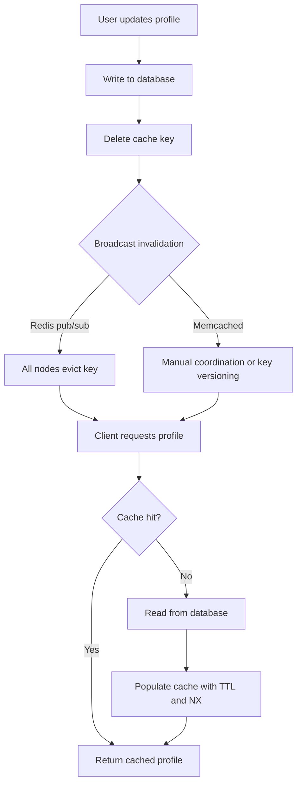
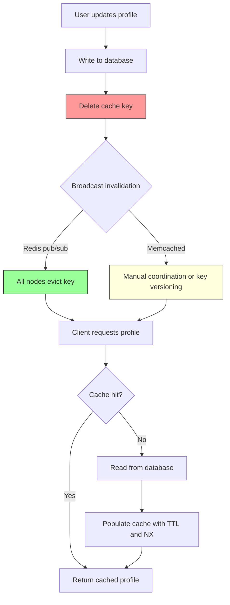

| Difficulty | Channel | Tags |
|---|---|---|
| beginner | backend | redis, memcached, cache-invalidation |

At Facebook, a single page load could fan out to dozens of memcached servers sitting in front of a sharded MySQL fleet, and keeping those caches honest under relentless concurrent writes exposed two brutal failure modes: stale sets and thundering herds [1]. Engineers responded with a lease mechanism that slashed peak database query rate from 17,000 queries per second to about 1,300, and dropped stale-write frequency from 6% to 0.3% without damaging the cache hit rate [1]. That same tension, speed versus truth, is exactly what you face the moment you build a user profile service that caches frequently accessed data. This article follows the journey from broken cache to consistent cache, and shows where Redis and Memcached force you to make real trade-offs.

---

> ### Real-World Case — Facebook (Meta)
>
> Facebook's social graph required enormous read fan-out — a single page request could contact dozens of different memcached servers. They deployed thousands of memcached servers as a demand-filled look-aside cache in front of sharded MySQL, handling trillions of items. But keeping that cache consistent with the database under massive concurrent read/write load introduced two nasty failure modes: stale sets (a slow reader writing an outdated value back into the cache) and thundering herds (a hot key repeatedly invalidated, forcing legions of reads straight to the database).
>
> | | |
> |---|---|
> | **Challenge** | Implement correct cache invalidation at billion-user scale without letting stale data persist or letting cache misses stampede the database. Naively deleting and re-setting keys on every update was both non-idempotent-safe and could not arbitrate races between concurrent writers, and per-key invalidations broadcast from backend clusters threatened to flood the network. |
> | **Solution** | Facebook extended the memcached protocol with 'leases' — on a cache miss, memcached hands the client a 64-bit token bound to that key, and the client must present the token to write the value back. If a delete arrives first, the lease is invalidated and the stale write is rejected, solving stale sets. Leases also throttle thundering herds by allowing only one client to recompute a missing value while others wait or use a slightly stale value. For cross-cluster consistency, backend database servers run 'mcsqueal' daemons that tail the MySQL commit log and broadcast batched invalidations through mcrouter, achieving read-after-write consistency and resynchronizing caches after failures. |
> | **Outcome** | The lease mechanism cut peak database query rate from 17,000 queries/second to about 1,300/second, and reduced stale set frequency from 6% to 0.3% without hurting the cache hit rate. Batching invalidations from the commit log used 18x fewer packets than naive broadcast approaches. The resulting infrastructure serves billions of requests per second across trillions of cached items. |
> | **Lesson** | Cache invalidation is genuinely a distributed-coordination problem, not just a delete call. Facebook chose deletes over sets because deletes are idempotent, and pushed complexity into the client and cache protocol (leases) rather than trusting application code to win races. The key insight: a soft-state cache can become your de facto primary data store, so you must engineer consistency, failure handling, and invalidation as first-class concerns — and operational efficiency (batching, fewer packets) matters as much as raw performance. |

---

## Hook — The Cache That Quietly Went Rotten

Picture the moment a product manager pings you because a user changed their display name an hour ago and it still shows the old one everywhere in the app. Nothing is down. Your dashboards are green. The database row is correct. And yet every single user is being served a ghost.

That is the strange cruelty of caching: it works perfectly until it doesn't, and when it fails it fails silently. At Facebook, this wasn't a hypothetical. Their social graph demanded enormous read fan-out, and they deployed thousands of memcached servers as a demand-filled look-aside cache [1]. Scaling the terabytes was the easy part. Keeping that cache consistent with the database under massive concurrent read/write load is where the real war started [1].

So here's the question that should keep you up at night: when a user updates their profile, how do you make sure the change wins everywhere, instantly, without melting your database when a hot key gets hit a million times a second? The answer is less about picking a tool and more about understanding two failure modes most developers don't see until production teaches them the hard way.

## Problem — Caching Is Easy, Consistency Is a Trap

Many developers think caching is a performance feature. It is actually a consistency problem wearing a performance costume. The moment you store a second copy of the truth, you own the job of keeping those copies in sync, and cache invalidation has a well-earned reputation as one of the hardest problems in computer science [2].

Consider what you're really asking for in a user profile service:

- Reads are frequent. Profile data is fetched constantly and is a perfect caching candidate.
- Writes are rare but must be authoritative. When someone edits their bio, the new value must win.
- Traffic is concurrent. Reads and writes for the same key can overlap, and the interleaving creates bugs no unit test catches.

The trap is that the naive approach feels obvious: update the database, then update the cache. But under concurrency, a slow reader can write an outdated value back into the cache after a faster writer just refreshed it. That's a stale set. And if a hot key gets invalidated repeatedly, legions of reads bypass the cache and hammer the database at once. That's a thundering herd [10]. Neither shows up in your happy-path tests. Both show up at 3 a.m.

This is why the stakes feel so personal. You are not just choosing a cache; you are deciding which failure modes you are willing to live with. And as the next section shows, even a company operating at planetary scale had to engineer its way out of exactly these two traps.

## Real-World Case — Facebook (Meta) and the Trillion-Item Cache

Facebook's memcached deployment was, and remains, a masterclass in look-aside caching at scale. A single page request could touch dozens of different memcached servers, each backed by a sharded MySQL cluster, collectively handling trillions of items [1]. The cache absorbed breathtaking read volume, but consistency under concurrency gave them two specific nightmares.

First, stale sets. A reader could fetch a value, get delayed, and then write that now-outdated value back into the cache, overwriting a fresher write. Facebook measured this happening on roughly 6% of writes in the affected scenarios, which at their scale meant an enormous volume of silently wrong data [1].

Second, thundering herds. When a popular key was invalidated, thousands of concurrent requests would miss simultaneously and stampede straight to the database [1]. A single hot item could effectively DDoS their own storage layer.

The fix was elegant: a lease mechanism. On a miss, the cache hands out a short-lived lease to one client to fetch and set the value, while other clients are told to wait briefly instead of hitting the database [1]. The results were dramatic. Peak database query rate fell from 17,000 queries per second to about 1,300, and stale-set frequency dropped from 6% to 0.3%, all without hurting the cache hit rate [1]. They also batched invalidations from the commit log, using 18x fewer packets than a naive broadcast approach [1].

The takeaway for your profile service is not that you need Facebook's infrastructure. It's that the two failure modes they fought are operating in your system right now, just smaller. The next section unpacks the mechanics so you can design them out.

## Deep Dive — Redis vs Memcached and the Real Trade-offs

Building on Facebook's experience, the natural question becomes: which cache engine do you reach for? The honest answer is that the engine matters less than the invalidation strategy you build on top of it. Get the strategy wrong and even the best cache betrays you. Get it right and either engine can work.

Start with the invalidation patterns themselves:

- Cache-aside (look-aside): the application reads the cache, and on a miss reads the database and populates the cache. Facebook leaned heavily on this model [1]. It's simple and resilient, but the populate step is where stale sets creep in.
- Write-through: on an update, you write to the database and the cache together, or delete the key so the next read repopulates. Deleting is often safer than overwriting, because it avoids racing a stale write [2].
- TTL-based expiration: every entry carries a time-to-live. For profiles, 5 to 30 minutes is a sensible band. TTL is your safety net, not your primary strategy; it bounds how long a mistake can live.

Now the Redis vs Memcached comparison, with the real trade-off spelled out:

| Dimension | Redis | Memcached |
|---|---|---|
| Distributed invalidation | Native pub/sub lets nodes broadcast eviction events [4] | No built-in messaging; you coordinate manually |
| Persistence | Optional snapshots and AOF for durability [4] | Pure in-memory, data is gone on restart [3] |
| Data structures | Lists, sets, sorted sets, hashes, streams [4] | Simple key-value blobs only [3] |
| Memory overhead | Higher per-key overhead | Lower overhead, very efficient for plain caching [3] |
| Horizontal scaling | More operational surface area | Simpler to shard and scale |

But wait, it gets better. Redis pub/sub sounds like magic until you realize it has a sharp edge: pub/sub is fire-and-forget. If a subscriber node is restarting when the invalidation fires, it misses the message and can serve stale data until the TTL saves it. That's why durable invalidation often uses Redis Streams or a versioned key scheme instead of raw pub/sub. Memcached, by contrast, gives you no messaging at all, so teams typically lean on TTL plus a version counter in the key name to sidestep cross-node coordination entirely [3].

The HTTP caching world solved a version of this problem formally, and it's worth borrowing its vocabulary: RFC 9111 defines how caches validate freshness and revalidate stale entries [8], and MDN's guide to HTTP caching is a great mental model for TTLs and validators [7]. For managed deployments, AWS documents these exact strategies for Redis [9].

So which do you choose? If you need distributed invalidation, richer data structures, or durability, Redis is the natural fit [4]. If you want the simplest possible pure cache with minimal memory overhead and you're comfortable coordinating invalidation yourself, Memcached stays brutally efficient [3]. Now let's turn this into an actual workflow.

## Workflow — The Invalidation Journey, Step by Step

This leads to the practical flow. The diagram below tells the whole visual story: how a read warms the cache, how a write invalidates it, and how the invalidation message reaches every node.

1. Read path. The client requests a profile. The service checks the cache first. On a hit, return immediately.
2. Cache miss. On a miss, read from the database, then populate the cache with a TTL. Use a set-if-not-exists operation so a concurrent writer isn't clobbered by your stale read.
3. Write path. When a user updates a profile, write to the database first. The database is the source of truth, always.
4. Invalidate. Delete the cache key rather than blindly overwriting it. Deleting forces the next read to repopulate from the authoritative database [2].
5. Broadcast. Publish an invalidation event. With Redis, pub/sub fans it out to every node [4]. With Memcached, you either coordinate manually or encode a version into the key.
6. Absorb the herd. Use a short-lived lease or a slightly stale serve window so a hot key's invalidation doesn't send a stampede to the database [10].

The visual flow:

Notice the deliberate asymmetry: writes always touch the database, and the cache is treated as disposable. That single decision is what keeps you sane when things go wrong. Because here's the thing though, the flowchart hides the hard part, the race conditions. The code example brings them into the light.

## Code Example — A Safe Write-Through Profile Cache in Python

Finally, this is where theory meets your editor. The following Python example implements cache-aside reads, write-through updates, and Redis pub/sub invalidation. It is illustrative but mirrors real production structure.

The key design decisions embedded in the code:

- socket_timeout is set aggressively short so a slow cache never becomes a slow request path. Cache failures should degrade gracefully, not cascade.
- Reads use set with nx=True (set-if-not-exists) so a delayed reader cannot overwrite a fresher value, directly addressing the stale-set problem Facebook fought [1].
- Writes go to the database first, then the cache, and then publish an invalidation event so every node drops its view [4].
- The subscriber deletes keys rather than overwriting, letting the next read repopulate safely [2].

The explanation after the code walks through each section and explains why it is ordered this way.

## Lessons Learned — What to Do Differently Tomorrow

Let's close the loop. The journey started with a ghost: a profile that looked updated in the database but stale everywhere users could see it. Facebook's experience shows that the ghost is not a tooling failure; it is a design failure waiting to happen in any cache, at any scale [1].

Here are the takeaways worth taping to your monitor:

- Treat the cache as disposable and the database as truth. Every design decision should follow from that hierarchy.
- Delete keys on update instead of overwriting them. Deleting sidesteps the stale-set race that overwriting invites [2].
- Always set a TTL, even if it feels generous. TTL is your blast radius limiter for bugs you haven't found yet.
- Design for the thundering herd before it finds you. A lease or a short stale-serve window turns a stampede into a queue [10].
- Choose Redis when you need distributed invalidation, durability, or rich structures, and Memcached when you want raw simplicity and low overhead [3][4].
- Monitor hit rate, eviction rate, and database load. At Facebook, measuring the 6% stale rate was as important as fixing it [1].
- Remember that pub/sub is fire-and-forget. Pair it with TTLs or durable streams so a missed message is a delay, not permanent corruption [4].

⚠️ Watch Out: the most common battle scar is testing invalidation only on single-threaded, low-concurrency paths. If your tests never interleave a slow read with a fast write, they never exercise the stale set, and your first production incident becomes your regression test.

The moral of the story is simple and shareable: caching is not about how fast you can serve data, it is about how confidently you can serve the truth. Build the invalidation path first, treat the cache as disposable, and your users will never see the ghost.

---

## Cache Invalidation Flow

<strong>Original Interview Question</strong>

**Q:** You're building a user profile service that caches frequently accessed profiles. How would you implement cache invalidation when a user updates their profile, and what trade-offs would you consider between Redis and Memcached?

**A:** Implement write-through caching with TTL-based expiration. On profile update, invalidate the cache by deleting the key and writing new data to both the database and cache. Redis offers pub/sub for automatic distributed invalidation, while Memcached requires manual coordination across nodes.

## Conclusion

The ghost in the cache is always a design choice you didn't make on purpose. Facebook proved that stale sets and thundering herds are survivable at planetary scale with a lease and batched invalidation, cutting peak database load from 17,000 to 1,300 queries per second [1]. Tomorrow, audit your own profile service: confirm you delete keys instead of overwriting, confirm every entry has a TTL, and confirm an invalidation event reaches every node or is bounded by that TTL. Then ask your team the one question that matters: if the cache vanished right now, would the system still serve the truth? The memorable insight to share is this: caching is not about serving data faster, it is about serving the truth confidently.

---

## References

1. [Facebook (Meta) incident report](https://www.usenix.org/conference/nsdi13/technical-sessions/presentation/nishtala) — paper
2. [Cache invalidation strategies](https://en.wikipedia.org/wiki/Cache_invalidation) — documentation
3. [Memcached overview](https://en.wikipedia.org/wiki/Memcached) — documentation
4. [Redis overview and data structures](https://en.wikipedia.org/wiki/Redis) — documentation
5. [Redis source repository](https://github.com/redis/redis) — documentation
6. [Memcached source repository](https://github.com/memcached/memcached) — documentation
7. [MDN: HTTP caching](https://developer.mozilla.org/en-US/docs/Web/HTTP/Caching) — documentation
8. [RFC 9111: HTTP Caching](https://datatracker.ietf.org/doc/html/rfc9111) — documentation
9. [AWS: Database Caching Strategies Using Redis](https://docs.aws.amazon.com/whitepapers/latest/database-caching-strategies-using-redis/database-caching-strategies-using-redis.html) — documentation
10. [Thundering herd problem](https://en.wikipedia.org/wiki/Thundering_herd_problem) — documentation

---

**Author:** Satishkumar Dhule — [GitHub](https://github.com/satishkumar-dhule) · [LinkedIn](https://linkedin.com/in/satishkumar-dhule) · [Website](https://satishkumar-dhule.github.io)
