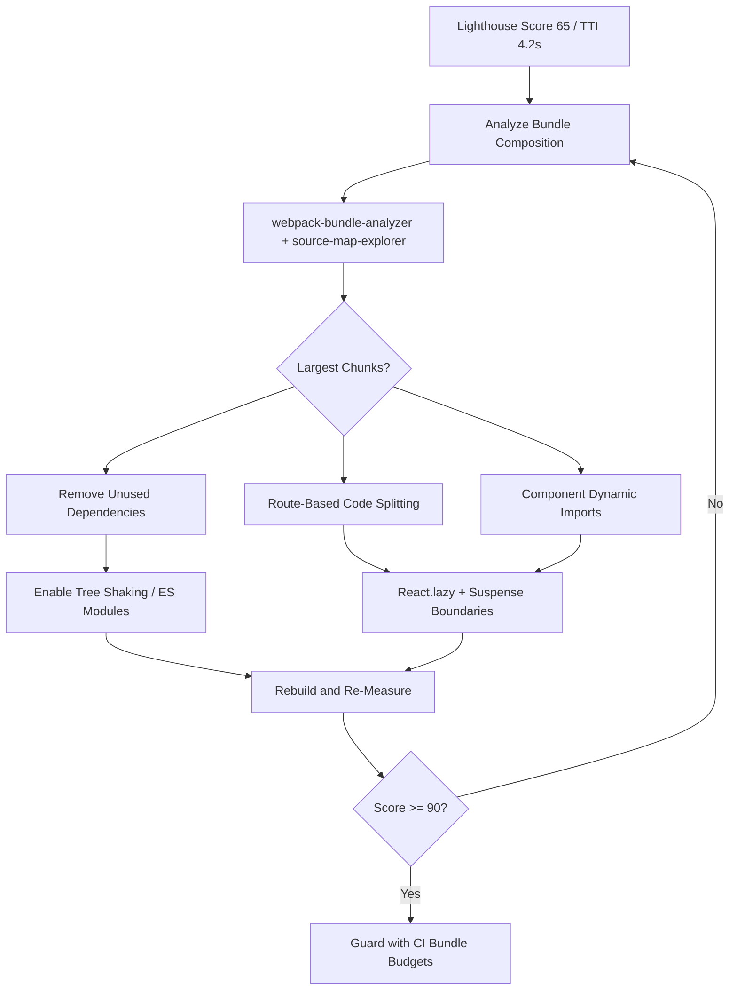

| Difficulty | Channel | Tags |
|---|---|---|
| intermediate | frontend | lighthouse, bundle, lazy-loading |

Dropbox once shipped a homegrown module bundler that quietly ballooned into a 6,000-line packaging map, dragging every user down with megabytes of JavaScript they never asked for [1]. When the team finally replaced it, bundle sizes fell by 33% and script counts by 15% — but the migration also detonated a few landmines nobody saw coming. So when your own Lighthouse score sits at a sad 65 and Time to Interactive stretches to 4.2 seconds, the lesson isn't 'just lazy load.' It's that shrinking JavaScript is a story about trade-offs, and the surprises are where the real learning lives.

---

> ### Real-World Case — Dropbox
>
> Dropbox's web app relied on a homegrown module bundler built back in 2014. As the codebase grew, it shipped huge amounts of unnecessary JavaScript to every user, hurting page loads and frustrating developers who had to manually maintain a 6,000+ line packaging map.
>
> | | |
> |---|---|
> | **Challenge** | Eliminate massive bundle sizes and slow Time-to-Visible-Content by solving three problems at once: no automatic code-splitting (so users downloaded the whole app for any page), no tree shaking (so unused code and third-party libraries bloated every package), and a brittle manual packaging process that slowed engineering velocity. |
> | **Solution** | They migrated to Rollup as their module bundler to get automatic code-splitting, tree shaking, and other optimizations out of the box. Route-based code-splitting meant only the chunks needed for the current page were downloaded, and tree shaking stripped unused code — including megabytes of unused code introduced by Protobuf observability instrumentation. |
> | **Outcome** | After rolling out to all Dropbox users, JavaScript bundle sizes dropped by 33% and total script count by 15%, with modest Time-to-Visible-Content improvements — while eliminating manual bundle shuffling and slashing years of accumulated tech debt. The migration also surfaced surprises: Rollup's aggressive tree shaking could introduce bugs, legacy code failed under strict mode, and too many chunks actually hurt compression and module discovery despite HTTP/2 multiplexing. |
> | **Lesson** | Code splitting is not a free win: splitting into too many chunks can backfire because browsers spend more time discovering modules and compression is less efficient across many small files than one large one. Also, enabling tree shaking and strict mode on a large legacy codebase will surface latent bugs and dead code you never knew you were shipping. |

---

## Hook — Your App Is Fast on Your Laptop and Slow Everywhere That Matters

Picture the moment: a product review, a projector humming, someone opens the app on a mid-range Android over hotel Wi-Fi. The spinner spins. And spins. A 2.1MB bundle is a lot of JavaScript to hand a phone that is already doing its best. Lighthouse says 65. Time to Interactive says 4.2 seconds. The dashboard looks fine on the developer's M-series laptop, which is exactly the trap — fast machines and cached assets lie to you constantly. Every second a user waits, you are paying for it in bounce, conversion, and trust. The question is not whether the bundle is too big. It is why, and what you are willing to break to fix it. That uncomfortable frontier is what Dropbox ran straight into [1].

## Problem — A 2.1MB Bundle Is Not One Problem, It's Five

Here is the thing though: a bloated bundle is rarely caused by a single bad decision. It is the slow accumulation of dozens of reasonable ones. A charting library imported wholesale for one sparkline. Three date libraries, because different teams picked different ones. A polyfill for a browser that no longer exists. A 400KB admin module that every anonymous visitor downloads but never uses.

Consequently, the metrics hide the root cause. Time to Interactive (TTI) is a symptom, not a diagnosis — it measures when the main thread finally calms down enough to respond, which depends on parse time, execution time, and network transfer all at once. A 2.1MB bundle is roughly 2.1MB of parsing and compilation that has to happen before your app does anything meaningful.

Who feels this? Everyone. Users on slower devices feel it as latency. Product teams feel it as lower conversion. And developers feel it as a growing sense of dread, because they know each new import makes the problem invisible-until-it-isn't worse. Ever noticed how the bundle always seems 'fine' right up until the day it isn't? That is the accumulation problem in a nutshell.

## Real-World Case — Dropbox Rewrites Its Bundler and Finds Both Wins and Wounds

Dropbox's engineering team documented how their web app relied on a homegrown module bundler built back in 2014. As the codebase grew, the bundler shipped enormous amounts of unnecessary JavaScript to every user, and developers had to manually maintain a packaging map that stretched past 6,000 lines [1]. That map was the tell: the tooling had stopped scaling long before the symptoms showed up in production.

The team migrated to Rollup and rolled it out to all users. The headline results were real: JavaScript bundle sizes dropped by 33% and total script count by 15%, with modest but measurable improvements to Time-to-Visible-Content — all while eliminating the manual bundle shuffling and years of accrued tech debt [1].

But wait, it gets better, and messier. Rollup's aggressive tree shaking could actually introduce bugs by removing code it decided was unreachable. Legacy code failed under strict mode. And, counterintuitively, creating too many chunks ended up hurting compression and module discovery — even with HTTP/2 multiplexing on their side [1]. That last point is the plot twist many teams miss: splitting is not free, and more chunks is not automatically better.

## Deep Dive — Code Splitting, Tree Shaking, and the Trade-offs Nobody Warns You About

Building on Dropbox's experience, the core techniques split into two families: making the bundle smaller (tree shaking, dead-code elimination, dependency pruning) and making the bundle arrive later (code splitting, dynamic imports, lazy loading).

📦 Tree shaking removes unused exports by statically analyzing ES modules. It only works reliably when modules are side-effect free; a module that mutates globals on import is a landmine. This is exactly why Rollup's aggressive shaking surprised Dropbox — it can be correct by the letter of the spec and still break your app [1].

✂️ Code splitting breaks one monolith into loadable pieces. Route-based splitting is the highest-leverage move because it aligns bundles with navigation: users download the analytics page only when they visit the analytics page. Component-based splitting is finer-grained and more dangerous.

Here is a table worth pinning to your wall:

| Strategy | Best For | The Real Trade-off |
|---|---|---|
| Route-based splitting | Multi-page apps, dashboards | Slight delay on first navigation to a route |
| Component splitting | Heavy, rarely-used widgets | Request waterfall; too many small chunks |
| Tree shaking | Removing dead exports | Breaks if modules have side effects |
| Dynamic imports | Third-party opt-in features | Loading/error states to design and handle |

⚠️ Watch Out: HTTP/2 multiplexing lets browsers request many files in parallel, but it does not make chunk counts free. Dropbox observed that excessive chunking hurt compression and module discovery [1]. Each chunk has its own overhead, and gzip/brotli compress across a single file's redundancy — so splitting a repeated utility across twenty chunks can actually increase total bytes.

💡 Insight: The goal is not 'smallest possible initial bundle.' It is 'the fastest path to a useful, interactive screen,' which sometimes means letting a route load one medium chunk instead of ten tiny ones.

## Workflow — A Repeatable Pipeline From 65 to 90+

Therefore, resist the urge to start slicing files immediately. Measure, split, verify, repeat — the same discipline Dropbox applied when they stopped hand-maintaining that 6,000-line map [1]. The diagram below tells the whole visual story:

flowchart TD
    A[Lighthouse Score 65 / TTI 4.2s] --> B[Analyze Bundle Composition]
    B --> C[webpack-bundle-analyzer + source-map-explorer]
    C --> D{Largest Chunks?}
    D --> E[Remove Unused Dependencies]
    D --> F[Route-Based Code Splitting]
    D --> G[Component Dynamic Imports]
    E --> H[Enable Tree Shaking / ES Modules]
    F --> I[React.lazy + Suspense Boundaries]
    G --> I
    H --> J[Rebuild and Re-Measure]
    I --> J
    J --> K{Score >= 90?}
    K -- No --> B
    K -- Yes --> L[Guard with CI Bundle Budgets]

Step by step, the pipeline looks like this:

1. Profile before touching code. Run webpack-bundle-analyzer and answer one question: what are the top five chunks by parsed size? "I think it's lodash" is not data.
2. Remove the obvious waste first. Swap moment for a lighter date library, replace a full icon set with individual imports, and drop polyfills your analytics say you no longer need. This is free wins before any architectural change.
3. Enable tree shaking correctly. Confirm your bundler resolves ES modules (module field or 'sideEffects: false' where safe), because if it is consuming CommonJS, shaking silently does nothing.
4. Apply route-based splitting. Wrap each top-level route in React.lazy and a Suspense boundary. This is the single highest-return change for most apps [1].
5. Add dynamic imports for heavy, non-critical widgets. Charts, rich editors, and map libraries are ideal candidates — they are big and often below the fold.
6. Tune the chunk count. Merge tiny chunks into vendor and shared bundles to keep compression and module discovery healthy, echoing Dropbox's finding that too many chunks backfire [1].
7. Verify. Re-run Lighthouse in the same conditions, on throttled mobile, and lock in a CI budget so the regression cannot sneak back.

A common mistake here is measuring on a fast local machine with warm caches. If this feels overwhelming, you are not alone — but throttled Lighthouse runs are non-negotiable.

## Code Example — Route and Component Splitting With Real Error Handling

Now for the implementation. The snippet below wires route-based splitting, component-level lazy loading, a real error boundary, and a webpack hint that keeps chunking sane — directly answering the 2.1MB problem from the opening.

JavaScript, React: the code defines lazy routes, groups them under Suspense, and provides an ErrorBoundary so a failed import never blanks the screen.

```javascript
import React, { Suspense, lazy } from 'react';
import { Routes, Route } from 'react-router-dom';

// Route-based splitting: each top-level page becomes its own chunk.
// Users download Dashboard JS only when they actually navigate to /dashboard.
const Dashboard = lazy(() => import(/* webpackChunkName: "dashboard" */ './Dashboard'));
const Analytics = lazy(() => import(/* webpackChunkName: "analytics" */ './Analytics'));
const Settings  = lazy(() => import(/* webpackChunkName: "settings" */  './Settings'));

// Component-based splitting for a heavy, below-the-fold widget.
const HeavyChart = lazy(() => import(/* webpackChunkName: "charts" */ './HeavyChart'));

class ErrorBoundary extends React.Component {
  state = { hasError: false };
  // A failed dynamic import must not blank the whole app.
  static getDerivedStateFromError() { return { hasError: true }; }
  componentDidCatch(error) {
    // Ship this to your error tracker instead of swallowing it.
    console.error('Chunk load failed:', error);
  }
  render() {
    if (this.state.hasError) return <p role="alert">This section failed to load. Retry?</p>;
    return this.props.children;
  }
}

function App() {
  return (
    <ErrorBoundary>
      {/* One Suspense boundary per route keeps fallbacks scoped, not global. */}
      <Suspense fallback={<LoadingSpinner />}>
        <Routes>
          <Route path="/dashboard" element={<Dashboard />} />
          <Route path="/analytics" element={<Analytics />} />
          <Route path="/settings"  element={<Settings />} />
        </Routes>
      </Suspense>
      {/* Load the chart only when its section renders. */}
      <Suspense fallback={<ChartSkeleton />}>
        <HeavyChart />
      </Suspense>
    </ErrorBoundary>
  );
}

export default App;
```

The explanation walks through the design decisions. The lazy() calls turn static imports into dynamic imports, each producing a separate chunk named via webpackChunkName — those names make the analyzer output readable instead of 'chunk.4f2a.js'. Route-based boundaries mean the initial payload contains only the shell plus the current route. The ErrorBoundary is not decoration: dynamic imports fail in the real world (offline users, stale chunk hashes after a deploy), and without it a failed chunk blanks the app. Scoping Suspense per section avoids a full-page spinner when only one widget is loading. Finally, the chunk-name comments pair with a webpack splitChunks config that merges shared dependencies into a vendor bundle — keeping chunk count low so compression stays effective, the exact trap Dropbox documented [1].

## Lessons Learned — What to Do Differently Tomorrow

So what is the moral of this journey from a 65 Lighthouse score to 90+? That the win does not come from a single clever trick — it comes from a repeatable loop of measurement, splitting, and verification.

🎯 Key Point: Optimization is a practice, not a one-time event. The moment you stop measuring, tech debt quietly re-accumulates the way Dropbox's 6,000-line map did [1].

🔥 Hot Take: More chunks is not the same as faster. Dropbox found that over-splitting hurt compression and module discovery despite HTTP/2 [1] — so treat chunk count as a metric with a floor and a ceiling, not a race to the bottom.

Here are the takeaways worth sharing with your team:

- Analyze before you act. The top chunk is almost never the one you assume.
- Remove before you split. Deleted dependencies are infinitely small and load instantly.
- Split by route first, component second. It aligns payload with user intent.
- Always wrap lazy imports in an error boundary. Stale chunks after deploys are a classic 2am page.
- Guard your gains with a CI bundle budget, or watch them evaporate.
- Beware aggressive tree shaking and strict mode when migrating bundlers — Dropbox learned both the hard way [1].

Expect surprises. Migrations surface legacy assumptions. A module that mutated globals, a build that depended on import order, a polyfill load-bearing in a way nobody documented. That is not failure — it is the debt becoming visible so you can finally pay it down.

The memorable takeaway: shipping less JavaScript is a feature. Every kilobyte you don't send is a kilobyte no user has to parse, and the fastest code is the code you never load.

---

## Bundle Optimization Workflow



<details>
<summary><strong>Original Interview Question</strong></summary>

**Q:** You're tasked with improving a React app's Lighthouse performance score from 65 to 90+. The bundle size is 2.1MB and Time to Interactive is 4.2s. What specific steps would you take to optimize the bundle and implement lazy loading?

**A:** Implement code splitting with React.lazy() and Suspense, analyze bundle composition with webpack-bundle-analyzer to identify largest chunks, remove unused dependencies and optimize imports, add dynamic imports for heavy components and third-party libraries, implement route-based splitting for better initial load times, and utilize tree shaking with proper ES module configuration.

</details>

## Conclusion

The journey from a 65 Lighthouse score to 90+ is not a hack you apply once — it is a discipline you keep. Dropbox proved the payoff is real, with 33% smaller bundles and 15% fewer scripts, but they also proved the road is bumpy, from tree-shaking bugs to strict-mode failures to over-chunking that quietly hurt compression [1]. Start tomorrow by running a bundle analyzer and naming your five biggest chunks out loud. Then delete what you don't need, split by route, wrap every lazy import in an error boundary, and lock the win behind a CI budget. The insight to share with your team: the fastest JavaScript is the JavaScript you never ship at all.

---

## References

1. [Dropbox incident report](https://dropbox.tech/frontend/how-we-reduced-the-size-of-our-javascript-bundles-by-33-percent) — article
2. [MDN: import() dynamic import](https://developer.mozilla.org/en-US/docs/Web/JavaScript/Reference/Operators/import) — documentation
3. [MDN: Lazy loading](https://developer.mozilla.org/en-US/docs/Web/Performance/Lazy_loading) — documentation
4. [React: lazy](https://react.dev/reference/react/lazy) — documentation
5. [Wikipedia: Code splitting](https://en.wikipedia.org/wiki/Code_splitting) — article
6. [Wikipedia: Tree shaking](https://en.wikipedia.org/wiki/Tree_shaking) — article
7. [webpack: Code Splitting guide](https://webpack.js.org/guides/code-splitting/) — documentation
8. [webpack-bundle-analyzer](https://github.com/webpack-contrib/webpack-bundle-analyzer) — documentation
9. [Rollup](https://github.com/rollup/rollup) — documentation
10. [Wikipedia: Lighthouse (software)](https://en.wikipedia.org/wiki/Lighthouse_(software)) — article

---

**Author:** Satishkumar Dhule — [GitHub](https://github.com/satishkumar-dhule) · [LinkedIn](https://linkedin.com/in/satishkumar-dhule) · [Website](https://satishkumar-dhule.github.io)
