| Difficulty | Channel | Tags |
|---|---|---|
| intermediate | database | acid, isolation-levels, mvcc |

Picture a hotel room in Amsterdam, a flight seat to Lisbon, and a rental car in Rome — three separate reservations that Booking.com wanted to sell as one seamless 'Connected Trip.' That vision hinged on a centralized Order Platform that had to guarantee a single truth: a room, a seat, or a car could never be sold twice, no matter how many travelers clicked 'Book' in the same second [1]. The platform started life on Cassandra, chosen after years of painful sharded-MySQL failovers, but booking correctness demanded something Cassandra was never built to give: multi-row ACID transactions across an entire connected itinerary [1]. The story of how Booking.com moved roughly 20TB of SOX-compliant reservation data to CockroachDB — hitting 99.999% availability across three regions — is one of the clearest lessons in transaction design you will ever read [1].

---

> ### Real-World Case — Booking.com
>
> To deliver its "Connected Trip" vision, Booking.com built a centralized Order Platform to orchestrate all reservation data across hotels, flights, and rentals. Initially designed on Cassandra (chosen after years of painful sharded-MySQL failovers), the platform had to guarantee that a room, seat, or rental could never be double-booked under massive concurrent demand.
>
> | | |
> |---|---|
> | **Challenge** | Reservation data is inherently transactional, but Cassandra offers no proper ACID transactions and only row-level isolation — making it unsuitable for multi-step read-modify-write operations spanning multiple rows or partitions (the exact pattern needed to atomically check-and-reserve availability). The team's workaround — a home-grown locking system built on Cassandra lightweight transactions (LWT) — frequently timed out simply due to how LWT works, and the highly denormalized models needed to fake atomicity created severe cognitive overload and operational fragility. |
> | **Solution** | After a proof-of-concept against three databases evaluated on real-world scenarios, Booking.com migrated the Order Platform to CockroachDB, which defaults to SERIALIZABLE isolation and provides native distributed ACID transactions across rows and partitions. This eliminated the brittle application-level locking layer, allowing the orchestrator to perform atomic multi-row read-modify-write operations for reservation confirmation, modification, and checkout while keeping 3 regions of data strongly consistent. |
> | **Outcome** | Booking.com successfully migrated its SOX-compliant Order Platform (~20TB of reservation data) from Cassandra to CockroachDB with 99.999% availability across 3 regions, horizontal scale-out by simply adding nodes, no data tampering during the controlled migration, and is now moving fully off Cassandra to remove 'some of the components that are actually causing havoc.' |
> | **Lesson** | Weaker isolation (row-level/no-ACID) pushes the burden of correctness into application-level locking hacks, which fail under concurrency and timeouts. For booking/order systems, buying strong SERIALIZABLE guarantees from the storage layer is often simpler and safer than engineering atomicity in the app — even if it means moving from a distributed NoSQL store back to a distributed SQL one. |

---

## Hook — When Two Travelers Get the Same Room

It is the kind of support ticket every platform engineer dreads: two customers, one confirmation email, one hotel room. Both passengers hold a boarding pass for seat 14C. Both renters have keys to the same car. Nobody did anything wrong — they just clicked at the same time, and the system let them. Booking systems live and die on a single promise: what you reserve is yours, and yours alone. Break that promise once and you do not just lose a booking, you lose trust, refunds become customer-service fires, and your brand becomes the screenshot in someone's angry tweet. So here is the uncomfortable truth hiding under every reservation flow: the gap between checking availability and committing the booking is where race conditions breed. This article walks through that gap, why a globally distributed platform like Booking.com had to re-architect around it [1], and the concrete database patterns that let you close it without sacrificing availability.

## Problem — The Infinite Gap Between Check and Commit

Every reservation system performs the same two-step dance: read whether a slot is free, then write a claim on it. In a single-threaded world those two steps are instantaneous and inseparable. But production is never single-threaded. Your API runs dozens of worker processes, your database serves hundreds of concurrent connections, and in the sliver of time between SELECT and INSERT a second request can slip through the same check. Both reads see 'available.' Both writes commit. Now you own a double booking — the classic lost-update anomaly that database theorists have studied since the 1970s [5][6].

The naive fixes make things worse. An application-level mutex works only inside one process. A Redis distributed lock works until the lock holder crashes or a network partition splits the cluster, leaving a stale lock and a stalled checkout. Worse, the moment you scale horizontally or spread across regions, these single-node tricks collapse entirely. This is precisely the tension that defines modern booking systems: correctness demands that concurrent operations be serialized, while availability demands that they proceed in parallel. The database is the one component that can satisfy both — if you understand the tools it already gives you [2][5]. The rest of this article is about those tools, and the real production system that had to bet an entire product vision on getting them right [1].

## Real-World Case — Booking.com

Booking.com did not set out to build a database migration story; it set out to build a product. Its 'Connected Trip' vision required a single Order Platform that could orchestrate hotel, flight, and rental reservations as one unit — and that meant every connected order had to be transactional across services that used to live in separate silos [1]. The original choice was Apache Cassandra, adopted deliberately after years of operational pain running sharded MySQL with frequent, manual failovers. Cassandra gave Booking.com horizontal scale and multi-region resilience, but it is a wide-column store built for availability and eventual consistency, not for the multi-row, cross-entity serializability that a connected itinerary demands [1].

The stakes were not theoretical. The Order Platform held roughly 20TB of reservation data and fell under SOX compliance, meaning any data-tampering or inconsistency during a migration would be a regulatory problem, not just a technical one [1]. Booking.com migrated that workload to CockroachDB, a distributed SQL database that speaks Postgres wire protocol and provides serializable, ACID transactions across nodes and regions. The results were striking: 99.999% availability across three geographic regions, horizontal scale-out achieved by simply adding nodes, no data tampering throughout the controlled migration, and a clear path to retire Cassandra entirely and remove 'some of the components that are actually causing havoc' [1]. In other words, the team did not compromise correctness for scale — it found a database that refuses to choose between them. That is the real-world bar your booking logic is being measured against.

## Deep Dive — Isolation Levels, MVCC, and Two Ways to Win

To understand why Booking.com's migration worked, you have to understand isolation. SQL defines four isolation levels, and only the strongest — SERIALIZABLE — eliminates every concurrency anomaly: dirty reads, non-repeatable reads, and phantom reads [2][6]. Under SERIALIZABLE, the database guarantees that concurrent transactions produce a result equivalent to running them one strictly after another [3]. When a conflict is detected, the loser is aborted with a serialization error (PostgreSQL error code 40001), and the application retries. This is the guarantee a booking system actually needs [2].

But here is the nuance many engineers miss: SERIALIZABLE does not mean 'slow.' Modern databases implement snapshot isolation using MVCC (Multi-Version Concurrency Control), which lets readers see a consistent snapshot without blocking writers and vice versa [4]. That is why availability queries for browsing can stay fast and lock-free, while only the final booking transaction pays the serialization cost. The beautiful part is that reads and writes stop fighting each other [4].

Within a transaction, you then choose a concurrency-control strategy. The table below compares the two dominant approaches.

| Aspect | Pessimistic Locking (SELECT ... FOR UPDATE) | Optimistic Locking (version column) |
| --- | --- | --- |
| How it works | Locks rows up front; concurrent writers block | Reads a version, then checks it is unchanged on write |
| Best when | Contention on the same hot rows is high | Conflicts are rare and reads dominate |
| Failure mode | Lock waits, deadlocks, timeouts | Updates silently fail and must retry |
| Booking fit | Great for a single hot property/seat | Great for a broad inventory with occasional clashes |
| Cost | Latency under contention | Wasted work on every conflict |

Neither is universally right. The pattern that wins in production is often a hybrid: use SELECT ... FOR UPDATE to lock the authoritative availability rows for the specific dates or seats being booked, keep an optimistic version column as a cheap safety net, and wrap the whole thing in a SERIALIZABLE transaction so the database itself catches anything your application logic missed [3][7]. This is how you turn a silent double-booking into a clean 'one succeeds, one gets 409 Conflict' [7].

## Workflow — Anatomy of a Safe, Scalable Booking Transaction

The sequence diagram below traces two concurrent requests for the same property through a properly isolated booking flow. Request A acquires the row lock and commits. Request B does not silently succeed; it blocks on the lock, retries, re-reads the authoritative state, discovers the slot is gone, and returns a clean 409 — while the read path stays entirely unblocked thanks to MVCC snapshots.

Step by step, the flow works like this. A booking request enters the API layer, which first consults a read-through cache or read replica for a fast rejection of obviously taken slots. The authoritative check then happens inside a SERIALIZABLE transaction. The transaction issues BEGIN ISOLATION LEVEL SERIALIZABLE and locks the specific availability rows with SELECT ... FOR UPDATE. If another transaction already holds that lock, this request waits rather than racing ahead. Once the lock is granted, availability is re-verified against the authoritative database. If the slot is still free, the booking INSERT runs and the transaction COMMITs. On a serialization failure, the application retries with exponential backoff and jitter. After a successful commit, the cache entry for that property is invalidated so subsequent reads reflect the new reality. For hot properties under extreme load, a per-property circuit breaker sheds or queues traffic before lock contention spirals into timeouts [7].

## Code Example — The Booking Transaction Pattern in TypeScript

Here is the production pattern: availability check and booking insert share one SERIALIZABLE transaction and one row-level lock, with bounded retries on serialization failure. Notice that the failure path is not an exception — it is a first-class, expected outcome that returns a precise conflict to the caller.

## Lessons Learned — What Every Developer Takes From Booking.com

First, correctness is an architectural requirement, not a database setting you flip at the end. Booking.com's Connected Trip only became possible once the storage layer could guarantee multi-row transactions across entities [1]. If your reservation logic spans multiple rows or services, eventual consistency is not a foundation you can build a booking promise on.

Second, your database probably already has the answer. SELECT FOR UPDATE, SERIALIZABLE isolation, and MVCC snapshots are mature, battle-tested primitives [2][4]. Teams often reach for Redis locks or custom coordination before exhausting what PostgreSQL-style engines provide out of the box — and then discover those ad-hoc layers introduce the very failure modes they were meant to prevent.

Third, plan for conflicts, not just for the happy path. Serialization failures are normal traffic. Retry them with exponential backoff and jitter, cap the attempts, and always surface a deterministic 409 rather than a phantom success [7]. Battle scar to avoid: retrying without an idempotency key, which can create duplicate bookings when the client resends a request it thinks failed.

Fourth, keep the fast path fast. Use MVCC-backed snapshot reads and read replicas for browsing and availability display, and reserve locking for the moment of commitment [4]. That is how you get high read throughput without weakening write correctness.

Finally, migrate deliberately. Booking.com's move was a controlled, no-tampering migration of SOX-compliant data with 99.999% availability [1]. Whatever engine you choose, treat a data migration as a first-class engineering project with verification at every step — not a weekend deploy. The next time you write a check-then-act sequence, ask the one question that matters: what happens if two requests arrive at the same millisecond? If the answer is not 'one wins, one gets a clean error,' a race condition is already living in your code.

---

## Concurrent Booking Flow with Serializable Transactions and Row-Level Locks

```mermaid
sequenceDiagram
    participant A as Traveler A
    participant B as Traveler B
    participant API as Booking API
    participant Cache as Availability Cache/Replica
    participant DB as SQL Database (SERIALIZABLE + MVCC)

    A->>API: POST /bookings (property, date)
    B->>API: POST /bookings (same property, date)

    API->>Cache: Quick availability check
    Cache-->>API: Available (may be stale)

    A->>DB: BEGIN ISOLATION LEVEL SERIALIZABLE
    A->>DB: SELECT ... FOR UPDATE (lock availability rows)
    Note over DB: Row-level lock held on property/date
    A->>DB: Verify availability (authoritative)
    DB-->>A: Still available
    A->>DB: INSERT INTO bookings
    A->>DB: COMMIT
    A->>API: Invalidate cache for property
    API-->>A: 200 OK (booking confirmed)

    Note over B: Second request arrives during the lock
    B->>DB: BEGIN ISOLATION LEVEL SERIALIZABLE
    B->>DB: SELECT ... FOR UPDATE
    Note over DB: Lock conflict - waits, then re-reads
    B->>DB: Verify availability
    DB-->>B: Slot already taken
    B->>DB: ROLLBACK
    API-->>B: 409 Conflict (no double booking)

    Note over Cache,DB: MVCC snapshot reads keep browsing fast and unblocked
```

<strong>Original Interview Question</strong>

**Q:** You're building a booking system for Airbnb where multiple users can reserve the same property simultaneously. How would you design the transaction handling to prevent double bookings while maintaining high availability?

**A:** Use SERIALIZABLE isolation with optimistic concurrency control. Implement row-level locks on property availability tables, use MVCC snapshot reads for checking availability, and apply application-level validation to ensure atomic booking operations.

## Conclusion

The gap between checking availability and committing a booking is where race conditions breed — and Booking.com's Connected Trip could only ship once its storage layer guaranteed true multi-row, ACID transactions, which is why it migrated ~20TB of SOX-compliant data from Cassandra to CockroachDB and reached 99.999% availability across three regions [1]. You do not need a distributed SQL migration to apply the lesson. The next time you write a check-then-act sequence — booking a room, claiming a seat, reserving inventory, or assigning a username — wrap the check and the write in one SERIALIZABLE transaction, lock the authoritative rows, retry serialization failures with backoff, and always return a deterministic conflict instead of a phantom success [2][8]. Keep reads fast with MVCC snapshots and replicas; spend the locking budget only at the moment of commitment [4]. One memorable insight to take to your team: correctness is not the enemy of availability — in a well-chosen database, it is what makes availability safe.

---

## References

1. [Booking.com incident report](https://www.cockroachlabs.com/customers/booking-com/) — article
2. [PostgreSQL Documentation: Transaction Isolation](https://www.postgresql.org/docs/current/transaction-iso.html) — documentation
3. [PostgreSQL Documentation: Serializable Isolation Level](https://www.postgresql.org/docs/current/transaction-iso.html#XACT-SERIALIZABLE) — documentation
4. [PostgreSQL Documentation: Concurrency Control (MVCC)](https://www.postgresql.org/docs/current/mvcc.html) — documentation
5. [ACID (Wikipedia)](https://en.wikipedia.org/wiki/ACID) — paper
6. [Isolation (Database Systems) (Wikipedia)](https://en.wikipedia.org/wiki/Isolation_(database_systems)) — paper
7. [Optimistic Concurrency Control (Wikipedia)](https://en.wikipedia.org/wiki/Optimistic_concurrency_control) — paper
8. [PostgreSQL Documentation: Explicit Locking and SELECT FOR UPDATE](https://www.postgresql.org/docs/current/explicit-locking.html) — documentation

---

**Author:** Satishkumar Dhule — [GitHub](https://github.com/satishkumar-dhule) · [LinkedIn](https://linkedin.com/in/satishkumar-dhule) · [Website](https://satishkumar-dhule.github.io)
