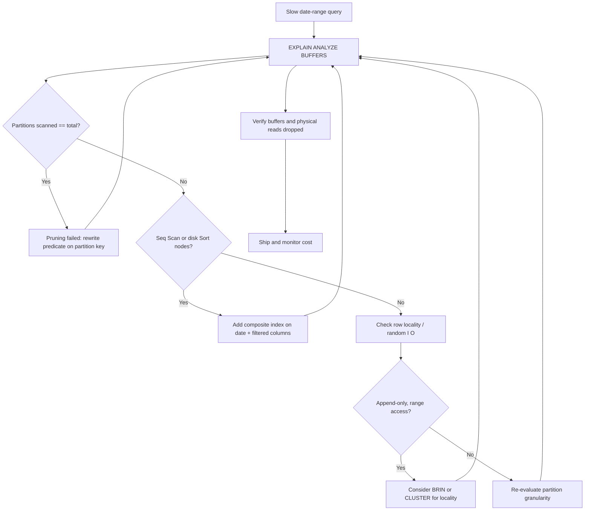

| Difficulty | Channel | Tags |
|---|---|---|
| intermediate | database | explain, query-plan, partitioning |

At production scale, a date-range query that runs in 40 milliseconds on a laptop can balloon into millions of physical read I/Os and a five-figure monthly storage bill. Amazon Web Services (AWS) learned exactly this when a team running an Aurora PostgreSQL time-series workload watched a single 'orders' table grow past 33 TB with over 100 columns, ingesting roughly 46 GB of new data every day [1]. Indexes were in place, the partitioning key looked correct, and yet queries kept getting slower and more expensive. What follows is the story of why that happens, how the team stopped the bleeding, and what your own EXPLAIN plan is quietly trying to tell you.

---

> ### Real-World Case — Amazon Web Services (AWS)
>
> An AWS database team worked with a production-scale Aurora PostgreSQL time-series workload whose single 'orders' table had grown to 33 TB with over 100 columns and relationships, while ingesting ~46 GB per day. Even with indexes in place, date-range queries were slow and expensive because the working set no longer fit in memory, forcing millions of physical read I/Os against the storage layer.
>
> | | |
> |---|---|
> | **Challenge** | PostgreSQL could not keep the hot data in the buffer cache as the table grew, so reads spilled to disk and every query on a date range paid a heavy I/O penalty. On Aurora, I/O operations are billed, so the slow plan translated directly into tens of thousands of dollars in monthly read-I/O charges. |
> | **Solution** | They converted the large table to native range partitioning on created_at (first monthly, then daily) using in-place partitioning with the pg_partman extension, and verified that PostgreSQL's partition pruning routed queries to only the relevant partitions. Because unique constraints on a partitioned table must include the partition key, they rebuilt the primary key as a composite (public_id, created_at) and adapted the application so returning/updating rows always carried the partition key. This shrank the effective working set from 33 TB to ~46 GB (the current partition), letting reads hit the shared buffers. |
> | **Outcome** | Partition pruning dropped physical read spikes from ~600,000 blocks/sec to ~25,000 blocks/sec and cut writer ReadIOPS from 100,000/sec to 40,000/sec, while buffer-cache hits rose from ~600K to ~1.5M blocks/sec. Weekly storage I/O cost fell from $17,676.81 to $5,608.33 (~68% reduction), with the team reporting up to 40% savings using monthly partitions and up to 60% with daily partitions. |
> | **Lesson** | Partitioning a huge table does not automatically speed up queries; you must confirm in the EXPLAIN plan that pruning is actually eliminating partitions. The real win is often subtle: pruning plus a composite key keeps only the current partition's working set in memory, converting expensive physical I/Os into cache hits — and on a pay-per-I/O system like Aurora, that is a direct cost reduction. |

---

## Hook — The Query That Looked Fine Until It Wasn't

Picture the dashboard on the wall at 2 a.m.: a perfectly ordinary date-range query, one that a developer wrote and tested months ago, now dragging the storage layer to its knees. Nothing in the schema changed. Nothing in the query changed. The only thing that changed was the data — it kept arriving, day after day, at 46 GB a day [1]. This is the cruelest kind of performance bug: the code is innocent, but the workload has outgrown the plan. When a table reaches tens of terabytes, the working set no longer fits in memory, so the database quietly abandons the fast path you designed and falls back to physical I/O against storage. The gap between a healthy query and a production incident is, at that scale, often just a few hundred terabytes of accumulated history. That single question — 'why is my date-range query slow?' — is where the investigation begins.

## Problem — When a Good Index Meets a Growing Table

The naive answer to slow queries is 'add an index,' but indexes only help when the planner can use them selectively. At 33 TB, a query filtering by date range and status may still scan enormous swaths of data if the plan touches more partitions than it should, or if a sort has to spill to disk. The real pain point is that performance degrades non-linearly: the table keeps growing, the buffer cache keeps missing, and every missed block becomes a physical read charged to your cloud bill. This is the silent killer of time-series workloads. Many developers discover the problem only when a query that used to take 200 ms now takes 20 seconds, and the fix is not a single index but a rethinking of how data is physically organized and pruned. The stakes are concrete: AWS measured weekly storage I/O costs at $17,676.81 before optimization [1]. If you are running any append-heavy table — events, orders, metrics, logs — you are on the same clock.

## Real-World Case — AWS and the Aurora Table That Wouldn't Shrink

The AWS database team inherited a time-series workload on Amazon Aurora PostgreSQL whose single 'orders' table had swollen to 33 TB with more than 100 columns and multiple relationships, all while ingesting roughly 46 GB per day [1]. Indexes existed and were technically valid, but because the working set no longer fit in memory, date-range queries triggered millions of physical I/Os against the storage layer, producing punishing read spikes near 600,000 blocks per second and writer ReadIOPS around 100,000 per second. The turning point was recognizing that partition pruning — not indexing — was the missing lever. By aligning the partition strategy with the actual query predicates and adopting range partitioning, physical read spikes collapsed from roughly 600,000 blocks/sec to about 25,000 blocks/sec, writer ReadIOPS fell from 100,000/sec to 40,000/sec, and buffer-cache hits climbed from around 600K to 1.5M blocks/sec [1]. The financial result is the number to remember: weekly storage I/O cost dropped from $17,676.81 to $5,608.33, a reduction of about 68%, with the team reporting up to 40% savings using monthly partitions and up to 60% with daily partitions [1].

## Deep Dive — Pruning, Indexing, and the Physics of Large Tables

Three forces compete inside every slow query plan, and understanding them is what separates guessing from diagnosing. First is partition pruning: PostgreSQL can skip entire partitions only if the WHERE clause on the partition key is expressed in a way the planner can prove at plan time [2]. A range predicate like a BETWEEN on the date column prunes beautifully; a function wrapping that column, such as WHERE date_trunc('month', event_date) = ..., can defeat pruning entirely and force a scan of every partition. Second is index utilization: you need to confirm the plan shows an Index Scan or Bitmap Index Scan rather than a Seq Scan, and that the index is actually selective for your predicate [3]. Third, and most overlooked at scale, is data locality — the physical ordering of rows on disk. When a query must gather scattered rows across a huge table, a sequential read pattern beats random seeks, which is why clustering matters. Composite indexes on (date, filtered_columns) let the planner satisfy both the range and the equality predicate from a single structure, while CLUSTER physically reorders the table to match the index, turning random I/O into something the storage layer can serve far more efficiently [4][5]. The trade-off is that CLUSTER takes an exclusive lock and rewrites the table, so it belongs in a maintenance window, not a hot path. For append-only time-series data, BRIN indexes are another ally: they store min/max summaries per block range, are tiny compared to B-tree, and are naturally aligned with the physical order that inserts create [6].

## Workflow — A Repeatable Diagnostic Loop

Optimizing a partitioned table is not a single command; it is a disciplined loop that reads evidence before it changes anything. The workflow below mirrors how the AWS team approached their workload. Step one: capture a real plan with EXPLAIN (ANALYZE, BUFFERS) so you see which partitions were actually scanned and how many buffers were touched [3]. Step two: verify pruning by counting the partitions referenced in the plan — if the number approaches your total partition count, pruning has failed. Step three: inspect the node types for Seq Scan or Sort/Hash Aggregate nodes spilling to disk, since those are the expensive operations that dominate at scale. Step four: add a composite index covering the WHERE clause and re-run the plan to confirm the planner adopts it [7]. Step five: evaluate clustering or BRIN for locality when the access pattern is inherently range-based [5][6]. The diagram below traces this loop from symptom to verified fix.

## Code Example — Reading the Plan, Then Fixing It

The bash script below drives psql through the same diagnostic sequence: it captures a plan with buffers, adds a composite index concurrently so it does not lock the table, and re-checks the plan to confirm the planner chose the index. Run the capture first, read the output, then apply the index.

## Lessons Learned — What to Do Differently Tomorrow

The AWS story is not really about PostgreSQL syntax; it is about respecting the difference between a table that fits in memory and one that never will [1]. First, always verify partition pruning instead of assuming it: an unpruned plan silently turns a targeted query into a full-table scan across every partition [2]. Second, treat EXPLAIN (ANALYZE, BUFFERS) as your primary diagnostic instrument, not an afterthought — the buffer counts tell you exactly where the physical I/O is going [3]. Third, remember that an index that exists is not an index that is used; confirm the planner adopts it [7]. Fourth, accept that at scale, data locality is a first-class design concern, so evaluate clustering and BRIN alongside B-tree [5][6]. Fifth, let your partition granularity follow your query pattern — monthly partitions captured up to 40% savings for AWS, while daily partitions reached up to 60% [1]. The single insight worth sharing with your team: slow range queries on huge tables are almost never a missing index — they are a missing partition boundary or a plan that lost its pruning.

---

## Query Optimization Decision Flow

<strong>Original Interview Question</strong>

**Q:** You have a PostgreSQL table with 100M rows partitioned by date. A query filtering on a specific date range is still slow. What would you check in the EXPLAIN plan and how would you optimize it?

**A:** Check partition pruning effectiveness, index utilization patterns, and expensive sort operations. Create composite indexes on (date, filtered_columns) and evaluate clustering strategies for optimal data access.

## Conclusion

The next time a date-range query turns slow on a large table, resist the reflex to add another index. Open EXPLAIN (ANALYZE, BUFFERS), count the partitions the plan actually touched, and look for the physical reads hiding behind those buffer numbers [1][3]. AWS reduced its weekly storage I/O cost by roughly 68% not by rewriting the query, but by making the planner prune and the storage serve sequential reads — a reminder that at scale, how data is physically organized matters more than how clever the SQL looks [1]. Start with one append-heavy table, verify pruning, add a matching composite index, and let the plan tell you what to do next.

---

## References

1. [Amazon Web Services (AWS) incident report](https://aws.amazon.com/blogs/database/reduce-read-i-o-cost-of-your-amazon-aurora-postgresql-database-with-range-partitioning/) — article
2. [PostgreSQL Documentation: Table Partitioning](https://www.postgresql.org/docs/current/ddl-partitioning.html) — documentation
3. [PostgreSQL Documentation: Using EXPLAIN](https://www.postgresql.org/docs/current/using-explain.html) — documentation
4. [PostgreSQL Documentation: CLUSTER](https://www.postgresql.org/docs/current/sql-cluster.html) — documentation
5. [PostgreSQL Documentation: CREATE INDEX](https://www.postgresql.org/docs/current/sql-createindex.html) — documentation
6. [PostgreSQL Documentation: BRIN Indexes](https://www.postgresql.org/docs/current/brin-intro.html) — documentation
7. [Wikipedia: Database index](https://en.wikipedia.org/wiki/Database_index) — article
8. [AWS Documentation: Performance Insights for Amazon Aurora](https://docs.aws.amazon.com/AmazonRDS/latest/AuroraUserGuide/USER_PerfInsights.html) — documentation

---

**Author:** Satishkumar Dhule — [GitHub](https://github.com/satishkumar-dhule) · [LinkedIn](https://linkedin.com/in/satishkumar-dhule) · [Website](https://satishkumar-dhule.github.io)
