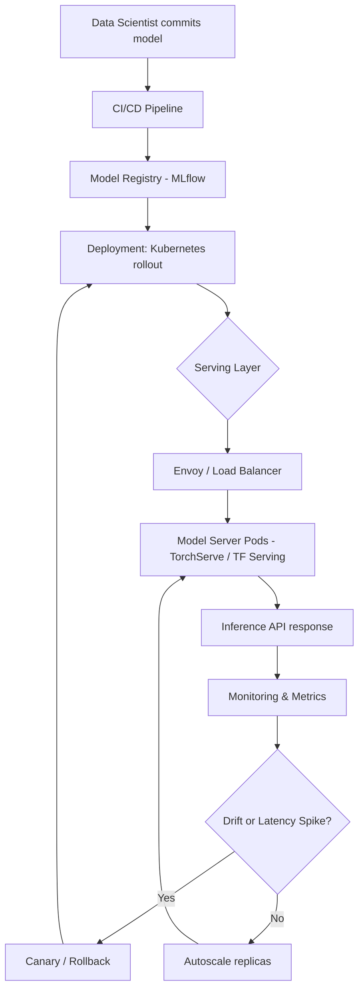

| Difficulty | Channel | Tags |
|---|---|---|
| beginner | devops | mlops, deployment |

Netflix's centralized ML platform powers recommendations, commerce, and fraud detection across more than 30 client microservices and roughly 1 million inference requests per second [1]. It was a triumph of scale — until a custom routing proxy quietly became the bottleneck, adding 10–20ms of overhead and a single point of failure to every call. The fix revealed a truth many teams learn late: deployment and serving are two different disciplines living in the same system. This is the story of why that distinction matters, and how to get both right.

---

> ### Real-World Case — Netflix
>
> Netflix built a centralized ML model serving platform to power recommendations, commerce, and fraud detection at member scale. By 2025 the platform was serving hundreds of model types and roughly 1 million inference requests per second for over 30 client microservices, but its custom routing proxy had become a scaling and latency problem.
>
> | | |
> |---|---|
> | **Challenge** | The platform needed to route each request to the right model instance, on the right cluster shard, for the right user and use case, while preserving a simple client abstraction and supporting A/B tests, canary rollouts, shadow mode, and rollbacks. Off-the-shelf API gateways (AWS API Gateway, standalone service mesh proxies) couldn't handle Netflix's experimentation integration, gRPC endpoints, or rich context-aware routing. |
> | **Solution** | They built Switchboard, a custom context-aware routing proxy that acted as the single entry point for model inference, decoupling experimentation config (via Gutenberg pub-sub) from serving code. As scale grew, the extra network hop introduced 10-20ms latency plus tail-latency amplification and a single point of failure, so they refactored into the Lightbulb architecture: a lightweight metadata service that resolves routing decisions, with the actual request routing pushed down to Netflix's existing Envoy proxy using routing keys in headers. |
> | **Outcome** | The platform serves ~1 million inference requests per second across 300+ models with 30+ client services. Moving routing into Envoy eliminated the 10-20ms Switchboard hop overhead and the single-point-of-failure risk while retaining dynamic traffic splitting, canary deployments, and rollbacks. |
> | **Lesson** | A centralized serving abstraction dramatically speeds up model iteration and safe deployment, but every extra hop in the inference hot path costs latency and becomes a scaling risk. Separating control-plane metadata resolution (Lightbulb) from data-plane routing (Envoy) keeps the abstraction without paying the performance tax. |

---

## Hook — The Night a Routing Hop Cost a Million Requests

At 3am, an on-call engineer stares at a latency graph that refuses to flatten. The models are healthy, the GPUs are idle, the pods are green — yet p99 latency keeps creeping upward. Nothing broke, which is exactly the problem. The culprit is not the model at all; it is the invisible hop between the request and the model. Netflix lived this at an almost unimaginable scale, and its solution is a masterclass in separating concerns [1]. Once you see where deployment ends and serving begins, half of your production incidents suddenly make sense. Sound familiar?

## Problem — Two Jobs, One Word, Countless Outages

Developers often use "deployment" and "serving" interchangeably, then wonder why their ML systems are fragile. Deployment is the logistics of getting a model from a notebook into production: CI/CD pipelines, infrastructure provisioning, model registries, and monitoring [7]. Serving is the runtime discipline of answering requests fast and reliably: routing, batching, versioning, and autoscaling. When teams blur the two, they build a serving layer that cannot roll back safely or a deployment pipeline that ignores latency budgets. The stakes are concrete — a real-time endpoint that misses a 100ms budget loses user trust, while a batch job that misses a 1s window quietly wastes GPU spend. The tension between latency and throughput is not a configuration detail; it is an architectural fork in the road.

## Real-World Case — Netflix

By 2025, Netflix's model-serving platform was handling hundreds of model types for over 30 client microservices at roughly 1 million inference requests per second [1]. Its custom routing proxy, called Switchboard, had grown into a scaling and latency liability — adding 10–20ms of overhead per call and representing a single point of failure. The team moved routing into Envoy, an industry-standard proxy, which eliminated the extra hop entirely [1][8]. Critically, they retained the capabilities that mattered: dynamic traffic splitting, canary deployments, and instant rollbacks. The lesson is sharp — Netflix did not replace its models or its deployment pipeline; it fixed the serving layer. Separating the routing concern from the model runtime turned a bottleneck into a platform capability, proof that the deployment/serving boundary is where reliability is won or lost.

## Deep Dive — Deployment Versus Serving, Decoded

Think of deployment as the supply chain and serving as the storefront. Deployment owns the path a model travels: Terraform provisions infrastructure, MLflow or SageMaker registers versions, and GitHub Actions or Jenkins drives promotion from staging to production [7]. Serving owns the moment a user waits: frameworks like TensorFlow Serving, TorchServe, or BentoML load the model into memory and expose an inference API [4][5][6]. The trade-offs live almost entirely in the serving tier. Latency versus throughput is the classic dial — dynamic batching raises throughput but can add milliseconds. Batch versus real-time inference determines whether you optimize for cost or responsiveness. Cold starts punish autoscaling: a fresh container may spend seconds loading a multi-gigabyte model before it answers its first request. Consider the comparison below.

## Workflow — From Commit to Canary

A production-grade ML system moves through a repeatable pipeline, and each stage belongs to a specific discipline. Deployment handles the left half; serving handles the right half. The diagram below shows the journey from a data scientist's commit to a canary rollout and autoscale decision. First, a model is logged to a registry. Next, a CI/CD pipeline packages it into a container. Then Kubernetes performs a rolling or canary rollout, and the serving layer begins routing traffic. Health and readiness probes gate traffic until the model is warm. Finally, observability feeds back into rollback or autoscaling logic — closing the loop that makes the system self-correcting rather than merely automated [2].

## Code Example — A Serving Layer That Respects the Boundary

The following Python server uses FastAPI to make the deployment/serving split concrete. Notice three things: the model loads once at startup via a lifespan handler (avoiding per-request cold starts), a liveness probe tracks whether the process is alive, and a separate readiness probe prevents traffic from reaching a pod that has not finished loading its model. This mirrors how Kubernetes decides when to route traffic [2].

## Lessons Learned — What to Do Differently Tomorrow

First, name the boundary. Draw an explicit line between your deployment pipeline and your serving runtime, then assign them separate reliability budgets. Second, instrument routing as a first-class concern — Netflix's 10–20ms ghost disappeared only when routing moved to a specialized proxy [1][8]. Third, always separate liveness from readiness so autoscaling never sends traffic to a cold model. Fourth, treat model versioning and rollback as serving primitives, not afterthoughts, because canary deployments are your seatbelt. Finally, measure the right thing: p99 latency and throughput per replica tell you more than average latency ever will. The one insight worth sharing with your team — if your models are healthy but your users are waiting, the problem is almost never the model; it is the routing and runtime around it.

---

## Deployment and Serving Flow

<strong>Original Interview Question</strong>

**Q:** Explain the key differences between model serving and model deployment in ML systems, including specific technologies, scaling considerations, and real-world implementation patterns?

**A:** Deployment encompasses CI/CD pipelines, infrastructure setup, and monitoring using tools like Kubernetes, MLflow, and SageMaker. Serving focuses on runtime inference APIs with frameworks like TensorFlow Serving, TorchServe, or BentoML, handling request routing, model versioning, and autoscaling. Key trade-offs include latency vs throughput, batch vs real-time inference, and cold start optimization.

## Conclusion

The distinction between deployment and serving is not academic trivia — it is the fault line along which production ML either scales gracefully or collapses under its own weight. Netflix proved that even a platform serving a million requests per second can be dragged down by a single routing hop, and that the cure is specialization, not heroics [1]. So take action tomorrow: draw the boundary explicitly, instrument routing as a first-class citizen, separate liveness from readiness, and treat versioning and rollback as serving primitives. The memorable takeaway to bring to your team — when the models look fine but the users are waiting, stop debugging the model and start debugging the path it travels.

---

## References

1. [Netflix incident report](https://netflixtechblog.com/state-of-routing-in-model-serving-16e22fe18741) — article
2. [Kubernetes Documentation: Deployments](https://kubernetes.io/docs/concepts/workloads/controllers/deployment/) — documentation
3. [KServe: Standardized Serverless ML Inference](https://github.com/kserve/kserve) — documentation
4. [TensorFlow Serving Guide](https://www.tensorflow.org/tfx/guide/serving) — documentation
5. [TorchServe: Model Serving for PyTorch](https://github.com/pytorch/serve) — documentation
6. [BentoML: Unified Model Serving Framework](https://github.com/bentoml/BentoML) — documentation
7. [Machine Learning Operations (MLOps): Overview, Definition, and Architecture](https://arxiv.org/abs/2205.02302) — paper
8. [Envoy Proxy Documentation](https://www.envoyproxy.io/docs/envoy/latest/) — documentation
9. [MLflow Documentation](https://mlflow.org/docs/latest/index.html) — documentation
10. [ONNX Runtime: High-Performance Inference Engine](https://github.com/microsoft/onnxruntime) — documentation

---

**Author:** Satishkumar Dhule — [GitHub](https://github.com/satishkumar-dhule) · [LinkedIn](https://linkedin.com/in/satishkumar-dhule) · [Website](https://satishkumar-dhule.github.io)
