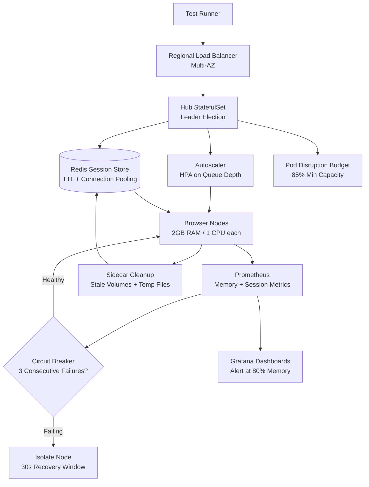

| Difficulty | Channel | Tags |
|---|---|---|
| advanced | system-design | selenium, webdriver, grid |

Picture a wall of red build results at 3am, each one a browser test that never even got a node to run on. That was the reality for many engineering orgs as their UI suites grew faster than their infrastructure. Expedia Group hit this wall head-on and rebuilt its entire automation stack on Kubernetes, Docker, Helm, and Traefik, scaling to 100+ Selenium hubs and roughly 140,000 tests per day [1]. This article walks the same path: designing a grid that survives 10,000 concurrent sessions, 99.9% uptime, and the memory leaks that quietly eat clusters alive.

---

> ### Real-World Case — Expedia Group
>
> Expedia Group needed to scale its UI test automation infrastructure to support concurrent execution across many teams and microservices, moving away from a static EC2-based SeleniumGridScaler that required manual hub creation, slow scaling (2-4 minutes), and downtime when hubs were stopped/started.
>
> | | |
> |---|---|
> | **Challenge** | How to provide on-demand, dynamically scalable Selenium Grid infrastructure that could handle large test volumes with faster feedback, better reliability, and reduced operational overhead across multiple environments. |
> | **Solution** | They built 'DA Kube' (Distributed Automation on Kubernetes) using Kubernetes (EKS), Docker, Helm, and Traefik as an ingress/router. They deployed Selenium hubs/nodes via Helm charts, enabled on-demand hub creation per branch/environment, scaled browser node pods dynamically, and improved reliability using Kubernetes QoS (Guaranteed) to reduce pod eviction. They also addressed networking/IP constraints and recommended running one browser per pod. |
> | **Outcome** | The system scaled to 100+ Selenium hubs and ran ~140k+ tests per day. It eliminated manual hub provisioning, reduced node scaling time from minutes to container startup times, enabled dynamic per-branch grids (different browsers/versions), and delivered substantial cost savings (estimated ~$80k annually vs. ~$350k for equivalent third-party parallel connections, scaling to ~$2.4M at higher parallel counts). |
> | **Lesson** | A containerized, Kubernetes-orchestrated Selenium Grid with ingress routing and proper QoS/reliability controls can deliver massive scale and cost efficiency compared to static VM grids, especially when you need isolated, on-demand grids per team/branch. |

---

## Hook — When Your 'Green Build' Is Actually a Queue

It started innocently enough. A test suite that ran in 20 minutes became 40, then two hours. Engineers refreshed the CI dashboard, saw a spinning wheel, and assumed the tests were running. They were not. They were *queued*, stacked behind hundreds of other jobs waiting for a browser that would never come because the hub had quietly died overnight.

Sound familiar? Static Selenium grids have a cruel failure mode: they do not crash loudly, they starve silently. Hubs need manual provisioning, scaling takes minutes, and the moment you stop a hub for maintenance, every session pointed at it vanishes. For a team of 3, this is annoying. For a company running microservices across dozens of teams, it is a productivity black hole where thousands of engineer-hours disappear into 'flaky infrastructure.'

The stakes get real when you do the math: 10,000 concurrent sessions at 50 sessions per node means 200 nodes, a 520GB memory ceiling, and a hard requirement of 99.9% uptime. Miss any one of those and the whole grid collapses into a thundering herd of retries. So how do you build a grid that scales like a cloud service instead of a pet server? Let's find out.

## Problem — Why Static Grids Break at Scale

The classic Selenium Grid model is a hub-node pattern: one central hub routes WebDriver requests to browser nodes. It works beautifully for 10 sessions and falls apart at 10,000. Here is why.

**First, scaling is manual and slow.** Spinning up a new node traditionally means launching an EC2 instance, configuring the browser, registering it with the hub, and waiting. That is minutes of dead time while your test queue grows. Kubernetes changed the game here because container startup is seconds, not minutes, and Horizontal Pod Autoscaling can react to load automatically [2].

**Second, sessions leak.** Browsers crash. Drivers hang. Docker volumes pile up. Without strict lifecycle management, a node slowly accumulates zombie processes until it runs out of memory and takes the hub down with it. This is the memory leak that keeps SREs up at night: it is not one big failure, it is a thousand small ones.

**Third, availability is fragile.** When everything routes through one hub in one availability zone, a single network partition or AZ outage means 100% downtime. No redundancy, no graceful degradation, just a wall of red.

The core tension is this: you need *elasticity* (scale up and down on demand), *isolation* (one bad node cannot poison the grid), and *observability* (you must see leaks before they bite). Static infrastructure gives you none of these by default.

## Real-World Case — Expedia Group Rewrites the Rules

Expedia Group lived this exact problem. Their UI test automation was running on a static EC2-based SeleniumGridScaler, which meant manual hub creation, scaling that took 2-4 minutes, and unavoidable downtime whenever hubs were stopped or started. For a company with many teams and microservices all depending on the same grid, that friction compounded daily [1].

The team rebuilt the platform using Kubernetes, Docker, Helm, and Traefik. Instead of long-lived EC2 instances, browsers became containers. Instead of manually creating a hub, teams got *dynamic per-branch grids* with their own browser and version combinations. The results were dramatic:

- Scaled to **100+ Selenium hubs**
- Ran **~140,000+ tests per day**
- Node scaling dropped from **minutes to container startup time**
- Estimated cost savings of **~$80,000 annually**, versus ~$350,000 for equivalent third-party parallel connections, scaling to roughly **$2.4 million** at higher parallel counts [1]

The plot twist: the migration was not really about Selenium at all. It was about treating test infrastructure as an ephemeral, declarative workload, the same way the rest of their services already worked. Once browsers became pods, every scaling and failure problem became a Kubernetes problem, and Kubernetes already had answers.

## Deep Dive — The Four Pillars of a Leak-Proof Grid

Building on Expedia's lesson, a 10,000-session grid rests on four pillars. Get any one wrong and the tower leans.

**1. Elastic Node Pools.** Use a hub in a StatefulSet for stable identity and leader election, backed by auto-scaling node pools for browsers [3]. Each browser pod gets hard resource limits (2GB RAM, 1 CPU). Do the math before you deploy: 200 nodes × 2GB = 400GB baseline, plus a 30% buffer brings you to 520GB. Autoscaling should key off *queue depth*, not CPU alone, because a saturated queue is the real signal that tests are waiting.

**2. Session Store with TTL.** Redis is the natural fit for tracking active sessions. Every session key gets a TTL, so a crashed node cannot leave a permanent orphan. When the key expires, the session is considered dead and its resources are reclaimed [7]. Connection pooling keeps Redis from becoming the bottleneck at 10,000 concurrent reads.

**3. Circuit Breakers.** A failing node should be isolated, not retried forever. The circuit breaker pattern trips after repeated failures and routes traffic away for a recovery window, giving the node room to heal [5]. Hystrix-style isolation with a 30-second window is a proven default.

**4. Observability.** Prometheus scrapes memory and session-duration metrics; Grafana turns them into dashboards you can actually read at 3am [8]. Alert at 80% memory, not 99%.

Here is the tradeoff table many teams wish they had sooner:

| Approach | Scaling Speed | Failure Isolation | Cost | Best For |
| --- | --- | --- | --- | --- |
| Static EC2 grid | Minutes | None (shared hub) | High idle cost | Tiny, stable suites |
| VM autoscaling | 1-3 min | Partial | Medium | Medium suites |
| Kubernetes containers | Seconds | Per-pod | Low, elastic | Large, multi-team grids |

💡 Insight: The winner is not Kubernetes itself. It is *ephemerality*. If any component can be destroyed and recreated without drama, leaks and failures stop being emergencies.

## Workflow — Wiring the Grid End to End

Now let's trace a single session from request to cleanup. The diagram below captures the whole journey.

A test runner hits a regional load balancer, which routes to the nearest hub. The hub authenticates and asks Redis for a free browser slot; Redis holds the authoritative session registry with TTL-based expiration. If the pool is saturated, the autoscaler sees growing queue depth and adds browser pods. Each browser pod runs a sidecar container whose only job is cleanup: it watches for session termination and removes stale Docker volumes and temp files before they accumulate [6].

Meanwhile, Prometheus scrapes every node for memory usage and session duration. When a node throws three consecutive health-check failures, the circuit breaker trips and isolates it for 30 seconds [5]. Pod Disruption Budgets guarantee at least 85% capacity survives any rolling update, and canary deployments split traffic for new browser versions [4].

⚠️ Watch Out: The sidecar cleanup is not optional. Without it, disk and memory creep back exactly like the static grid you escaped.

The critical ordering is: *register session → allocate node → run test → expire session → clean volumes*. Break that chain and you get orphans.

## Code Example — TTL-Backed Session Lifecycle in Python

Theory is cheap. Here is a production-shaped session manager that implements the TTL registry and health-based circuit breaker described above. It uses Redis for session state and exposes memory metrics for Prometheus to scrape.

Every line maps to a pillar from the deep dive: TTL expiration prevents orphans, the circuit breaker isolates bad nodes, and the cleanup routine keeps volumes from piling up. Run it as a sidecar or a controller pod next to your hub.

## Lessons Learned — What to Take to Work Tomorrow

The journey from a static, 2-hour queue to a 10,000-session elastic grid comes down to a handful of hard-won lessons.

- **Make everything ephemeral.** Expedia's biggest win was not a faster hub; it was containers that start in seconds and vanish without ceremony [1].
- **TTL is your seatbelt.** A session without an expiry is a memory leak waiting to happen [7].
- **Autoscale on queue depth, not just CPU.** The queue is the honest signal of user pain. HPA can do this well when you feed it the right metric [2].
- **Isolate failures with circuit breakers.** Retrying a dead node is just slow failure. Trip the breaker and move on [5].
- **Budget for disruption.** Pod Disruption Budgets and multi-AZ deployment are what turn 99.9% from a wish into a guarantee [4].

🔥 Hot Take: If your test infrastructure takes longer to fix than to use, you do not have a testing problem. You have a platform problem, and it is costing you in engineer-hours every single day.

A final number to keep handy: 200 nodes at 2GB is 400GB before buffer, 520GB after. If your cluster memory does not clear that bar with room to spare, your autoscaler is just a queue generator with extra steps.

---

## Selenium Grid Session Lifecycle

<strong>Original Interview Question</strong>

**Q:** Design a scalable Selenium Grid architecture to handle 10,000 concurrent test sessions with 99.9% uptime, ensuring zero memory leaks through automatic session lifecycle management, real-time monitoring, and graceful node failure recovery across multiple data centers?

**A:** Deploy Kubernetes cluster with auto-scaling node pools, Redis session store with TTL policies, Prometheus metrics for memory monitoring, circuit breakers for node isolation, and sidecar containers for session cleanup. Implement health checks, resource quotas, and rolling updates.

## Conclusion

The Expedia Group story ends where your story should begin: with test infrastructure that behaves like the rest of your cloud, not like a fragile pet server [1]. The journey here ran from silent queue starvation, to static grids that scaled in minutes, to an ephemeral, TTL-guarded, circuit-broken grid that handles 10,000 sessions with multi-AZ resilience. The memorable insight worth sharing with your team: leaks and outages are not separate problems, they are both symptoms of non-ephemeral components. Destroy and recreate everything, expire every session, isolate every failure, and 99.9% stops being a heroic effort and becomes a default. Start tomorrow by adding a TTL to your session store and a sidecar to your nodes; the rest of the architecture follows naturally.

---

## References

1. [Expedia Group incident report](https://medium.com/expedia-group-tech/da-kube-selenium-grid-using-kubernetes-docker-helm-and-traefik-856b802d1d08) — blog
2. [Kubernetes: Horizontal Pod Autoscaling](https://kubernetes.io/docs/tasks/run-application/horizontal-pod-autoscale/) — documentation
3. [Kubernetes: StatefulSets](https://kubernetes.io/docs/concepts/workloads/controllers/statefulset/) — documentation
4. [Kubernetes: Pod Disruptions and Pod Disruption Budgets](https://kubernetes.io/docs/concepts/workloads/pods/disruptions/) — documentation
5. [Circuit Breaker Design Pattern](https://en.wikipedia.org/wiki/Circuit_breaker_design_pattern) — documentation
6. [Docker Selenium: Official Selenium Grid containers](https://github.com/SeleniumHQ/docker-selenium) — documentation
7. [Redis: Keyspace and Key Expiration](https://redis.io/docs/latest/develop/use/keyspace/) — documentation
8. [Prometheus: Instrumentation Best Practices](https://prometheus.io/docs/practices/instrumentation/) — documentation
9. [DigitalOcean: An Introduction to Kubernetes](https://www.digitalocean.com/community/tutorials/an-introduction-to-kubernetes) — blog

---

**Author:** Satishkumar Dhule — [GitHub](https://github.com/satishkumar-dhule) · [LinkedIn](https://linkedin.com/in/satishkumar-dhule) · [Website](https://satishkumar-dhule.github.io)
