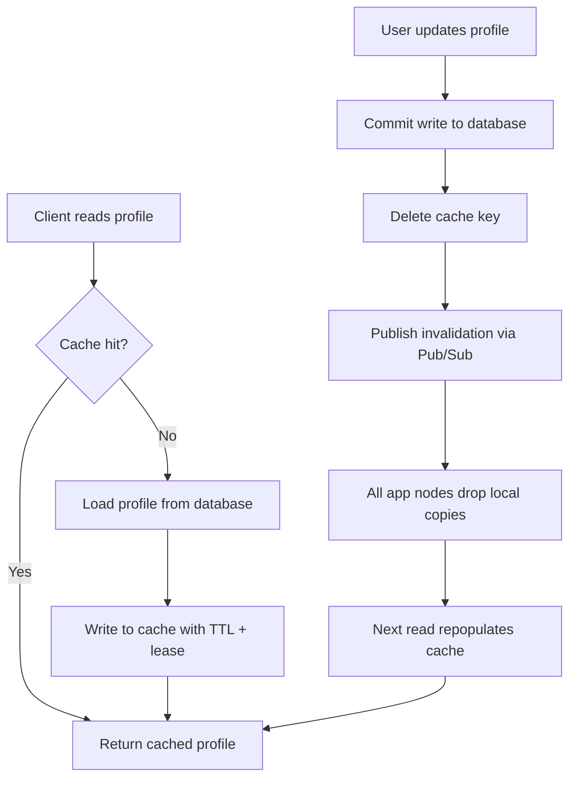

| Difficulty | Channel | Tags |
|---|---|---|
| beginner | backend | redis, memcached, cache-invalidation |

In 2005, Facebook bolted Memcached directly onto its Apache web servers to absorb database queries that were climbing faster than the servers could answer [1]. Fast forward a few years, and that humble cache layer had quietly become the de-facto primary data store — the thing that actually served billions of profile and social-graph reads per second [1]. The moment a cache stops being an optimization and starts being your source of truth, cache invalidation stops being a homework exercise and becomes a correctness problem with real users on the other side. Here is how that journey unfolded, what it means for a simple user-profile service, and why the trade-off between Redis and Memcached is nowhere near as clean as the interview answer suggests.

---

> ### Real-World Case — Facebook (Meta)
>
> In 2005 Facebook installed memcached directly on its Apache web servers to absorb increasingly costly database queries on every page load. As it scaled past a billion users, its cache layer became the de-facto primary data store, and keeping cached profiles and social-graph objects consistent across multiple regions became a critical correctness problem.
>
> | | |
> |---|---|
> | **Challenge** | Because Memcached is a simple look-aside cache with no native invalidation or pub/sub mechanism, Facebook hit two classic bugs: 'stale sets' (a slow web server re-populating a key with an older value after a concurrent update, leaving cache and DB inconsistent) and 'thundering herds' (a hot key repeatedly invalidated, sending a flood of reads straight to MySQL). They also needed to propagate cache deletes across multiple front-end clusters and geographic regions after database writes. |
> | **Solution** | Instead of switching to Redis, Facebook extended Memcached itself. They added a 'lease' mechanism: every cache miss returns a 64-bit token bound to the key, and a delete invalidates the lease, so stale writers are rejected — solving stale sets and thundering herds with one primitive. To invalidate across clusters they built McSqueal, a daemon that tails the MySQL commit log and issues deletes via mcrouter, so invalidations only fire once the DB transaction has committed and replicated. |
> | **Outcome** | On a set of keys highly susceptible to thundering herds, peak database query rate dropped from 17,000 queries/second without leases to 1,300/second with leases (~92% reduction). Today the system serves billions of requests per second, holds trillions of items, and supports over a billion users — all on Memcached rather than Redis. |
> | **Lesson** | Cache invalidation isn't a client-side afterthought — it's a distributed-consistency problem. Facebook's counterintuitive move was to push complexity into the cache protocol (leases) and to derive invalidations from the database commit log rather than replicating them separately, which prevents 'invalidate-before-the-DB-knows' races. Memcached's lack of pub/sub didn't force a Redis migration; it forced Facebook to engineer deterministic coordination, showing that the tool matters less than the invalidation contract you build around it. |

---

## Hook — The Night the Cache Became the Database

Picture this: your profile service is humming along, response times in single-digit milliseconds, database load comfortably under capacity. Then someone updates their display name. Some requests show the new name; others show the old one; and a handful show a twisted mix of both because two writes raced each other across regions [1]. This is the exact shape of the problem Facebook hit as it scaled past a billion users [1].

What started as a cache bolted onto Apache web servers in 2005 grew into a distributed system holding trillions of items, serving billions of requests per second, and behaving — for all practical purposes — like the primary data store for the social graph [1]. That is a terrifying place for a cache to end up. Caches are supposed to be disposable. The moment they become load-bearing, every invalidation bug is a user-visible correctness bug.

Here is the thing though: nothing about this scenario is unique to Facebook's scale. A profile service with ten thousand users has the same invariant — the cache must never disagree with the database about who someone is [1]. The stakes just arrive faster at massive scale. So the question is not *whether* you will face invalidation pain; it is whether your architecture survives it.

💡 **Insight:** The interview answer "just delete the key on update" is correct for a single node and quietly wrong for a distributed fleet. The gap between those two truths is where careers and outages live.

## Problem — Cache Invalidation Is a Consistency Problem in Disguise

At its core, a cache is a copy [4]. Every copy can drift from the original, and the only question is how far and for how long you are willing to let it drift before a user notices. For a user-profile service, "drift" means someone sees a stale avatar, a wrong display name, or — worse — permissions attached to a role they no longer hold. That is not a performance bug. That is a correctness and sometimes a security bug [4].

Many developers think of caching as a read optimization. In practice, the hard part is always the write path. When a profile changes, you now have at least two places that claim to know the truth: the database and the cache [4]. You can update the cache, delete from the cache, or update both — and each choice has a failure mode:

- **Update the cache first, then the DB:** a crash between the two leaves the cache holding a lie.
- **Delete the cache first, then the DB:** a concurrent read can repopulate the cache with the *old* value before the DB write lands.
- **Update both without coordination:** concurrent writers interleave and you get last-write-wins chaos across replicas.

Consequently, the real problem is not "how do I cache reads faster?" but "how do I guarantee that every replica of the truth converges, even under concurrency and partial failure?" That is a distributed-systems problem wearing a caching costume [5][8].

Sound familiar? It should. This is the same shape of problem that HTTP itself formalized decades ago as cache freshness and revalidation [4][6]. Browsers, CDNs, and origin servers all negotiate staleness via TTLs and validators — and your profile cache is a smaller, faster, more opinionated version of that same negotiation.

⚠️ **Watch Out:** The classic mistake is treating the TTL as a correctness mechanism. A TTL bounds *eventual* staleness; it does not prevent *interim* staleness. If correctness depends on the window being zero, a TTL alone will betray you.

## Real-World Case — Facebook's Memcached Leases (2005 and Beyond)

Facebook's story is the definitive war story for this topic. In 2005, the company installed Memcached directly on its Apache web servers to absorb database load that grew with every page view [1]. As the platform scaled past a billion users, the cache stopped being a sidecar and became the primary read path for profiles and social-graph objects [1]. At that point, consistency across regions was no longer optional — it was the product.

The killer problem at that scale is the **thundering herd**: when a hot key expires or is invalidated, thousands of web servers simultaneously miss and stampede the database with identical queries [9]. Facebook's response was the **lease** mechanism — a token handed to a limited number of clients that missed, letting one of them refresh the value while the rest wait briefly and serve the recomputed result. The payoff was dramatic: on a set of keys highly susceptible to thundering herds, peak database query rate dropped from 17,000 queries/second without leases to 1,300/second with leases — roughly a 92% reduction [1].

Here is the plot twist. Facebook runs this entire empire on **Memcached**, not Redis [1]. The default assumption among many developers is that Redis is the "serious" choice and Memcached is the lightweight toy. Production reality at internet scale says otherwise. Facebook even built and open-sourced **mcrouter**, a Memcached protocol router, to handle connection pooling, failover, and shard routing across thousands of servers [10]. That is not a toy setup — that is infrastructure.

Today the system serves billions of requests per second, holds trillions of items, and supports over a billion users [1]. The lesson is not "always pick Memcached." The lesson is that the invalidation pattern matters more than the cache product — and that simplicity, pushed to extremes, scales shockingly far.

## Deep Dive — Write-Through, Cache-Aside, and the Redis/Memcached Trade-off

Building on Facebook's experience, let's dissect the two big patterns you will actually choose between.

**Cache-aside (lazy loading):** the application reads from the cache; on a miss, it loads from the DB and populates the cache [7]. Reads degrade gracefully and memory is used efficiently, but every miss is a potential stampede, and invalidation is entirely your responsibility.

**Write-through:** the application writes to the DB and the cache in the same operation, so the cache reflects the write immediately [7]. Reads never miss on freshly written data, but writes are slower and you must still handle the delete-on-update race described earlier.

In practice, the most robust beginner-friendly strategy is a hybrid: **cache-aside for reads, write-through plus delete-on-update for writes**, with a bounded TTL (5–30 minutes for profiles) acting as a safety net rather than a correctness guarantee [7].

Now, the Redis vs Memcached question. The real trade-off is not speed — at the microsecond level, both are dominated by network latency [2][3]. The real trade-off is *what you can build with each.*

| Dimension | Memcached | Redis |
|---|---|---|
| Data model | Key → blob only | Strings, hashes, lists, sets, streams [3] |
| Distributed invalidation | Manual coordination via mcrouter-style routing [10] | Native Pub/Sub and keyspace events [3] |
| Persistence | None — purely volatile [2] | Optional RDB/AOF snapshots and replication [3] |
| Memory overhead | Lower per key, very predictable [2] | Higher per key, richer metadata |
| Multi-threaded | Yes — benefits from many cores [2] | Historically single-threaded command execution [3] |
| Best for | Pure high-throughput caching at massive scale [1] | Complex invalidation, queues, rate limits, durability [3] |

Here is the counterintuitive part: **Redis's Pub/Sub is not as reliable as it looks.** In Redis, Pub/Sub is fire-and-forget — if a subscriber is disconnected when the invalidation message is published, it never receives it [3]. Therefore, never treat Pub/Sub as your only invalidation path. Pair it with a TTL so that a missed message cannot cause permanent staleness. Facebook's Memcached design sidesteps this by embedding invalidation into the request/response flow itself, using leases to make the refresh path deterministic [1].

🔥 **Hot Take:** The "Redis for complex, Memcached for simple" rule of thumb is too lazy. Choose Redis when you need durability, data structures, or native fan-out. Choose Memcached when you need boring, predictable, memory-cheap key/value caching at a scale where operational simplicity beats features — a decision Facebook validated at the extreme [1][2].

## Workflow — Invalidation as a Deterministic Pipeline

This leads to a workflow you can implement tomorrow. The goal is to make the read path fast and the write path unambiguous.

The pipeline has five moves:

1. **Read:** check the cache first. On a hit, return immediately. On a miss, load from the database [7].
2. **Populate:** write the loaded value into the cache with a TTL and — if you support it — use a lease or single-flight lock so only one client refills a hot key [1][9].
3. **Write:** on a user update, write to the database *first* — the database is the source of truth [5].
4. **Invalidate:** after the DB commit succeeds, delete the cache key, then publish an invalidation event so every application node drops any local copies [3].
5. **Converge:** the next read repopulates the cache with fresh data. The TTL guarantees eventual convergence even if the invalidation event is lost [7].

The diagram below tells this story visually — note how the write path always touches the database before the cache, and how the invalidation event fans out to every node.



🎯 **Key Point:** Notice the ordering. The database commit is the trigger for invalidation, never the reverse. If you invalidate before the commit lands, a concurrent reader can repopulate the cache with the old value — the classic race that bites teams in production [5].

## Code Example — A Write-Through Profile Cache with Invalidation

Here is a focused Python implementation of the hybrid strategy: cache-aside reads, write-through plus delete-on-update writes, a TTL safety net, and a best-effort Pub/Sub invalidation hook. It uses only the standard library for the cache abstraction so the pattern — not the library — is what you take away.

```python
import time
import hashlib
import threading
from dataclasses import dataclass, field
from typing import Optional, Callable, Dict

@dataclass
class CacheEntry:
    value: dict
    expires_at: float

class ProfileCache:
    """A tiny in-process cache that models the write-through + TTL pattern.

    In production you would swap the dict for a Redis or Memcached client,
    but the invalidation contract stays exactly the same.
    """

    def __init__(self, ttl_seconds: int = 300):
        self._store: Dict[str, CacheEntry] = {}
        self._locks: Dict[str, threading.Lock] = {}
        self._meta_lock = threading.Lock()
        self.ttl = ttl_seconds

    def _key(self, user_id: str) -> str:
        # Namespaced, versioned key so schema changes can roll out safely.
        return f"profile:v1:{user_id}"

    def _lock_for(self, key: str) -> threading.Lock:
        # Single-flight lock prevents thundering herds on a hot key.
        with self._meta_lock:
            if key not in self._locks:
                self._locks[key] = threading.Lock()
            return self._locks[key]

    def get(self, user_id: str, loader: Callable[[str], Optional[dict]]) -> Optional[dict]:
        """Cache-aside read with single-flight protection on misses."""
        key = self._key(user_id)
        entry = self._store.get(key)

        if entry and entry.expires_at > time.time():
            return entry.value  # Cache hit — fast path.

        # Miss: only one thread should hit the database for this key.
        with self._lock_for(key):
            entry = self._store.get(key)
            if entry and entry.expires_at > time.time():
                return entry.value  # Another thread just filled it.
            value = loader(user_id)
            if value is not None:
                self._store[key] = CacheEntry(
                    value=value, expires_at=time.time() + self.ttl
                )
            return value

    def write_through(self, user_id: str, new_value: dict,
                      db_writer: Callable[[str, dict], bool]) -> bool:
        """Write to the database first, then refresh the cache.

        If the DB write fails we never touch the cache, so the cache can
        never contain data the database rejected.
        """
        if not db_writer(user_id, new_value):
            return False

        key = self._key(user_id)
        # Delete-then-repopulate avoids the read/modify/write race.
        self._store.pop(key, None)
        self._store[key] = CacheEntry(
            value=new_value, expires_at=time.time() + self.ttl
        )
        return True

    def invalidate(self, user_id: str, publisher: Optional[Callable[[str], None]] = None) -> None:
        """Delete the local key and broadcast the invalidation to peers."""
        key = self._key(user_id)
        self._store.pop(key, None)
        if publisher:
            # Best-effort fan-out. TTL is the guaranteed fallback if this
            # message is dropped (Redis Pub/Sub is fire-and-forget).
            publisher(key)
```

The `get` method implements cache-aside with a per-key lock — the same single-flight idea as Facebook's leases, scaled down [1][9]. The `write_through` method enforces the critical ordering: database commit first, cache mutation second, so a failed DB write can never leak into the cache [5]. The `invalidate` method deletes the key and optionally publishes a fan-out event, while the TTL in `CacheEntry` guarantees convergence even if the event is lost [3][7]. Swap the `dict` for a Redis client and `publisher` for `redis.publish`, and this exact structure runs in production.

## Lessons Learned — What to Do Differently Tomorrow

So what is the moral of this journey? Facebook started with a cache and accidentally built a primary database, then spent years hardening consistency at every layer [1]. You can borrow the hard-won lessons without repeating the pain:

- **The database is the source of truth — always write it first.** Invalidating before the commit is the single most common cause of "ghost" stale reads [5].
- **Delete on update, don't try to update in place.** Deleting sidesteps the read/modify/write race and lets the next read populate a clean value [7].
- **Treat TTLs as a safety net, not a strategy.** They bound eventual staleness; they do not deliver immediate consistency [4].
- **Never let Pub/Sub be your only invalidation path.** Fire-and-forget messaging drops events; pair it with a TTL [3].
- **Protect hot keys.** The thundering herd is real — Facebook cut peak DB queries by ~92% on herd-prone keys using leases [1][9]. Single-flight locks are your lightweight version.
- **Pick the cache for the pattern, not the hype.** Memcached carried Facebook to a billion users on boring, predictable key/value caching [1][2][10]. Redis earns its place when you need durability, data structures, or native fan-out [3].
- **Monitor hit rate, miss latency, and invalidation lag.** You cannot fix staleness you cannot see [7].

Many developers learn caching as a read optimization and only later discover it is a distributed-consistency problem. If this feels overwhelming, you are not alone — the teams who get it right are the ones who make the write path explicit and test it under concurrency, not the ones who pick the trendiest cache.

Start small: add a single-flight guard to your hottest read, add a TTL to every key, and write one test that asserts the cache and database agree after an update. Those three habits will prevent most of the outages in this article.

---

## Cache Invalidation Flow


<details>
<summary><strong>Original Interview Question</strong></summary>

**Q:** You're building a user profile service that caches frequently accessed profiles. How would you implement cache invalidation when a user updates their profile, and what trade-offs would you consider between Redis and Memcached?

**A:** Implement write-through caching with TTL-based expiration. On profile update, invalidate the cache by deleting the key and writing new data to both the database and cache. Redis offers pub/sub for automatic distributed invalidation, while Memcached requires manual coordination across nodes.

</details>

## Conclusion

Facebook's cache stopped being an optimization and became the primary data store — and that is precisely why invalidation turned into a first-class correctness concern [1]. The good news is that the fix is not exotic: write the database first, delete on update, guard hot keys with single-flight logic or leases, and let a bounded TTL catch whatever slips through [1][3][7]. Do that tomorrow: add one single-flight guard to your hottest read, give every key a TTL, and write a test that asserts the cache and database agree after an update. The one insight worth sharing with your team: a cache is a copy, and copies drift — your architecture should be designed for convergence, not for the comforting fiction that they never will.

---

## References

1. [Facebook (Meta) incident report](https://engineering.fb.com/2013/04/15/core-infra/scaling-memcache-at-facebook/) — article
2. [Memcached — Wikipedia](https://en.wikipedia.org/wiki/Memcached) — documentation
3. [Redis — Wikipedia](https://en.wikipedia.org/wiki/Redis) — documentation
4. [HTTP Caching — MDN Web Docs](https://developer.mozilla.org/en-US/docs/Web/HTTP/Caching) — documentation
5. [Cache coherence — Wikipedia](https://en.wikipedia.org/wiki/Cache_coherence) — documentation
6. [RFC 7234: Hypertext Transfer Protocol (HTTP/1.1): Caching](https://datatracker.ietf.org/doc/html/rfc7234) — paper
7. [Database Caching Strategies Using Redis — AWS Whitepaper](https://docs.aws.amazon.com/whitepapers/latest/database-caching-strategies-using-redis/caching-patterns.html) — documentation
8. [Cache Coherence and Scalable Multiprocessors — Wikipedia](https://en.wikipedia.org/wiki/MESI_protocol) — documentation
9. [Thundering herd problem — Wikipedia](https://en.wikipedia.org/wiki/Thundering_herd_problem) — documentation
10. [facebook/mcrouter — GitHub](https://github.com/facebook/mcrouter) — documentation

---

**Author:** Satishkumar Dhule — [GitHub](https://github.com/satishkumar-dhule) · [LinkedIn](https://linkedin.com/in/satishkumar-dhule) · [Website](https://satishkumar-dhule.github.io)
