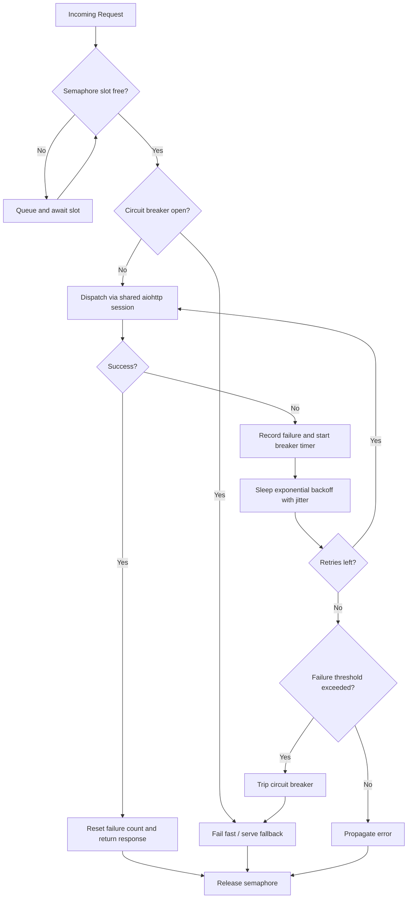

| Difficulty | Channel | Tags |
|---|---|---|
| advanced | backend | asyncio, aiohttp, concurrency |

By 2011, Netflix's API was fanning every single user request into dozens of downstream calls, and one slow dependency was enough to saturate an entire server's request threads and take healthy services down with it [1]. The lesson was brutal and simple: a connection pool without a brake is just a fuse waiting to blow. This is the story of how bounded concurrency, exponential backoff, and circuit breakers turn a fragile aiohttp client into a system that degrades gracefully instead of collapsing.

---

> ### Real-World Case — Netflix
>
> By 2011-2012, Netflix's API was brokering catalog and subscriber metadata between internal services and hundreds of device types, fanning out each user request into dozens of downstream calls. A single slow or failing dependency could saturate all of a server's Tomcat request threads, cascading failures across otherwise healthy services and degrading the streaming experience for millions of members.
>
> | | |
> |---|---|
> | **Challenge** | Protect a high-volume distributed system from cascading failures when individual dependencies become latent or fail — without overloading the already-struggling backend by blindly retrying, and while still serving a usable (degraded) response to users. |
> | **Solution** | Netflix built Hystrix, a latency and fault-tolerance library combining exactly the patterns in this topic: bounded thread pools and asyncio-style semaphores to cap concurrent calls per dependency (bulkheading), aggressive per-call timeouts and retries, and a circuit breaker that trips when a dependency exceeds an error threshold (e.g. 50% error rate in a 10-second rolling window) and then fails fast instead of piling up hung connections. Fallbacks provide graceful degradation — serve stale cache, queue writes, return stubbed data, or fail silent when a dependency is down. |
> | **Outcome** | Hystrix grew from Netflix's own production incidents involving saturated connection/thread pools and cascading failures. At adoption it was executing tens of billions of thread-isolated and hundreds of billions of semaphore-isolated calls per day across 100+ command types and 40+ thread pools, with the API handling ~20,000 requests per second at peak. During a real database-throttling incident, circuit breakers and fallback query caches kept the failure from being member-facing — only 157 of 200 server instances served fallbacks while video views stayed essentially flat. |
> | **Lesson** | Don't give a struggling dependency more resources — that's the path to self-DDoS. Cap concurrency (semaphore/bulkhead), set timeouts near the healthy p99.5, and let the circuit breaker shed load to give the downstream time to recover. Graceful degradation via fallbacks preserves the user experience far better than fail-fast alone. |

---

## Hook — The 3am Pager Nobody Could Silence

Picture this: a single database starts responding in 8 seconds instead of 80 milliseconds. Nothing is technically down. Yet within minutes, your aiohttp service has thousands of coroutines parked on sockets, your event loop is churning, and every feature that touches that database has gone dark. Sound familiar? This is the classic cascade failure, and it is exactly the trap that pushed Netflix to build Hystrix in the first place [1]. The frightening part is not the slow dependency. It is that your own concurrency model amplified a small hiccup into a full outage. Before you reach for more servers, ask the harder question: what is supposed to stop the flood? If the answer is "nothing," a connection pool manager is the missing piece.

## Problem — When One Slow Dependency Takes Down Everything

Async Python has a cruel secret: concurrency without limits is not resilience, it is a stampede. When you open an unbounded number of connections, every slow or failing endpoint draws an ever-larger share of your sockets, memory, and event-loop time. Because tasks queue on I/O rather than blocking threads, the failure mode looks different from a classic thread pool, but the outcome is the same: overwhelming a struggling dependency guarantees it stays down longer, and your latency skyrockets as healthy work waits behind doomed requests. Developers commonly miss this because asyncio feels infinitely scalable. In reality, the socket pool, the DNS cache, and the remote service are all finite resources. The core challenge, therefore, is to answer three questions at once: how many connections may be open at once, what happens when one times out, and how do you stop hammering a service that is already falling over? These questions map directly to semaphore-based limiting, exponential backoff, and the circuit breaker pattern [2].

## Real-World Case — Netflix and the Semaphore-Isolated Save

Netflix did not invent fault tolerance in a whiteboard session; it grew out of production incidents where saturated connection and thread pools turned local slowdowns into cascading failures [1]. Their answer, Hystrix, wrapped every downstream call in isolation (thread pools or semaphores), timeouts, and a circuit breaker with a fallback. The scale at adoption was staggering: tens of billions of thread-isolated and hundreds of billions of semaphore-isolated calls per day, across 100+ command types and 40+ thread pools, while the API handled roughly 20,000 requests per second at peak [1]. The payoff showed up during a real database-throttling incident: circuit breakers tripped and fallback query caches absorbed the traffic, so only 157 of 200 server instances were serving fallbacks while video views stayed essentially flat [1]. That is the whole point. Members never noticed, because the system was designed to fail partially and gracefully rather than completely. If a 157-of-200 fallback event can be invisible, your own aiohttp pool can learn the same discipline.

## Deep Dive — Semaphores, Backoff, and Circuit Breakers

Building on Netflix's blueprint, three mechanisms do most of the heavy lifting, and they solve three different failure modes.

First, concurrency limiting. An asyncio Semaphore is the async-native cousin of a bounded thread pool: it caps how many requests are in flight at once, so a slow dependency cannot consume unlimited sockets [2]. As a bonus, queueing behind the semaphore naturally buffers bursts.

Second, exponential backoff with jitter. Naive retries are a denial-of-service attack you launch against yourself. Backoff spaces retries out geometrically, and jitter desynchronizes clients so they do not retry in lockstep [3][4].

Third, the circuit breaker. After a threshold of failures, the breaker opens and rejects calls immediately, giving the struggling service room to recover; after a cooldown it half-opens to test the waters [5][6]. This is the counterintuitive plot twist: the fastest way to heal a downstream dependency is to temporarily stop talking to it.

Here is the real trade-off developers wrestle with:

| Mechanism | Protects against | Cost when tuned wrong |
|---|---|---|
| Semaphore limit | Socket/thread saturation | Too low = needless queueing; too high = stampede |
| Exponential backoff | Retry storms | Too aggressive = slow recovery, wasted latency |
| Circuit breaker | Cascading failure | Threshold too twitchy = flapping; too loose = no protection |

⚠️ Watch Out: A breaker that resets its timer on every failure may never half-open. Track the window deliberately, not accidentally.

💡 Insight: These three compose. The semaphore bounds the present, backoff paces the retries, and the breaker guards the future. Remove any one and the others carry more than they should.

## Workflow — A Request's Journey Through the Pool

This leads to the actual mechanics. Every request now walks a gauntlet before it touches the network, and each gate answers a specific "what if."

1. Arrival and admission: the request tries to acquire a semaphore slot. If the pool is saturated, it waits here instead of opening a new socket.
2. Circuit check: with a slot in hand, the manager checks whether the breaker is open. If it is, the request fails fast or routes to a fallback, sparing the failing dependency.
3. Dispatch: the request goes out through a single shared aiohttp session so TCP connections are reused via keep-alive.
4. Outcome handling: on success, the failure counter resets. On timeout or client error, the failure is recorded and the breaker's clock starts.
5. Retry with backoff: if retries remain, the request sleeps for an exponentially growing, jittered delay and tries again.
6. Release: the semaphore slot is always released, whether the request succeeded, failed, or short-circuited.

The diagram below traces that journey end to end, including the fail-fast path that keeps a bad day from becoming a bad week. Crucially, note step 6: a leaked slot is a silent outage in slow motion. The finally-style release of the async context manager is what prevents it.

## Code Example — Building the Manager

Here is the pattern in working form. It is deliberately small, but every line maps to a decision made earlier in the story. The shared session enables keep-alive, the semaphore bounds concurrency, backoff with jitter paces retries, and the breaker decides when to stop trying at all.

## Lessons Learned — What to Do Differently Tomorrow

Pulling the thread together: Netflix's Hystrix proved that graceful degradation is not a luxury but a survival trait for high-volume systems [1], and the same principles fit comfortably into a few hundred lines of aiohttp. So what should change when you go back to your editor tomorrow?

- Never let concurrency be unbounded. A semaphore is one line of code that stands between you and a stampede [2].
- Always add jitter to retries. Without it, your clients synchronize and recreate the very spike you are trying to avoid [3][4].
- Treat the circuit breaker as a first-class citizen, not an afterthought. Decide your failure threshold and cooldown explicitly [5][6].
- Configure timeouts on total, connect, and socket-read separately. A single 30-second total timeout hides which layer is actually slow.
- Clean up on shutdown. Leaked sessions and sockets are outages you schedule for later.

🎯 Key Point: The goal is not to eliminate failures. It is to make sure a failure of one dependency never becomes a failure of everything. Many developers think resilience means retrying harder. The truth is closer to the opposite: knowing when to stop is the real superpower. If this feels like a lot, you are not alone, and you do not have to implement all of it at once. Start with the semaphore, then the breaker, then backoff. Your 3am pager will thank you.

---

## Graceful Degradation Flow

<strong>Original Interview Question</strong>

**Q:** How would you implement a connection pool manager for aiohttp that handles graceful degradation under high load and connection timeouts?

**A:** Implement a connection pool manager for aiohttp using a semaphore to limit concurrent connections, exponential backoff for retrying failed requests, and circuit breaker pattern to gracefully degrade under high load and connection timeouts.

## Conclusion

Netflix learned the hard way that protecting a system means knowing when to stop talking to a struggling dependency [1]. You do not need Hystrix-scale infrastructure to apply that lesson. Add a semaphore to bound concurrency, give retries exponential backoff with jitter, and let a circuit breaker fail fast when something downstream is clearly drowning [2][3][5]. Do it today, and the next slow database goes from "the site is down" to "one feature is degraded while everything else hums along." The one insight worth sharing with your team: resilience is not about retrying harder, it is about failing smaller.

---

## References

1. [Netflix incident report](https://netflixtechblog.com/fault-tolerance-in-a-high-volume-distributed-system-91ab4faae74a) — article
2. [Python asyncio synchronization primitives (Semaphore)](https://docs.python.org/3/library/asyncio-sync.html) — documentation
3. [Exponential backoff](https://en.wikipedia.org/wiki/Exponential_backoff) — article
4. [AWS Builders' Library: Timeouts, retries, and backoff with jitter](https://aws.amazon.com/builders-library/timeouts-retries-and-backoff-with-jitter/) — blog
5. [Circuit breaker design pattern](https://en.wikipedia.org/wiki/Circuit_breaker_design_pattern) — article
6. [Martin Fowler: CircuitBreaker](https://martinfowler.com/bliki/CircuitBreaker.html) — blog
7. [aiohttp client quickstart](https://docs.aiohttp.org/en/stable/client_quickstart.html) — documentation
8. [aiohttp client reference (ClientTimeout, TCPConnector)](https://docs.aiohttp.org/en/stable/client_reference.html) — documentation
9. [Python asyncio tasks and timeouts](https://docs.python.org/3/library/asyncio-task.html) — documentation
10. [HTTP 503 Service Unavailable (MDN)](https://developer.mozilla.org/en-US/docs/Web/HTTP/Status/503) — documentation

---

**Author:** Satishkumar Dhule — [GitHub](https://github.com/satishkumar-dhule) · [LinkedIn](https://linkedin.com/in/satishkumar-dhule) · [Website](https://satishkumar-dhule.github.io)
