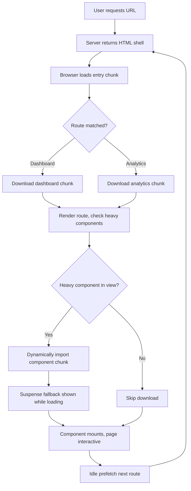

| Difficulty | Channel | Tags |
|---|---|---|
| intermediate | frontend | lighthouse, bundle, lazy-loading |

In 2017 the Netflix web team audited netflix.com and found something uncomfortable: the logged-out homepage — the very first page every new or signed-out visitor sees — was shipping roughly 300kB of JavaScript and feeling sluggish as a result [1]. The kicker? React itself accounted for only 45kB of that weight, yet pulling React and the other client-side libraries out of the critical path cut more than 200kB and halved both Loading and Time-to-Interactive [1]. That single experiment became a masterclass in what lazy loading and disciplined code splitting can do for a React app — and it is exactly the journey you are about to take with your own 2.1MB bundle.

---

> ### Real-World Case — Netflix
>
> Netflix wanted to speed up the logged-out homepage at netflix.com, the first page every new or signed-out visitor hits to sign up or log in. Despite being a React-heavy web app, the page was shipping roughly 300kB of JavaScript, causing sluggish Time-to-Interactive that hurt sign-up conversion on both mobile and desktop.
>
> | | |
> |---|---|
> | **Challenge** | The client-side JavaScript had a high execution cost. React and utility libraries such as Lodash, plus the state data needed to hydrate React, dominated the payload — even though most of the visible page was static HTML. The team needed to cut Time-to-Interactive without breaking the signup flow. |
> | **Solution** | Instead of doubling down on code splitting and lazy loading, Netflix went further: they audited which components actually needed client-side JavaScript and ported them from React to vanilla JavaScript (for example, the language switcher was rewritten in under 300 lines of vanilla JS). React stayed on the server for rendering, while the client shipped only minimal vanilla JS. They also added prefetching of HTML, CSS, and future-route JavaScript to warm the cache ahead of navigation. |
> | **Outcome** | JavaScript bundle size dropped by over 200kB (from ~300kB) by removing React and other client-side libraries — even though React's own footprint was only 45kB. Logged-out homepage Loading and Time-to-Interactive dropped by 50%, and prefetching cut Time-to-Interactive by an additional 30% for subsequent navigations. |
> | **Lesson** | The framework is rarely the real bloat — React itself was only 45kB, while the ecosystem around it (Lodash, hydration state, app code) accounted for the other ~200kB. Before reaching for code splitting on a marketing or logged-out page, ask whether the JavaScript is needed at all: shipping less code (or no client framework) beats optimizing code you never needed to send. |

---

## Hook — Your Bundle Is Silent Until Someone Measures It

Picture this: your Lighthouse score reads 65. Your bundle tips the scales at 2.1MB. Time to Interactive sits at 4.2 seconds on a mid-tier phone, and every extra second is a user who hits back before your app ever becomes usable. Nothing looks broken in development — everything loads, eventually. That is the trap. Bundles grow one convenient import at a time, and no single commit ever feels like the one that killed performance. Netflix learned the same lesson from the opposite direction: its homepage was not losing because React was heavy, it was losing because too much JavaScript sat in the critical path at the exact moment sign-up conversion was on the line [1]. So before you touch a line of code, the real question is not 'which library is slow?' but 'what is actually in my bundle, and does it need to be there before the user can do anything?'

## Problem — Why a 4.2s TTI Quietly Bleeds Users

Time to Interactive (TTI) measures the moment a page becomes reliably responsive to input — before that, taps feel dead and users assume the site is broken [2]. On a React app, the browser must download, parse, compile, and execute your JavaScript before the first paint of an interactive UI can happen, and every kilobyte in the main bundle delays that moment for every visitor on every page. This is not an edge-case problem: studies and framework guidance consistently show that heavy JavaScript execution is one of the largest contributors to poor mobile performance [3]. The stakes compound because the damage is invisible in aggregate dashboards — a 4.2s TTI does not throw errors, it just nudges people away. Many developers reach for a bigger CDN or a faster server, but the bottleneck is usually not network transit; it is the sheer amount of code the browser is forced to evaluate before anything works. Consequently, the fix is not faster delivery of the same code — it is shipping less code, later, and only when needed.

## Real-World Case — Netflix and the 300kB Homepage

The public Netflix web performance case study is a rare, fully documented example of this exact trade-off. The team targeted the logged-out homepage because it is the entry point for every prospective customer — a sluggish first impression directly threatens sign-up conversion on both mobile and desktop [1]. Their investigation revealed roughly 300kB of JavaScript on the page, and by removing React plus a set of other client-side libraries from the initial load, they cut over 200kB of JavaScript [1]. Crucially, the headline number came with a counterintuitive twist: React's own footprint was only about 45kB, meaning the dramatic win came mostly from the *other* libraries dragged along with it [1]. The measured results were Loading and Time-to-Interactive dropping by 50%, and — because they also prefetched resources for subsequent navigations — an additional 30% reduction in TTI after the first interaction [1]. The lesson generalizes far beyond React: a framework is rarely the whole bill, and the libraries you import around it often dominate the cost.

## Deep Dive — Code Splitting, Tree Shaking, and the Real Trade-offs

Building on Netflix's finding, the goal is to move non-critical code off the critical path. Code splitting breaks one monolithic bundle into smaller chunks that load on demand, while tree shaking removes unused exports from libraries that ship ES modules [4][5]. These are complementary: splitting controls *when* code loads, tree shaking controls *how much* exists in the first place. Start by measuring, not guessing — webpack-bundle-analyzer renders an interactive treemap of exactly which modules dominate your chunks, turning vague suspicion into a ranked list [6]. Not all splitting strategies are equal, however, and choosing wrong can make things worse by scattering tiny requests.

| Strategy | Best For | Trade-off |
|---|---|---|
| Route-based splitting | Multi-page apps with distinct views | Great first-load win; shared code may duplicate unless vendor chunks are extracted |
| Component-based splitting | Heavy widgets (charts, editors, maps) | Precise control, but too many small chunks add request overhead |
| Vendor chunk extraction | Stable third-party deps | Better caching across deploys, but can re-couple unrelated libraries |

💡 Insight: The biggest wins usually come from removing dependencies entirely — Netflix's 200kB cut dwarfed the 45kB React itself contributed [1]. ⚠️ Watch Out: Splitting a dynamic import so aggressively that you create dozens of micro-chunks can hurt more than help, because each chunk costs a network round trip. 🎯 Key Point: Tree shaking only works reliably when dependencies ship ES modules and your bundler is set to production mode, so audit `sideEffects` and import styles carefully [5].

## Workflow — From 2.1MB to a 90+ Score, Step by Step

With the theory grounded, here is the order that actually works in practice. Each step feeds the next, and skipping straight to lazy loading without measurement is how teams optimize the wrong thing.

1. **Measure first.** Run Lighthouse to capture a baseline TTI and score, then generate a bundle treemap with webpack-bundle-analyzer to rank the heaviest modules [6][7].
2. **Triage dependencies.** For each large module, ask whether it is truly needed on initial render; remove unused dependencies and replace heavyweight libraries with lighter or native alternatives.
3. **Fix imports.** Swap barrel imports (`import { x } from 'lib'`) for direct path imports so the bundler can eliminate unreachable exports [5].
4. **Split by route.** Convert top-level views to `React.lazy()` so each route downloads only its own code [8].
5. **Split heavy components.** Wrap charts, editors, and modals in their own lazy boundaries with a `Suspense` fallback.
6. **Defer non-critical work.** Dynamically import analytics, chat widgets, and A/B libraries after interaction or idle time.
7. **Optimize assets.** Lazy-load below-the-fold images and use a service worker to cache stable chunks [3].
8. **Re-measure.** Re-run Lighthouse, confirm the score cleared 90, and commit the budget so regressions get caught early.

The following flow shows how a request moves from entry to interactive UI once routing and components are split.

## Code Example — Route and Component Splitting in Practice

The snippet below combines the two highest-leverage techniques from the workflow: route-based splitting for top-level views and component-based splitting for a heavy chart, both guarded by error boundaries and a shared `Suspense` fallback. Notice how each dynamic `import()` creates a natural chunk boundary, and how the chart never enters the initial bundle unless its route is visited. Pair this with a bundle analysis pass so you can confirm the split actually reduced your main chunk.

## Lessons Learned — Budget the Bundle, Then Defend It

The journey from a 65 Lighthouse score to 90+ is less about a single clever trick and more about discipline applied in the right order. Netflix's 300kB homepage proved the uncomfortable truth that the framework you blame is often not the framework that costs you — React's 45kB was a rounding error next to the surrounding libraries [1]. Building on that, the durable habits are: measure before optimizing, delete before deferring, and split along real user boundaries (routes and heavy components) rather than arbitrary lines. Moreover, tree shaking and modern ES module configuration are multipliers, not replacements, for the decision to remove code entirely [5]. 🔥 Hot Take: If your first instinct on a performance ticket is 'add a CDN,' you are probably optimizing delivery when you should be optimizing payload [3]. Finally, tie the work to a metric that means something — Netflix measured Loading and TTI because those map to sign-up conversion, and you should tie your budget to revenue-critical flows, not vanity scores alone [1][2].

---

## Lazy Loading Request Flow

<strong>Original Interview Question</strong>

**Q:** You're tasked with improving a React app's Lighthouse performance score from 65 to 90+. The bundle size is 2.1MB and Time to Interactive is 4.2s. What specific steps would you take to optimize the bundle and implement lazy loading?

**A:** Implement code splitting with React.lazy() and Suspense, analyze bundle composition with webpack-bundle-analyzer to identify largest chunks, remove unused dependencies and optimize imports, add dynamic imports for heavy components and third-party libraries, implement route-based splitting for better initial load times, and utilize tree shaking with proper ES module configuration.

## Conclusion

Your 2.1MB bundle and 4.2s TTI are not permanent facts — they are the accumulated result of a hundred reasonable-looking imports, and Netflix's 300kB homepage is the proof that the fix is often subtraction before addition [1]. Tomorrow, do three things differently: run a bundle analyzer and rank your heaviest modules before writing a single optimization, convert your top routes and one heavy component to `React.lazy()` with a shared `Suspense` boundary [8], and set a bundle-size budget in CI so the regression cannot creep back. The memorable insight to share with your team is this: React was never the villain — the unexamined import was.

---

## References

1. [Netflix incident report](https://medium.com/dev-channel/a-netflix-web-performance-case-study-c0bcde26a9d9) — article
2. [Time to Interactive — web performance metric](https://en.wikipedia.org/wiki/Time_to_interactive) — documentation
3. [MDN — Lazy loading](https://developer.mozilla.org/en-US/docs/Web/Performance/Lazy_loading) — documentation
4. [MDN — Code splitting](https://developer.mozilla.org/en-US/docs/Glossary/Code_splitting) — documentation
5. [Tree shaking](https://en.wikipedia.org/wiki/Tree_shaking) — documentation
6. [webpack-bundle-analyzer](https://github.com/webpack-contrib/webpack-bundle-analyzer) — documentation
7. [Lighthouse overview — Chrome Developers](https://developer.chrome.com/docs/lighthouse/overview) — documentation
8. [React.lazy — React documentation](https://react.dev/reference/react/lazy) — documentation
9. [webpack — Code Splitting guide](https://webpack.js.org/guides/code-splitting/) — documentation

---

**Author:** Satishkumar Dhule — [GitHub](https://github.com/satishkumar-dhule) · [LinkedIn](https://linkedin.com/in/satishkumar-dhule) · [Website](https://satishkumar-dhule.github.io)
