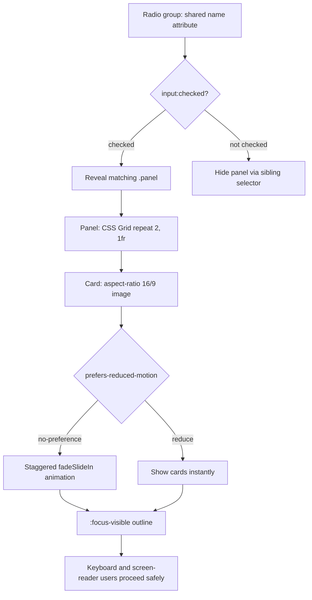

| Difficulty | Channel | Tags |
|---|---|---|
| beginner | frontend | css, flexbox, grid, animations |

In September 2013, Apple shipped iOS 7 with folders that flew toward your face and parallax wallpaper that tilted with every tilt of the phone. Within weeks, thousands of users with vestibular disorders reported headaches, dizziness, and nausea just from navigating their devices [1]. Apple's fix — the Reduce Motion control in iOS 7.0.3 — quietly became the blueprint for the web's own accessibility contract: the `prefers-reduced-motion` media query. As you build a JavaScript-free tab panel today, that same lesson is waiting for you in a single CSS line you might otherwise forget.

---

> ### Real-World Case — Apple
>
> When Apple shipped iOS 7 in September 2013, it added pervasive zoom, slide, and parallax motion effects across the OS — folders that flew toward your face, parallax wallpaper on the home screen, and zoom transitions between apps. Thousands of users with vestibular disorders reported headaches, dizziness, and nausea just from navigating their phones.
>
> | | |
> |---|---|
> | **Challenge** | Apple had designed motion as a core part of iOS 7's visual identity, but that same motion made the entire OS unusable for a subset of users who were physically sickened by it. They needed a way to let affected users opt out of non-essential animation without gutting the design system for everyone else. |
> | **Solution** | Apple added a system-level "Reduce Motion" accessibility setting and wired the OS's decorative animations to respect it — turning zoom transitions into simple crossfades and disabling parallax wallpaper. That OS preference later became the model for the web platform's CSS `@media (prefers-reduced-motion: reduce)` media query (Media Queries Level 5), letting developers detect the same user intent and conditionally drop non-essential animations, exactly like the reduced-motion guard in the tab/card entrance animation for this topic. |
> | **Outcome** | Within roughly a month, iOS 7.0.3 delivered a revamped Reduce Motion control that replaced most zoom effects with crossfades, and iOS 7.1 refined it further. A developer who had to close her eyes during every transition said she could "finally use the phone like a normal person again." The pattern became a platform standard: every major browser now supports `prefers-reduced-motion`, and WCAG 2.3.3 (Animation from Interactions) points to it as the mechanism for disabling non-essential motion. |
> | **Lesson** | Decorative motion is not neutral — for users with vestibular disorders it literally causes nausea and headaches, so any entrance animation, slide, or transition must be wrapped so it can be disabled via `prefers-reduced-motion`. The right pattern is to animate only when motion is permitted (e.g. `@media (prefers-reduced-motion: no-preference)`) and make the reduced-motion experience the safe default. |

---

## Hook — The Feature Nobody Asked For (But Everyone Felt)

Picture this: it's launch day, and the most complained-about feature of your product is one the designers bragged about in the keynote. That's exactly what happened to Apple in 2013. The parallax home screen and zooming app transitions were meant to feel alive — a phone that responded to your touch, not a grid of static icons. Instead, users prone to motion sensitivity found themselves closing their eyes during every app switch, because a full-screen zoom is essentially a rollercoaster you didn't opt into. Disorientation, nausea, and headaches weren't edge cases; they became a public accessibility story that the company could not ignore [1]. Here's the uncomfortable truth this story plants early: motion is not neutral. Every entrance animation, every slide, every stagger you add to a UI is a physical experience for the person on the other end. And for a small but real fraction of your users, it's a bad one. So when a job or a design-system task asks you to add a 'subtle entrance animation' with a stagger, there are two requirements hiding in that sentence — the animation itself, and the escape hatch that makes it safe. Most developers ship the first and forget the second. This post walks through building a CSS-only, JavaScript-free tab panel for a design-system docs page: radio-driven tabs, a 2x2 responsive card grid, staggered entrances, and the accessibility guarantees that keep it humane.

## Problem — Tabs Without JavaScript Is a Trap (Until You Know the Trick)

Tabs look trivial. Click a label, show a panel — what could go wrong? The trap is that interactive patterns are normally the domain of JavaScript, and the moment a team forbids JS (performance budgets, no-build docs sites, CMS-embedded widgets, CSP-strict environments), the obvious tools disappear. You can't attach click handlers. You can't toggle `aria-hidden` on demand. You can't remember which tab was open without a script. Consequently, many developers reach for ``/``, hacky `:target` anchors, or — worse — ship a static stack of all four panels visible at once and call it 'tabs.' Each of these has real costs. `:target` breaks browser history and deep-link semantics; `` gives one open section at a time but no visual tab bar; showing everything defeats the purpose entirely. The problem space is bigger than layout, though. Three constraints collide at once: (1) state management without JavaScript, (2) responsive layout that flips a 2x2 grid into a single column, and (3) accessibility that survives the absence of a runtime — keyboard focus, screen-reader semantics, and motion sensitivity. Get the state machine wrong and keyboard users get stuck. Get the layout wrong and mobile cards squash their 16:9 images. Get the motion wrong and you're the next iOS 7 headline. Sound familiar? The good news is that CSS has quietly grown a complete toolkit for exactly this: the `:checked` pseudo-class, sibling combinators, `aspect-ratio`, and `prefers-reduced-motion`. The challenge is wiring them together so the browser does the state management for you.

## Real-World Case — Apple and the iOS 7 Motion Backlash

On September 18, 2013, Apple released iOS 7, and with it an aggressive redesign that layered zoom transitions, a parallax home screen, and flying folder animations throughout the operating system. The effects were technically impressive — they gave the flat new interface a sense of depth and physicality. However, within days, users with vestibular disorders began reporting that simply using their phones made them dizzy, nauseous, and headachy. The Guardian documented the outcry, including a developer who said she had to close her eyes during every transition because the motion was so disorienting [1]. The stakes were unusually high because the OS-level effect was unavoidable: you could not browse past it, and there was no toggle at launch. Apple's response was fast by big-company standards. Roughly a month later, iOS 7.0.3 introduced a revamped Reduce Motion control that replaced most zoom transitions with crossfades, and iOS 7.1 refined the behavior further [1]. The user who had been closing her eyes reported she could 'finally use the phone like a normal person again.' The impact rippled far beyond Apple. The episode became a canonical example of why motion needs an opt-out, and the web standards community codified the lesson into the `prefers-reduced-motion` media query, which every major browser now supports [2]. WCAG 2.3.3, 'Animation from Interactions,' points directly at that mechanism as the sanctioned way to disable non-essential motion triggered by interaction [3]. In other words, the same year Apple learned this lesson the hard way, the web was building the exact tool that would prevent the next developer from repeating it — and it fits in one CSS block.

## Deep Dive — The Radio-Button State Machine and Its Trade-offs

The counterintuitive insight at the heart of CSS-only tabs is this: a group of radio inputs is already a state machine. Radios sharing a `name` attribute enforce mutual exclusivity for free — the browser guarantees exactly one is selected [4]. That's the entire 'which tab is active' problem solved by the platform, with no JavaScript. Pair each radio with a `` and the label becomes a first-class, clickable, keyboard-focusable control that toggles the input [4]. Now add the CSS sibling combinators. If the inputs sit before the panels in the DOM, then `input:not(:checked) ~ .panel` can hide every panel whose radio isn't selected, while `input:checked + .panel` (or the general sibling equivalent) reveals the active one. This is the adjacent/general sibling selector pattern, and it depends entirely on source order: the inputs must precede the panels, and each input must be associated with the right panel by position. Trade-offs matter here. First, DOM order becomes load-bearing — reordering elements in markup silently breaks the whole thing, which is why a comment or a lint rule is worth it. Second, backups like `:target` or `` trade visual consistency for history semantics; radio tabs win on appearance and keyboard behavior but lose stateful deep-linking (the browser won't put `#tab-2` in the URL for you). Third, layout: `aspect-ratio: 16 / 9` on the image container is the modern, one-line way to lock an image box's proportions without padding hacks [5]. Then CSS Grid's `grid-template-columns: repeat(2, 1fr)` gives the desktop 2x2, and a single media query collapses it to `1fr` on mobile [6]. Finally, the accessibility layer. `:focus-visible` renders an outline only for keyboard navigation, so mouse users don't see noisy rings but keyboard users never lose their place [7]. Wrap the animation in `@media (prefers-reduced-motion: no-preference)` — note the 'no-preference' direction, not the inverse — so the stagger only runs when the user hasn't asked for less motion [2]. That inverted default is the subtle pro move: it means reduced-motion users get an instantly visible panel, not an invisible one waiting for an animation that never fires.

## Workflow — From Markup to Motion in Five Steps

Here's the assembly order that keeps the pattern coherent. Follow it top to bottom, because each step depends on the one before it. The flow is visualized in the diagram: a single radio group fans out into labeled tabs, each tab gates one panel, and every panel flows into a responsive card grid whose cards animate conditionally. Step 1 — Markup skeleton: place all radio inputs of a group first, give them one shared `name`, and mark the default with `checked`. Follow each input immediately with its ``, then its ``. Step 2 — Label association and keyboard: because the input is the focusable element and the label triggers it, arrow-key navigation between radios works natively; never replace labels with divs. Step 3 — State visibility: use `input:checked` to reveal the matching panel and `input:not(:checked) ~ .panel` (or per-panel selectors) to hide the rest, relying on sibling order. Step 4 — Responsive grid: set `display: grid` with `repeat(2, 1fr)` on the panel, and collapse to one column in a `max-width` media query. Each card's image wrapper uses `aspect-ratio: 16 / 9`. Step 5 — Staggered, respectful motion: define a `fadeSlideIn` keyframe, apply it inside `@media (prefers-reduced-motion: no-preference)`, and increment `animation-delay` per `:nth-child`. Cap the total stagger so late cards don't feel laggy. Finally, add `:focus-visible` outlines and test with a keyboard and the OS-level Reduce Motion setting enabled. Here's what many developers miss: the stagger only needs to run once per tab reveal, so keep delays small (0.1s increments) and the animation short (~0.3s) to avoid a 'loading' feel.

## Code Example — A Complete CSS-Only Tab Panel

The snippet below is production-shaped: HTML with a radio state machine, then CSS for layout, state visibility, responsive behavior, staggered entrance, and motion-safe focus treatment. Read it as five labeled layers, each doing one job.

## Lessons Learned — Motion Is a Contract, Not a Decoration

The iOS 7 story is not ancient history — it's the reason the media query you type today exists [1][2]. Building CSS-only tabs teaches the same lesson at a smaller scale: the pattern that looks clever in a demo becomes a liability the moment it ignores the human using it. Here's what to carry forward. First, if you take one thing away, make it the `prefers-reduced-motion` block — a tab panel that works for a mouse user but nauseates a motion-sensitive one is a broken tab panel, full stop [3]. Second, treat radio-driven tabs as a genuine design pattern with real constraints: DOM order is load-bearing, so document it and lint it; and you trade URL state for zero-JS simplicity, which is a fine trade for docs pages but not for deep-linked dashboards. Third, `aspect-ratio` and CSS Grid together replace a decade of padding-top hacks and float clears — reach for them before any library [5][6]. Fourth, accessibility is cheap when built in and expensive when bolted on: `:focus-visible` is one rule, label semantics are free, and both prevent the kind of public embarrassment Apple could not undo [7]. For your next task, do this: after you write any transition or keyframe, add the reduced-motion guard in the same commit, then flip the OS setting and confirm nothing breaks. That habit is the difference between shipping polish and shipping a headache. The memorable insight to share with your team: 'The most accessible animation is the one the user can turn off without turning off the feature.'

---

## CSS Tab State Flow

<strong>Original Interview Question</strong>

**Q:** Build a CSS-only tab panel for a design-system docs page. Use radio inputs to switch tabs (no JavaScript). Desktop: a 2x2 grid of cards under each tab; mobile: single column. Each card has a fixed 16:9 image area, a title, and a short meta line. Add a subtle entrance animation with a stagger and keep focus-visible outlines; ensure prefers-reduced-motion is respected?

**A:** Use a set of radio inputs with a shared `name` attribute and corresponding `` elements for each tab section. The `:checked` state of each radio controls visibility of its associated panel via adjacent sibling selectors. Each panel renders a 2×2 card grid on desktop and collapses to a single column on mobile. Cards use `aspect-ratio: 16/9` for fixed image containers, with a title and meta line below.

## Conclusion

Apple learned in 2013 that motion is not decoration — it's an experience every user is forced to have [1]. The web answered with `prefers-reduced-motion` [2] and WCAG 2.3.3 [3], and now the lessons live in a few lines of CSS you can write in minutes. Tomorrow, when you build a tab panel, a carousel, or a page transition, do the one thing iOS 7 didn't do on day one: ship the opt-out alongside the animation. Your radio-based tabs will work without JavaScript, your 2x2 grid will collapse cleanly with CSS Grid and `aspect-ratio`, and your staggered entrance will fade gracefully into place for those who want it and simply appear for those who don't. That's the whole game — clever when motion helps, invisible when it hurts, and usable by everyone in between.

---

## References

1. [Apple incident report](https://www.theguardian.com/technology/2014/mar/13/apple-iphone-ipad-ios-71-motion-sickness) — article
2. [MDN: prefers-reduced-motion media query](https://developer.mozilla.org/en-US/docs/Web/CSS/@media/prefers-reduced-motion) — documentation
3. [W3C WCAG 2.1 Understanding 2.3.3: Animation from Interactions](https://www.w3.org/WAI/WCAG21/Understanding/animation-from-interactions.html) — documentation
4. [MDN: The :checked CSS pseudo-class](https://developer.mozilla.org/en-US/docs/Web/CSS/:checked) — documentation
5. [MDN: aspect-ratio CSS property](https://developer.mozilla.org/en-US/docs/Web/CSS/aspect-ratio) — documentation
6. [MDN: CSS Grid Layout](https://developer.mozilla.org/en-US/docs/Web/CSS/CSS_grid_layout) — documentation
7. [MDN: The :focus-visible CSS pseudo-class](https://developer.mozilla.org/en-US/docs/Web/CSS/:focus-visible) — documentation
8. [Wikipedia: Vestibular system and motion sickness](https://en.wikipedia.org/wiki/Vestibular_system) — article

---

**Author:** Satishkumar Dhule — [GitHub](https://github.com/satishkumar-dhule) · [LinkedIn](https://linkedin.com/in/satishkumar-dhule) · [Website](https://satishkumar-dhule.github.io)
