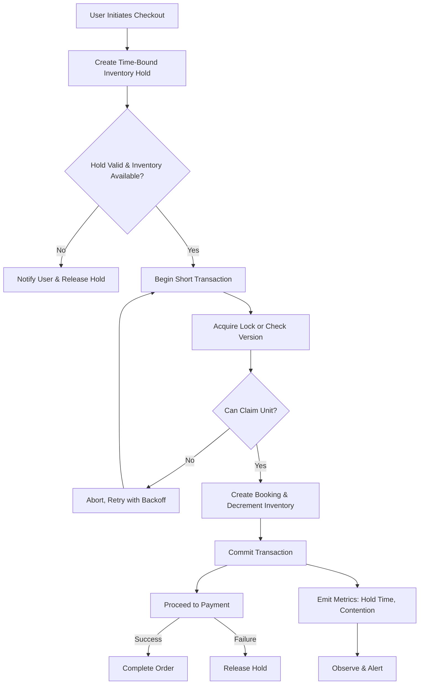

| Difficulty | Channel | Tags |
|---|---|---|
| intermediate | database | acid, isolation-levels, mvcc |

It was Black Friday. For Shopify's merchants, carts were flying off the shelves at a staggering $5.1 million in sales per minute [1]. With that level of velocity, the nightmare scenario for any ecommerce platform becomes terrifyingly real: two customers hitting 'checkout' at the exact same millisecond for the last unit of inventory. This is the same race condition that plagues Airbnb hosts, hotel operators, and anyone selling a finite resource. For Shopify, the 'straw that broke the camel's back' wasn't CPU or raw query speed, but something far more insidious - database connection exhaustion [1].

---

> ### Real-World Case — Shopify
>
> During Black Friday 2025, merchants on Shopify hit a record $5.1 million in sales per minute at peak—every transaction touching inventory. Shopify's oversell protection system must place short holds on inventory units during payment processing so two concurrent checkouts can never claim the same last unit, a race condition identical to double-booking a hotel room or listing.
>
> | | |
> |---|---|
> | **Challenge** | The reservation system had run on Redis for years, but reservations and the MySQL inventory ledger lived in two different systems. The 'claim' step (payment succeeds → permanently deduct inventory) required updating MySQL and cleaning up Redis, and those two operations couldn't be wrapped in a single atomic transaction—causing intermittent overselling (item sold but never deducted from the ledger) and underselling (item deducted but still marked reserved). They needed ACID guarantees across reserve and claim without sacrificing peak throughput. |
> | **Solution** | Shopify replaced Redis with MySQL using a SKIP LOCKED design inspired by 37signals' Solid Queue: one row per sellable unit (not one row with a quantity column), bounded to a 1,000-row pool per item/location that replenishes from the ledger. They switched the reservation transactions from MySQL's default REPEATABLE READ to READ COMMITTED to eliminate gap/supremum locks that blocked replenishment inserts and caused deadlocks; adopted composite primary keys (shop_id, inventory_item_id, inventory_group_id, id) to cut locks from two per row to one; enforced consistent lock ordering between reserve and claim paths; and batched multi-item cart reservations with UNION ALL. They dual-wrote to Redis and MySQL in 'shadow mode' before cutting over with a kill switch. |
> | **Outcome** | During high-volume flash sales, writer CPU stayed under 50% and reader CPU under 16% with headroom to spare. Optimizing the broader checkout path (guided by per-connection-hold-time attribution via SQL comment tags parsed at ProxySQL) removed 50% of reads and 33% of transactions on the primary database. The surprising finding: the throughput ceiling wasn't CPU or query speed at all—it was database connection exhaustion caused by other checkout code holding connections too long, with reservations merely the 'straw that broke the camel's back.' |
> | **Lesson** | Correctness and scale often point in opposite directions, but modern database features (SKIP LOCKED, READ COMMITTED) can give you both—sometimes by using a LESS strict isolation level than the textbook answer, not more. Also: when metrics don't add up (low CPU, high queuing), instrument connection-hold-time by business process; the bottleneck is often in code you weren't looking at. Finally, revisit 'impossible' old decisions: what couldn't run on MySQL five years ago may run fine today. |

---

## Hook — The Million Dollar Millisecond

Picture this: you are a developer on call during the biggest sales day of the year. Alarms are quiet, charts look healthy, and CPU usage is sitting comfortably under 50% [1]. Yet, your platform is beginning to buckle. Why? Because when every checkout is holding onto a database connection for just a little too long, a flood of transactions can grind everything to a halt. The terrifying truth is that for finite inventory, correctness and availability are constantly at war with one another. Getting that balance wrong can cost millions, all within the span of a single millisecond.

## Problem — The Double Booking Race

At its core, the issue is a classic concurrency problem. When two processes read that '1 unit left' at the same time, both can pass validation and write a successful booking, selling two units for one [2]. This violates the atomicity and consistency guarantees that are foundational to safe transactions [5]. You might think that simply increasing your database's horsepower will solve this. However, this is where the plot twist lies. For Shopify, throwing more CPU at the problem would have done little to help, as their bottleneck was not computation, but the finite pool of database connections [1]. Therefore, preventing double bookings is not about brute force, but about intelligent serialization and resource stewardship.

## Real-World Case — Shopify

During Black Friday 2025, Shopify was forced to confront this exact problem on an unprecedented scale. Their oversell protection system placed short holds on inventory units during payment processing, ensuring that two concurrent checkouts could never claim the same last unit [1]. Through their observability efforts, specifically by attributing per-connection-hold-time via SQL comment tags parsed at ProxySQL, Shopify's engineering team made a shocking discovery. Optimizing the broader checkout path removed 50% of reads and 33% of transactions on the primary database. Despite writer CPU remaining under 50% and reader CPU under 16%, the true throughput ceiling was database connection exhaustion [1]. The reservations weren't the problem themselves, they were the 'straw that broke the camel's back'. This serves as a powerful reminder to developers: always measure before you optimize, as your perceived bottleneck may be masking the real one [1].

## Deep Dive — The Tools to Keep Your Data Honest

So, how do you prevent selling the same resource twice without holding connections hostage? The answer lies in a layered approach that utilizes the guarantees provided by your database, whilst still maintaining high availability [3][4]. 

- **MVCC is your safety net:** Most modern relational databases utilize Multi-Version Concurrency Control (MVCC), allowing readers and writers to coexist without blocking one another. This grants high read concurrency, however, it alone does not prevent write-write conflicts [2]. 
- **Lock with intent:** For critical operations, `SELECT ... FOR UPDATE` allows you to lock specific rows prior to writing, preventing other transactions from modifying them until your transaction completes [4]. When applied to a concrete availability row (such as a specific property on a specific date), this creates an exclusion boundary. 
- **Embrace the right isolation:** For the absolute strictest guarantees, SERIALIZABLE isolation can prevent anomalies, however, this comes at the cost of increased aborts and contention [3][5]. For many booking flows, combining row-level locking with application-level validation strikes the perfect balance. 
- **Don't trust, verify:** Optimistic concurrency control (OCC) takes a different route. By adding a version column to a record, you can detect if it has been modified between your read and write. If the version mismatches, you abort and retry [6]. This is incredibly effective at reducing lock time, and when paired with short transactions, it preserves connection pool availability [7]. 

The key takeaway? Shorten your critical sections. The less time your code holds a lock or an open transaction, the more headroom your connection pool will have for the rest of your traffic [1][7].

## Workflow — From Cart to Confirmed in Milliseconds

With the theory in mind, let's visualize the battle-tested workflow that platforms such as Shopify and Airbnb utilize to prevent double bookings whilst keeping their systems available. As shown in the diagram below, the goal is to create the shortest possible window of exclusivity for an inventory unit [1][4][6]. 

1. **Reserve Intent:** When a user initiates checkout, create a short-lived hold for the specific inventory item (e.g. the last room on a given date). This hold should be time-bound to prevent deadlocks from abandoned carts. 
2. **Validate Atomically:** Within a single, short transaction, read the availability and acquire a lock on that specific row (`SELECT ... FOR UPDATE`) or compare against a version. This ensures no other process can claim it. 
3. **Create the Booking:** Only if the hold is still valid and the inventory is claimable, write the booking record and decrement availability. Commit as fast as possible. 
4. **Release or Expire:** If payment fails, release the hold. If the hold expires, automatically free the unit. 
5. **Observe Relentlessly:** Track hold times, lock contention, connection wait time, and abort rates. As Shopify proved, these metrics will always tell you the truth [1][7].

## Code Example — A Practical, Retry-Safe Booking

Theory is great, but implementation is where the battle scars are earned. The following example showcases a battle-tested pattern: use optimistic concurrency control with a version column, wrap the critical operation in a short transaction, and utilize exponential backoff to retry on contention [6]. This minimizes lock duration, protecting your all-important connection pool from exhaustion [1][7].

## Lessons Learned — The Art of the Short Transaction

If there is one lesson to carry with you from this journey, it's this: correctness does not need to come at the cost of availability, however, it does demand discipline. 

- **Measure first.** Do not assume CPU is your enemy. Shopify's greatest bottleneck was connection exhaustion, which was only uncovered through granular attribution of hold times [1]. 
- **Keep transactions tiny.** The larger your critical section, the larger your blast radius. Lock rows, not tables, and commit the moment your write is safe [3][4]. 
- **Prefer OCC for hot inventory.** When contention is high but transactions can be retried safely, a versioned approach will drastically reduce your time spent holding locks [6]. 
- **Time-bound everything.** Holds, locks, and requests must all have an expiration. A forever-hold is just as dangerous as a double booking. 
- **Embrace idempotency.** Network blips happen. Ensure that retries cannot re-process a payment or double-charge a customer by utilizing idempotency keys [7]. 

At the end of the day, preventing the last room from being sold twice isn't about heroic database tuning. It's about respecting the finite nature of your resources, both your inventory, and your database connections. Get that right, and you too can scale to millions of sales per minute without breaking a sweat.

---

## Inventory Reservation & Booking Flow

<strong>Original Interview Question</strong>

**Q:** You're building a booking system for Airbnb where multiple users can reserve the same property simultaneously. How would you design the transaction handling to prevent double bookings while maintaining high availability?

**A:** Use SERIALIZABLE isolation with optimistic concurrency control. Implement row-level locks on property availability tables, use MVCC snapshot reads for checking availability, and apply application-level validation to ensure atomic booking operations.

## Conclusion

The next time you are tasked with selling a finite resource, resist the urge to 'just lock the table'. Instead, measure your connection hold times, keep your transactions microscopic, and opt for versioned, retry-safe operations when contention runs high. After all, as Shopify proved during their record-breaking Black Friday, the resource that runs dry first isn't always CPU - it's your database connections [1]. That single insight, applied to your own systems tomorrow, could be the difference between a sold-out success, and a million-dollar double booking.

---

## References

1. [Shopify incident report: Scaling Inventory Reservations](https://shopify.engineering/scaling-inventory-reservations) — blog
2. [PostgreSQL: Introduction to MVCC](https://www.postgresql.org/docs/current/mvcc-intro.html) — documentation
3. [PostgreSQL: Transaction Isolation](https://www.postgresql.org/docs/current/transaction-iso.html) — documentation
4. [PostgreSQL: SELECT ... FOR UPDATE](https://www.postgresql.org/docs/current/sql-select.html#SQL-FOR-UPDATE-SHARE) — documentation
5. [ACID (atomicity, consistency, isolation, durability)](https://en.wikipedia.org/wiki/ACID) — documentation
6. [Optimistic concurrency control](https://en.wikipedia.org/wiki/Optimistic_concurrency_control) — documentation
7. [Connection pool](https://en.wikipedia.org/wiki/Connection_pool) — documentation
8. [Exponential backoff](https://en.wikipedia.org/wiki/Exponential_backoff) — documentation

---

**Author:** Satishkumar Dhule — [GitHub](https://github.com/satishkumar-dhule) · [LinkedIn](https://linkedin.com/in/satishkumar-dhule) · [Website](https://satishkumar-dhule.github.io)
