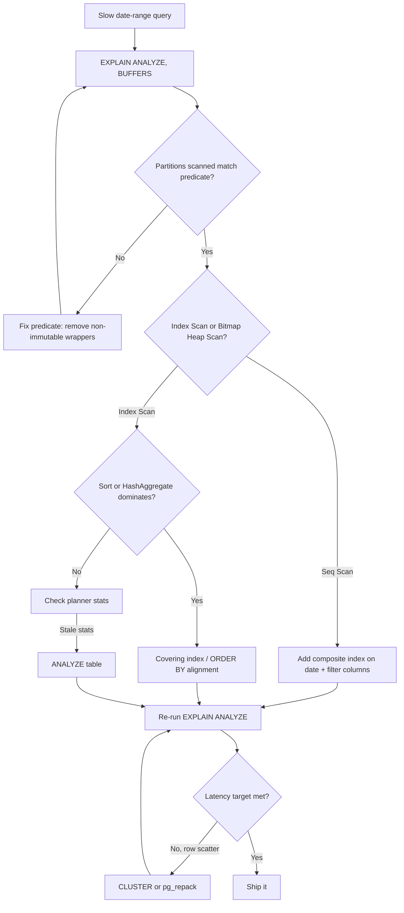

| Difficulty | Channel | Tags |
|---|---|---|
| intermediate | database | explain, query-plan, partitioning |

It started with a dashboard going red. CoinGecko's core PostgreSQL table — eight years of hourly crypto price data — had swelled past 1TB, and average queries were taking 30+ seconds while price endpoints blew through their provisioned IOPS every single day. Queues grew, Apdex scores cratered, replicas lagged behind during traffic spikes [1]. That is what a slow query looks like when it stops being a nuisance and starts being a business incident. The uncomfortable part? The same failure mode hides inside any large partitioned table the moment you filter by a date range and assume the database will do the right thing.

---

> ### Real-World Case — CoinGecko
>
> CoinGecko's core PostgreSQL (RDS) table storing 8 years of hourly crypto price data grew past 1TB, with queries taking 30+ seconds on average. Price endpoints were breaching provisioned IOPS daily (pushed to 24K and still alerting), request queues grew, Apdex scores fell, and replica lag appeared during traffic spikes.
>
> | | |
> |---|---|
> | **Challenge** | Diagnose why date-range queries on a huge time-series table were slow and fix them without downtime — while first attempting (and failing) to solve it with indexes, since the JSONB currency-key columns made per-application indexing impractical. |
> | **Solution** | They analyzed query patterns and chose RANGE partitioning by month (nearly all queries filter on a timestamp range and touch at most 4 months), created a new partitioned table, copied 1.2TB using a Foreign Data Wrapper trick to avoid cold-cache IOPS on production, prewarmed partitions with pg_prewarm, then flipped via a rename + sync-trigger rollback plan. Crucially, they validated pruning via EXPLAIN results: one query that regressed was found to lack a lower date bound and scanned ALL partitions (it had actually been fine on the unpartitioned table), and another shaped as `created_at > ?` with no upper limit scanned empty future partitions — both fixed by rewriting the queries. |
> | **Outcome** | p99 response time cut 86% (4.13s → 578ms), 6-8x query speedup in benchmarks, IOPS reduced 20% (savings multiplied across replicas), and replica lag disappeared. Dry runs showed partition prewarming took 3 hours vs 10 for the original table. |
> | **Lesson** | Partitioning only pays off when queries let the planner prune — the same query can be FASTER on an unpartitioned table if its date range has no lower/upper bound, because it then scans every partition. Verify pruning in EXPLAIN, and don't skip cache-warming when swapping a hot table. |

---

## Hook — The Query That Ate the IOPS Budget

Every developer has stared at a query that "should" be fast. The table is partitioned by date. The filter is a date range. Logically, the database only needs one slice of data — yet the timer ticks past three seconds, then ten, then thirty.

Here is the tension: partitioning is sold as the silver bullet for time-series data [3]. So when a date-range query is still slow, the first instinct is to blame the hardware, bump provisioned IOPS, and hope the alerts quiet down. That is exactly the treadmill CoinGecko found themselves on — pushing IOPS to 24K and still getting paged [1]. The bill grows, the query does not get faster, and nobody can explain where the time is going.

So what is actually happening inside the planner? And why does the answer hide in a plan you may be skimming instead of reading?

## Problem — Partitioned But Not Faster

Consider the classic setup: a PostgreSQL table with 100M rows partitioned by date, and a query filtering on a narrow window like a single day or week. The expectation is that the database reads one or two partitions and returns instantly. The reality is often a full sweep, a bloated sort, or an index that quietly stopped being useful.

The pain shows up in three places:

- **Latency:** p99 balloons because a handful of scans dominate the request tail.
- **I/O:** every unnecessary page read burns provisioned IOPS, which you pay for on every replica too [8].
- **Operations:** replica lag appears during spikes, backups stretch, and prewarming a table takes all night.

Many developers assume that "partitioned by date" automatically means "partition pruning works." It does not. Pruning depends on how the predicate is written, whether the planner can prove the expression is immutable, and whether prepared statements or opaque parameters hide the value from the planner at plan time [3]. Similarly, an index on each partition is worthless if the query's filter column is not part of that index, or if the rows you need are scattered randomly across the heap.

The stakes: you keep scaling a machine to compensate for a plan problem. Sound familiar?

## Real-World Case — CoinGecko

Now scale that pain to production. CoinGecko's core PostgreSQL (RDS) table held 8 years of hourly crypto price data and crossed 1TB. Price endpoints averaged 30+ second queries, breached provisioned IOPS daily even after being pushed to 24K, queued requests piled up, Apdex scores fell, and replica lag appeared under traffic spikes [1].

The fix was not a bigger instance. The team moved to table partitioning and rethought index strategy around the query pattern. The results were quantified:

- **p99 response time cut 86%** — from 4.13s to 578ms.
- **6–8x query speedup** in benchmarks.
- **IOPS reduced ~20%**, a saving multiplied across every replica.
- **Replica lag disappeared** during spikes.
- **Partition prewarming took 3 hours** versus 10 for the original table [1].

Notice the plot twist: the win did not come from adding capacity. It came from making the storage layout and index strategy match the access pattern. The 20% IOPS reduction matters more than it sounds — provisioned IOPS are billed continuously and duplicated across replicas [8], so a plan-level improvement compounds into a line-item saving.

That raises the obvious question: if partitioning plus the right indexes delivered those numbers, what exactly should you look for in your own EXPLAIN plan to know whether you are on the fast path or the expensive one?

## Deep Dive — Reading the EXPLAIN Plan Like a Crime Scene

With the CoinGecko outcome as the target, the diagnosis gets specific. PostgreSQL's EXPLAIN machinery shows exactly where rows are read, sorted, and joined [2]. Four checks cover the vast majority of slow date-range queries.

**1. Verify partition pruning.** In `EXPLAIN (ANALYZE, BUFFERS)`, count the partition child scans. A one-week filter on a daily-partitioned table should touch a handful of partitions, not dozens. If every child appears, pruning failed — often because the predicate wraps the column in a non-immutable expression like a cast or function call, or because the parameter was invisible at plan time [3]. Postgres supports both plan-time and runtime pruning [3], but runtime pruning only kicks in once parameter values are known.

**2. Check index utilization.** Look at the node type under each surviving partition. `Seq Scan` on a large partition means the index was ignored — typical when the leading index column does not match the filter, when the planner estimates the scan will return most of the partition anyway, or when planner statistics are stale. `Bitmap Heap Scan` or `Index Scan` signals the index is doing its job [4].

**3. Hunt expensive sorts and hash aggregates.** A `Sort` node spilling to disk (`Sort Method: external merge`) or a `HashAggregate` building a large hash table can dwarf the scan itself. Often the fix is an index that delivers rows already in the needed order, removing the sort entirely.

**4. Evaluate the partition key against the query pattern.** If every query filters on `event_date` but also on `status`, partitioning on `event_date` alone still requires index lookups inside each partition. This is where composite indexes earn their keep.

Here is the counterintuitive bit many teams miss:

| Approach | What it fixes | What it does NOT fix |
|---|---|---|
| More provisioned IOPS | Temporary I/O pressure | Plan inefficiency; cost keeps rising [8] |
| Index on `(event_date)` alone | Range lookups, ordering | Non-leading filter columns like `status` |
| Composite `(event_date, status)` | Filters on both columns in one scan | Physical row scatter inside the heap |
| `CLUSTER` / `pg_repack` | Sequential physical order after index | New writes that scatter pages again over time |

⚠️ **Watch Out:** `CLUSTER` takes an exclusive lock and rewrites the table [5]. On a live 100M-row table, run it in a maintenance window or use `pg_repack` for online rebuilds. Similarly, always build indexes with `CONCURRENTLY` — a plain `CREATE INDEX` on a hot table blocks writes and can trigger the exact outage you were trying to prevent.

💡 **Insight:** after running `EXPLAIN (ANALYZE, BUFFERS)`, the `shared read` vs `shared hit` ratio tells you whether caching or I/O is the bottleneck. High shared-read counts on repeated queries mean the working set does not fit memory — a symptom of reading far more rows than the predicate actually needs.

So the diagnosis has four checkpoints. The next step is turning that into a repeatable routine you can run before touching production.

## Workflow — A Five-Step Diagnosis Loop

Building on those four checks, the reliable path from "this is slow" to "this is fixed" follows a loop. The following diagram maps the decision flow — each branch corresponds to a specific line in the plan output:

```mermaid
flowchart TD
    A[Slow date-range query] --> B[EXPLAIN ANALYZE, BUFFERS]
    B --> C{Partitions scanned\nmatch predicate?}
    C -->|No| D[Fix predicate: remove\nnon-immutable wrappers]
    C -->|Yes| E{Index Scan or\nBitmap Heap Scan?}
    E -->|Seq Scan| F[Add composite index\non date + filter columns]
    E -->|Index Scan| G{Sort or HashAggregate\ndominates?}
    G -->|Yes| H[Covering index /\nORDER BY alignment]
    G -->|No| I[Check planner stats]
    D --> B
    F --> J[Re-run EXPLAIN ANALYZE]
    H --> J
    I -->|Stale stats| K[ANALYZE table]
    K --> J
    J --> L{Latency target met?}
    L -->|No, row scatter| M[CLUSTER or pg_repack]
    L -->|Yes| N[Ship it]\nM --> J
```

The steps in order:

1. **Capture a truthful plan.** `EXPLAIN (ANALYZE, BUFFERS)` on the real query with real parameters — never a hand-written surrogate [2].
2. **Audit pruning.** Count child partition scans against the date range you filtered on [3].
3. **Audit node types.** Confirm index usage and identify sorting or aggregation hotspots [4].
4. **Fix one thing at a time.** Predicate, then index, then statistics, then physical layout [5].
5. **Re-measure.** Compare actual runtime and buffer counts before and after each change.

🎯 **Key Point:** treat this as a loop, not a one-shot. Each iteration should change exactly one variable, so the next `EXPLAIN ANALYZE` tells you precisely what that variable was worth.

## Code Example — From Blind Retry to Measured Fix

The workflow becomes concrete in a single script. Rather than guessing, it captures the plan, verifies pruning, adds the composite index without blocking writers, and optionally reclusters in a controlled window:

```bash
#!/usr/bin/env bash
# Diagnose and fix a slow date-range query on a partitioned table.
set -euo pipefail

PSQL="psql -d app_db -X -q"

# Step 1: capture the REAL plan, including buffer usage.
# BUFFERS shows shared hit vs shared read: caching vs disk I/O.
$PSQL <<'SQL'
EXPLAIN (ANALYZE, BUFFERS)
SELECT * FROM events
WHERE event_date BETWEEN '2024-01-01' AND '2024-01-31'
  AND status = 'completed';
SQL

# Step 2: verify partition pruning by listing every scanned child.
# A one-month filter on daily partitions should touch ~31, not 2900+.
$PSQL <<'SQL'
EXPLAIN (ANALYZE, VERBOSE)
SELECT count(*) FROM events
WHERE event_date = '2024-01-15'
  AND status = 'completed';
SQL

# Step 3: add a composite index matching BOTH filter columns.
# CONCURRENTLY keeps writes flowing; it just takes longer.
$PSQL -c "CREATE INDEX CONCURRENTLY IF NOT EXISTS idx_events_date_status
          ON events (event_date, status);"

# Step 4: refresh planner statistics so the index looks attractive.
$PSQL -c "ANALYZE events;"

# Step 5: OPTIONAL and scheduled separately - physically reorder rows.
# CLUSTER takes an EXCLUSIVE lock: maintenance window required.
if [ "${RECLUSTER:-0}" = "1" ]; then
  $PSQL -c "CLUSTER events USING idx_events_date_status;"
fi

# Step 6: re-measure the same query and compare runtimes.
$PSQL <<'SQL'
EXPLAIN (ANALYZE, BUFFERS)
SELECT * FROM events
WHERE event_date BETWEEN '2024-01-01' AND '2024-01-31'
  AND status = 'completed';
SQL
```

Walking through it:

- **Steps 1–2** produce evidence. The first plan reveals node types and buffer traffic; the second isolates pruning by checking which partition children the planner actually touched [2] [3]. A mismatch here means the predicate, not the index, is the bug.
- **Step 3** creates the composite index on `(event_date, status)` so both predicates are resolved from one index scan instead of a filter after the fact [4]. `CONCURRENTLY` avoids blocking writes, at the cost of a longer build and the possibility of an invalid index you must drop and retry.
- **Step 4** matters more than it looks. Stale statistics make the planner prefer a sequential scan even when the index would win; `ANALYZE` re-prices both paths.
- **Step 5** is deliberately gated behind an environment variable. Physical clustering yields the biggest sequential-read gains, but the exclusive lock makes it a scheduled operation [5].
- **Step 6** closes the loop with a fresh plan — the only honest way to know whether the change worked.

The design decision that matters: every step is measured, and every risky operation is opt-in. That is how you get a 6–8x improvement without getting a 3am page [1].

## Lessons Learned — What to Do Differently Tomorrow

Returning to where this started: CoinGecko's 1TB table did not need a heroic rewrite. It needed a plan that matched the query pattern, and the discipline to measure instead of guessing [1]. The same arc applies to any slow date-range query.

Here is what to take back to your team:

- **Partition pruning is a claim, not a guarantee.** Always confirm it by counting child scans in `EXPLAIN (ANALYZE)` [3].
- **Index the filter, not just the key.** A composite index on `(date, filtered_columns)` often doubles as a covering path and removes sorts entirely [4].
- **Statistics are a performance fix.** A stale `ANALYZE` can make the planner ignore an index you spent hours building.
- **Physical layout is a multiplier, not a first move.** `CLUSTER`/`pg_repack` helps once the plan is right — and costs an exclusive lock otherwise [5].
- **Measure buffer hits, not just milliseconds.** In production, repeated `shared read` counts are how you catch IOPS breaches before the billing alert does [8].

⚠️ **Battle Scars:** the recurring mistakes are creating indexes without `CONCURRENTLY`, recluster-ing during peak traffic, wrapping the partition key in functions (silently killing pruning), and "fixing" latency by raising IOPS without ever opening the plan. Each one trades a real outage or a real invoice for a problem that a five-minute EXPLAIN run would have exposed.

One memorable insight to share with your team: **a slow query on a partitioned table is a hypothesis you haven't tested yet.** The plan is the experiment.

So what should change tomorrow? Before your next scaling ticket gets approved, capture `EXPLAIN (ANALYZE, BUFFERS)` and count the partitions scanned. Nine times out of ten, the fix is cheaper than the instance upgrade — and the savings compound across every replica you own.

---

## Slow Query Diagnosis Loop



<details>
<summary><strong>Original Interview Question</strong></summary>

**Q:** You have a PostgreSQL table with 100M rows partitioned by date. A query filtering on a specific date range is still slow. What would you check in the EXPLAIN plan and how would you optimize it?

**A:** Check partition pruning effectiveness, index utilization patterns, and expensive sort operations. Create composite indexes on (date, filtered_columns) and evaluate clustering strategies for optimal data access.

</details>

## Conclusion

The journey started with a red dashboard: a 1TB table, 30+ second queries, and IOPS alerts that kept firing no how high the limit was pushed [1]. It ended with an 86% p99 improvement that came from reading a query plan, not buying hardware. The same arc is waiting inside your own database — the slow date-range query is a hypothesis you have not tested yet, and `EXPLAIN (ANALYZE, BUFFERS)` is the experiment. Tomorrow, before approving that instance upgrade, capture the plan, count the partitions scanned, confirm the index node types, and change exactly one thing. The most shareable takeaway for your team is simple: partitioned does not mean pruned, indexed does not mean used — until the plan proves it.

---

## References

1. [CoinGecko incident report](https://dev.to/coingecko/scaling-postgresql-performance-with-table-partitioning-136o) — article
2. [PostgreSQL Documentation — Using EXPLAIN](https://www.postgresql.org/docs/current/using-explain.html) — documentation
3. [PostgreSQL Documentation — Partition Pruning](https://www.postgresql.org/docs/current/partition-pruning.html) — documentation
4. [PostgreSQL Documentation — Indexes](https://www.postgresql.org/docs/current/indexes.html) — documentation
5. [PostgreSQL Documentation — CLUSTER](https://www.postgresql.org/docs/current/sql-cluster.html) — documentation
6. [DigitalOcean — PostgreSQL Table Partitioning Tutorial](https://www.digitalocean.com/community/tutorials/postgresql-table-partitioning) — blog
7. [PostgreSQL Documentation — pg_stat_statements](https://www.postgresql.org/docs/current/pgstatstatements.html) — documentation
8. [AWS Documentation — Provisioned IOPS for Amazon RDS](https://docs.aws.amazon.com/AmazonRDS/latest/UserGuide/USER_PIOPS.html) — documentation
9. [Wikipedia — PostgreSQL](https://en.wikipedia.org/wiki/PostgreSQL) — documentation

---

**Author:** Satishkumar Dhule — [GitHub](https://github.com/satishkumar-dhule) · [LinkedIn](https://linkedin.com/in/satishkumar-dhule) · [Website](https://satishkumar-dhule.github.io)
