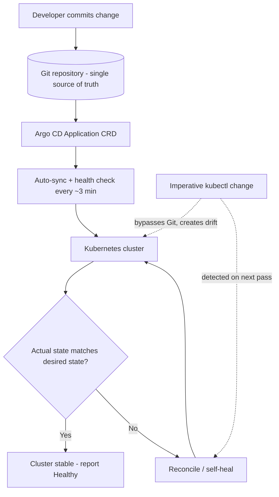

| Difficulty | Channel | Tags |
|---|---|---|
| beginner | devops | argocd, flux, declarative |

When Intuit's Kubernetes footprint exploded into hundreds of applications across dozens of clusters, their Argo CD setup — once perfectly fine for a dozen apps on a couple of clusters — started taking minutes to reconcile a single change [1]. A lag like that turns GitOps from a safety net into a liability. This is the story of how declarative delivery scales, where imperative habits quietly sabotage it, and what it takes to make your cluster react in well under a second [1].

---

> ### Real-World Case — Intuit
>
> As Kubernetes adoption grew at Intuit, they needed to manage hundreds of applications across dozens of clusters with GitOps, but their initial Argo CD implementation only worked well for a few dozen applications and a couple of clusters, with reconciliation times in the minutes.
>
> | | |
> |---|---|
> | **Challenge** | They needed a scalable GitOps continuous delivery solution that could continuously reconcile live application state with Git-defined desired state in near real time, without excessive memory overhead, while providing visibility and safe automation. |
> | **Solution** | They evolved Argo CD's Application Controller by moving cached resource state into an in-memory cache, redesigning bottlenecks in the controller to improve performance at scale, and configuring Applications (CRDs) pointing to Git sources with automated sync and self-healing capabilities (declarative state in Git continuously reconciled against cluster state, rather than imperative kubectl changes). |
> | **Outcome** | Reconciliation performance improved dramatically (e.g. Istio reconciliation went from ~1 minute to ~0.5 seconds), enabling Argo CD to manage hundreds of applications across dozens of clusters and be used as a responsive Kubernetes troubleshooting/operations tool. |
> | **Lesson** | Declarative GitOps with continuous reconciliation enables safe automation at scale, but controller architecture and caching are critical to achieving real-time reconciliation and operational visibility. |

---

## Hook — The three-minute window where everything goes wrong

Sooner or later, every platform team hits the same wall: the deploy looked fine, the pipeline went green, and yet production is running something nobody committed.

Picture a Friday afternoon where a well-meaning engineer runs `kubectl scale` to unblock a demo. The change sticks. By Monday, nobody remembers why the replica count differs from Git. Multiply that by hundreds of applications across dozens of clusters, and you get configuration drift at a scale no human can audit [3].

The stakes are not abstract. Drift is how rollback stories begin, and how 'it works on staging' turns into a 3am incident. The question was never whether your cluster will diverge from Git — it is whether anything will notice before your users do.

## Problem — Your cluster has two authors, and only one of them keeps receipts

Here is the thing though: Kubernetes was built around a declarative model. You describe the desired state as objects, and control loops continuously drive reality toward it [3]. The catch is that imperative commands — `kubectl run`, `kubectl scale`, `kubectl edit` — are still sitting right there, and they are wonderfully convenient.

Every imperative change is a message written outside version control. No code review, no audit trail, no automated rollback, and no shared history when someone asks 'why is prod different from staging?' Sound familiar?

Many developers discover this the hard way. Common battle scars:

- **Hotfixes bypassing Git**: a `kubectl patch` at 2am that nobody commits, so the next Git-synced deploy silently reverts it — or worse, doesn't.
- **Environment drift**: staging and production drift apart until a manifest that passed review fails on apply.
- **Mystery rollbacks**: rolling back means digging through shell history instead of `git revert`.
- **Permission sprawl**: everyone with cluster access becomes a release engineer.

Consequently, teams end up trusting Git sometimes and kubectl other times — and partial trust is worse than either pure approach. If Git is not the single source of truth, then who is? The answer sets up the real-world story that follows.

## Real-World Case — Intuit's reconciliation wall

As Kubernetes adoption grew at Intuit, the team needed GitOps to manage hundreds of applications across dozens of clusters. Their initial Argo CD implementation only worked well for a few dozen applications and a couple of clusters, with reconciliation times measured in minutes [1].

That sounds tolerable until you do the math: if reconciling a change takes minutes, Argo CD is a batch job, not an operations tool. You cannot debug a live cluster with a system that reacts slower than you can type.

The impact of fixing it was dramatic. Istio reconciliation dropped from roughly 1 minute to about 0.5 seconds — a ~120x improvement — enabling Argo CD to manage hundreds of applications across dozens of clusters and be used as a responsive Kubernetes troubleshooting and operations tool [1].

The takeaway is not simply 'Argo CD is fast.' It is that the declarative loop only pays off when reconciliation is fast enough to be interactive [1]. Otherwise you have faithfully automated a queue of delays. Which raises the obvious question: what exactly does that loop consist of?

## Deep Dive — The Application CRD, auto-sync, and self-healing

Argo CD's whole model boils down to three configuration decisions, all declared inside an Application Custom Resource Definition [2]:

- **Source of truth**: the Application CRD points at your Git repository — plain YAML manifests, Helm charts [7], or Kustomize overlays [9] — as the definition of desired state.
- **Auto-sync**: automated synchronization with a configurable health check interval, typically 1–5 minutes (3 minutes is a common default) [2]. Without it, you are clicking a sync button, which is imperative with extra steps.
- **Self-healing**: automatic remediation that reverts manual cluster changes back to the Git-declared state [2]. This is the feature that makes drift someone else's problem — specifically, the cluster's.

Now for the comparison you actually came for:

| Dimension | Declarative (GitOps) | Imperative (kubectl) |
| --- | --- | --- |
| Source of truth | Git repository | Whoever ran the command |
| Change path | Commit → PR → review → sync | Direct API call to cluster |
| Auditability | Full history in `git log` | Shell history, maybe |
| Rollback | `git revert` + auto-sync | Hope you remember the old value |
| Drift handling | Detected and reverted automatically | Accumulates silently |
| Team collaboration | Code review + CI gates | Tribal knowledge |
| Scale | Hundreds of apps, dozens of clusters [1] | Dozens before it becomes chaos |

🔥 **Hot Take**: an imperative command inside a GitOps pipeline is not hypocrisy — it is fine, because Git still recorded it. The problem is an imperative command *bypassing* Git.

💡 **Insight**: this is exactly what the OpenGitOps principles codify — automated delivery and drift correction driven by declared state [4]. Flux CD, the other major GitOps engine, follows the same principles [5], which is useful confirmation that this is a pattern, not a vendor quirk.

So declarative wins on paper. But a declared state only matters if the reconciliation loop actually runs — and runs often enough to matter. That loop is the workflow below.

## Workflow — How a change travels from commit to cluster

The path from keyboard to running pod is short, but each step has a job:

1. **Declare**: commit your manifests, Helm chart, or Kustomize overlay to Git — this is now the desired state [3].
2. **Point**: create an Application CRD that references the repo, target revision, and destination cluster/namespace [2].
3. **Sync**: enable automated sync so Argo CD polls the repo and applies differences on a health check interval (often 3 minutes) [2].
4. **Verify**: Argo CD compares live state against desired state and reports Synced/OutOfSync plus Healthy/Degraded.
5. **Heal**: if someone edits the cluster out-of-band, self-healing reverts the change on the next reconciliation [2].



Notice the asymmetry: Git flows downward through one door, while manual kubectl edits enter the cluster from the side — and get folded back into line on the next pass [4]. But diagrams are cheap; the next section puts an actual Application CRD on the page so you can run it.

## Code Example — A production-shaped Application CRD with self-healing

Here is a complete, runnable setup: it declares the desired state, turns on auto-sync and self-healing, and then deliberately breaks the cluster to prove the healing works.

```bash
#!/usr/bin/env bash
set -euo pipefail

# Step 1: Declare the Argo CD Application as code - this IS the GitOps config.
cat <<'EOF' > argocd-app.yaml
apiVersion: argoproj.io/v1alpha1
kind: Application
metadata:
  name: payments-service
  namespace: argocd
spec:
  project: default
  source:
    repoURL: https://github.com/acme/payments-deploy.git  # source of truth
    targetRevision: main
    path: overlays/production        # Kustomize overlay = desired state
  destination:
    server: https://kubernetes.default.svc
    namespace: payments
  syncPolicy:
    automated:                       # auto-sync, no clicking the UI
      prune: true                    # delete resources removed from Git
      selfHeal: true                 # revert manual kubectl edits
      allowEmpty: false
    syncOptions:
      - CreateNamespace=true
    retry:
      limit: 5                       # resilient to transient API errors
      backoff:
        duration: 5s
        factor: 2
EOF

# Step 2: Apply it once. After this, Git is the only writer that matters.
kubectl apply -f argocd-app.yaml

# Step 3: Confirm auto-sync and self-healing are actually enabled.
argocd app get payments-service -o json \
  | jq '{sync: .status.sync.status, health: .status.health.status, autoSync: .spec.syncPolicy.automated}'

# Step 4: Prove self-healing - make a forbidden imperative change.
kubectl -n payments scale deploy/payments --replicas=99

# Step 5: Wait for the health check interval (~180s) and watch Git win.
sleep 180
argocd app get payments-service --operations   # shows the revert in history
```

Walking through it:

- **Lines 4–30** define the Application CRD — the single object Argo CD needs to know the repo, the revision, and the cluster [2]. The `path` field means your desired state lives as Kustomize overlays rather than hand-edited YAML [9].
- **`automated`** enables auto-sync; `prune: true` means resources deleted from Git disappear from the cluster, so Git is genuinely authoritative rather than merely suggestive.
- **`selfHeal: true`** is the drift killer: any out-of-band change gets reverted on the next reconciliation, which is precisely the mechanism Intuit relied on to keep hundreds of apps consistent [1].
- **`retry` with backoff** matters more than it looks — without it, a transient API-server hiccup can leave a sync stuck until a human notices [2].
- **Steps 4–5** are the experiment: scale to 99 replicas imperatively, wait one health check interval, and Argo CD rolls it back to the Git-declared value. The imperative change loses, automatically.

If you only borrow one line from this, borrow `selfHeal: true` — it is the difference between a Git repository that describes your cluster and one that actually governs it.

## Lessons Learned — What to steal from Intuit's wall

The journey from a few dozen apps to hundreds of clusters is really a journey of trust: trusting Git enough to make it the only author that counts. The concrete takeaways:

- **Start declarative on day one.** Retrofitting drift out of an imperative estate is far more expensive than never creating it [3].
- **Enable auto-sync *and* self-healing together.** Auto-sync without self-healing only fixes things when someone commits; self-healing without auto-sync has nothing to converge on [2].
- **Tune the health check interval to your blast radius.** 1–5 minutes is typical [2]; shorter intervals give faster feedback but more Git API traffic — a real cost at Intuit's scale [1].
- **Ban direct kubectl writes in production.** Let engineers keep `kubectl describe` and `kubectl logs`; route writes through Git PRs, or through a pipeline that commits on their behalf [4].
- **Watch the scale multipliers.** Apps × clusters × sync frequency is the load Argo CD actually carries; if reconciliation lags, optimize there before adding tooling [1].

⚠️ **Watch Out**: `prune: true` plus a wrong `path` in your Application CRD is a fast way to delete production resources. Always dry-run (`argocd app diff`) before the first automated sync of a new app.

💡 **Insight**: GitOps is not a tool you install — it is a discipline you enforce. Argo CD simply makes the discipline automatic.

---

## GitOps Reconciliation Loop


<details>
<summary><strong>Original Interview Question</strong></summary>

**Q:** You're setting up GitOps for a microservices deployment. How would you configure ArgoCD to automatically sync changes from your Git repository to Kubernetes, and what's the difference between declarative and imperative approaches in this context?

**A:** I'd configure ArgoCD by setting up a Git repository containing Kubernetes manifests or Helm charts, creating an Application CRD that points to the Git repository, enabling auto-sync with a health check interval of 3 minutes, and implementing self-healing to automatically revert any manual changes. The declarative approach involves defining the desired state in Git through YAML manifests, Helm charts, or Kustomize configurations, where ArgoCD continuously reconciles the actual state with the desired state. In contrast, the imperative approach uses kubectl commands to make direct changes to the cluster, bypassing the Git repository as the single source of truth.

</details>

## Conclusion

Intuit's wall was not a missing feature — it was a reconciliation loop too slow to be trusted [1]. Once they made declarative sync fast enough to feel interactive, Git stopped being a suggestion and became the only author that counted, across hundreds of applications and dozens of clusters. Tomorrow, do three things: enable `automated` with `selfHeal: true` on every Application CRD [2], audit your repos for any pipeline that writes to the cluster without committing to Git, and pick one 'harmless' manual kubectl change and watch whether anything reverts it. If nothing does, your GitOps is decorative. The memorable bit to share with your team: **the value of GitOps is measured in how quickly your cluster forgives a mistake it never agreed to** — declarative state is just the paperwork.

---

## References

1. [Intuit incident report](https://blog.argoproj.io/doing-gitops-at-scale-6313f5889775) — article
2. [Argo CD Documentation](https://argo-cd.readthedocs.io/en/stable/) — documentation
3. [Kubernetes Objects: Understanding the Desired State Model](https://kubernetes.io/docs/concepts/overview/working-with-objects/kubernetes-objects/) — documentation
4. [OpenGitOps: GitOps Principles](https://opengitops.dev/) — documentation
5. [Flux CD Documentation](https://fluxcd.io/flux/) — documentation
6. [Argo CD Source Repository](https://github.com/argoproj/argo-cd) — documentation
7. [Helm Documentation](https://helm.sh/docs/) — documentation
8. [kubectl Reference and Command-Line Guide](https://kubernetes.io/docs/reference/kubectl/) — documentation
9. [Kustomize: Template-free YAML Customization](https://kustomize.io/) — documentation

---

**Author:** Satishkumar Dhule — [GitHub](https://github.com/satishkumar-dhule) · [LinkedIn](https://linkedin.com/in/satishkumar-dhule) · [Website](https://satishkumar-dhule.github.io)
