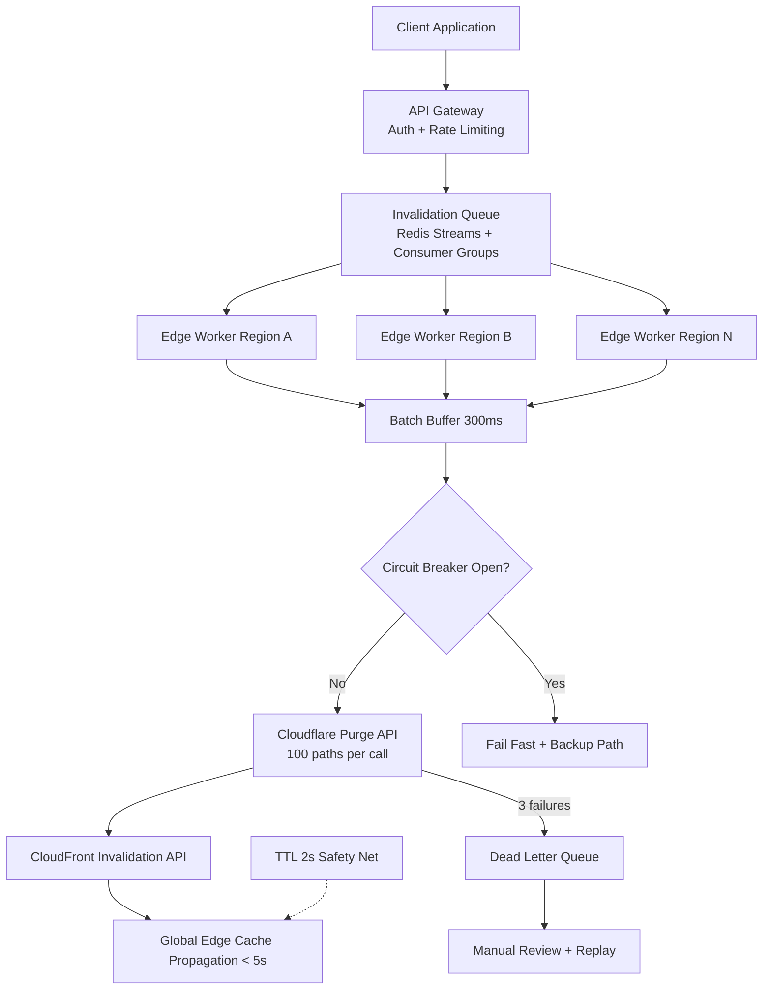

| Difficulty | Channel | Tags |
|---|---|---|
| intermediate | system-design | edge, caching, purging |

For a decade, Cloudflare's cache purge pipeline funneled every single purge through centralized "core" data centers that authenticated the request, then fanned it out to more than 270 cities worldwide [1]. As customers ramped up to millions of purge API calls a day, global purge latency ballooned to roughly 1.6 seconds, purge keys ate disk that should have been caching customer content, and the quick fixes — Kafka buffers, batching — only made the pipeline slower. If a CDN giant with edge compute in 330 cities struggled to purge caches fast, what chance does your team have of guaranteeing five-second propagation while absorbing 10,000 invalidations per second? The uncomfortable answer: you can do it, but only if you stop treating purging as a bolt-on API call and start treating it as a first-class distributed systems problem.

---

> ### Real-World Case — Cloudflare
>
> Cloudflare's decade-old cache purge pipeline routed every purge through centralized 'core' data centers for auth and fanout to 270+ cities. As customers began making millions of purge API calls daily, purge latency hit ~1.6s globally, purge keys consumed growing amounts of disk that could have cached customer content, and early fixes (Kafka buffers, batching) only added more latency.
>
> | | |
> |---|---|
> | **Challenge** | Propagate cache invalidations to every data center worldwide in well under 5 seconds while scaling to millions of purge requests per day, without the storage cost of lazy-purge bookkeeping growing in lockstep with usage. |
> | **Solution** | Rebuilt the system as 'coreless' Instant Purge: purge auth/filtering runs on Workers at the receiving edge, Durable Objects act as regional purge queues with per-region fanout workers (cutting distribution load 50% and tripling throughput), and CacheDB — a Rust service on RocksDB co-located with each cache proxy — does per-machine indexing and active deletion of purged objects instead of lazy expiration. |
> | **Outcome** | Global P50 purge latency dropped from 1,570ms to 149ms (90% improvement) across 330 cities in 120+ countries; storage needs fell 10x by eliminating lazy-purge accumulation, boosting cache HIT ratios; the pipeline now reliably runs under 150ms even under load, enabling Instant Purge for all customer plans by April 2025. |
> | **Lesson** | Centralized coordination and 'protective' buffering (queues, batching) couple rising usage to rising latency and storage cost — moving coordination to the edge with direct peer-style fanout and actively deleting purged content beats both the hub-and-spoke and lazy-invalidation designs at CDN scale. |

---

## Hook — 1.6 Seconds Feels Fast — Until Your Users Don't

Picture this: you ship a breaking change to a product page at 9:00 AM. Marketing has already launched the campaign. Legal has already approved the pricing. You fire a cache purge across every CDN region and wait. And wait. A 1.6-second stale window sounds trivial — but at Cloudflare's scale it meant stale security headers, outdated pricing, and content purges that quietly fell behind customer demand [1]. Multiply that across millions of purge calls a day and you get an insidious failure mode: the system never "breaks," it just gets consistently, measurably slower until customers notice before your dashboards do. Here is the thing most developers miss: cache purging is not an API problem. It is a coordination problem, a fanout problem, and a failure-domain problem wearing an API costume. If you have ever wondered why your CloudFront invalidations "complete" in 30 seconds but users still see stale content in Singapore, you are about to find out — and it will change how you design every cache layer you touch from now on.

## Problem — The 5-Second SLA You Did Not Know You Signed Up For

Let us name the challenge precisely, because vagueness is where purge systems go to die. You need three properties simultaneously, and they pull against each other. First, propagation latency under five seconds globally — not P95 in your home region, but P50 across every edge city you serve. Second, throughput of 10,000 concurrent invalidations per second, which means bursty traffic from CI pipelines, CMS webhooks, and panic-button "purge everything" buttons. Third, availability of 99.99% with strong consistency guarantees across regions. The tension is immediate: strong consistency wants centralized coordination, but centralized coordination is exactly what made Cloudflare's original pipeline crawl [1]. Batch invalidation cuts API costs and call volume, yet batching adds queueing delay. Exponential backoff protects you from rate limits, yet every retry pushes propagation toward and eventually past your SLA. Many teams discover this trade-off only during their first Black Friday incident, when a surge of invalidations floods the queue, backoff multiplies delays, and stale pricing pages go live for thousands of customers. The stakes are not theoretical. Stale content after a recall notice, a pricing error, or a leaked credential rotation is a revenue, compliance, and trust problem at once. That is why the next section matters: Cloudflare has already fought this war in public, and the numbers are brutal enough to reshape your architecture before you write a single line of queue consumer code.

## Real-World Case — Cloudflare's Purge Pipeline Rebuild

Cloudflare's purge pipeline worked like this for years: every purge request hit a centralized core data center for authentication, then fanned out to every edge location in the network [1]. It was simple, auditable, and correct — right up until scale made "simple" synonymous with "slow." As customers crossed millions of purge API calls per day, three problems compounded. Purge latency hit approximately 1.6 seconds globally. Purge keys — the internal state tracking what to evict — consumed growing amounts of disk that could otherwise cache customer content, quietly degrading cache hit ratios across the entire network. And the tactical patches, including Kafka buffers and batching layers, added latency rather than removing it, because each buffer is another hop between the purge and the edge. The redesign inverted the model. Instead of routing purges through centralized cores, Cloudflare pushed purge state generation and distribution toward the edge itself, eliminating the fanout bottleneck and the lazy-purge key accumulation entirely. The reported results: global P50 purge latency dropped from 1,570 ms to 149 ms — a 90% improvement — across 330 cities in more than 120 countries. Storage requirements fell roughly 10× by eliminating lazy-purge accumulation, which in turn boosted cache HIT ratios. The pipeline now sustains sub-150 ms purges even under load, and by April 2025 this enabled Instant Purge on every customer plan [1]. The lesson is not "use more Kafka." The lesson is that the topology of your purge fanout, not the cleverness of your queue, determines whether you hit your SLA at all. Keep that in mind as we break down how to build the equivalent — on a budget, with CloudFront and Cloudflare together, at 10,000 invalidations per second.

## Deep Dive — Where Purge Systems Actually Break

Building on Cloudflare's experience, the failure modes are worth cataloguing before design work starts. Purge systems break in predictable places, and each one maps to a decision you will make anyway. The first fault line is fanout topology. A centralized dispatcher gives you one place to enforce auth, rate limits, and ordering — but it is also a single choke point and a single latency floor [1]. Moving coordination to edge workers introduces partial failure: some regions acknowledge before others, and you must decide whether "success" means "my region accepted it" or "the planet accepted it." The second fault line is batch versus latency. CloudFront historically processed invalidations in batches, and pattern-based invalidations (wildcards like /products/*) cost more and propagate more slowly than object-level purges [2]. Batching 100 invalidations per API call cuts call volume by up to 90%, a massive cost win, but it also introduces batch fill delay: the 99th purge waits for the 100th to arrive, or for a timeout. You need a flush timer tuned against your SLA — for a five-second budget, a 200–400 ms flush window is a defensible starting point. The third fault line is consistency semantics. "Strong consistency across regions" is a phrase people love in design docs and hate in incident reviews. True cross-region strong consistency over CDN caches is not something you buy from a CDN API; what you actually deliver is short-TTL eventual consistency with invalidation as the acceleration mechanism [3]. That is why a 2-second TTL on dynamic content is a core part of this design: the invalidation queue accelerates eviction, but the TTL bounds the worst case if the queue itself stalls. Cache-Control headers become your safety net, not just a performance hint [4]. The fourth fault line is retry storms. Exponential backoff with jitter is the correct default [5], but uncapped retries turn a transient CloudFront API slowdown into a self-inflicted denial of service against your own invalidation endpoint. Cap retries at three, dead-letter the remainder, and let humans triage. Finally, circuit breakers matter more than most teams expect: after five consecutive failures against a regional endpoint, fail fast and route purges to a backup path, because a circuit that stays closed during an outage just converts availability incidents into latency incidents. The through-line: every one of these trade-offs exists because purge propagation is a distributed consensus problem with a deadline. Design for the deadline, and the architecture choices start making themselves.

## Workflow — From API Call to Global Propagation in Under 5 Seconds

Here is the end-to-end path, designed so that no single hop can eat more than a fraction of the five-second budget. The request flow is: client application → API Gateway (auth, validation, rate limiting) → invalidation queue (Redis Streams with consumer groups) → edge workers performing regional coordination → CDN provider purge APIs (CloudFront and Cloudflare, batched). The Mermaid diagram below tells the visual story — note how the queue is the only centralized element, and fanout happens in parallel at the edge rather than serially through a core. Step one: the API Gateway terminates auth and enforces per-tenant rate limits. Every purge request is durably enqueued into Redis Streams before the caller receives a 202-style acknowledgment — never make the caller wait on the CDN API, because CloudFront invalidation APIs are not fast enough to sit on the synchronous path [2]. Step two: regional edge workers consume from the stream via consumer groups, which give you parallel processing with at-least-once delivery semantics. Each worker is responsible for a subset of regions, so a slow region does not stall the others. Step three: within each worker, a batching buffer accumulates purge patterns for 200–400 ms, then issues a single batched purge call — up to 100 files or paths per Cloudflare purge request, and up to 3,000 paths per CloudFront invalidation call [2]. Step four: responses are correlated back to the original requests, successes are acked on the stream, and failures enter the retry path with exponential backoff plus jitter, capped at three attempts. Step five: anything still failing after three attempts lands on the dead-letter queue for manual review, while a circuit breaker opens after five consecutive regional failures to prevent cascading stalls. The elegant part is the TTL safety net: with dynamic content cached at a 2-second max-age and must-revalidate, even a total purge-pipeline outage leaves customers seeing stale content for no more than a couple of seconds. The invalidation queue is an optimization path to sub-second freshness, not a single point of failure for correctness.

## Code Example — Batched Purge Worker with Backoff and Circuit Breaking

The snippet below is the heart of the system: a Cloudflare Workers–compatible consumer that batches purge patterns, issues them against the purge API, and applies exponential backoff with a circuit breaker. Walk through it section by section. The BATCH_LIMIT and FLUSH_INTERVAL_MS constants encode the two tuning knobs discussed above — 100 patterns per call matches Cloudflare's batch purge API shape, and a 300 ms flush window keeps queueing delay well inside the five-second SLA. The CircuitBreaker class is intentionally minimal: it counts consecutive failures, opens after five, and half-opens after a cooldown to probe recovery. This is the fail-fast mechanism that prevents one degraded region from consuming the entire propagation budget. The purgeBatch function constructs the single batched request — the Authorization bearer token and JSON body with a files array of paths and wildcards — which is exactly the pattern Cloudflare's purge API accepts. Note the wildcard usage: pattern-based purging like /products/* is how you avoid enumerating every cache key, at the cost of broader invalidation scope. The main flush loop pulls buffered patterns, awaits the circuit breaker, sends one batch, and on failure schedules retries with jittered exponential backoff using the retryAfterMs helper. Jitter is not optional: without it, a fleet of workers hitting a rate-limited API retries in lockstep, amplifying the very problem backoff is meant to solve [5]. Finally, the dead-letter hook is where failed purges go after the third attempt — persist them, alert, and let a human decide whether to replay or investigate. Together, roughly sixty lines implement batching, retries, circuit breaking, and dead-lettering — the four pillars every production purge worker needs.

## Lessons Learned — What to Steal Before Your Next Incident

The journey from Cloudflare's 1,570 ms centralized pipeline to a sub-150 ms edge-coordinated one, and from your own vague "we should purge faster" ticket to a five-second SLA system, yields a handful of takeaways you can act on tomorrow. Centralize policy, decentralize fanout: keep auth and rate limiting at the gateway, but never route bulk invalidation traffic through a single core [1]. Treat TTLs as your correctness net and invalidations as your performance path — a 2-second max-age bounds your worst case even when the queue is down [4]. Batch aggressively but flush on a timer tied to your SLA, not to batch size alone. Cap retries and circuit-break aggressively; an uncapped retry loop is an outage you inflict on yourself [5]. Measure P50 purge latency across real edge regions in your tests, not P99 in your home region, because global propagation is where SLAs die. And watch the hidden cost Cloudflare discovered: purge bookkeeping state that accumulates in cache storage directly degrades hit ratios, so lazy-purge accumulation is a performance tax, not just a storage line item [1]. If this feels like a lot, remember the shape of the problem: it is the same fanout, consistency, and failure-domain puzzle that governs config distribution, feature flag rollouts, and search index invalidation. Solve it once well, and you have a pattern for a decade of systems. The one sentence to share with your team tomorrow: your purge SLA is only as strong as your slowest fanout hop — so remove the hops, add a TTL safety net, and measure across the whole planet.

---

## Multi-Region CDN Purge System Flow

<strong>Original Interview Question</strong>

**Q:** How would you design a multi-region CDN cache purging system that guarantees content propagation within 5 seconds while handling 10,000 concurrent invalidations per second?

**A:** Implement Cloudflare API + AWS CloudFront with distributed invalidation queue, edge compute coordination, and 2-second TTL. Use batch invalidation, exponential backoff, and regional cache headers for 5-second SLA.

## Conclusion

Cloudflare spent a decade learning that centralized purge fanout cannot scale to millions of calls a day, and its rebuild — edge-coordinated distribution, eliminated lazy-purge accumulation, 90% lower P50 latency across 330 cities — is the proof [1]. The same principles scale down to your five-second, 10,000-invalidations-per-second design: durably queue before you acknowledge, fan out in parallel from the edge, batch with an SLA-aware flush timer, bound your retries, circuit-break when a region goes bad, and keep a short TTL as the correctness net under it all. What should you do differently tomorrow? Instrument your actual global purge latency P50 — not your home-region P99 — and set a TTL you can live with if the queue dies. That single measurement, plus a TTL safety net, will tell you whether your purge system is Cloudflare-before or Cloudflare-after.

---

## References

1. [Cloudflare incident report](https://blog.cloudflare.com/instant-purge/) — article
2. [Amazon CloudFront Invalidation API Documentation](https://docs.aws.amazon.com/AmazonCloudFront/latest/DeveloperGuide/Invalidation.html) — documentation
3. [Wikipedia: Cache invalidation](https://en.wikipedia.org/wiki/Cache_invalidation) — article
4. [MDN Web Docs: Cache-Control HTTP header](https://developer.mozilla.org/en-US/docs/Web/HTTP/Headers/Cache-Control) — documentation
5. [Wikipedia: Exponential backoff](https://en.wikipedia.org/wiki/Exponential_backoff) — article
6. [Cloudflare API Documentation: Purge Cache](https://developers.cloudflare.com/api/operations/zone-purge-cache) — documentation
7. [MDN Web Docs: Web Subresource Client Hints and caching patterns via Fetch API](https://developer.mozilla.org/en-US/docs/Web/API/Fetch_API) — documentation
8. [Wikipedia: Redis (data structure store)](https://en.wikipedia.org/wiki/Redis) — article
9. [RFC 9111: HTTP Caching](https://datatracker.ietf.org/doc/html/rfc9111) — documentation

---

**Author:** Satishkumar Dhule — [GitHub](https://github.com/satishkumar-dhule) · [LinkedIn](https://linkedin.com/in/satishkumar-dhule) · [Website](https://satishkumar-dhule.github.io)
