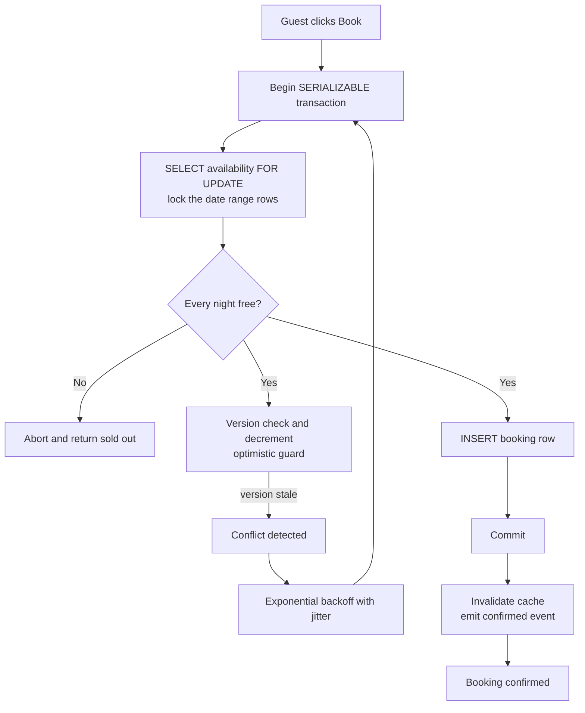

| Difficulty | Channel | Tags |
|---|---|---|
| intermediate | database | acid, isolation-levels, mvcc |

At peak Black Friday 2025, Shopify merchants were ringing up $5.1 million in sales per minute, and every one of those transactions had to reserve inventory before payment could settle [1]. Their oversell protection had to guarantee that two concurrent checkouts could never claim the same unit — the exact same race condition that produces a double-booked cabin on Airbnb [1]. Whether you are selling nights, seats, or sneakers, the fight is identical: correctness under concurrency without melting your database. Here is how teams win that fight, what isolation levels actually cost you, and the counterintuitive place the real bottleneck usually hides.

---

> ### Real-World Case — Shopify
>
> On Black Friday 2025 Shopify merchants hit a record $5.1 million in sales per minute, and every transaction touches inventory. Shopify's oversell protection system must reserve units during payment so two concurrent checkouts can never claim the same item — the same race condition as double-booking an Airbnb property — while keeping reservations and the inventory ledger consistent.
>
> | | |
> |---|---|
> | **Challenge** | For years reservations lived in Redis (DECR/INCR) while the inventory ledger lived in MySQL, so the 'claim' step couldn't be atomic across both systems: depending on write order, payment could succeed without deducting inventory (oversell) or deduct inventory that stayed reserved (undersell). Earlier attempts to move to MySQL failed because a single quantity row couldn't handle lock contention, and MySQL's default REPEATABLE READ isolation produced gap/supremum locks that deadlocked the replenishment path. |
> | **Solution** | Rebuilt reservations in MySQL with one row per sellable unit drawn from a bounded pool (capped at 1,000 rows per item/location), using SELECT ... FOR UPDATE SKIP LOCKED so transactions skip locked rows instead of queueing on hot items. They switched these transactions to READ COMMITTED to eliminate gap locks, adopted a composite primary key (shop_id, inventory_item_id, inventory_group_id, id) to cut two row locks per reservation down to one, enforced a consistent lock ordering between reserve and claim to remove deadlocks, added an inline single-writer replenishment lock to prevent thundering herds on hot items, and cut over via 'shadow mode' dual-writes to Redis and MySQL with a kill switch. |
> | **Outcome** | Hit their high-throughput targets during peak 2025 Black Friday traffic (11% higher sales per minute YoY, 14% of U.S. ecommerce). Instrumenting connection hold time revealed the real ceiling was connections, not locks: cleaning up other checkout-path code removed 50% of reads and 33% of transactions on the primary database, and after config tuning writer CPU stayed under 50% and reader CPU under 16% during flash sales — with zero oversells. |
> | **Lesson** | Your existing database may already be enough — you often don't need Redis or a custom coordination layer for high-throughput mutual exclusion; and the textbook default of stronger isolation backfired (they deliberately downgraded to READ COMMITTED to avoid gap-lock deadlocks). When metrics don't add up (low CPU but queuing), instrument the full path: the bottleneck was connection holders in code they weren't even looking at, not the locking code they'd optimized for weeks. |

---

## Hook — Two Guests, One Cabin, 400 Milliseconds Apart

Picture this: two guests are staring at the same lakeside cabin for a Saturday night. Both have the listing open. Both fill in card details. Both hit "Book now" within 400 milliseconds of each other. In a naive implementation, each request runs a quick SELECT, sees an open unit, and writes a fresh reservation — and now two families hold confirmations for one cabin. That is the double-booking race condition, and the database happily commits both transactions because each one, in isolation, looked perfectly legal [6]. The trouble starts the moment "in isolation" stops being true.

So here is the question that separates a demo from a production booking system: how do you force the database to treat those two requests as if they happened one after the other, even when they absolutely did not?

## Problem — The Read-Then-Write Gap That Ruins Weekends

Building on that scenario, the flaw is a read-then-write gap. Between the moment you check availability and the moment you write the reservation, another request slips through. Under the default Read Committed isolation level, each statement sees only committed data as of its own start — so two concurrent availability checks can both return "free" before either transaction writes anything [10].

Here is what you need to know about why this bites so hard:

- **The check and the write are separate statements.** Nothing in a basic SELECT reserves anything; it is a photograph, not a lock.
- **Phantom reads sneak in.** Even if row values do not change, a brand-new booking row can appear between your check and your insert [6].
- **Application-level validation is mandatory.** Database constraints catch duplicates of the same key, but "property 42 is full on July 3" spans many rows and usually cannot be expressed as a UNIQUE index.
- **Retries are part of correctness.** If you serialize the hot path, you must handle the requests that lose the race.

The stakes go beyond a single angry guest. Overbookings cascade into refunds, support tickets, host penalties, and — worst of all — a trust tax on every future booking. Sound familiar? Many developers discover the bug only in production, on the weekend of a sold-out festival, when the pager goes off at 3am.

⚠️ **Watch Out:** the most common battle scar is verifying availability in the application, then inserting in a second, separate database call. If those are not inside one transaction with locking, you do not have a booking system — you have a lottery.

## Real-World Case — Shopify's Zero-Oversell Black Friday

This is not a theoretical concern. On Black Friday 2025, Shopify merchants hit a record $5.1 million in sales per minute — 11% higher than the year before and roughly 14% of all U.S. ecommerce traffic — and every transaction touched inventory [1]. Their oversell protection system must reserve units during payment so two concurrent checkouts can never claim the same item, while keeping reservations and the inventory ledger consistent [1].

What makes the story instructive is the plot twist: Shopify's engineers expected locks to be the ceiling, and they were wrong. Instrumenting connection hold time revealed the real constraint was database connections, not lock contention [1]. After cleaning up other checkout-path code, the primary database shed 50% of reads and 33% of total transactions, and following configuration tuning, writer CPU stayed under 50% and reader CPU under 16% during flash sales — with zero oversells [1].

The takeaway is uncomfortable for anyone who has spent a week tuning lock timeouts: often the winning move is not a cleverer lock, it is fewer queries competing for the lock in the first place. Correctness came from reservation semantics; headroom came from deleting work.

🎯 **Key Point:** Shopify treated oversell protection and throughput as two separate problems — correctness in the transaction, efficiency in the query path. Conflating them is how teams ship a system that is either wrong or slow, never both right and fast.

## Deep Dive — Isolation Levels, MVCC, and What Correctness Costs

Now for the machinery. Under the hood, PostgreSQL's Multiversion Concurrency Control keeps old row versions around so readers never block writers and writers never block readers [4]. Snapshots let an availability check run at full speed while reservations are being written. The question is which isolation level your critical section runs at, and what you pay for it.

| Isolation level | Dirty read | Non-repeatable read | Phantom read | Real cost for a booking path |
|---|---|---|---|---|
| Read Committed (Postgres default) [10] | No | Yes | Yes | Cheapest, but double-booking prone |
| Repeatable Read | No | No | Largely prevented in Postgres [2] | Moderate; still needs explicit locks |
| Serializable [2] | No | No | No | Highest; requires retry logic on conflict |

Two broad strategies emerge, and most production systems use both at different layers:

- **Pessimistic locking:** take the row with SELECT ... FOR UPDATE so competitors wait at the door [3]. Ideal for hot rows — the cabin everyone wants, the flash-sale SKU.
- **Optimistic concurrency control:** carry a version column, attempt the write, and let the database reject you if someone else got there first [5]. Ideal when conflicts are rare and you would rather retry than wait.

Many developers reach for SERIALIZABLE everywhere after their first overbooking incident. It works — but it converts conflicts into aborts, so you must implement retries with exponential backoff and jitter, otherwise your p99 latency becomes a horror show under load [8]. Moreover, holding locks for the duration of external calls (payment APIs, emails) will melt your pool faster than any lock wait ever could.

🔥 **Hot Take:** SERIALIZABLE is not a performance strategy, it is a correctness strategy with a retry bill attached. Use it for the booking transaction itself — the short, purely-database section — and keep everything else out of the transaction.

And the deeper discovery Shopify's team stumbled into: the ceiling is frequently connections, not locks [1]. Read replicas can absorb availability checks so the primary handles only writes [9], but only if you can tolerate the replication lag — which, during a booking race, you usually cannot.

## Workflow — The Booking Transaction, Step by Step

Here is the sequence that ties it all together — a short, serializable transaction that locks the exact date rows it needs, validates in the application, writes the reservation, and backs off cleanly when it loses.



Walking through the flow:

1. **Begin** a SERIALIZABLE transaction — the shortest possible scope [2].
2. **Lock** only the rows for the requested stay dates with FOR UPDATE [3]. Other guests for other properties never notice you exist.
3. **Validate** in application code: every single night in the range must have availability.
4. **Write** the reservation and the inventory decrement in the same transaction, guarded by a version column [5].
5. **Commit or retry.** A serialization failure or version mismatch triggers backoff with jitter, then the whole transaction runs again [8].
6. **Invalidate the cache** only after a successful commit — never before, or you will serve stale availability and restart the race from the top.

Each step exists because the step before it can fail. The cliffhanger: none of this matters if your code holds the transaction open while calling a payment provider. Keep the lock window to single-digit milliseconds and the retries almost never fire.

## Code Example — A Serializable Booking Handler in Python

Here is what the pattern looks like in practice, using asyncpg against PostgreSQL. It combines pessimistic row locks, an optimistic version guard, application-level validation, and retry-with-jitter — the full stack from the workflow above.

```python
import asyncio
import random

import asyncpg

class VersionConflict(Exception):
    """Another writer touched our rows between read and update."""

async def book_property(pool, property_id, check_in, check_out, guest_id):
    """Reserve every night of a stay for one guest, or fail cleanly."""
    for attempt in range(5):
        try:
            async with pool.acquire() as conn:
                # SERIALIZABLE: the database promises no interleaving surprises [2]
                async with conn.transaction(isolation="serializable"):
                    # 1. Pessimistic lock on exactly the rows we care about [3]
                    rows = await conn.fetch(
                        """
                        SELECT stay_date, available_units, version
                          FROM property_availability
                         WHERE property_id = $1
                           AND stay_date >= $2 AND stay_date < $3
                         ORDER BY stay_date
                           FOR UPDATE
                        """,
                        property_id, check_in, check_out,
                    )

                    # 2. Application-level validation: every night must be free
                    if not rows or any(r["available_units"] < 1 for r in rows):
                        return None  # genuinely sold out, no point retrying

                    # 3. Optimistic guard: version column catches stale writes [5]
                    for row in rows:
                        tag = await conn.execute(
                            """
                            UPDATE property_availability
                               SET available_units = available_units - 1,
                                   version = version + 1
                             WHERE property_id = $1
                               AND stay_date = $2
                               AND version = $3
                               AND available_units > 0
                            """,
                            property_id, row["stay_date"], row["version"],
                        )
                        if tag != "UPDATE 1":
                            raise VersionConflict()

                    # 4. Reservation is written inside the same transaction
                    return await conn.fetchval(
                        """
                        INSERT INTO bookings
                            (property_id, guest_id, check_in, check_out, status)
                        VALUES ($1, $2, $3, $4, 'confirmed')
                        RETURNING id
                        """,
                        property_id, guest_id, check_in, check_out,
                    )

        except (asyncpg.SerializationError,
                asyncpg.DeadlockDetected,
                VersionConflict):
            # 5. Conflict means someone won the race; back off with jitter [8]
            delay = min(0.05 * (2 ** attempt), 2.0) * (0.5 + random.random())
            await asyncio.sleep(delay)

    raise RuntimeError("hot property: too much contention, try again later")
```

Step by step:

1. **The retry loop** wraps the entire transaction. Any conflict aborts cleanly and starts over — that is the contract SERIALIZABLE forces on you [2].
2. **The transaction** is opened at SERIALIZABLE isolation and contains nothing but database work. No HTTP calls, no payment SDKs, no surprise latency inside the lock window.
3. **SELECT ... FOR UPDATE** locks precisely the availability rows for the requested date range, so competing writers for those nights queue up instead of racing [3].
4. **The validation pass** (`any(...)`) is the application-level check: a range is only bookable if every night in it has stock. Returning `None` here avoids pointless retries for a real sellout.
5. **The versioned UPDATE** is belt-and-suspenders: even under the row lock, the version column guarantees no lost update if a code path ever skips locking [5]. A non-`UPDATE 1` result raises `VersionConflict`, which routes into the backoff path.
6. **The booking INSERT** shares the transaction, so inventory decrements and reservations commit or roll back as one atomic unit — the ledger stays consistent.
7. **Backoff uses exponential growth plus random jitter**, which prevents thousands of losing requests from retrying in lockstep and hammering the same hot row [8].

The `except` clause deliberately catches serialization failures and deadlocks — the two errors that mean "your snapshot went stale," not "your code is broken."

## Lessons Learned — Battle Scars and What to Do Tomorrow

Building on the whole journey — from the two-guests-one-cabin problem through Shopify's zero-oversell Black Friday [1] — the patterns that survive production reviews are remarkably consistent.

- **Keep the locked section tiny.** Every network call inside the transaction is rent paid on a held row lock. Externalize payments, then reconcile asynchronously.
- **Retry is not optional.** Choose SERIALIZABLE and you own retry-with-jitter [8]; choose Read Committed and you own explicit locking [3]. There is no third option.
- **Order your locks.** Lock availability rows in a deterministic order (property_id, stay_date) to eliminate deadlocks before they happen.
- **Invalidate caches after commit, never before.** Stale availability in Redis will happily re-open the race you just closed.
- **Delete queries before adding infrastructure.** Shopify's ceiling was connections, not locks; removing checkout-path reads cut primary-database load by 50% reads and 33% transactions [1].
- **Measure hold time, not just lock wait.** Connection hold time surfaces the real bottleneck when dashboards only show "no deadlocks."
- **Separate read traffic.** Availability browsing can hit read replicas [9]; the write path cannot, because replica lag is a double-booking with extra steps.

⚠️ **Watch Out:** circuit-break hot properties. On a flash-sale listing, thousands of retries against one row will exhaust your connection pool before any lock times out — throttle admission instead of letting every request fight for the same cabin.

The so-what for tomorrow: audit your booking or checkout path for any read-then-write sequence that spans two separate database calls. Wrap it in one short transaction with row locks, add a version column as a safety net, and put jittered retries around the outside. That single refactor is the difference between a system that is occasionally wrong and one you can trust at $5.1 million per minute.

---

## Booking Reservation Flow


<details>
<summary><strong>Original Interview Question</strong></summary>

**Q:** You're building a booking system for Airbnb where multiple users can reserve the same property simultaneously. How would you design the transaction handling to prevent double bookings while maintaining high availability?

**A:** Use SERIALIZABLE isolation with optimistic concurrency control. Implement row-level locks on property availability tables, use MVCC snapshot reads for checking availability, and apply application-level validation to ensure atomic booking operations.

</details>

## Conclusion

The journey started with two guests and one cabin, passed through Shopify's $5.1 million-per-minute Black Friday where zero oversells came from treating correctness and throughput as separate problems [1], and ended with a short SERIALIZABLE transaction that locks date rows, validates in application code, and retries with jitter. The moral: the race is won before the write, not after the incident report. Audit your booking or checkout path today for any read-then-write sequence split across two database calls, wrap it in one tight transaction with FOR UPDATE and a version column, and measure connection hold time alongside lock waits — because the ceiling is very often connections, not locks. One insight worth sharing with your team tomorrow: locks are cheap, retries are cheaper than refunds, and the queries you delete are the fastest queries of all.

---

## References

1. [Shopify incident report](https://shopify.engineering/scaling-inventory-reservations) — article
2. [PostgreSQL Documentation: 13.2. Transaction Isolation](https://www.postgresql.org/docs/current/transaction-iso.html) — documentation
3. [PostgreSQL Documentation: Locking Clause (SELECT FOR UPDATE)](https://www.postgresql.org/docs/current/queries-locking-clauses.html) — documentation
4. [Multiversion concurrency control — Wikipedia](https://en.wikipedia.org/wiki/Multiversion_concurrency_control) — documentation
5. [Optimistic concurrency control — Wikipedia](https://en.wikipedia.org/wiki/Optimistic_concurrency_control) — documentation
6. [Race condition — Wikipedia](https://en.wikipedia.org/wiki/Race_condition) — documentation
7. [Two-phase locking — Wikipedia](https://en.wikipedia.org/wiki/Two-phase_locking) — documentation
8. [Timeouts, retries, and backoff with jitter — AWS Builders' Library](https://aws.amazon.com/builders-library/timeouts-retries-and-backoff-with-jitter/) — blog
9. [Amazon RDS User Guide: Read Replicas](https://docs.aws.amazon.com/AmazonRDS/latest/UserGuide/USER_ReadReplica.html) — documentation
10. [Isolation (database systems) — Wikipedia](https://en.wikipedia.org/wiki/Isolation_(database_systems)) — documentation
11. [asyncpg documentation](https://magicstack.github.io/asyncpg/current/) — documentation

---

**Author:** Satishkumar Dhule — [GitHub](https://github.com/satishkumar-dhule) · [LinkedIn](https://linkedin.com/in/satishkumar-dhule) · [Website](https://satishkumar-dhule.github.io)
