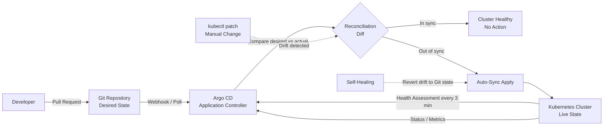

| Difficulty | Channel | Tags |
|---|---|---|
| beginner | devops | argocd, flux, declarative |

Your cluster says everything is fine. The dashboard is green. But somewhere, three days ago, someone ran a kubectl patch during an incident, and now production quietly disagrees with your Git repository. Nobody knows which version is actually deployed. Adobe faced exactly this class of drift at enterprise scale: their legacy internal deployment platform, Moonbeam, had become nearly impossible to scale, secure, and operate reliably across a massive footprint. In the second half of 2024, they forced a migration of service teams onto Flex, a new GitOps-based delivery platform built on Kubernetes and the full Argo ecosystem—Argo CD, Argo Workflows, Argo Events, and Argo Rollouts [1]. The results were staggering, and the lessons apply whether you run 6,000 services or six. This is the story of declarative versus imperative infrastructure, and why the difference decides whether your platform scales or stagnates.

---

> ### Real-World Case — Adobe
>
> Adobe's legacy internal deployment platform (Moonbeam) had become increasingly difficult to scale, secure, and operate reliably across a massive enterprise footprint. In 2H 2024 they launched a forced migration of service teams off Moonbeam onto Flex, a new GitOps-based delivery platform built on Kubernetes and the full Argo project ecosystem (Argo CD, Argo Workflows, Argo Events, Argo Rollouts).
>
> | | |
> |---|---|
> | **Challenge** | Manage thousands of services and tens of thousands of environments declaratively while eliminating configuration drift, fragile queue-based deployment workflows, and weak auditability — and do it without stalling hundreds of engineering teams during the migration. |
> | **Solution** | Adobe made Git the single source of truth and used Argo CD for continuous reconciliation of cluster state against approved state in source control, paired with Argo Workflows to orchestrate the long-running, resumable migration itself (start/pause/continue/end controls, state management, reporting) rather than relying on one-off scripts. Declarative sync with self-healing replaced imperative, pipeline-pushed kubectl-style changes. |
> | **Outcome** | Flex now manages over 6,000 services across nearly 50,000 environments, including ~19,000 production environments supporting 3,300+ production services; 10,400 pipelines were migrated or decommissioned; hundreds of teams and 3,000+ developers moved to GitOps workflows; deployment queue times dropped significantly; and the migration uncovered and retired roughly 80% of previously identified stale/duplicate services, contributing meaningful infrastructure cost savings. |
> | **Lesson** | Large-scale GitOps adoption isn't just about adopting a tool — the workflow experience and governance model around it is what makes migration practical. And the audit trail Git provides becomes a forcing function for platform hygiene: reconciling everything against Git exposed thousands of forgotten services that pure imperative workflows had let rot for years. |

---

## Hook — The 2 AM Patch That Broke the Source of Truth

It starts innocently enough. A critical service is throwing 500s. The on-call engineer, running on caffeine and adrenaline, applies an emergency resource limit bump with kubectl. The service recovers. Everyone goes back to sleep. But the Git repository—the place where your entire infrastructure is supposed to be defined—never learns about that change. Three weeks later, a fresh environment gets deployed from Git and reproduces the exact same outage. The fix existed. It just never made it home. This is configuration drift, and it is the silent killer of Kubernetes platforms. Many developers discover it only after an incident review points at a change that no one committed. The tension here is real: imperative changes are fast in the moment and expensive over time. Declarative changes feel slower up front and compound in reliability. Every team eventually learns this lesson—usually the hard way [2].

## Problem — Why Imperative Infrastructure Hits a Wall

Here is the thing though: kubectl is a wonderful tool and a terrible governance model. Running kubectl apply, kubectl edit, or kubectl patch talks directly to the Kubernetes API server, mutating cluster state immediately [3]. That immediacy is the entire problem. There is no review, no audit trail tied to a merge request, no rollback button that points to a known-good commit, and no guarantee that staging matches production. Consequently, as an organization grows from one team to hundreds, imperative workflows produce a slow-burning crisis. Configuration drift accumulates invisibly. Environments diverge. Security patches applied manually to one cluster are forgotten on eleven others. Moreover, the operational knowledge of what is actually running lives in the heads of a few senior engineers instead of in version control. The stakes compound with scale: Adobe eventually discovered roughly 80% stale or duplicate services during their migration—dead weight that imperative workflows had hidden for years [1]. If you cannot answer 'what is running in production right now, and which commit put it there?' your platform has already failed its most basic audit.

## Real-World Case — Adobe Flex and the Forced Migration to GitOps

Adobe's Moonbeam platform was not a failure of intent—it was a failure of operating model. As their internal platform documentation and CNCF case study describe, Moonbeam had become increasingly difficult to scale, secure, and operate reliably across a sprawling enterprise footprint [1]. In 2H 2024, Adobe launched a forced migration of service teams off Moonbeam onto Flex, a GitOps-based delivery platform built on Kubernetes and the Argo project ecosystem. The numbers tell the story of what happens when declarative delivery is applied at extreme scale: Flex now manages over 6,000 services across nearly 50,000 environments, including roughly 19,000 production environments supporting more than 3,300 production services [1]. Ten thousand four hundred pipelines were migrated or decommissioned. Hundreds of teams and over 3,000 developers moved to GitOps workflows. Deployment queue times dropped significantly. And perhaps most tellingly, the migration uncovered and retired approximately 80% of previously identified stale or duplicate services, contributing meaningful infrastructure cost savings [1]. That last statistic is the plot twist most people miss. GitOps did not just fix delivery speed—it forced organizational honesty about what existed at all. You cannot reconcile desired state against actual state if you have never written down the desired state. Adobe's migration proved that the act of declaring your infrastructure is itself an audit.

## Deep Dive — Declarative vs Imperative, and the Reconciliation Loop That Changes Everything

Building on Adobe's experience, let us name the two philosophies precisely. The imperative approach executes commands to make things happen: create this deployment, scale that replica set, patch this config map. The cluster does what you told it, when you told it, and remembers nothing about why. The declarative approach defines the desired end state and lets a controller make reality match it [2]. Argo CD is that controller for Git. It watches a Git repository containing Kubernetes manifests, Helm charts, or Kustomize overlays, continuously compares that declared state against the live cluster, and reconciles the differences [4]. Specifically, three configuration choices determine whether Argo CD protects you or merely reports on your drift. First, the Application Custom Resource Definition (CRD) points Argo CD at your Git repository, target cluster, and destination namespace [5]. Second, auto-sync enables continuous reconciliation on a health check interval—typically one to five minutes [6]. Third, self-healing automatically reverts manual cluster changes that diverge from Git, turning your repository into a true source of truth rather than a suggestion. Here is the counterintuitive insight: self-healing feels aggressive until you have been paged at 2 AM by a drift-caused outage. Then it feels like a safety net. The trade-off table below captures what most teams discover only after their first painful migration.

## Workflow — From Commit to Reconciled Cluster in Six Steps

So how does the loop actually run? The workflow below is the pattern Adobe's Flex platform operationalizes at scale, and the same flow works whether you manage two services or six thousand. First, define your manifests, Helm chart, or Kustomize overlays in a Git repository. Second, create an Argo CD Application CRD that references that repository, the destination cluster, and the target namespace [5]. Third, enable auto-sync with a health assessment interval—three minutes is a sensible starting point [6]. Fourth, enable self-healing and automated pruning so unauthorized changes are reverted and deleted resources are cleaned up. Fifth, open a pull request to change infrastructure; CI validates it, a human approves it, and the merge becomes the single event that alters production. Sixth, Argo CD detects the new commit, diffs it against live state, and applies the delta. The Mermaid diagram below shows this reconciliation loop visually. Notice what is absent: any human running kubectl against production. That absence is the entire design.

## Code Example — A Production-Shaped Argo CD Application

Now let us make this concrete. The following example defines an Argo CD Application CRD with auto-sync and self-healing enabled, followed by the shell commands to apply it and watch the reconciliation happen. Each line is annotated so the intent is unmistakable.

## Lessons Learned — What to Do Differently Tomorrow

The journey from imperative firefighting to declarative delivery is not really about Argo CD. It is about whether your organization treats infrastructure as a shared, auditable artifact or as a series of one-off commands. Adobe's migration of 6,000 services and 3,000+ developers to GitOps workflows demonstrates that the transition is painful but transformative—deployment queue times dropped, and roughly 80% of stale services were identified and retired [1]. Here is what to take into your next platform review. Enable self-healing early; teams that skip it end up back in drift within weeks. Start auto-sync intervals conservatively (three to five minutes) and tighten as confidence grows [6]. Use Kustomize overlays or Helm values files to keep environment differences explicit rather than hand-edited [8][9]. Adopt the OpenGitOps principles—declarative, versioned, automated, and continuously reconciled—as your team's contract [2]. Battle scar to avoid: many teams enable auto-sync but forget pruning, so deleted resources linger in clusters forever like digital attic junk. And the most important insight of all: you cannot automate your way out of a system nobody has written down. If this feels overwhelming, you are not alone—every platform team starts with a single service and a single Application CRD. The memorable insight to share with your team tomorrow is this: Git does not just store your infrastructure; it becomes the only version of the truth your cluster is allowed to obey.

---

## GitOps Reconciliation Loop with Argo CD

<strong>Original Interview Question</strong>

**Q:** You're setting up GitOps for a microservices deployment. How would you configure ArgoCD to automatically sync changes from your Git repository to Kubernetes, and what's the difference between declarative and imperative approaches in this context?

**A:** I'd configure ArgoCD by setting up a Git repository containing Kubernetes manifests or Helm charts, creating an Application CRD that points to the Git repository, enabling auto-sync with a health check interval of 3 minutes, and implementing self-healing to automatically revert any manual changes. The declarative approach involves defining the desired state in Git through YAML manifests, Helm charts, or Kustomize configurations, where ArgoCD continuously reconciles the actual state with the desired state. In contrast, the imperative approach uses kubectl commands to make direct changes to the cluster, bypassing the Git repository as the single source of truth.

## Conclusion

Adobe did not adopt GitOps because it was trendy—they adopted it because Moonbeam's imperative operating model could no longer scale, secure, or reliably serve 3,000+ developers across nearly 50,000 environments [1]. The migration to Flex delivered measurable results: 10,400 pipelines retired, deployment queue times significantly reduced, and roughly 80% of stale services uncovered and decommissioned [1]. The journey from your first Application CRD to that outcome is not linear, but the first step is small. Tonight, enable auto-sync with self-healing on a single non-critical service. Watch Argo CD revert a manual change. That moment—seeing the cluster snap back to match Git—is when declarative infrastructure stops being a philosophy and starts being a safety net. The insight worth sharing with your team tomorrow: your Git repository should not merely describe your infrastructure; it should be the only thing your cluster is allowed to obey.

---

## References

1. [Adobe incident report](https://www.cncf.io/case-studies/adobe/) — article
2. [OpenGitOps — GitOps Principles](https://opengitops.dev/) — documentation
3. [Kubernetes — Declarative Management of Kubernetes Objects](https://kubernetes.io/docs/tasks/manage-kubernetes-objects/declarative-config/) — documentation
4. [Argo CD Documentation](https://argo-cd.readthedocs.io/en/stable/) — documentation
5. [Argo CD — Application Specification](https://argo-cd.readthedocs.io/en/stable/user-guide/application/) — documentation
6. [Argo CD — Automated Sync Policy](https://argo-cd.readthedocs.io/en/stable/user_guide/auto_sync/) — documentation
7. [Flux — GitOps Toolkit Documentation](https://fluxcd.io/flux/) — documentation
8. [Kustomize — Kubernetes Native Configuration Customization](https://kustomize.io/) — documentation
9. [Helm Documentation](https://helm.sh/docs/) — documentation
10. [How to Set Up Argo CD on a Kubernetes Cluster — DigitalOcean Tutorial](https://www.digitalocean.com/community/tutorials/how-to-set-up-argo-cd-on-a-kubernetes-cluster) — blog

---

**Author:** Satishkumar Dhule — [GitHub](https://github.com/satishkumar-dhule) · [LinkedIn](https://linkedin.com/in/satishkumar-dhule) · [Website](https://satishkumar-dhule.github.io)
