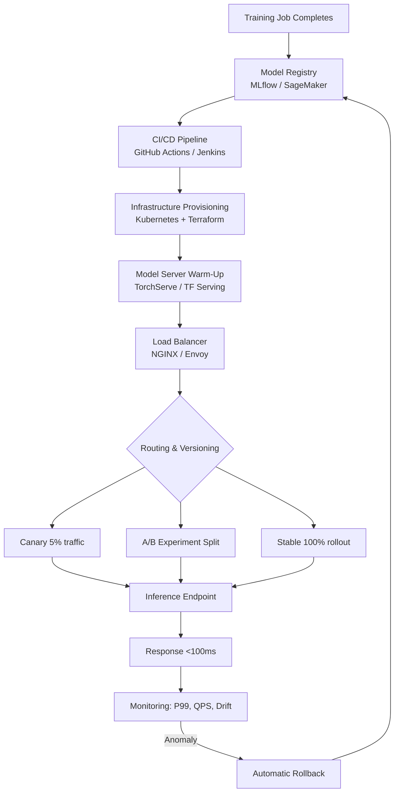

| Difficulty | Channel | Tags |
|---|---|---|
| beginner | devops | mlops, deployment |

Imagine a single hop — just 10 to 20 milliseconds — sitting in the hot path of every inference request across a platform handling over 1 million requests per second. For Netflix, that tiny routing hop was a single point of failure threatening recommendations, fraud detection, and commerce for 30+ internal service clients [1]. Their fix, a custom routing proxy called Switchboard, reveals something most developers get wrong: model deployment and model serving are two entirely different battles, and confusing them is how production ML systems break [1].

---

> ### Real-World Case — Netflix
>
> Netflix's centralized ML model serving platform handles over 1 million inference requests per second across hundreds of model versions (recommendations, fraud detection, commerce) for 30+ internal service clients. To give every client a single abstraction for model routing, A/B experimentation, canaries, and rollbacks, they built a custom routing proxy called Switchboard that sat in the hot path of every inference request.
>
> | | |
> |---|---|
> | **Challenge** | Off-the-shelf API gateways (AWS API Gateway, generic service mesh proxies) couldn't integrate with Netflix's experimentation platform, expose gRPC endpoints, do context-aware routing based on device/locale/A/B assignment, or support model lifecycle stages like shadow mode and canaries. But their custom solution eventually hit scaling walls: a single point of failure in the critical request path, 10-20ms of added latency per request from serialize/deserialize hops (plus tail latency amplification), noisy-neighbor error cascades between tenants, and obscured client request origins that made real-vs-synthetic training data logging difficult. |
> | **Solution** | They refactored into the Lightbulb architecture: split Switchboard's config into Model Serving Configuration (model selection) and Routing Rules (model-to-VIP mapping), moved actual request routing into Envoy (already Netflix's egress proxy) using a lightweight routingKey header, and kept a small metadata service (Lightbulb) only for resolving request context to routing config. Rules are published via Netflix's Gutenberg pub-sub for versioning, dynamic loading, and fast rollbacks — decoupled from code deployments. |
> | **Outcome** | Eliminated the routing service from the hot request path (removing the SPOF and the 10-20ms hop), preserved the single-client-abstraction covering 30+ services and 1M+ requests/sec, improved tenant fault isolation, and enabled A/B experiments and gradual model rollouts to propagate without client code changes. |
> | **Lesson** | The serving layer (routing, versioning, traffic splitting) is a genuinely different engineering problem from deployment (CI/CD, infra, monitoring) — and putting your routing control plane in the synchronous request path is a trap. Decouple config resolution from data-plane routing: let a lightweight metadata service decide, and let a battle-tested proxy (Envoy) execute. Also, model experimentation config should have an independent release cycle from serving code. |

---

## Hook — One Shared Abstraction, One Terrifying Bottleneck

Picture this: hundreds of model versions, dozens of internal clients, and a unified routing layer that promises A/B experiments, canaries, and rollbacks without client code changes. It sounds elegant — until you realize the routing service itself lives in the hot path of every single request [1]. One outage there, and every inference call fails simultaneously. This is the hidden tension in ML systems: the abstraction that makes your platform easy to use can also become the thing that takes everything down. So when you ship a model, what exactly are you shipping — and where does your responsibility actually end?

## Problem — Two Words, Two Entirely Different Jobs

Here is the thing though: many developers use "deployment" and "serving" interchangeably, and that blurred vocabulary hides real architectural mistakes. Deployment is everything upstream — CI/CD pipelines, infrastructure provisioning, monitoring, and rollback strategies using tools like Kubernetes, Terraform, MLflow, and SageMaker [2]. Serving is everything at runtime — inference APIs, request routing, model loading, and response optimization with frameworks like TensorFlow Serving, TorchServe, and BentoML [3]. Consequently, a team that thinks "we deployed the model" also shipped monitoring is in for a rude awakening when latency spikes go unnoticed. The stakes? Real-time use cases demand sub-100ms responses, while batch pipelines tolerate seconds — misaligning these expectations is a classic production failure. And the trade-offs only get sharper from here.

## Real-World Case — How Netflix Removed the SPOF

Netflix's centralized ML serving platform grew to handle 1M+ inference requests per second across hundreds of model versions for 30+ service clients [1]. To preserve a single client abstraction for routing, A/B experimentation, canaries, and rollbacks, they built Switchboard — a custom routing proxy that initially sat in the hot path of every request. The problem? That hop added 10-20ms of latency and created a single point of failure [1]. The fix: eliminate the routing service from the hot request path entirely, while preserving the same single-client abstraction, improving tenant fault isolation, and letting A/B experiments and gradual rollouts propagate without client code changes [1]. The lesson is brutal but simple — your serving architecture's weakest link is often the routing layer nobody diagrams. This leads us to the deeper technical question: how do you actually structure deployment and serving to avoid repeating this mistake?

## Deep Dive — Deployment vs. Serving: The Real Trade-Offs

Building on Netflix's story, let's dissect the two layers properly. Deployment answers "is the model live and safe?" Serving answers "can it respond fast enough?" These pull in opposite directions:

- **Latency vs. throughput**: Real-time endpoints target <100ms, while batch scoring optimizes for throughput over per-request speed [4].
- **Batch vs. real-time**: Fraud detection demands synchronous responses; recommendation refreshes can wait minutes [5].
- **Cold starts**: Loading a multi-GB model into GPU memory can take seconds — a non-starter for sub-50ms SLAs without pre-warming [6].
- **Scaling direction**: Horizontal scaling adds pod replicas via container orchestration, while vertical scaling adds GPU memory or CPU — each with different cost curves [7].

| Concern | Deployment Focus | Serving Focus |
|---|---|---|
| Primary goal | Ship safely | Respond fast |
| Core tools | Kubernetes, MLflow, GitHub Actions [2] | TorchServe, gRPC, NGINX [3] |
| Failure mode | Broken pipeline | Latency spike, OOM crash |
| Key metric | Deploy frequency, rollback time | P99 latency, QPS, error rate |
| Rollback | Revert CI/CD commit | Shift traffic to prior model version |

⚠️ **Watch Out**: A perfect CI/CD pipeline means nothing if your serving layer can't handle a cold start during an autoscaling event. Deployment and serving fail in different ways — instrument both.

## Workflow — From Commit to Production Inference

So how do the pieces fit together? The following flow walks a model from training artifact to production request handling. Notice how deployment concerns (left) and serving concerns (right) converge only at the routing layer — exactly where Netflix found their bottleneck [1].



🎯 **Key Point**: Rollback must exist at both layers — revert the pipeline for infrastructure bugs, shift traffic versions for model regressions. Teams that only automate one half are half-protected.

## Code Example — A Serving Router With Rollback Built In

The following Python example builds a minimal inference router that separates deployment state (which versions are registered) from serving behavior (routing, canaries, and instant rollback) — the exact separation that kept Netflix's abstraction intact after removing the hot-path SPOF [1].

```python
import random
import time
from dataclasses import dataclass, field
from typing import Dict, Optional

# --- Deployment layer: populated by your CI/CD pipeline ---
@dataclass
class ModelVersion:
    name: str
    version: str
    loaded_model: object          # stands in for a real TorchServe/TF-Serving handle
    error_rate: float = 0.0

class ModelRegistry:
    """Mirrors MLflow/SageMaker model registry state."""
    def __init__(self):
        self.versions: Dict[str, ModelVersion] = {}
        self.active_version: Optional[str] = None

    def register(self, mv: ModelVersion) -> None:
        self.versions[f"{mv.name}:{mv.version}"] = mv
        print(f"[deploy] registered {mv.name}:{mv.version}")

    def activate(self, key: str) -> None:
        # Called by the pipeline AFTER health checks pass
        self.active_version = key
        print(f"[deploy] activated {key}")

# --- Serving layer: hot path, must stay lean ---
class InferenceRouter:
    """Routes traffic with canary + automatic rollback capability."""
    def __init__(self, registry: ModelRegistry, canary_pct: float = 5.0):
        self.registry = registry
        self.canary_pct = canary_pct
        self.latency_budget_ms = 100  # real-time SLA [4]

    def _pick_version(self) -> ModelVersion:
        active = self.registry.versions[self.registry.active_version]
        # 5% of traffic hits the canary version if one is staged
        staged = [v for k, v in self.registry.versions.items()
                  if k != self.registry.active_version]
        if staged and random.random() * 100 < self.canary_pct:
            return staged[0]
        return active

    def predict(self, features: dict) -> dict:
        start = time.perf_counter()
        mv = self._pick_version()
        result = mv.loaded_model(features)  # actual inference call
        elapsed_ms = (time.perf_counter() - start) * 1000

        # Serving-layer guard: breach the latency/error budget -> roll back
        if elapsed_ms > self.latency_budget_ms or mv.error_rate > 0.05:
            self._rollback(mv)
        return {"prediction": result, "model": mv.version,
                "latency_ms": round(elapsed_ms, 2)}

    def _rollback(self, bad: ModelVersion) -> None:
        # Traffic instantly shifts to the stable version — no client changes needed
        stable_key = self.registry.active_version
        if stable_key:
            print(f"[serving] ROLLBACK from {bad.version} -> {stable_key}")
            self.canary_pct = 0.0

# --- Wiring it together ---
if __name__ == "__main__":
    registry = ModelRegistry()
    # Simulated model artifacts as they would arrive from CI/CD
    registry.register(ModelVersion("fraud-detector", "v3.1",
                                   lambda x: "approve"))
    registry.register(ModelVersion("fraud-detector", "v3.2",
                                   lambda x: "review"))
    registry.activate("fraud-detector:v3.1")

    router = InferenceRouter(registry, canary_pct=20.0)
    for i in range(5):
        print(router.predict({"amount": 100 * i}))
```

Walkthrough:
1. **`ModelRegistry`** represents the deployment side — CI/CD registers and activates versions only after health checks, mirroring MLflow workflows [2].
2. **`InferenceRouter._pick_version`** handles serving concerns: canary traffic splitting without any client-side awareness, echoing Netflix's no-client-change rollout goal [1].
3. **`predict`** enforces the sub-100ms latency budget inline — a lightweight stand-in for a service mesh or Envoy check [4].
4. **`_rollback`** shifts traffic instantly at the serving layer, independent of pipeline rollback — this dual-layer safety is the core lesson.

## Lessons Learned — What To Do Differently Tomorrow

The journey from Netflix's 15ms hop to your own stack reveals a pattern: confusion between deployment and serving isn't just semantic — it creates blind spots in monitoring, rollback, and scaling. Here's what to take into your next standup:

- **Name them separately in your docs and runbooks.** Teams with distinct "deploy health" and "serve health" dashboards catch failures faster [8].
- **Automate rollback at BOTH layers.** Pipeline reverts fix infrastructure bugs; traffic shifts fix model regressions — you need both [1].
- **Measure P99, not averages.** An average 40ms can hide a p99 of 800ms that violates your SLA [4].
- **Pre-warm models before traffic shifts.** Cold starts can add seconds during canary rollouts [6].
- **Keep the hot path boring.** Netflix removed routing logic from the request path for a reason — every extra hop is a potential SPOF [1].

Battle scar: many teams bolt A/B routing onto their serving framework only to discover it adds serialization overhead on every request. Better to route once at the edge, like NGINX or Envoy, than deep inside application code [3].

🔥 **Hot Take**: Your deployment pipeline can be world-class and your system still fails at 2am — because the problem was always in serving. The two disciplines share a model registry, and nothing else.

---

## Deployment-to-Serving System Flow


<details>
<summary><strong>Original Interview Question</strong></summary>

**Q:** Explain the key differences between model serving and model deployment in ML systems, including specific technologies, scaling considerations, and real-world implementation patterns?

**A:** Deployment encompasses CI/CD pipelines, infrastructure setup, and monitoring using tools like Kubernetes, MLflow, and SageMaker. Serving focuses on runtime inference APIs with frameworks like TensorFlow Serving, TorchServe, or BentoML, handling request routing, model versioning, and autoscaling. Key trade-offs include latency vs throughput, batch vs real-time inference, and cold start optimization.

</details>

## Conclusion

The story started with a 15ms hop in Netflix's hot path and ended with a principle every ML team should internalize: deployment and serving are different disciplines with different failure modes, different tools, and different rollback mechanisms [1]. Tomorrow, split your dashboards into deploy health and serve health, automate traffic-shift rollback alongside pipeline rollback, and audit your hot path for unnecessary hops. The memorable takeaway to share with your team: your CI/CD pipeline can be flawless and your system will still page you at 2am — because reliability lives in serving, and every extra millisecond in the request path is a millisecond you have to defend.

---

## References

1. [Netflix incident report](https://netflixtechblog.com/state-of-routing-in-model-serving-16e22fe18741) — article
2. [Kubernetes Documentation](https://kubernetes.io/docs/home/) — documentation
3. [PyTorch TorchServe Repository](https://github.com/pytorch/serve) — documentation
4. [DigitalOcean: Understanding Latency and Response Time](https://www.digitalocean.com/community/tutorials/understanding-latency) — documentation
5. [AWS SageMaker Developer Guide](https://docs.aws.amazon.com/sagemaker/latest/dg/whatis.html) — documentation
6. [TensorFlow Serving Documentation](https://www.tensorflow.org/tfx/guide/serving) — documentation
7. [Kubernetes Horizontal Pod Autoscaling](https://kubernetes.io/docs/tasks/run-application/horizontal-pod-autoscale/) — documentation
8. [Google Site Reliability Engineering Book](https://sre.google/sre-book/table-of-contents/) — documentation

---

**Author:** Satishkumar Dhule — [GitHub](https://github.com/satishkumar-dhule) · [LinkedIn](https://linkedin.com/in/satishkumar-dhule) · [Website](https://satishkumar-dhule.github.io)
