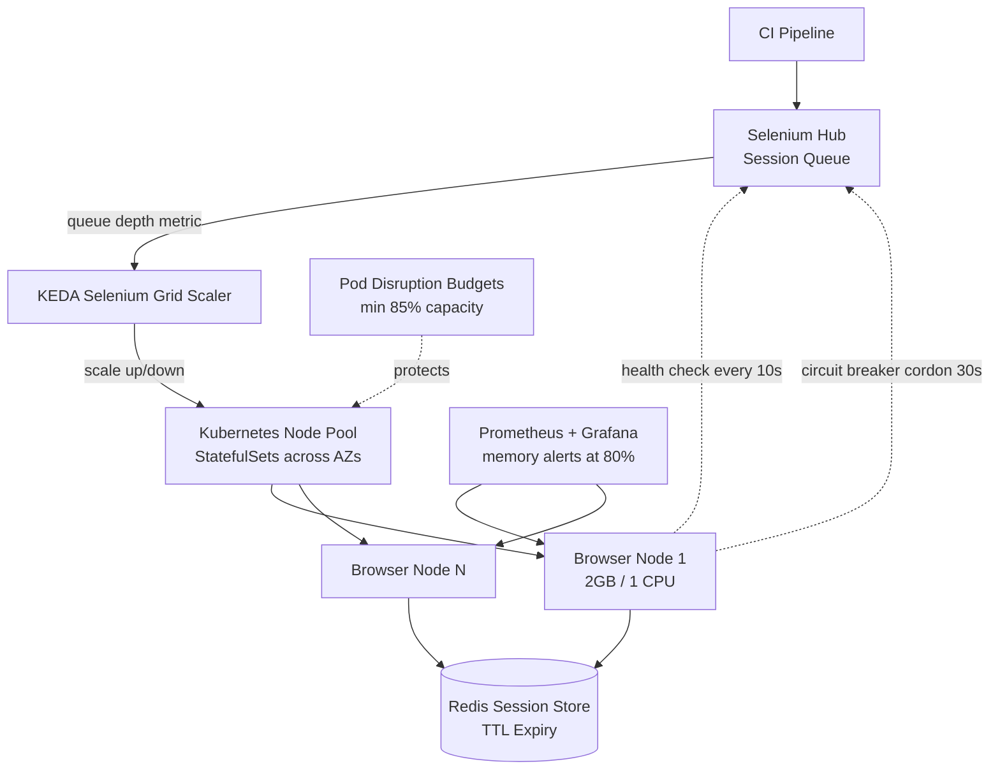

| Difficulty | Channel | Tags |
|---|---|---|
| advanced | system-design | selenium, webdriver, grid |

Volvo Cars needed a massive browser test fleet on Kubernetes to validate web and connected-car software — and they hit the trap that ambushes every team that gets there: the Horizontal Pod Autoscaler does not understand Selenium Grid [1]. Browser pods idle at near-zero CPU even when the session queue is backed up, so HPA never scales up; when it does scale down, it picks pods at random and terminates live tests mid-run. Volvo's fix — queue-depth autoscaling — eliminated session loss during scale-down and even enabled scale-to-zero, something stock HPA fundamentally cannot do [1]. That scaler became the reference implementation in KEDA, co-maintained by Volvo Cars and SeleniumHQ, and it now runs in production at teams like Indonesian e-commerce firm Blibli, hundreds of concurrent browsers and thousands of test scenarios per hour [1]. This is the story of how you build a Selenium Grid that survives 10,000 concurrent sessions at 99.9% uptime — and why the obvious Kubernetes playbook will betray you at the worst possible moment.

---

> ### Real-World Case — Volvo Cars
>
> Volvo Cars needed to run large-scale browser test fleets on Kubernetes for their web and connected-car software testing, and hit a problem that everyone hits: Kubernetes' built-in Horizontal Pod Autoscaler does not understand Selenium Grid. Browser pods idle at near-zero CPU even when the session queue is backed up, so HPA never scaled up, and when it did scale down it picked pods at random — terminating pods that still had live tests mid-run, killing sessions and causing connection failures.
>
> | | |
> |---|---|
> | **Challenge** | Scaling Selenium Grid browser nodes on Kubernetes without losing running test sessions: CPU/memory-based autoscaling gives no signal for queue depth, and Kubernetes' random scale-down terminates pods that are actively executing tests. Long-lived browser sessions also leak memory and hold slots open if cleanup is incomplete. |
> | **Solution** | Volvo Cars built and contributed the selenium-grid scaler to KEDA (shipped in KEDA v2.4, 2022), which polls the Grid's GraphQL endpoint and provisions one browser node per pending session-queue request instead of guessing from CPU — enabling scale-to-zero when idle. They paired it with graceful session lifecycle handling: a PreStop hook that curls the node to drain it so it stops accepting new sessions, terminationGracePeriodSeconds long enough for in-flight tests to finish, and polling the node /status endpoint until it goes dark before allowing termination. It is now co-maintained with SeleniumHQ and is the standard autoscaling path for Selenium Grid on Kubernetes (the official Selenium Helm/KEDA integration). |
> | **Outcome** | Queue-depth autoscaling eliminated session loss during scale-down ('your Selenium Grid pods should now scale up and down properly without any lost sessions' — official Selenium blog) and added scale-to-zero, which stock HPA cannot do. The scaler became the reference implementation in KEDA (maintained by Volvo Cars + SeleniumHQ), and downstream teams adopted it at scale — e.g. Indonesian e-commerce firm Blibli runs hundreds of concurrent browsers per test run and thousands of test scenarios per hour on GKE using exactly this Volvo-authored scaler, reporting significant cost savings after moving off their always-on Selenoid setup. |
> | **Lesson** | The counterintuitive part: the obvious Kubernetes tool (HPA on CPU/memory) is structurally wrong for browser test grids, because load lives in the session queue, not in resource utilization — and the default scale-down path silently kills in-flight work. Scale on queue depth (domain signal) and make termination a drain protocol, not a kill signal. |

---

## Hook — Picture Your Grid at 10,000 Sessions

Picture this. Your release train is minutes from departure. The CI dashboard is a wall of green — except for the browser suite, where 340 sessions are queued behind nodes that report 3% CPU utilization. The autoscaler looks at those numbers and concludes: everything is fine. Meanwhile, developers are refreshing their pipelines, the release manager is calling your phone, and every minute of delay compounds across dozens of dependent teams. This is not a hypothetical. It is the default failure mode of running Selenium Grid on Kubernetes with the wrong scaling signal. At 10,000 concurrent sessions, you are managing roughly 200 browser nodes, 520GB+ of baseline cluster memory, and a blast radius where a single bad scale-down event can silently kill hundreds of in-flight tests [1]. The stakes are not just red builds. They are eroded trust in your entire test signal — the moment teams stop believing CI, they start shipping on hope. And here is the uncomfortable truth many teams discover only after their third incident review: the bottleneck is almost never Selenium itself. It is the orchestration layer treating browsers like stateless web servers.

## Problem — CPU Lies, and Autoscalers Believe It

The core challenge is a category error. Kubernetes HPA scales on observable resource metrics — CPU and memory by default [4]. Selenium browser pods are different: between sessions, or even during certain phases of a test, they burn almost no CPU. A grid running at 90% queue saturation can look, to HPA, like a cluster that is delightfully underutilized. Consequently, the fleet never grows when you need it most. The problem cuts both ways. When load drops, HPA scales down by terminating arbitrary pods from the ReplicaSet. Browser nodes are not interchangeable sockets — a pod hosting five live WebDriver sessions is not the same as an idle pod. Killing the wrong one produces connection resets, half-written results, and flaky-test noise that takes engineers hours to triage. Multiply that across 10,000 sessions and multiple availability zones, and you have a fleet that fails in two opposite directions at once: too slow to scale up, too careless to scale down. Add the memory-leak dimension — Chrome and Firefox accumulate garbage over long-lived nodes, and stale Docker volumes pile up on hosts — and you see why zero-leak, zero-session-loss operation demands a fundamentally different architecture, not a tweaked HPA config. The question is not whether your grid will hit this. It is whether you will hit it during a product launch.

## Real-World Case — Volvo Cars and the KEDA Turning Point

Volvo Cars ran into exactly this while operating large-scale browser test fleets on Kubernetes for web and connected-car software testing [1]. The failure mode was textbook: browser pods idled at near-zero CPU while the Selenium session queue backed up, so HPA never triggered a scale-up; worse, scale-down selected pods at random, terminating nodes that still had live tests mid-run and causing connection failures across the suite [1]. The fix Volvo shipped was conceptually simple but operationally transformative: scale on queue depth instead of CPU. With queue-depth autoscaling, their Selenium Grid pods scaled up and down properly without any lost sessions, and the grid gained scale-to-zero capability that stock HPA cannot provide [1]. The impact extended well beyond one company. The Volvo-authored scaler became the reference implementation in KEDA, the Kubernetes Event-Driven Autoscaling project, maintained jointly by Volvo Cars and SeleniumHQ [1][2]. Downstream adoption followed fast: Indonesian e-commerce firm Blibli runs hundreds of concurrent browsers per test run and thousands of test scenarios per hour on Google Kubernetes Engine using precisely this Volvo-authored scaler, reporting significant cost savings after migrating off an always-on Selenoid setup [1]. The lesson here is sharp. Volvo did not win by adding more nodes or tuning memory limits. They won by changing the metric that drove the scaling decision — and refusing to let the orchestrator kill work in progress.

## Deep Dive — Anatomy of a Grid That Refuses to Lose Sessions

With the Volvo lesson as your north star, the architecture for 10,000 concurrent sessions at 99.9% uptime takes shape around four pillars. First, the hub-node topology. A central Selenium Hub fronts Kubernetes StatefulSets that manage browser pods across multiple availability zones [5]. StatefulSets matter here: they provide stable network identities, which you need when circuit breakers and health checks must reason about specific nodes rather than anonymous ReplicaSet members. Second, session state must be externalized and self-expiring. A Redis cluster holds session records with TTL-based expiration, connection pooling, and automatic cleanup [7]. The TTL is your insurance policy against the classic leak: a browser dies, the sidecar never runs, and the session lingers forever. With TTL, orphans evaporate on their own. Third, scaling and protection signals come from the right places. Prometheus collects per-node memory and session-duration metrics [6], Grafana surfaces trends before they become incidents, and KEDA reads session queue depth to drive node-pool autoscaling [1][2]. Meanwhile, Pod Disruption Budgets guarantee that voluntary disruptions never strip more than a defined fraction of capacity — targeting a floor of roughly 85% availability during maintenance events [8]. Fourth, failure isolation. Health endpoints are polled every 10 seconds; three consecutive failures trigger immediate node removal. Circuit breakers quarantine suspect nodes in 30-second recovery windows before reintroducing traffic. Now, the numbers, because hand-waving kills designs: 10,000 sessions at 50 sessions per node yields a 200-node minimum. At 2GB RAM and 1 CPU per node, that is 400GB baseline plus a 30% buffer — call it 520GB of cluster memory. Session initiation should hold P99 under 2 seconds through regional load balancing, and multi-AZ deployment with automatic failover is what buys you the 99.9% target. A word of caution: weekly rolling restarts, memory alerts at the 80% threshold, and garbage-collection tuning are not optional garnish. They are the difference between a grid that degrades gracefully and one that bleeds memory until Chrome starts crashing sessions at random hours.

## Workflow — From Queue Spike to Scaled Fleet

Here is how the pieces move together when a flood of sessions hits the grid. Follow the flow in the diagram below, then the step-by-step. 1. A CI pipeline submits a session request. The Selenium Hub enqueues it and exposes queue depth via its GraphQL endpoint. 2. KEDA's Selenium Grid scaler polls that queue depth — not CPU — and computes desired node-pool replicas, including scale-to-zero when the queue drains [1][2]. 3. Kubernetes StatefulSets bring browser pods up across availability zones, each pod bounded by explicit CPU and memory quotas [5]. 4. On session start, a Redis record is written with a TTL, so even if a cleanup sidecar never fires, the session self-expires [7]. 5. Prometheus scrapes per-node health and memory metrics; alerts fire at 80% memory utilization [6]. 6. If a node fails three consecutive 10-second health probes, the circuit breaker cordons it and the hub redistributes new sessions; Pod Disruption Budgets hold the remaining capacity above the 85% floor [8]. 7. As queue depth falls, KEDA scales the pool down — but only pods without live sessions are drained first, which is precisely the guarantee stock HPA could not provide [1]. The architecture diagram below captures the full loop.

## Code Example — A Session-Aware Scaling Probe in Python

The following Python probe mirrors the queue-depth philosophy behind the Volvo/KEDA scaler [1][2]. It queries the Selenium Grid GraphQL endpoint for queue depth and node capacity, registers every session in Redis with a hard TTL so leaks self-heal [7], and computes a desired replica count that HPA alone could never derive from CPU. Walkthrough, section by section: the GraphQL query pulls live queue size and per-node session counts; `register_session` writes a TTL-backed key so orphaned sessions vanish even if cleanup sidecars die; `cordon_node` implements the 30-second circuit-breaker quarantine; and `desired_replicas` blends queue pressure with a 30% headroom buffer, outputting a value you feed to a KEDA ScaledObject rather than to HPA. In production, you would run this logic inside the scaler or a small controller, and pair it with the StatefulSet, Redis, and Prometheus pieces from the deep dive.

## Lessons Learned — Battle Scars and What to Do Tomorrow

After tracing this pattern across teams that run grids at serious scale, a few scars and takeaways stand out. Battle scar one: scaling on CPU. It looks correct in every tutorial and fails in every real browser fleet. Switch your scaling metric to queue depth via KEDA [1][2] — this is the single highest-leverage change you can make. Battle scar two: letting the orchestrator kill busy pods. Configure scale-down to drain sessions first, and back it with Pod Disruption Budgets so voluntary disruptions never breach your capacity floor [8]. Battle scar three: trusting cleanup without a TTL. Sidecars fail; init containers get skipped during node pressure. TTL-based Redis expiration is your dead-man switch for memory leaks [7]. Battle scar four: flying blind on memory. Instrument with Prometheus from day one, alert at 80%, and schedule weekly rolling restarts — Chrome's memory curve is not your friend on day eight of uptime [6]. Battle scar five: single-AZ thinking. 99.9% uptime is a multi-AZ commitment with automatic failover, not a slogan [5]. If this feels like a lot, start small: one StatefulSet, one Redis with TTLs, one queue-depth scaler. Pro tip: after debugging this pattern across several grid migrations, the teams that win are the ones who treat session lifecycle as a first-class distributed-systems problem — not as a test-infra afterthought. What should you do differently tomorrow? Audit your current scaling signal. If it is CPU, you are running Volvo's old incident on a loop.

---

## Selenium Grid Auto-scaling Architecture

<strong>Original Interview Question</strong>

**Q:** Design a scalable Selenium Grid architecture to handle 10,000 concurrent test sessions with 99.9% uptime, ensuring zero memory leaks through automatic session lifecycle management, real-time monitoring, and graceful node failure recovery across multiple data centers?

**A:** Deploy Kubernetes cluster with auto-scaling node pools, Redis session store with TTL policies, Prometheus metrics for memory monitoring, circuit breakers for node isolation, and sidecar containers for session cleanup. Implement health checks, resource quotas, and rolling updates.

## Conclusion

Volvo Cars did not fix their grid by throwing hardware at it. They fixed it by noticing that the orchestrator was watching the wrong number — CPU, when the truth lived in the session queue — and by refusing to let scale-down murder work in progress [1]. That single insight became a KEDA scaler now used from automotive QA suites to Indonesian e-commerce pipelines running thousands of test scenarios per hour [1]. The journey from a red CI board at 3% CPU utilization to a self-healing 10,000-session fleet runs through queue-depth autoscaling, TTL-backed session stores, StatefulSets with real health checks, Prometheus memory alerts, and Pod Disruption Budgets that protect your capacity floor. Tomorrow, do one thing: open your autoscaler config and ask what metric it is scaling on. If the answer is CPU, you now know exactly which incident you are replaying — and exactly how to stop.

---

## References

1. [Volvo Cars incident report — KEDA Selenium Grid Scaler](https://keda.sh/docs/2.21/scalers/selenium-grid-scaler/) — article
2. [KEDA — Kubernetes Event-Driven Autoscaling (GitHub)](https://github.com/kedacore/keda) — documentation
3. [SeleniumHQ Selenium (GitHub)](https://github.com/SeleniumHQ/selenium) — documentation
4. [Horizontal Pod Autoscaling — Kubernetes Docs](https://kubernetes.io/docs/tasks/run-application/horizontal-pod-autoscale/) — documentation
5. [StatefulSets — Kubernetes Docs](https://kubernetes.io/docs/concepts/workloads/controllers/statefulset/) — documentation
6. [Prometheus Overview](https://prometheus.io/docs/introduction/overview/) — documentation
7. [Redis TTL (time-to-live) — Redis Docs](https://redis.io/docs/latest/develop/use/ttl/) — documentation
8. [Pod Disruptions — Kubernetes Docs](https://kubernetes.io/docs/concepts/workloads/pods/disruptions/) — documentation
9. [Prometheus Alerting Practices](https://prometheus.io/docs/practices/alerting/) — documentation
10. [Debug Pods and Nodes — Kubernetes Docs](https://kubernetes.io/docs/tasks/debug/debug-application/debug-pod-and-node/) — documentation

---

**Author:** Satishkumar Dhule — [GitHub](https://github.com/satishkumar-dhule) · [LinkedIn](https://linkedin.com/in/satishkumar-dhule) · [Website](https://satishkumar-dhule.github.io)
