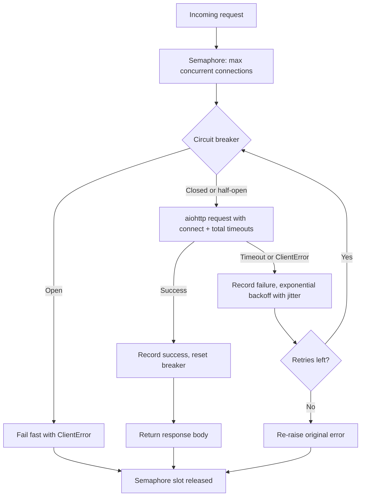

| Difficulty | Channel | Tags |
|---|---|---|
| advanced | backend | asyncio, aiohttp, concurrency |

Millions of members were streaming when Netflix's internal dependencies started failing. Rather than serving a wall of 500s, the Netflix API tripped circuits, invoked fallbacks, and kept the video flowing with slightly less personalized recommendations [1]. That is graceful degradation under load: the system stays up, just a little less perfect. That same discipline is exactly what you need when an aiohttp service faces connection timeouts, thundering retries, and cascading failures across your own backends.

---

> ### Real-World Case — Netflix
>
> During peak traffic and partial outages of internal service dependencies (databases, metadata services, recommendation backends), Netflix's API had to continue serving streaming requests to millions of users without cascading failures.
>
> | | |
> |---|---|
> | **Challenge** | Prevent cascading failures when downstream services became slow, saturated, or unavailable while still providing a usable experience for members who wanted to continue watching content. |
> | **Solution** | Netflix implemented a circuit breaker pattern (later popularized through Hystrix) in the API. Each service dependency call was wrapped to track timeouts, thread pool saturation, and exception rates. When error thresholds were exceeded, the circuit would 'trip' and immediately serve predefined fallbacks (custom fallbacks using cached/local data, or fail-silent returns) instead of attempting calls to the failing service. This enforced graceful degradation and isolation of failures. |
> | **Outcome** | During real incidents (including database failures), the API automatically tripped circuits and invoked fallbacks, allowing members to continue streaming with slightly degraded/personalized-less experiences rather than complete request failures. The system preserved availability under dependency failures. |
> | **Lesson** | Graceful degradation via circuit breakers and well-defined fallbacks is essential at scale to avoid cascading failures; availability can be preserved by returning reduced-functionality responses when dependencies fail. |

---

## Hook — The 500 That Ate Production

Picture this: a downstream recommendation service starts answering in 12 seconds instead of 40 milliseconds. Your async Python service, written with clean `async with session.get(url)` calls, keeps firing requests at it. Worker tasks pile up. Memory grows. Latency charts turn from green to red. Suddenly your API is not slow because of one dependency — it is down, because every dependency failure cascaded through every open connection at once.

You have all been there: staring at a dashboard where p99 latency is climbing like a rocket and every retry makes it worse. The cruel irony of async Python is that a library like aiohttp makes it dangerously easy to send thousands of concurrent requests, but concurrency without limits is just a faster path to a total outage.

So what actually stops a partial outage from becoming a full one? Not faster code. Better failure manners.

## Problem — Concurrency Without Boundaries Is a House of Cards

At its core, the problem is simple to state and hard to survive: an unbounded aiohttp client will happily open connections until the operating system, the remote service, or your own event loop says "no." Connection pools exist to keep TCP and TLS overhead down [3], but a pool alone does not decide what to do when the pool is full or the far end is unhealthy.

Three failure modes feed each other:

- **Saturation** — without a concurrency ceiling, each slow response keeps a connection occupied, and every new request waits longer, which keeps connections occupied longer. Positive feedback, zero mercy.
- **Retry storms** — when requests time out and immediately re-fire with no delay, you create a thundering herd that crushes the recovering dependency the moment it comes back.
- **Cascade** — one dead service occupies your available connections long enough that healthy services starve too, turning a partial outage into a total one.

Therefore, a production-grade connection pool manager is not really about pooling sockets. It is about **policy**: how many requests may run at once, what counts as failure, how aggressively to retry, and when to stop trying entirely. That last question — when to stop — is where most teams learn the circuit breaker pattern the hard way [2].

## Real-World Case — Netflix and the Art of Staying Up While Breaking

During peak traffic and partial outages of internal service dependencies — databases, metadata services, recommendation backends — Netflix's API had to continue serving streaming requests to millions of members without cascading failures [1]. In real incidents, including database failures, the API automatically tripped circuits and invoked fallbacks, allowing members to keep streaming with degraded, less personalized experiences rather than complete request failures [1].

The impact is worth internalizing: availability was preserved under dependency failure by **choosing** to degrade. Recommendations got dumber; playback did not stop. That is the mental model to steal for your own aiohttp services. You are not optimizing for a world where nothing fails. You are optimizing for a world where failure is normal and total darkness is unacceptable.

A useful companion insight comes from Netflix's Hystrix lineage: falling back is a product decision disguised as infrastructure code [2]. The question is not only "should the circuit open?" but "what do members see while it is open?" In your service, the equivalent might be cached data, a default response, or a fast 503 with a `Retry-After` header rather than a timeout that burns a connection for 30 seconds [8].

## Deep Dive — The Four Knights of Resilience (and Their Trade-Offs)

Building on Netflix's example, the aiohttp connection pool manager rests on four mechanisms that work together — each with a real trade-off.

**1. Semaphore-based concurrency limiting.** An `asyncio.Semaphore` caps how many coroutines may hold a live connection at once [4]. The trade-off is blunt: a low cap protects the downstream service but queues your own traffic; a high cap absorbs bursts but recreates the saturation problem. A common production pattern is to size the semaphore around the dependency's documented capacity, not your server's CPU count.

**2. Explicit timeouts everywhere.** Aiohttp's `ClientTimeout` separates connect, sock-read, and total budgets [6]. Many developers set only `total`, which hides a subtle trap: a 30-second total timeout can still hold a pooled connection through a long, slow body read. Setting a tight connect timeout plus a moderate total timeout fails fast and returns the connection slot to the semaphore sooner.

**3. Exponential backoff with jitter.** Retrying a timed-out request immediately is how outages get longer. Exponential backoff — delay doubling per attempt, capped at a ceiling — gives the dependency room to recover [9]. The plot twist: naive exponential backoff without jitter synchronizes your fleet into simultaneous retries, so you want full jitter, where each delay is randomized across the backoff window [9]. The HTTP `Retry-After` header, when present, should trump your local schedule [8].

**4. Circuit breaker.** After a threshold of recent failures, the breaker opens and requests fail fast without touching the network; after a cool-down it moves to half-open and lets a probe through [2]. The trade-off is correctness versus protection: an aggressive threshold stops cascades faster but can open on blips; a lenient one keeps sending traffic to a dead endpoint. Half-open probing is how you get both.

| Mechanism | Failure it stops | Over-aggressive setting costs you |
| --- | --- | --- |
| Semaphore | Connection exhaustion | Throughput and queue depth |
| Strict timeouts | Stuck connections | False failures on legitimately slow calls |
| Exponential backoff | Retry storms | Higher recovery latency |
| Circuit breaker | Cascade failures | Brief fail-fast window on flapping services |

⚠️ Watch Out: a circuit breaker keyed on one shared counter across all hosts is a classic bug. One flaky replica can open the circuit for healthy ones. Track failures per destination host, not globally — and remember that HTTP keep-alive reuses TCP connections [7], so "the connection worked five minutes ago" is not the same as "the host is healthy now."

## Workflow — The Life of a Single Request Through the Pool

Here is the step-by-step journey every request takes through the manager:

1. **Gate 1 — Semaphore.** The coroutine acquires a slot from the semaphore [4]. If all slots are held, it waits — deliberately, rather than opening yet another connection.
2. **Gate 2 — Circuit breaker.** Before any I/O, the breaker is consulted. If open, the request fails fast with a `ClientError` in microseconds instead of burning 30 seconds on a dead host [5].
3. **The attempt.** The session executes the request under connect and total timeouts [6]. TLS verification stays on — silently disabling SSL validation to "fix" timeouts is a security regression, not an optimization.
4. **Success path.** The breaker resets to closed, the semaphore slot is released, and the response is returned.
5. **Failure path.** Timeout or `ClientError` records a breaker failure, then the client sleeps for an exponentially growing, jittered delay [9] before retrying. Exhausted retries re-raise the original class of error so callers can handle it with the same `except` they already wrote.

The flow below is the architecture in one picture — each branch is a policy decision the code makes explicit:



🎯 Key Point: the semaphore release is not a cleanup detail — it is the entire resilience story. Every path out of the request loop must return the slot, or the pool leaks connections until the service quietly suffocates.

## Code Example — A Pool That Knows When to Quit

Below is an illustrative, runnable-style implementation of the full pattern: three-state circuit breaker, semaphore-gated requests, explicit timeouts, and jittered exponential backoff. Each block is annotated so you can adapt it to your own service.

```python
import asyncio
import random
import time
from typing import Optional

import aiohttp

class CircuitBreaker:
    """Fails fast when a dependency is unhealthy; probes after a cool-down."""

    def __init__(self, failure_threshold: int = 5, recovery_timeout: float = 60.0):
        self.failure_threshold = failure_threshold
        self.recovery_timeout = recovery_timeout
        self.failures = 0
        self.state = "closed"          # closed -> open -> half-open -> closed
        self.last_failure = 0.0

    def allow_request(self) -> bool:
        if self.state == "closed":
            return True
        if self.state == "open":
            # Cool-down elapsed? Let a probe through via half-open.
            if time.monotonic() - self.last_failure >= self.recovery_timeout:
                self.state = "half-open"
                return True
            return False
        return True  # half-open admits traffic to test recovery

    def record_success(self) -> None:
        self.failures = 0
        self.state = "closed"

    def record_failure(self) -> None:
        self.failures += 1
        self.last_failure = time.monotonic()
        if self.state == "half-open" or self.failures >= self.failure_threshold:
            self.state = "open"

class ConnectionPoolManager:
    """aiohttp pool with concurrency limits, timeouts, backoff, and circuit breaking."""

    def __init__(
        self,
        max_connections: int = 100,
        total_timeout: float = 30.0,
        connect_timeout: float = 5.0,
        max_retries: int = 3,
    ) -> None:
        # Semaphore caps concurrent in-flight connections [4]
        self.semaphore = asyncio.Semaphore(max_connections)
        self.circuit = CircuitBreaker()
        self.max_retries = max_retries
        # Split budgets: fail slow connects fast, still bound total work
        self._timeout = aiohttp.ClientTimeout(total=total_timeout, connect=connect_timeout)
        self._session: Optional[aiohttp.ClientSession] = None

    async def start(self) -> None:
        # TCPConnector keeps keep-alive reuse explicit; ssl=True keeps cert checks on
        connector = aiohttp.TCPConnector(
            limit=100, limit_per_host=10, enable_cleanup_closed=True, ssl=True
        )
        self._session = aiohttp.ClientSession(connector=connector, timeout=self._timeout)

    async def close(self) -> None:
        # Always drain the session on shutdown to avoid leaked sockets
        if self._session and not self._session.closed:
            await self._session.close()

    async def make_request(self, url: str, method: str = "GET") -> str:
        async with self.semaphore:  # hold a connection slot for the whole call
            for attempt in range(self.max_retries + 1):
                if not self.circuit.allow_request():
                    # Fail fast in microseconds instead of timing out for 30s
                    raise aiohttp.ClientError("Circuit breaker open")
                try:
                    assert self._session is not None
                    async with self._session.request(method, url) as response:
                        response.raise_for_status()
                        body = await response.text()
                    self.circuit.record_success()
                    return body
                except (asyncio.TimeoutError, aiohttp.ClientError) as exc:
                    self.circuit.record_failure()
                    if attempt >= self.max_retries:
                        raise  # preserve the original error type for callers
                    await asyncio.sleep(self._backoff(attempt))

    @staticmethod
    def _backoff(attempt: int) -> float:
        # Full jitter: randomize across the window to prevent retry herds [9]
        base = min(2 ** attempt, 30)
        return base + random.uniform(0, 1)

async def main() -> None:
    pool = ConnectionPoolManager(max_connections=20)
    await pool.start()
    try:
        body = await pool.make_request("https://httpbin.org/get")
        print(body[:80])
    finally:
        await pool.close()

if __name__ == "__main__":
    asyncio.run(main())
```

A step-by-step walkthrough of the design:

- **`CircuitBreaker`** implements the three canonical states. `allow_request` gates I/O, `record_success` closes the circuit, and `record_failure` opens it either on threshold or immediately when a half-open probe fails [2]. Using `time.monotonic()` keeps cool-down math immune to wall-clock jumps.
- **`ConnectionPoolManager.__init__`** sizes the semaphore to the concurrency ceiling and builds one `ClientTimeout` with split budgets — a common pitfall is leaving connect at the 30-second default, which pins connections to dead hosts [6].
- **`start`/`close`** own the session lifecycle. Creating a `ClientSession` per request is the most frequent aiohttp performance bug; leaking one at shutdown is the most frequent ops bug [6].
- **`make_request`** is the policy core: semaphore gate, breaker gate, attempt, record, back off, retry, re-raise. Note the semaphore wraps the entire retry loop — releasing it between attempts would let the fleet retry in parallel and re-create the storm you just engineered against.
- **`_backoff`** applies full jitter so retries spread out instead of aligning [9]. Capping at 30 seconds keeps recovery bounded.

💡 Insight: keep the breaker keyed per destination host if you call multiple services from one manager. A single global failure counter across unrelated hosts will open circuits against perfectly healthy dependencies the first time any one of them blips.

## Lessons Learned — Battle Scars and What to Do Tomorrow

If this feels like a lot, remember that every mechanism above exists because someone shipped the version without it and got paged. Here is the distilled battle-scar list:

- **Connection leaks are silent until they are fatal.** Every exception path must release the semaphore slot, and every session must be closed on shutdown. A pool that leaks 1% of slots per minute becomes a full outage in under two hours.
- **Never disable SSL verification to "fix" timeouts.** TLS failures and network timeouts are different signals; conflating them hides real attacks and real outages alike.
- **Retries without jitter are amplifiers.** Exponential growth alone still synchronizes fleets [9]; randomize the delay or your recovery will knock the dependency back over.
- **Fail fast beats fail slow.** A circuit breaker that rejects in microseconds [2] is more valuable under load than a pool that politely times out over 30 seconds while eating every connection slot.
- **Make degradation a product decision.** Like Netflix choosing less-personalized streaming over no streaming [1], decide what your fallback returns — cached value, default payload, or a structured 503 with `Retry-After` [8] — before the incident chooses for you.
- **Observe the four numbers.** Track semaphore wait time, active connections, breaker state transitions, and retry counts. A circuit that never opens is misconfigured; one that opens every hour is also misconfigured.

The moral of the story: resilience is not a library you import — it is a set of explicit policies about limits, timeouts, retries, and stopping. Start small: add a semaphore and split timeouts to your biggest aiohttp client this week, then add the breaker when you can name the dependency that would cascade. And leave your team with one idea worth repeating: the goal is not to avoid failure, it is to fail in the smallest possible circle.

---

## Resilient Connection Pool Request Flow


<details>
<summary><strong>Original Interview Question</strong></summary>

**Q:** How would you implement a connection pool manager for aiohttp that handles graceful degradation under high load and connection timeouts?

**A:** Implement a connection pool manager for aiohttp using a semaphore to limit concurrent connections, exponential backoff for retrying failed requests, and circuit breaker pattern to gracefully degrade under high load and connection timeouts.

</details>

## Conclusion

Netflix's API survived dependency failures because it refused to treat every error as a reason to keep trying [1]. The aiohttp pool in this article encodes the same lesson: a semaphore that caps concurrency [4], split timeouts that fail fast [6], jittered exponential backoff that lets dependencies breathe [9], and a circuit breaker that stops traffic before a partial outage becomes a total one [2]. Tomorrow, take your noisiest aiohttp client and add a semaphore plus explicit connect timeouts — a ten-line change that already breaks the saturation cycle. Then, when you can name the dependency that would cascade, add the breaker and decide the fallback response before the pager decides it for you. The memorable idea to share with your team: resilience is not about making failures rarer; it is about making each failure smaller than the last.

---

## References

1. [Netflix incident report: Making the Netflix API More Resilient](https://netflixtechblog.com/making-the-netflix-api-more-resilient-a8ec62159c2d) — article
2. [Circuit breaker design pattern](https://en.wikipedia.org/wiki/Circuit_breaker_design_pattern) — documentation
3. [Connection pool](https://en.wikipedia.org/wiki/Connection_pool) — documentation
4. [Python asyncio synchronization primitives (Semaphore)](https://docs.python.org/3/library/asyncio-sync.html) — documentation
5. [aiohttp client exceptions reference](https://docs.aiohttp.org/en/stable/client_exceptions.html) — documentation
6. [aiohttp advanced client usage (sessions, connectors, timeouts)](https://docs.aiohttp.org/en/stable/client_advanced.html) — documentation
7. [RFC 9112: HTTP/1.1 (persistent connections and keep-alive)](https://datatracker.ietf.org/doc/html/rfc9112) — documentation
8. [MDN: Retry-After HTTP header](https://developer.mozilla.org/en-US/docs/Web/HTTP/Headers/Retry-After) — documentation
9. [AWS general reference: API retries and exponential backoff](https://docs.aws.amazon.com/general/latest/gr/api-retries.html) — documentation
10. [Python asyncio task timeouts (asyncio.timeout)](https://docs.python.org/3/library/asyncio-task.html) — documentation

---

**Author:** Satishkumar Dhule — [GitHub](https://github.com/satishkumar-dhule) · [LinkedIn](https://linkedin.com/in/satishkumar-dhule) · [Website](https://satishkumar-dhule.github.io)
