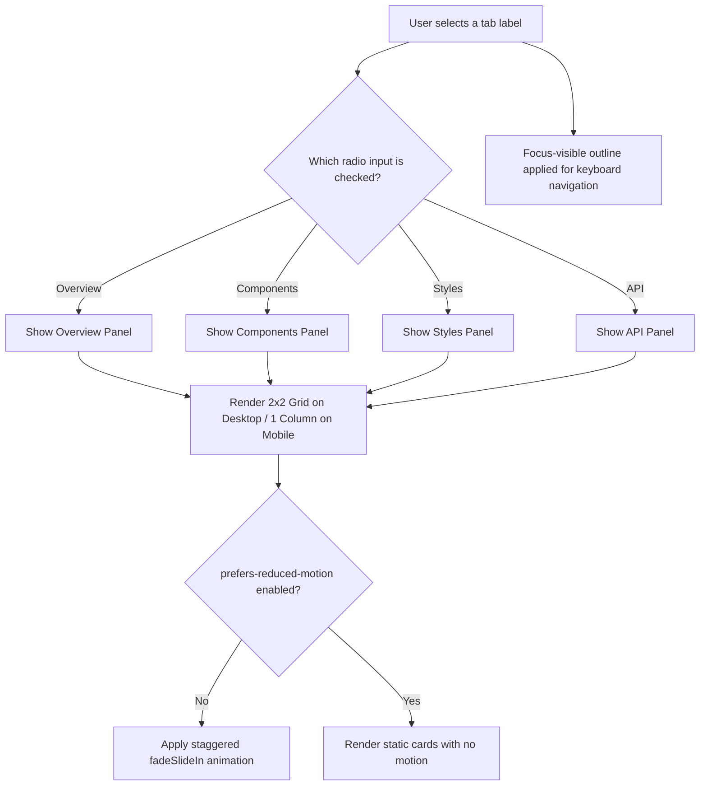

| Difficulty | Channel | Tags |
|---|---|---|
| beginner | frontend | css, flexbox, grid, animations |

It only took a few days for millions of people to realize something was deeply wrong. When Apple shipped iOS 7 in September of 2013, its bold new animations and parallax effects were meant to feel futuristic and fluid. Instead, they left countless users feeling dizzy, nauseous, and even physically ill [1]. This stark reminder of how powerful motion can be is exactly why, as developers, you must build interfaces that respect not just what looks beautiful, but what feels safe for your users.

---

> ### Real-World Case — Apple
>
> In September 2013, Apple shipped iOS 7 with a ground-up visual redesign by Jony Ive that leaned heavily on zoom transitions, sliding panels, and a new parallax wallpaper effect. Within days, hundreds of millions of users reported dizziness, nausea, and vertigo from the animations — with some so affected they downgraded back to iOS 6. Apple had to ship an emergency accessibility escape hatch for its own flagship design.
>
> | | |
> |---|---|
> | **Challenge** | The hero animations of iOS 7 triggered motion sickness (vestibular distress) in a significant portion of users, and there was no web-platform mechanism at all to let user agents express a motion preference to websites — meaning the same sickness triggers were spreading into web design as animation usage grew 'by an order of magnitude' after 2013. |
> | **Solution** | Apple added the 'Reduce Motion' toggle to iOS 7's Accessibility settings (disabling parallax and zoom effects), exposed a native API in iOS 8 (UIAccessibilityIsReduceMotionEnabled), proposed the `prefers-reduced-motion` media feature to the CSS Working Group in 2014, and WebKit shipped it in 2017 — giving every browser a standardized way to detect the OS preference and let CSS gate entrance animations behind `@media (prefers-reduced-motion: no-preference)`. |
> | **Outcome** | The incident directly produced the `prefers-reduced-motion` standard now implemented across all major browsers: 200 million+ iOS 7 downloads were exposed to the issue within the first week, the OS-level setting shipped within days of complaints, the CSS feature was proposed to the W3C within a year (2014) and reached WebKit in May 2017 — it is now the canonical WCAG 2.3.3 (Animation from Interactions) compliance mechanism cited in accessibility audits. |
> | **Lesson** | Motion is a medical accessibility concern, not just a taste preference — a platform-level preference signal (OS setting → media query → CSS) is the only robust way to handle it, which is exactly why entrance animations in production components must be wrapped in `prefers-reduced-motion` rather than shipped unconditionally. |

---

## Hook — The Price Of Beautiful Motion

Picture this: you spend months meticulously crafting the perfect interface. Every transition is silky smooth, every card elegantly slides into view, and your design team couldn't be prouder. But what if those very flourishes are making a portion of your audience physically unwell? This is not a hypothetical scenario. Apple's experience proved that the line between delightful and debilitating is razor thin [1]. With this in mind, the question becomes: how can you add polish to your interfaces without sacrificing the comfort of your users?

## Problem — Delight Should Never Come At The Cost Of Accessibility

For many developers, animations are seen as the cherry on top of an already great design. They guide attention, provide feedback, and breathe life into otherwise static pages. However, this pursuit of delight can quickly become exclusionary for users who are sensitive to motion. Vestibular disorders, migraines, and motion sickness can all be triggered by excessive movement on screen [2]. These are not edge cases either, but a large population of users that rely on your interface to be accessible. Therefore, the challenge is clear: you need to build interactive components that are not only functional, but also adaptive to the needs of your audience. This leads to an important realization: accessibility shouldn't be an afterthought, but a core design constraint from day one.

## Real-World Case — Apple

In September 2013, Apple shipped iOS 7 with a ground-up visual redesign by Jony Ive that leaned heavily on zoom transitions, sliding panels, and a new parallax wallpaper effect. Within days, hundreds of millions of users reported dizziness, nausea, and vertigo from the animations — with some so affected they downgraded back to iOS 6. Apple had to ship an emergency accessibility escape hatch for its own flagship design [1]. The impact was unprecedented: over 200 million iOS 7 downloads were exposed to the issue within the first week. This forced the creation of an OS-level setting, and sparked the proposal of `prefers-reduced-motion` to the W3C within a year (2014), eventually reaching WebKit in May 2017 [1]. Today, this feature is the canonical mechanism for WCAG 2.3.3 (Animation from Interactions) compliance [3].

## Deep Dive — Building With Empathy And The Right Tools

With the stakes now crystal clear, you can start tackling this problem with modern CSS. The solution lies in three key pillars that work in harmony. First, **pure CSS interactivity**: Utilizing radio inputs with a shared `name` and their corresponding `` elements allows you to create a fully functional tab panel without a single line of JavaScript [4]. This not only reduces complexity, but also preserves native accessibility semantics. Second, **responsive layouts**: With CSS Grid, you can easily craft a 2x2 card layout for desktop, collapsing down to a single column on mobile devices [5]. This ensures your content looks great regardless of screen size. Third, **motion respect**: By wrapping your entrance animations in a `prefers-reduced-motion: no-preference` media query, you only animate for users who have not requested reduced motion [2]. Moreover, pairing this with `focus-visible` outlines guarantees keyboard users can navigate your tabs with clarity [6]. These pillars prove that accessibility and delightful design don't have to be at odds. Instead, they reinforce one another.

## Workflow — Bringing It All Together

To construct this solution, you can follow a simple, battle-tested workflow. First, **structure your markup**: Create radio inputs (with one checked by default) and pair each with a label. Then, wrap each tab's content in a ``. Second, **control visibility**: Use the `:checked` pseudo-class alongside the adjacent sibling selector (`~`) to show the correct panel while hiding the others [4]. Third, **style your cards**: Utilize `aspect-ratio: 16 / 9` for your image containers to create consistent, fixed media areas [7]. Next, **implement responsiveness**: Leverage `grid-template-columns: repeat(2, 1fr)` for desktop and switch to `1fr` within a mobile media query [5]. Finally, **animate with care**: Define a subtle `fadeSlideIn` keyframe, apply it with a stagger to each card, and gate the entire animation behind `prefers-reduced-motion: no-preference` [2][6]. The flow of this logic can be visualized in the diagram below, showcasing how user input cascades to the correct rendered output.

## Code Example — Putting Theory Into Practice

Now, it's time to see these concepts in action. The code below showcases a production-ready, CSS-only tab panel that implements every requirement. From the semantic structure, all the way down to the reduced-motion guardrails, each piece works together to create an experience that is both beautiful and safe. Take a moment to walk through it: notice how the radio inputs act as the state manager, how the grid adapts to viewport sizes, and how the staggered animation is completely disabled for those that need it.

## Lessons Learned — Designing For Humans First

Looking back at the journey from Apple's painful lesson to a concrete implementation, a few key takeaways stand out. First and foremost, **empathy scales**: The choices you make in CSS can have very real physiological impacts on your users [1][3]. Second, **CSS is more powerful than you think**: With modern features like `:checked`, CSS Grid, `aspect-ratio`, and media queries, you can create highly interactive experiences without relying on JavaScript [4][5][7]. Third, **accessibility is a feature, not a bug**: Implementing `prefers-reduced-motion` and `focus-visible` doesn't detract from your design, it broadens your audience [2][6]. Most importantly, you don't need to sacrifice polish to do the right thing. By baking these guardrails in from the start, you can build interfaces that feel magical for everyone. So tomorrow, when you reach for that animation, ask yourself: am I adding delight, or am I excluding someone? That one question can change the entire trajectory of your product.

---

## CSS-Only Tab Panel Logic

<strong>Original Interview Question</strong>

**Q:** Build a CSS-only tab panel for a design-system docs page. Use radio inputs to switch tabs (no JavaScript). Desktop: a 2x2 grid of cards under each tab; mobile: single column. Each card has a fixed 16:9 image area, a title, and a short meta line. Add a subtle entrance animation with a stagger and keep focus-visible outlines; ensure prefers-reduced-motion is respected?

**A:** Use a set of radio inputs with a shared `name` attribute and corresponding `` elements for each tab section. The `:checked` state of each radio controls visibility of its associated panel via adjacent sibling selectors. Each panel renders a 2×2 card grid on desktop and collapses to a single column on mobile. Cards use `aspect-ratio: 16/9` for fixed image containers, with a title and meta line below.

## Conclusion

The web is built for everyone, not just those who can tolerate motion. Apple's hard-earned lesson reminds you that the most beautiful interfaces are the ones that care for their users first. By implementing accessible, CSS-only tabs with reduced motion support, you're not just writing code, you're actively preventing exclusion. The next time you add an animation to your project, take a moment to guard it with `prefers-reduced-motion`. That small act of empathy has the power to make your work accessible to millions. Share this practice with your team tomorrow, because accessibility should never be optional, it should be the default.

---

## References

1. [Apple incident report](https://webkit.org/blog/7551/responsive-design-for-motion/) — article
2. [prefers-reduced-motion - CSS: Cascading Style Sheets | MDN](https://developer.mozilla.org/en-US/docs/Web/CSS/@media/prefers-reduced-motion) — documentation
3. [Understanding Success Criterion 2.3.3: Animation from Interactions | WCAG 2.3](https://www.w3.org/WAI/WCAG22/Understanding/animation-from-interactions.html) — documentation
4. [:checked - CSS: Cascading Style Sheets | MDN](https://developer.mozilla.org/en-US/docs/Web/CSS/:checked) — documentation
5. [CSS Grid Layout - CSS: Cascading Style Sheets | MDN](https://developer.mozilla.org/en-US/docs/Web/CSS/CSS_grid_layout) — documentation
6. [:focus-visible - CSS: Cascading Style Sheets | MDN](https://developer.mozilla.org/en-US/docs/Web/CSS/:focus-visible) — documentation
7. [aspect-ratio - CSS: Cascading Style Sheets | MDN](https://developer.mozilla.org/en-US/docs/Web/CSS/aspect-ratio) — documentation
8. [Media Queries Level 5 - W3C Candidate Recommendation Snapshot](https://www.w3.org/TR/mediaqueries-5/) — documentation

---

**Author:** Satishkumar Dhule — [GitHub](https://github.com/satishkumar-dhule) · [LinkedIn](https://linkedin.com/in/satishkumar-dhule) · [Website](https://satishkumar-dhule.github.io)
