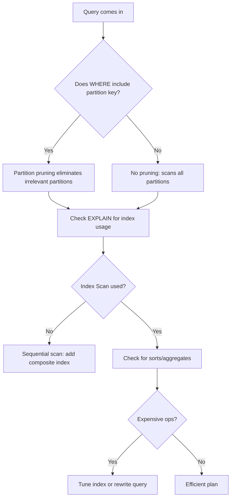

| Difficulty | Channel | Tags |
|---|---|---|
| intermediate | database | explain, query-plan, partitioning |

Picture this: your data is growing at breakneck speed, so you do the smart thing. You partition your massive table to keep things fast and manageable. But to your horror, the queries that should be blazing are still crawling. This exact scenario played out at Stripe [1], where their multi-TB ledger had to be tamed without sacrificing the snappy tail latencies their finance workflows demanded.

---

> ### Real-World Case — Stripe
>
> Stripe's core relational data (billions of charge, payout, and ledger rows) was growing into the multi-TB range on PostgreSQL. To keep writes, deletes (archival), and vacuum manageable, they moved large, append-heavy tables to declarative date-based partitioning. After partitioning, many operational and reporting queries that filtered by a date range were still unexpectedly slow, despite expecting partition pruning to drastically shrink the scanned set.
>
> | | |
> |---|---|
> | **Challenge** | Diagnosing and fixing slow date-range queries on a 100M+ row partitioned PostgreSQL table where naive partitioning alone was not delivering the expected latency/cost improvements. |
> | **Solution** | Stripe used EXPLAIN (ANALYZE, BUFFERS) to verify actual partition pruning and index usage per query. They ensured predicates matched the partition key boundaries to allow pruning, created partition-scoped composite indexes that included the secondary filter columns (e.g. (event_date, status/account_id) aligned to common WHERE clauses), avoided selecting unnecessary columns to enable index-only scans where possible, and restructured queries to prevent planner regressions (e.g. avoid functions that could inhibit pruning or index selectivity). This treated each partition as its own indexed table and optimized the access path to the minimal set of partitions and blocks. |
> | **Outcome** | Partitioning combined with targeted indexing and EXPLAIN-driven tuning materially reduced tail latencies for critical operational queries and made large historical range scans tractable at Stripe's scale (multi-billion row, TB-scale tables), enabling predictable performance for finance/ledger workloads while also making archival and vacuum operations far cheaper and safer in production. |
> | **Lesson** | Partition pruning is necessary but not sufficient: you must verify it with EXPLAIN (ANALYZE, BUFFERS), and you need the right per-partition composite indexes (covering the full predicate + ideally the projection) so that each accessed partition does an index scan (preferably index-only) rather than a heap scan. Alignment between partition key, query predicates, and index key order is the difference between "fast by date" and "still slow." |

---

## Hook — The False Promise of Partitioning

It is a rite of passage for every backend engineer. When a table crosses into the tens or hundreds of millions of rows, someone inevitably whispers the word: "partitioning". You might think that splitting data by date will magically make every range scan lightning fast. But here is the thing though - partitioning is not a performance silver bullet. It is an organizational tool. If you treat it as a free speed boost, you will be in for a rude awakening [2].

## Problem — Why Are Your Range Queries Still Slow?

The culprit is almost always a mismatch between expectation and reality. Partitioning can reduce the amount of data scanned, but only if your query allows the planner to actually do so. Many developers discover this the hard way when EXPLAIN shows the database still touching dozens of partitions. The stakes are high: at Stripe's scale, unpredictable query times meant headaches for mission-critical ledger and payout workloads [1]. So what exactly should you be looking for?

## Real-World Case — Stripe

In their push to scale PostgreSQL to billions of rows across multi-TB tables, Stripe adopted declarative date-based partitioning for append-heavy tables to make archival, deletes, and vacuum operations far cheaper and safer [1]. The payoff was huge: targeted indexing combined with EXPLAIN-driven tuning materially reduced tail latencies for critical operational queries and made large historical range scans tractable. The lesson? Partitioning lays the groundwork, but the real magic comes from verification and optimization [2].

## Deep Dive — Reading Between the Lines of EXPLAIN

To tame these queries, you need to interrogate the query plan. First, verify partition pruning is actually working. With declarative partitioning, the planner should eliminate irrelevant child tables before execution [2][3]. If you see 'Append' touching every partition, pruning failed. Next, look at index utilization. A partition key filter is only half the battle - if your other predicates aren't covered, you will fall back to scans [4]. Finally, watch for expensive sorts, hash aggregates, or bad row estimates. These often indicate missing composite indexes or poor correlation between columns [5].

## Workflow — A Methodical Approach

When facing a sluggish range query, resist the urge to guess. Instead, follow this battle-tested workflow: (1) Measure with EXPLAIN (ANALYZE, BUFFERS) to see actual runtime, I/O, and which partitions are scanned [6]. (2) Confirm pruning by checking 'Subplans Removed' or partition nodes - if none are pruned at execution time, your WHERE clause likely doesn't match the partition key [2]. (3) Inspect index usage on the remaining partitions. If you see sequential scans, consider a composite index on (partition_key, filtered_columns) [4]. (4) Optimize by creating targeted indexes (using CONCURRENTLY on busy systems), and if appropriate, cluster or rewrite the query to be index-friendly [5]. The diagram below visualizes this diagnostic journey.

## Code Example — Putting Theory Into Practice

Theory only goes so far. Let's apply this workflow to the classic events table partitioned by event_date. The query filters by a date range and status - a common pattern that often breaks if not indexed properly.

## Lessons Learned — From the Trenches

After debugging this pattern many times, here is what works: Always measure before optimizing - EXPLAIN (ANALYZE, BUFFERS) is your truth serum [6]. Ensure your filter includes the partition key; without it, pruning is dead on arrival [2]. Create composite indexes that cover your selective predicates, preferably leading with the partition key for maximum benefit [4][5]. Use CONCURRENTLY when creating indexes in production to avoid locking writes [5]. And finally, remember: partitioning reduces scan scope, but good indexing reduces I/O within those partitions. Master both, and you will avoid the false promise that so many developers fall for.

---

## PostgreSQL Partition Query Optimization Flow

<strong>Original Interview Question</strong>

**Q:** You have a PostgreSQL table with 100M rows partitioned by date. A query filtering on a specific date range is still slow. What would you check in the EXPLAIN plan and how would you optimize it?

**A:** Check partition pruning effectiveness, index utilization patterns, and expensive sort operations. Create composite indexes on (date, filtered_columns) and evaluate clustering strategies for optimal data access.

## Conclusion

Partitioning alone won't save a slow query. Like Stripe learned at scale [1], success comes from pairing smart data organization with ruthless verification. So tomorrow, before you add another partition, run EXPLAIN (ANALYZE, BUFFERS). Verify pruning. Check your indexes. That one habit will save you countless hours of guesswork.

---

## References

1. [Stripe incident report](https://stripe.com/blog/partitioning-stripe-s-data) — article
2. [PostgreSQL 16 Documentation: Table Partitioning](https://www.postgresql.org/docs/16/ddl-partitioning.html) — documentation
3. [PostgreSQL 16 Documentation: Partition Pruning](https://www.postgresql.org/docs/16/ddl-partitioning.html#DDL-PARTITION-PRUNING) — documentation
4. [PostgreSQL 16 Documentation: Indexes on Partitioned Tables](https://www.postgresql.org/docs/16/ddl-partitioning.html) — documentation
5. [PostgreSQL 16 Documentation: Partition Maintenance and Best Practices](https://www.postgresql.org/docs/16/ddl-partitioning.html#DDL-PARTITIONING-DECLARATIVE-BEST-PRACTICES) — documentation
6. [PostgreSQL 16 Documentation: Using EXPLAIN](https://www.postgresql.org/docs/16/using-explain.html) — documentation
7. [PostgreSQL 16 Documentation: EXPLAIN ANALYZE](https://www.postgresql.org/docs/16/using-explain.html#USING-EXPLAIN-ANALYZE) — documentation
8. [PostgreSQL Performance: Partitioning](https://www.postgresql.org/docs/16/ddl-partitioning.html) — documentation

---

**Author:** Satishkumar Dhule — [GitHub](https://github.com/satishkumar-dhule) · [LinkedIn](https://linkedin.com/in/satishkumar-dhule) · [Website](https://satishkumar-dhule.github.io)
