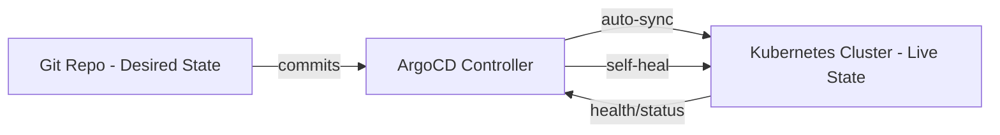

| Difficulty | Channel | Tags |
|---|---|---|
| beginner | devops | argocd, flux, declarative |

It was the kind of problem every engineering leader dreads: scale without guardrails. At Intuit, giving thousands of developers direct cluster access and letting pipelines push changes imperatively was proving unmanageable [1]. With no single source of truth, configuration drift crept in, rollbacks became tribal knowledge, and the cost of shipping safely was skyrocketing. This is the story of how one platform team discovered that the path to scale isn't more access—it's automated reconciliation from Git.

---

> ### Real-World Case — Intuit
>
> Intuit migrated thousands of microservices (TurboTax, QuickBooks, Credit Karma) to Kubernetes across hundreds of clusters, but found that giving developers direct kubectl access and letting CI pipelines push imperatively to clusters was unmanageable at scale—no audit trail, config drift between environments, and rollbacks requiring tribal knowledge. They needed a way for 4,000+ developers to ship to production safely without becoming Kubernetes experts.
>
> | | |
> |---|---|
> | **Challenge** | Managing application delivery for thousands of microservices across 100+ (eventually nearly 400) Kubernetes clusters while eliminating the risks of imperative kubectl-based deployments: drift, untracked changes, and unsafe access patterns. |
> | **Solution** | Intuit built Argo CD internally (then open-sourced it as a CNCF project): a declarative GitOps controller where Git is the sole source of truth. Their CI pipeline (12K+ Jenkins jobs/day) has zero credentials to Kubernetes clusters—it only commits image tag updates to a per-service deployment repo. Argo CD's Application CRDs continuously reconcile live cluster state with Git manifests, with auto-sync and self-healing that automatically reverts any out-of-band kubectl changes. |
> | **Outcome** | Argo CD reconciles ~150 applications in under 5 seconds (down from minutes); by 2019 it managed 1,500+ apps across 100+ clusters, and by 2021 thousands of applications across nearly 400 clusters. The Jenkins CI pipeline has no cluster access at all—every deployment flows through Git commits alone. |
> | **Lesson** | The plot twist: Intuit isn't a software company—they built Argo CD purely out of operational necessity and open-sourced it, and it became the de facto CNCF-standard GitOps tool. Their most counterintuitive win was giving CI pipelines *no* cluster credentials whatsoever: by forcing every change through a Git commit, they made deployments fully auditable, rollback became 'git revert,' and self-healing made imperative drift impossible to sustain. |

---

## Hook — When Scale Breaks Your Deployment Model

Everyone said give developers kubectl access. At Intuit, they learned that at massive scale, this creates chaos, not velocity [1]. With 4,000+ engineers shipping to hundreds of clusters, what felt like empowerment became a liability: no audit trail, environments drifting apart, and recovering from mistakes depending on who happened to remember the fix. The stakes are clear—safe delivery shouldn't depend on institutional memory.

## Problem — The Perils of Imperative Deployments

Many teams start by running kubectl apply in CI or letting engineers push directly to clusters. That imperative approach feels fast, but it sidesteps version control as the source of truth [2]. When changes bypass Git, tracking who changed what, when, and why becomes guesswork. Rollbacks turn into manual archaeology, drift accumulates between dev/staging/prod, and security/compliance reviews lack the evidence they need [3]. Sound familiar? If this feels overwhelming, you're not alone—these are symptoms of missing reconciliation.

## Real-World Case — Intuit

At Intuit, TurboTax, QuickBooks, and Credit Karma run on thousands of microservices across hundreds of Kubernetes clusters [1]. Direct cluster access and imperative CI pushed the system past what humans could safely manage. Argo CD changed the equation: it now reconciles ~150 applications in under five seconds (down from minutes). By 2019 it managed 1,500+ apps across 100+ clusters, and by 2021 thousands of applications across nearly 400 clusters [1]. Most importantly, the Jenkins CI pipeline has no cluster access at all—every deployment flows through Git commits alone [1].

## Deep Dive — Declarative State and Continuous Reconciliation

The solution is to declare the desired state in Git and let a controller continuously reconcile reality against it [3][4]. In a declarative model, manifests/Helm/Kustomize define what the cluster should look like; ArgoCD watches Git and ensures the live state matches [5]. This provides a single source of truth, full auditability via commits, and automated self-healing that reverts unauthorized manual changes. Imperative workflows, by contrast, issue commands that modify state directly and lack a continuous feedback loop [4]. The key insight: reconciliation is what prevents drift at scale.

## Workflow — How ArgoCD Keeps Clusters in Sync

Here's how you can operationalize this safely. First, define your desired state in a Git repo using manifests, Helm charts, or Kustomize [5]. Next, create an ArgoCD Application CRD that points to that repo and target namespace [5]. Enable auto-sync with a sensible health check interval (commonly 3 minutes) so changes flow automatically when Git updates [5]. Finally, enable self-healing to automatically revert any manual deviations from desired state [5]. As shown in the architecture diagram, Git remains the source of truth; ArgoCD continuously reconciles the cluster state back to it.

## Code Example — Defining an ArgoCD Application

The ArgoCD Application Custom Resource is the declarative contract: it tells ArgoCD where your manifests live, which branch/path to track, and what to sync [5]. The example below shows a minimal production-friendly setup with automated sync and self-healing enabled, plus a prune policy to clean up removed resources.

## Lessons Learned — What You Should Do Tomorrow

You don't need to boil the ocean to get benefits. Start by treating Git as the only way to change production-state definitions [1][3]. Prefer declarative manifests/Helm/Kustomize over ad-hoc kubectl runs [4]. Use auto-sync with self-healing and automated health checks to reduce toil while maintaining safety [5]. Most importantly, align your CI so it never has write access to clusters—let the reconciler enforce the source of truth [1]. Do this, and you stop fighting drift and start shipping with confidence.

---

## GitOps Reconciliation with ArgoCD

<strong>Original Interview Question</strong>

**Q:** You're setting up GitOps for a microservices deployment. How would you configure ArgoCD to automatically sync changes from your Git repository to Kubernetes, and what's the difference between declarative and imperative approaches in this context?

**A:** I'd configure ArgoCD by setting up a Git repository containing Kubernetes manifests or Helm charts, creating an Application CRD that points to the Git repository, enabling auto-sync with a health check interval of 3 minutes, and implementing self-healing to automatically revert any manual changes. The declarative approach involves defining the desired state in Git through YAML manifests, Helm charts, or Kustomize configurations, where ArgoCD continuously reconciles the actual state with the desired state. In contrast, the imperative approach uses kubectl commands to make direct changes to the cluster, bypassing the Git repository as the single source of truth.

## Conclusion

The journey is clear: from chaos to control. At scale, you don't win by pushing harder—you win by reconciling continuously. Treat Git as your single source of truth, declare desired state, and let ArgoCD do the heavy lifting. Tomorrow, take one small step: move one service's deployment to be Git-driven with auto-sync. You'll sleep better knowing the reconciler has your back.

---

## References

1. [Intuit incident report](https://www.redhat.com/en/about/press-releases/red-hat-and-intuit-join-forces-argo-project-extending-gitops-community-innovation-better-manage-multi-cluster-cloud-native-applications-scale) — article
2. [Kubernetes API Overview](https://kubernetes.io/docs/concepts/overview/kubernetes-api/) — documentation
3. [GitOps Principles](https://www.gitops.tech/) — documentation
4. [Kubernetes - Imperative vs Declarative](https://kubernetes.io/docs/tasks/manage-kubernetes-objects/) — documentation
5. [ArgoCD Documentation](https://argo-cd.readthedocs.io/en/stable/) — documentation

---

**Author:** Satishkumar Dhule — [GitHub](https://github.com/satishkumar-dhule) · [LinkedIn](https://linkedin.com/in/satishkumar-dhule) · [Website](https://satishkumar-dhule.github.io)
