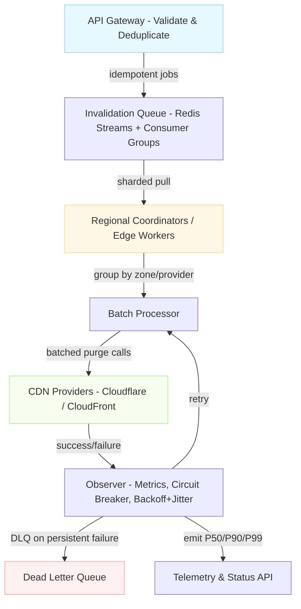

| Difficulty | Channel | Tags |
|---|---|---|
| intermediate | system-design | edge, caching, purging |

For years, Cloudflare watched every global cache invalidation crawl through a single choke point: its central 'core' data centers. As demand scaled to millions of purges per day, end-to-end latency ballooned to ~1,570ms P50 with worst-case times nearing 7 seconds [1]. This is the story of how a seemingly 'simple' cache clear became one of the hardest distributed systems problems to solve — and what you can learn from it to hit a sub-5 second SLA without breaking the bank.

---

> ### Real-World Case — Cloudflare
>
> Cloudflare's cache purge system was over a decade old and routed every invalidation through central 'core' data centers for authorization before fanning out to 330+ cities. As customer growth exploded — thousands of customers calling the purge API millions of times a day — the core became a bottleneck, purge history storage ate into cache disk space, and Kafka buffering added latency. Global purge latency sat at ~1,570ms P50, with worst-case completion near 7 seconds.
>
> | | |
> |---|---|
> | **Challenge** | Propagate cache invalidations globally within a tight SLA while handling millions of purge requests per day across 330 data centers in 120+ countries — without the central core becoming a single point of failure, and without purge-key storage crowding out cached content. |
> | **Solution** | Cloudflare built 'coreless purge': a purge request enters the nearest data center, where a Cloudflare Worker does auth and filtering, then hands off to a Durable Object that queues and broadcasts it via regional 'fanout' workers to every data center. Per-machine CacheDB (Rust on RocksDB) indexes cached files and executes active purges from local queues, replacing lazy expiry. They also discovered >50% of incoming purge requests targeted URLs the zone couldn't even cache and filtered those out before broadcast. |
> | **Outcome** | Global purge latency dropped from 1,570ms to 149ms P50 — a 90.5% improvement (some regions 89%). The fanout worker alone cut end-to-end latency 50% and tripled throughput. CacheDB reduced storage requirements 10x by eliminating lazy-purge accumulation. Single-file purge now runs at 234ms P50 across all 330 cities, and all purge methods were opened to every plan tier in 2025. |
> | **Lesson** | The counterintuitive win: the biggest performance gain came not from faster broadcasting but from doing less work — filtering out >50% of useless purge requests up front — and from decentralizing away from a core bottleneck entirely. Also, 'lazy' invalidation that seems fast actually creates a hidden storage tax that eventually throttles the whole system. |

---

## Hook — The 3 AM Pager

Picture this: you just deployed a critical security patch across your global application. Users are still seeing the vulnerable asset because it's cached in over 330 edge locations around the world. Every second counts. You hit 'purge all' and watch the clock tick... 1 second... 2... 5... still not done. Sound familiar? Many developers think 'just delete the key' until they learn that at global scale, invalidation is an exercise in distributed coordination, not a local DELETE statement.

## Problem — When 'Clear Cache' Becomes a Bottleneck

You might assume purging a CDN is trivial. After all, you tell the provider 'remove these files' and it disappears. However, the moment you operate across multiple regions, multiple CDN providers, and 10,000+ invalidations per second, the illusion falls apart. Cross-region fan-out, provider API rate limits, authorization checks, and audit history all compete for the same resources. The result is queueing delay, cascading timeouts, and inconsistent propagation. Without deliberate architecture, your 'instant' purge becomes a slow, expensive, and brittle operation. This is precisely the class of challenge that forces teams to rethink their control plane for the edge [2][5].

## Real-World Case — Cloudflare

Cloudflare's purge path was over a decade old. Every invalidation was routed through central core data centers for authorization before fanning out to 330+ cities. As customer growth exploded, the core became a bottleneck. Purge history storage began consuming cache disk space, and Kafka buffering added its own latency. The numbers told the story: global purge latency sat at ~1,570ms P50, with worst-case completion near 7 seconds [1]. The fix was ruthless simplification. By decentralizing authorization, eliminating lazy-purge accumulation with CacheDB, and moving fan-out to dedicated workers, Cloudflare dropped P50 global purge latency to 149ms — a 90.5% improvement. Single-file purge reached 234ms P50 across all cities, and throughput tripled. Most notably, every purge method was opened to all plan tiers in 2025 [1].

## Deep Dive — The Sub-5-Second Mandate

To reliably hit <5 seconds of global propagation while absorbing 10,000 concurrent invalidations per second, you need to optimize for four forces simultaneously: **throughput**, **propagation latency**, **consistency**, and **cost**. First, you must avoid synchronous round-trips to a single global authority for every request. Decentralized coordination — pushing work to edge workers or regional coordinators — removes the 'core' bottleneck [1][6]. Second, respect provider constraints. CDNs like AWS CloudFront and Cloudflare enforce per-zone and per-account rate limits; batching multiple paths into one API call is often the difference between 90% cheaper bills and provider throttles [3][6]. Third, treat invalidation as idempotent, replayable work. Durable queues (e.g. Redis Streams with consumer groups) let you absorb spikes, retry on failure, and inspect history without polluting your hot cache disks [4]. Finally, choose your freshness tradeoffs intentionally. A short TTL (e.g. 2 seconds) on dynamic content buys you an automatic 'escape hatch' for missed purges, reducing the blast radius of partial failures while still feeling 'live' to users [2][5].

## Workflow — From Request to Global Propagation

Building on these principles, a battle-tested workflow looks like this: (1) **Accept** — your API gateway validates and deduplicates incoming purge requests (paths, tags, or patterns). (2) **Enqueue** — write idempotent jobs into a durable, sharded invalidation queue. Redis Streams with consumer groups provide at-least-once delivery and horizontal scaling for 10K/sec bursts [4]. (3) **Fan-out** — regional coordinators or edge workers pull jobs and group them by affected zones/providers. This is the 'instant purge' fan-out pattern that removed Cloudflare's core dependency [1][6]. (4) **Batch & call** — call provider purge APIs in batches (e.g. 100 files per request) to maximize throughput and minimize cost [3][6]. (5) **Observe & retry** — track success per region/provider with circuit breakers, exponential backoff + jitter, and a dead-letter queue for manual review [7][8]. (6) **Signal completion** — emit metrics (P50/P90/P99 propagation) and confirmation to callers. Keep dynamic TTLs short (2s) and use `Cache-Control: max-age=2, must-revalidate` so clients revalidate gracefully on any residual staleness [2][5]. The architecture below visualizes this end-to-end flow.

## Code Example — Resilient Batch Purge with Backoff

Theory only gets you so far. You need code that survives provider 429s, network blips, and partial regional failures. The following TypeScript example demonstrates a pragmatic approach: batch paths into chunks, call the Cloudflare purge API, wrap calls with exponential backoff + jitter, and short-circuit with a circuit breaker. It's not a toy — it's the kind of 'production guardrail' you'd add around any third-party API to hit a strict SLA.

## Lessons Learned — What to Do Differently Tomorrow

After tracing this journey from 7-second worst-case purges down to ~150ms P50, a few lessons stand out. First, **remove central choke points** — if every write must pass through one global service, you'll hit its ceiling. Push fan-out to the edge or to region-local coordinators [1][6]. Second, **batch aggressively** — provider APIs are your currency; batching can slash call volume by an order of magnitude and directly cut cost [3][6]. Third, **design for failure** — circuit breakers, jittered backoff, idempotency keys, and DLQs aren't 'nice to haves', they're required to stay available at 10K/sec [7][8]. Fourth, **don't fight physics** — combine proactive invalidation with a short TTL and `must-revalidate` to guarantee eventual freshness without demanding perfection [2][5]. Finally, **measure what matters** — track P50/P90/P99 per region, not just global averages. If this feels overwhelming, you're not alone. But with these patterns in your toolbox, you'll spend less time staring at a ticking clock, and more time shipping safely to users worldwide.

---

## Sub-5s Global CDN Invalidation Flow

<strong>Original Interview Question</strong>

**Q:** How would you design a multi-region CDN cache purging system that guarantees content propagation within 5 seconds while handling 10,000 concurrent invalidations per second?

**A:** Implement Cloudflare API + AWS CloudFront with distributed invalidation queue, edge compute coordination, and 2-second TTL. Use batch invalidation, exponential backoff, and regional cache headers for 5-second SLA.

## Conclusion

The real lesson isn't 'delete faster' — it's 'coordinate smarter'. By removing central choke points, batching provider calls, embracing short TTLs with must-revalidate, and hardening with circuit breakers and jittered backoff, you transform cache purging from a ticking time bomb into a predictable, cost-efficient pipeline. Don't wait for your own 3 AM page to prove it: add these guardrails to your purge path today, instrument P50/P90/P99 per region, and you'll ship with confidence knowing your users see the right content in seconds, not seven.

---

## References

1. [Cloudflare incident report — Instant Purge](https://blog.cloudflare.com/instant-purge/) — blog
2. [MDN — Cache-Control](https://developer.mozilla.org/en-US/docs/Web/HTTP/Headers/Cache-Control) — documentation
3. [AWS CloudFront — Invalidating files](https://docs.aws.amazon.com/AmazonCloudFront/latest/DeveloperGuide/Invalidation.html) — documentation
4. [Redis — Streams introduction](https://redis.io/docs/latest/develop/data-types/streams/) — documentation
5. [RFC 7234 — Hypertext Transfer Protocol (HTTP/1.1): Caching](https://datatracker.ietf.org/doc/html/rfc7234) — paper
6. [Cloudflare — Purge cache](https://developers.cloudflare.com/api/operations/zone-purge) — documentation
7. [Martin Fowler — Circuit Breaker](https://martinfowler.com/bliki/CircuitBreaker.html) — blog
8. [AWS Builders Library — Timeouts, retries, and backoff with jitter](https://docs.aws.amazon.com/whitepapers/latest/reliability-pillar/timeout-retries-and-backoff-with-jitter.html) — documentation

---

**Author:** Satishkumar Dhule — [GitHub](https://github.com/satishkumar-dhule) · [LinkedIn](https://linkedin.com/in/satishkumar-dhule) · [Website](https://satishkumar-dhule.github.io)
