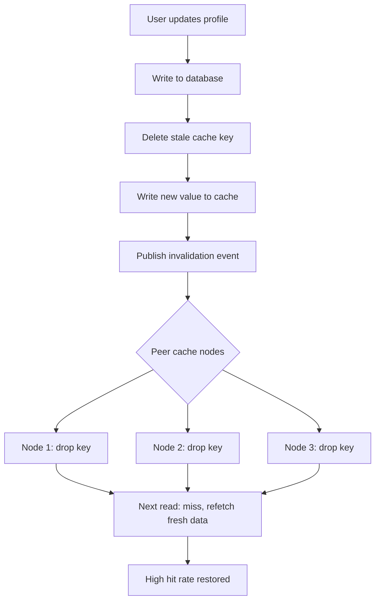

| Difficulty | Channel | Tags |
|---|---|---|
| beginner | backend | redis, memcached, cache-invalidation |

Picture this: a profile update happens, and within milliseconds it must ripple across thousands of cache nodes spanning multiple data centers — without stalling reads or hammering the database. Facebook (Meta) built exactly that for its social graph, and in production only about 4% of delete invalidation messages actually removed cached data [1]. That single statistic reveals something most developers get wrong about cache invalidation: the hard part isn't deleting keys, it's coordinating deletes efficiently across a distributed system. Let's unpack how they did it, and what it means for your profile service.

---

> ### Real-World Case — Facebook (Meta)
>
> Facebook needed to serve low-latency reads for billions of user profiles and social graph objects across thousands of servers in multiple data centers. With a write-through caching model, any profile update had to be reflected across many distributed cache nodes without sacrificing availability or overwhelming the database.
>
> | | |
> |---|---|
> | **Challenge** | Implementing reliable distributed cache invalidation at massive scale where updates must propagate to all relevant cache replicas after database commits, while keeping the system simple and resilient to network/datacenter failures. |
> | **Solution** | Facebook built their distributed cache on Memcached and implemented a custom invalidation pipeline. On profile/object updates, SQL statements were augmented with the memcache keys to invalidate; after transaction commit, invalidation daemons (mcsqueal) published delete requests to the appropriate frontend clusters. They deliberately chose delete-on-invalidation over update because deletes are idempotent. This is the classic trade-off: Memcached's simplicity required building manual coordination/invalidation infrastructure, whereas Redis would offer native pub/sub mechanisms for distributed invalidation out of the box. |
> | **Outcome** | The system scaled to serve billions of requests per second across the social graph. In production measurements, only about 4% of delete invalidation messages actually resulted in removing cached data (showing most keys were already evicted or not present) - a concrete efficiency metric from their deployment. The architecture achieved extreme scale while maintaining high cache hit rates and read-after-write semantics within a cluster. |
> | **Lesson** | At hyperscale, the choice between Redis and Memcached is often architectural: Redis provides richer primitives (pub/sub, persistence) that simplify distributed invalidation logic, while Memcached's minimalism pushes teams to build custom, highly optimized invalidation pipelines tailored to their workload. |

---

## Hook — The Stale Profile That Nobody Could Explain

It was 3am when a support ticket flagged something weird: users were updating their display names, but half the app still showed the old one. Sound familiar? The database was correct. The API returned fresh data. Yet somewhere between the write and the read, a cached copy was lying — and nobody could say which node still held it. This is the cache invalidation problem in its rawest form. Every team that adds a cache inherits this debt, and the interest compounds with every server you add. The scary part: most teams only discover the depth of the problem after stale data reaches real users.

## Problem — Why Invalidating a Single Key Across a Cluster Is Hard

At its core, the challenge deceptively simple on one machine: delete the key, write the new value, done. However, profile services are never single-machine. You might run cache-aside reads across dozens of application servers, each with its own connection pool to Redis or Memcached, potentially fronting shards spread across availability zones. A profile update on server A must invalidate a key that server B, C, and D may have just re-populated with stale data — and there is no coordination primitive built into basic key-value stores. Consequently, teams hit a three-way tension: consistency (never serve stale profiles), availability (never block profile writes on cache health), and latency (never add a synchronous fan-out that tanks your p99). Every design choice below is a negotiation between those three forces. The stakes are concrete: a social graph serving billions of requests per second cannot afford a thundering herd of re-reads hammering the database the moment a popular profile's TTL expires.

## Real-World Case — Facebook's Distributed Invalidation at Scale

Facebook faced precisely this problem: serving low-latency reads for billions of user profiles and social graph objects across thousands of servers in multiple data centers. With a write-through caching model, any profile update had to be reflected across many distributed cache nodes without sacrificing availability or overwhelming the database [1]. Their system scaled to serve billions of requests per second across the social graph, achieving high cache hit rates and read-after-write semantics within a cluster. The counterintuitive discovery? In production measurements, only about 4% of delete invalidation messages actually resulted in removing cached data [1] — most keys had already been evicted or were never present on that node. This plot twist reframes the entire problem: invalidation traffic is overwhelmingly redundant, so the winning strategy is not to make deletes perfectly precise, but to make them cheap, asynchronous, and forgiving. Facebook's engineering write-up of this architecture is a public lesson in building for the failure modes you cannot fully predict.

## Deep Dive — Redis vs Memcached: The Real Trade-offs

Building on Facebook's insight, the tooling choice now matters less than you might think — and more than you'd expect. The pattern you choose (write-through with delete-on-update and a sensible TTL of 5–30 minutes for profiles) is portable; the coordination mechanism is not. Here is the real tradeoff:

| Dimension | Redis | Memcached |
|---|---|---|
| Distributed invalidation | Built-in pub/sub: publish on update, every node unsubscribes stale keys automatically | Manual coordination — you bolt on a message bus yourself |
| Persistence | RDB/AOF snapshots survive restarts [2] | No persistence; cache is purely ephemeral |
| Data structures | Hashes, sorted sets, Lua scripting for complex invalidation logic [3] | Flat key-value strings only |
| Memory overhead | Higher per-key overhead, richer features | Lower overhead, leaner for pure caching [4] |
| Horizontal scaling | Cluster mode with hash slots [5] | Consistent hashing, famously simple sharding [4] |
| Best when | You need coordinated invalidation and durability | You want the simplest possible pure-read cache |

Many developers assume Redis is automatically the answer, but actually the decision hinges on one question: do you need the cache to *participate* in invalidation, or just *store* values? Redis's pub/sub lets a single profile-write event fan out to every subscriber node, which is exactly the automation Memcached lacks [3]. On the flip side, Memcached's smaller footprint and no-persistence model means less operational surface — if your TTLs are short and your data is reconstructable, that simplicity is a feature. 🔥 Hot take: for a beginner-scale profile cache, Memcached plus a short TTL will work fine; Redis earns its complexity the moment you need read-after-write guarantees or clustered invalidation.

## Workflow — Write-Through Invalidation, Step by Step

Here is the end-to-end flow that keeps profile reads fresh without synchronously fanning out across the cluster. The Mermaid diagram below (labelled "Profile Update Invalidation Flow") walks through each hop: a user updates their profile, the service writes to the database first (the source of truth), deletes the stale cache key, writes the new value back, and publishes an invalidation event so peer nodes drop their local copies.



Consequently, the sequence guarantees read-after-write within a cluster: any read after the update either hits the freshly written value or misses and refetches from the database. Two implementation notes matter here. First, always delete *before* you set — otherwise a concurrent reader can re-populate the old value between your write and your delete, silently resurrecting stale data. Second, treat the pub/sub notification as best-effort: pair it with TTLs (5–30 minutes) as a safety net so a dropped message self-heals within minutes rather than persisting indefinitely [1]. This is the practical compromise Facebook's 4% statistic validates — belt and suspenders, where the TTL is the suspenders.

## Code Example — Production-Style Write-Through Cache in Python

The snippet below implements the workflow: write-through on update, cache-aside on read, and pub/sub fan-out so peer nodes invalidate their local copies. It uses `redis-py`, whose synchronous client and pub/sub support mirror what you would run behind any Python service.

```python
import json
import time
import redis

# Single shared client - connection pooling is handled internally by redis-py
r = redis.Redis(host="localhost", port=6379, db=0, decode_responses=True)

PROFILE_TTL = 900  # 15 minutes: balances staleness risk vs. database load [1]
INVALIDATION_CHANNEL = "profile:invalidated"

def get_profile(user_id: str) -> dict | None:
    """Cache-aside read: fastest path hits cache, miss falls back to DB."""
    cached = r.get(f"profile:{user_id}")
    if cached:
        return json.loads(cached)          # cache hit - no database involved

    profile = fetch_from_database(user_id)  # simulate DB read
    if profile:
        # Set with TTL so a dropped invalidation message self-heals [1]
        r.set(f"profile:{user_id}", json.dumps(profile), ex=PROFILE_TTL)
    return profile

def update_profile(user_id: str, changes: dict) -> dict:
    """Write-through: DB first, then delete-then-set, then notify peers."""
    profile = write_to_database(user_id, changes)  # source of truth

    key = f"profile:{user_id}"
    # ORDER MATTERS: delete before set, otherwise a concurrent reader
    # can re-populate the stale value between these two calls
    r.delete(key)
    r.set(key, json.dumps(profile), ex=PROFILE_TTL)

    # Fan-out to peer nodes; best-effort - pub/sub has no delivery acks [3]
    r.publish(INVALIDATION_CHANNEL, user_id)
    return profile

def invalidate_locally(user_id: str) -> None:
    """Runs on every peer node subscribed to the invalidation channel."""
    r.delete(f"profile:{user_id}")

if __name__ == "__main__":
    pubsub = r.pubsub()
    pubsub.subscribe(INVALIDATION_CHANNEL)

    # Warm the cache, then update and observe the invalidation event
    print("Read:", get_profile("user:42"))
    update_profile("user:42", {"display_name": "Ada"})

    deadline = time.time() + 2
    for message in pubsub.listen():
        if message["type"] == "message":
            invalidate_locally(message["data"])
            print("Peer invalidated key for:", message["data"])
            break
        if time.time() > deadline:
            break

    print("After update:", get_profile("user:42"))
```

Walking through it: `get_profile` implements cache-aside — a hit returns in sub-millisecond time, a miss rebuilds from the database and repopulates with a TTL. `update_profile` performs the write-through sequence: database first, then delete-then-set (that ordering is the classic battle scar — get it wrong and stale values resurrect), then publishes the user ID on a channel. Each peer node runs `invalidate_locally`, dropping its local copy so the next read refetches fresh data. The TTL on every `SET` is deliberate redundancy: if the pub/sub message is lost (and it can be — pub/sub is fire-and-forget [3]), the entry expires naturally within 15 minutes. That is the same belt-and-suspenders philosophy behind Facebook's 4% observation [1]: you are not chasing perfection, you are engineering graceful degradation.

## Lessons Learned — Battle Scars and What to Do Tomorrow

The journey from a 3am stale-profile ticket to a coordinated invalidation design leaves several takeaways worth pinning to your team's wiki:

- **Order your operations or pay the price.** Delete before you set; a reader racing between the two can cache stale data indefinitely.
- **TTL is your safety net, not your strategy.** Pair every pub/sub invalidation with a 5–30 minute TTL so lost messages self-heal [1].
- **Optimize for cheap, not precise.** Facebook's 4% hit rate on delete messages shows most invalidation traffic is redundant — make it asynchronous and ignore the misses [1].
- **Choose Redis when the cache must participate in coordination; choose Memcached when it just stores values [3][4].** The pattern is portable; the bus is not.
- **Monitor hit rate and p99 read latency from day one.** You cannot tune what you do not measure — a sudden hit-rate drop is your earliest stale-data warning.
- ⚠️ **Watch out:** pub/sub delivers no acknowledgements. Never let it be your *only* invalidation mechanism.
- 💡 **Insight:** if invalidation fan-out ever becomes your bottleneck, batch notifications per shard rather than per key — Facebook's production data proves most individual deletes are wasted work [1].

So what should teams do differently tomorrow? Start with cache-aside plus TTL for reads and write-through with delete-then-set for writes. Add pub/sub fan-out only when you observe cross-node staleness in production. And the one memorable insight to share with your team: **great cache invalidation isn't about never serving stale data — it's about guaranteeing stale data can't outlive its TTL.**

---

## Profile Update Invalidation Flow


<details>
<summary><strong>Original Interview Question</strong></summary>

**Q:** You're building a user profile service that caches frequently accessed profiles. How would you implement cache invalidation when a user updates their profile, and what trade-offs would you consider between Redis and Memcached?

**A:** Implement write-through caching with TTL-based expiration. On profile update, invalidate the cache by deleting the key and writing new data to both the database and cache. Redis offers pub/sub for automatic distributed invalidation, while Memcached requires manual coordination across nodes.

</details>

## Conclusion

The stale-profile mystery that opened this story is really a story about coordination, not deletion. Facebook's 4% statistic proves that at scale, invalidation is a volume problem — make your deletes cheap, asynchronous, and TTL-backed rather than perfectly precise [1]. Tomorrow, audit your profile service: confirm delete-before-set ordering, verify every cache entry carries a TTL, and check whether cross-node staleness has ever reached a user. If it has, add pub/sub fan-out; if it hasn't, resist the complexity. The memorable insight to carry forward: great cache invalidation isn't about never serving stale data — it's about guaranteeing stale data can't outlive its TTL.

---

## References

1. [Facebook (Meta) incident report](https://www.usenix.org/system/files/conference/nsdi13/nsdi13-final170_update.pdf) — article
2. [Redis persistence documentation](https://redis.io/docs/latest/operate/oss_and_stack/management/persistence/) — documentation
3. [Redis pub/sub documentation](https://redis.io/docs/latest/develop/pubsub/) — documentation
4. [Memcached wiki](https://github.com/memcached/memcached/wiki) — documentation
5. [Redis cluster specification](https://redis.io/docs/latest/operate/oss_and_stack/management/scaling/) — documentation
6. [Wikipedia: Cache invalidation](https://en.wikipedia.org/wiki/Cache_invalidation) — documentation
7. [Wikipedia: Memcached](https://en.wikipedia.org/wiki/Memcached) — documentation
8. [Wikipedia: Redis](https://en.wikipedia.org/wiki/Redis) — documentation

---

**Author:** Satishkumar Dhule — [GitHub](https://github.com/satishkumar-dhule) · [LinkedIn](https://linkedin.com/in/satishkumar-dhule) · [Website](https://satishkumar-dhule.github.io)
