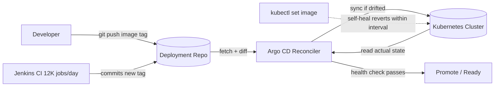

| Difficulty | Channel | Tags |
|---|---|---|
| beginner | devops | argocd, flux, declarative |

At Intuit, deployments used to be a multi-day ritual: Jenkins jobs ran raw kubectl commands against live clusters, scripts were hand-edited, and nobody could say with certainty what state production was actually in. Then Intuit acquired the startup behind Argo, open-sourced Argo CD, and rewired its platform so that CI never touches the cluster — instead, it commits image tags to Git and lets declarative reconciliation do the rest [1]. The payoff was dramatic: MTTR fell from 45 minutes to under 5, and release cycles collapsed from days to minutes. What made that possible was a deceptively simple idea — stop driving clusters with commands, and start declaring the state you want in Git.

---

> ### Real-World Case — Intuit
>
> Intuit's lift-and-shift to public cloud delivered 'only slight increases in development velocity' — teams still took days or weeks to ship releases because deployments were driven by imperative Jenkins jobs running kubectl against clusters, with manual scripts updated by hand. Intuit acquired Applatix (the startup behind Argo) and built its GitOps platform around Argo CD, the tool it open-sourced in 2018: CI never touches the cluster, instead Jenkins (12K+ jobs/day, 4,000 developers) commits new image tags to a separate deployment repo, and Argo CD Application CRDs continuously reconcile the cluster against that Git state.
>
> | | |
> |---|---|
> | **Challenge** | Deploy thousands of microservices across hundreds of Kubernetes clusters without configuration drift, lost audit trails, or multi-day rollbacks — the push-based imperative model (CI with cluster credentials running kubectl apply) had become slow, unauditable, and impossible to keep consistent across environments. |
> | **Solution** | Argo CD Applications point at per-service Git deployment repos (Helm/Kustomize overlays per environment) as the single source of truth, with automated sync and continuous reconciliation so drift is detected and reverted; crucially, the CI pipeline is stripped of all Kubernetes access, forcing every change through a Git commit. Rollbacks become git reverts rather than kubectl surgery. |
> | **Outcome** | MTTR dropped from 45 minutes to under 5 minutes; deployment cycles went from days to minutes; creating or upgrading a service takes under 10 minutes; Intuit operationalized 100+ clusters running 500 services in 2018 and grew to ~2,000 services on Kubernetes within 18 months. A notable scaling plot twist: the first production Argo CD instance (~150 apps) still took ~40 seconds from Git commit to refresh even after an upgrade, until a hidden bottleneck (per-reconciliation configmap queries) was replaced with informers, cutting reconciliation of 150 apps to under 5 seconds. |
> | **Lesson** | Declarative Git-as-source-of-truth plus pull-based reconciliation beats imperative kubectl pipelines for auditability, rollback speed, and scale — and the hard guarantee is architectural: CI that has no cluster credentials physically cannot create drift. Even the GitOps tooling itself needs engineering to scale; auto-sync at hundreds of applications exposes unexpected reconciliation bottlenecks. |

---

## Hook — The deploy looked fine. Then someone ran kubectl.

Picture a Friday afternoon. A senior engineer needs a quick config tweak in production, so they skip the pipeline and run `kubectl set image` directly. It works. The incident closes. Three days later, a routine redeploy silently wipes that change — because the cluster no longer matches what the Git repository says should exist. Nobody notices for an hour. Sound familiar? This is configuration drift, and it is the silent killer of deployment confidence. Every imperative command you run against a cluster is a small promise you make to your future self that you will remember to update Git later. You will not. The tension here is real: teams want speed, but every shortcut past version control trades speed today for debugging pain tomorrow.

## Problem — Two ways to talk to a cluster, only one remembers

Here is the core tension in every Kubernetes workflow: do you *tell* the cluster what to do step by step, or do you *describe* what the end state should be and let tooling figure out the rest? The imperative approach means typing kubectl commands — `apply`, `edit`, `set image`, `scale` — and mutating the cluster directly. It feels fast in the moment, but it bypasses your repository as the single source of truth. Changes become untracked, rollbacks become archaeology, and environments start diverging in ways no one can explain [5]. The declarative approach flips the model: the complete desired state lives in Git as YAML manifests, Helm charts, or Kustomize overlays, and a controller continuously reconciles reality toward that definition [6][7]. The stakes go beyond hygiene. In a microservices estate of hundreds of services, imperative pipelines scale badly — every manual script is another thing that breaks at 2am, and every environment that drifts is a potential outage waiting for a trigger. The question is not whether you can deploy imperatively. You can. The question is whether anyone can reconstruct what you did six months from now.

## Real-World Case — Intuit's lift-and-shift dead end

Intuit's experience is the clearest public case study of this trap. Its initial lift-and-shift to the public cloud delivered, by its own account, only slight increases in development velocity — teams still took days or weeks to ship releases, because deployments were driven by imperative Jenkins jobs running kubectl against clusters, with manual scripts updated by hand [1]. The fix came after Intuit acquired Applatix, the startup behind Argo, and built its GitOps platform around Argo CD, the tool it open-sourced in 2018. The new contract was elegant: CI never touches the cluster. Jenkins — running 12,000+ jobs a day for 4,000 developers — commits new image tags to a separate deployment repository, and Argo CD Application CRDs continuously reconcile the cluster against that Git state [1]. The numbers tell the transformation story. MTTR dropped from 45 minutes to under 5. Deployment cycles went from days to minutes. Creating or upgrading a service took under 10 minutes. Intuit operationalized 100+ clusters running 500 services in 2018 and grew to roughly 2,000 services on Kubernetes within 18 months [1]. ⚠️ Watch Out: there was a scaling plot twist worth remembering. Even after an upgrade, the first production Argo CD instance — handling around 150 apps — still took roughly 40 seconds from Git commit to refresh. The hidden bottleneck was per-reconciliation configmap queries; replacing them with informers cut reconciliation of those 150 apps to under 5 seconds [1]. Declarative does not automatically mean fast — you still have to profile the reconciler.

## Deep Dive — Declarative vs imperative, and what Argo CD actually does

Building on Intuit's story, it helps to be precise about the mechanics. An Argo CD Application CRD is nothing more exotic than a Kubernetes custom resource: a YAML object registered with the API server that describes a source (your Git repo path, revision, and chart or manifest format), a destination (cluster and namespace), and a sync policy [2][3]. Because it lives in Kubernetes, it gets the same watching, retrying, and status reporting as any Deployment or ConfigMap [6]. Two settings in that sync policy do most of the heavy lifting. Auto-sync periodically compares desired and actual state and applies differences on a configurable health check interval, typically 1 to 5 minutes [4]. Self-heal takes it further: if a human runs kubectl against the cluster and mutates a managed resource, Argo CD detects the drift and reverts it automatically [4]. That is the mechanism that makes the Friday-afternoon shortcut from the opening section self-correcting instead of silently permanent. The trade-off table looks like this:

| Dimension | Declarative (Git + Argo CD) | Imperative (raw kubectl) |
| --- | --- | --- |
| Source of truth | Git repository, versioned and reviewable | Cluster state, invisible to reviewers |
| Audit trail | Commits, PRs, blame, revert | Shell history at best |
| Drift handling | Detected and auto-reverted [4] | Accumulates until something breaks |
| Rollback | Point at a previous commit | Reconstruct commands by memory |
| Speed of a one-off | Slower (commit + sync) | Instant — and dangerous |
| Scaling to 100s of services | Reconciliation is uniform | Manual scripts multiply per service |

🔥 Hot Take: imperative kubectl is not evil — it is the right tool for debugging, for one-off exploratory changes, and for break-glass incidents. It is the wrong tool for *defining* production. The moment a command's effect should persist, it belongs in Git as a manifest, Helm chart, or Kustomize overlay [8][9]. Many developers treat declarative vs imperative as a binary religious war. Actually, they are layers: declare in Git, debug imperatively, then codify whatever you learned back into the repo.

One more nuance: Argo CD is not the only player in this space. Flux and other GitOps controllers implement the same reconciliation loop with different ergonomics [10], so the mental model transfers even if your tooling changes.

## Workflow — From commit to converged cluster in five steps

So how does this actually run day to day? The loop below is the shape of every healthy GitOps pipeline, and it is worth internalizing until it feels obvious. The flow is visualized in the diagram that follows these steps:

1. **Commit the desired state.** A developer or CI system updates the deployment repository — most commonly by bumping an image tag in a Kustomize overlay or values file. This commit is the only authorized way production changes [7].
2. **Argo CD watches the repository.** The Application CRD polls or receives a webhook, fetches the target revision, and renders the manifests into a desired-state model [3].
3. **Diff against the live cluster.** Argo CD reads the actual state from the cluster API and computes a three-way comparison against Git and the last-applied state.
4. **Sync and health-check.** If differences exist and auto-sync is enabled, Argo CD applies them, then waits for health checks to pass within the configured interval [4]. A failed health check halts promotion instead of silently rolling out a broken release.
5. **Reconcile forever.** The loop repeats every few minutes. Any manual kubectl mutation is detected as drift and reverted when self-healing is on — which is precisely the guarantee that would have saved the Friday-afternoon scenario from the opening.

🎯 Key Point: notice who never appears in that loop — a human running commands against production. The pipeline's job is to make the boring, correct path the easiest one to take.

## Code Example — A production-shaped Application CRD with auto-sync and self-heal

Here is a concrete implementation you can adapt: an Application CRD applied with kubectl, followed by the commands that verify convergence. Walk through the comments — each line encodes a decision discussed above.

```bash
#!/usr/bin/env bash
set -euo pipefail

# Step 1: Register the Application CRD with Argo CD.
# The source points at a Git repo path rendered by Kustomize;
# destination is the in-cluster API and target namespace.
cat <<'EOF' | kubectl apply -f -
apiVersion: argoproj.io/v1alpha1
kind: Application
metadata:
  name: payments-service
  namespace: argocd
  finalizers:
    - resources-finalizer.argocd.argoproj.io  # cascade-delete resources on app deletion
spec:
  project: default
  source:
    repoURL: https://github.com/acme/deployments.git
    targetRevision: main
    path: k8s/overlays/production   # desired state lives here, not in a shell
  destination:
    server: https://kubernetes.default.svc
    namespace: payments
  syncPolicy:
    automated:
      prune: true        # delete resources removed from Git (drift toward zero)
      selfHeal: true     # revert manual kubectl edits automatically [4]
      allowEmpty: false  # refuse to wipe the namespace on an empty render
    syncOptions:
      - CreateNamespace=true
    retry:
      limit: 5
      backoff:
        duration: 5s
        factor: 2
EOF

# Step 2: Block until the sync operation finishes and health checks pass.
argocd app wait payments-service --operation --timeout 60
argocd app wait payments-service --health   --timeout 120

# Step 3: Prove the loop works - drift and watch it heal.
kubectl -n payments set image deploy/payments payments=acme/payments:v9.9.9  # imperative drift
sleep 200   # within one health-check interval, selfHeal reverts this [4]
kubectl -n payments get deploy payments -o jsonpath='{.spec.template.spec.containers[0].image}'
# expected: the image tag declared in Git, not v9.9.9
```

The walkthrough: the YAML block declares the full desired state — repo, path, destination, and sync policy — and `kubectl apply` simply registers that declaration with the cluster [5]. The `automated` section is the heart of it: `prune` keeps the cluster from accumulating orphaned resources, while `selfHeal` is the mechanism that reverses unauthorized imperative changes on the next reconciliation [4]. The `argocd app wait` calls turn async reconciliation into a verifiable gate, so a pipeline can fail loudly instead of hoping. Finally, the drift test deliberately runs the imperative command from the opening story and demonstrates that it no longer wins: within one health-check interval, the cluster snaps back to Git. That single behavior is the difference between a GitOps platform and a Git-shaped documentation folder.

## Lessons Learned — What to steal from Intuit's playbook

The journey from imperative scripts to declarative reconciliation is really a journey from hoping your cluster matches your intent to *knowing* it does. Pulling the threads together:

- **Make Git the only write path to production.** CI commits, Argo CD reconciles, humans review. Intuit's rule — CI never touches the cluster — is the single highest-leverage policy you can adopt [1].
- **Turn on self-heal, but after you have discipline.** Auto-sync plus self-heal is powerful; enabling it while engineers still make hotfixes via kubectl just creates revert loops and confusion. Roll it out with the team, not at them [4].
- **Mind the reconciler's performance.** Intuit's 40-second-to-under-5-seconds fix came from eliminating per-reconciliation configmap queries with informers [1]. If refreshes feel slow at 150 apps, profile before you scale to 1,500.
- **Battle scar: forgetting `prune`.** Without it, deleting a resource from Git leaves it running forever — the opposite of drift correction.
- **Battle scar: no health checks.** Sync succeeds, rollout breaks. Always gate on health, not just on apply.
- **Battle scar: treating GitOps as docs.** If someone can change production without a commit, your GitOps is decorative.

If this feels overwhelming, start small: pick one non-critical service, define its desired state in a repo with an Application CRD, enable auto-sync, and watch drift heal itself for a week. What should you do differently tomorrow? Move exactly one imperative deployment step into Git. That is the whole first move. The memorable insight to share with your team is this: **your cluster's real configuration is whatever Git says it is — everything else is a rumor.**

---

## GitOps Reconciliation Loop



<details>
<summary><strong>Original Interview Question</strong></summary>

**Q:** You're setting up GitOps for a microservices deployment. How would you configure ArgoCD to automatically sync changes from your Git repository to Kubernetes, and what's the difference between declarative and imperative approaches in this context?

**A:** I'd configure ArgoCD by setting up a Git repository containing Kubernetes manifests or Helm charts, creating an Application CRD that points to the Git repository, enabling auto-sync with a health check interval of 3 minutes, and implementing self-healing to automatically revert any manual changes. The declarative approach involves defining the desired state in Git through YAML manifests, Helm charts, or Kustomize configurations, where ArgoCD continuously reconciles the actual state with the desired state. In contrast, the imperative approach uses kubectl commands to make direct changes to the cluster, bypassing the Git repository as the single source of truth.

</details>

## Conclusion

Intuit's story is the proof that the imperative habit is a scaling ceiling, not a speed boost: moving from hand-run kubectl scripts to Argo CD reconciling Git declarations cut MTTR from 45 minutes to under 5 and turned days-long releases into minutes-long ones [1]. The journey here has been from a simple question — declarative or imperative? — to a deeper realization: they are not rivals but layers, where Git declares intent, tooling enforces it, and kubectl remains a debugging instrument that can no longer quietly rewrite production. What to do differently tomorrow: take one service, define its desired state in a repository, attach an Application CRD with auto-sync and self-heal enabled, and let the reconciler prove itself for a week. The one insight to carry back to your team is short enough to remember at standup: your cluster's real configuration is whatever Git says it is — everything else is just a rumor waiting to be busted by the next deploy.

---

## References

1. [Intuit incident report](https://www.cncf.io/case-studies/intuit) — article
2. [Argo CD source repository](https://github.com/argoproj/argo-cd) — documentation
3. [Argo CD official documentation](https://argo-cd.readthedocs.io/en/stable/) — documentation
4. [Argo CD Auto Sync and Self-Heal](https://argo-cd.readthedocs.io/en/stable/user-guide/auto_sync/) — documentation
5. [Argo CD Declarative Setup](https://argo-cd.readthedocs.io/en/stable/operator-manual/declarative/) — documentation
6. [Kubernetes Objects documentation](https://kubernetes.io/docs/concepts/overview/working-with-objects/kubernetes-objects/) — documentation
7. [GitOps](https://en.wikipedia.org/wiki/GitOps) — article
8. [Helm repository](https://github.com/helm/helm) — documentation
9. [Kustomize](https://kustomize.io/) — documentation
10. [Flux CD](https://fluxcd.io/) — documentation
11. [kubectl reference](https://kubernetes.io/docs/reference/kubectl/) — documentation

---

**Author:** Satishkumar Dhule — [GitHub](https://github.com/satishkumar-dhule) · [LinkedIn](https://linkedin.com/in/satishkumar-dhule) · [Website](https://satishkumar-dhule.github.io)
