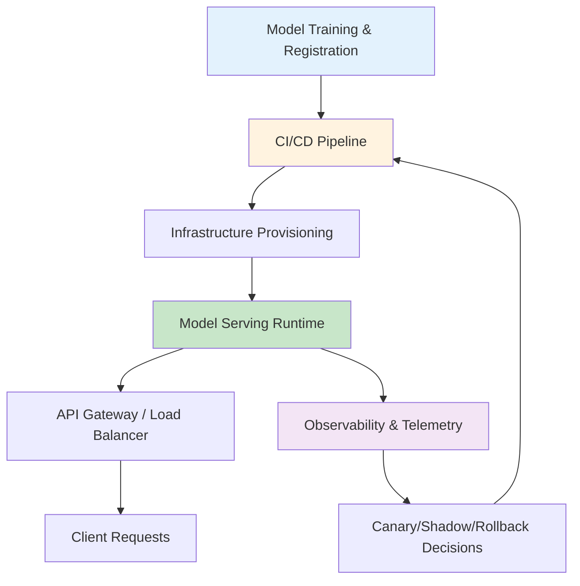

| Difficulty | Channel | Tags |
|---|---|---|
| beginner | devops | mlops, deployment |

It was the kind of scale most engineers only dream about: hundreds of ML models fielding over a million requests every second. This is exactly the reality Netflix navigated as they brought their full ML stack in-house to power everything from recommendations to commerce [1]. But with that ambition comes a question that haunts engineering teams everywhere: when you ship a model to production, are you 'deploying' it, or are you 'serving' it? The answer can be the difference between a smooth user experience and a system that buckles under pressure.

---

> ### Real-World Case — Netflix
>
> Netflix needed to serve inference for hundreds of ML and LLM models at massive scale (1M+ requests/sec) to power personalized experiences like recommendations, search, and commerce. They chose to run the full stack in-house rather than relying on hosted APIs, requiring them to unify deployment and serving across a diverse set of models and latency regimes.
>
> | | |
> |---|---|
> | **Challenge** | They needed to clearly separate model deployment (provisioning, versioning, CI/CD, rollouts, autoscaling) from model serving (runtime inference, request routing, batching, constrained decoding, low-latency responses) while supporting both traditional ML and LLMs on shared infrastructure with strict reliability and tail-latency requirements. |
> | **Solution** | Netflix built a unified platform centered around their Model Scoring Service (MSS) with NVIDIA Triton Inference Server and vLLM under the hood. Deployment is handled by a Java control plane that provisions GPU instances, manages model loading/versioning, health checks, zero-downtime upgrades, and multi-region rollouts (e.g., Kubernetes/Titus-based orchestration). Serving is handled by runtime components: MSS delegates to Triton/vLLM for inference, with context-aware routing initially via Switchboard (later evolved to a decoupled Lightbulb + Envoy to avoid single-point-of-failure and reduce hop latency). The system supports gRPC and HTTP, batch and real-time paths, and even constrained decoding implemented as batch-level C++ logits processors in vLLM V1 to avoid CPU bottlenecks. |
> | **Outcome** | The platform serves over 1M inference requests/sec across 300+ models of various types, supports multiple latency regimes on a single infrastructure, enables safe rollouts (shadow mode, canaries, instant rollback), and improves serving efficiency (e.g., on-the-fly sequence packing in post-training/serving-adjacent workflows delivering up to 4.7x throughput improvements in skewed workloads). |
> | **Lesson** | Deployment and serving are distinct concerns: deployment focuses on infrastructure, lifecycle, and safe rollout; serving focuses on runtime optimizations (batching, routing, decoding constraints, tail-latency reduction). The key architectural insight was decoupling routing metadata from the proxy path (Switchboard → Lightbulb) to preserve experimentation flexibility without creating a bottleneck. |

---

## Hook — The Hidden Cost of Getting This Wrong

Picture this: your latest ML feature just launched. Traffic is surging. Users are clicking, scrolling, and expecting that magical personalization to work instantly. Then the latency starts to creep up. What separates the teams that survive this moment from those that don't isn't just the model itself, but how they get that model into production. The stakes are enormous, because at scale, the way you move and run models can make or break the entire user experience.

## Problem — Two Worlds That Refuse to Merge

Many developers think of 'deployment' and 'serving' as interchangeable terms. But here's the thing: conflating them creates dangerous blind spots. On one side, you have the operational machinery that gets models into the right environments safely. On the other, you have the runtime machinery that answers user requests in milliseconds. These are two different disciplines with different goals, and when teams blur the lines, they often over-optimize for one while sacrificing the other. The result? Either painfully slow release cycles or APIs that crumble under unexpected load. This tension is what forces you to make deliberate trade-offs around latency, throughput, and reliability.

## Real-World Case — Netflix

This isn't theoretical. When Netflix decided to run their full inference stack in-house, they weren't just optimizing costs — they were solving for flexibility at a scale that hosted APIs couldn't match [1]. Their platform now serves over 1 million inference requests per second across 300+ models, spanning everything from lightweight ranking models to resource-hungry LLMs. To do this safely, they needed to unify deployment and serving on a single infrastructure while supporting multiple latency regimes. Most importantly, they built guardrails like shadow mode, canaries, and instant rollback to de-risk every change [1]. Even better, they found efficiency wins in unexpected places — on-the-fly sequence packing in serving-adjacent workflows delivered up to 4.7x throughput improvements on skewed workloads [1]. This is the power of treating deployment and serving as distinct, yet tightly orchestrated, systems.

## Deep Dive — Drawing the Line Between Deployment and Serving

Building on this real-world lesson, you need to understand the critical differences. **Deployment** is your delivery pipeline. It's about getting the right model artifact, code, and configuration into production safely and repeatably. This means versioning artifacts, running automated tests, spinning up infrastructure, and monitoring health across releases. Technologies like Kubernetes [2] provide the orchestration fabric, MLflow [3] helps track experiments and model lineage, and SageMaker [4] abstracts much of the infrastructure toil. Deployment is where you answer questions like: 'Can we roll this back?' and 'Is this release safe?'. **Serving**, on the other hand, is runtime execution. It's the system that loads models into memory, routes requests, and returns predictions with strict latency SLAs. Frameworks like TensorFlow Serving [5] and TorchServe [6] are purpose-built model servers, while BentoML [7] lets you package models as production-ready APIs. Serving is where you wrestle with request batching, caching, autoscaling, and cold starts. The trade-offs are very real: real-time use cases demand sub-100ms responses, while batch jobs can tolerate seconds [1]. Horizontal scaling gives you elasticity, vertical scaling unlocks GPU horsepower, and traffic splitting enables safe A/B tests. Ignore either side, and you risk building something that looks good in staging but fails in the wild.

## Workflow — Orchestrating a Safe Path to Production

So how do you bring these two worlds together? The workflow below, visualized in the diagram, shows how deployment pipelines feed into a resilient serving layer. First, you train and register your model, capturing its dependencies and metrics. Next, your CI/CD pipeline validates, packages, and promotes that artifact through environments. Then, infrastructure-as-code provisions the serving environment with the right compute. Finally, the serving runtime loads the versioned model, exposes it via APIs, and applies traffic management (canaries, shadowing) while exporting telemetry. This is the same philosophy that powers Netflix's safe rollouts [1] — where deployment and serving are decoupled enough to move fast, but coupled enough to observe and control risk.

## Code Example — Serving a Model the Right Way

Theory is useful, but code is where you see the serving layer in action. The example below shows a minimal, production-minded FastAPI application that loads a versioned model at startup, exposes a health check, and serves predictions. It mirrors serving best practices by keeping model loading separate from request handling, validating inputs, and returning structured responses. While deployment would handle packaging this service in a container and rolling it out via Kubernetes [2], this code is the heart of what actually answers user requests.

## Lessons Learned — What to Do Differently Tomorrow

If there's one lesson from Netflix's journey, it's this: you can't treat deployment and serving as an afterthought [1]. Many teams pour weeks into model accuracy only to discover production realities too late. So here's what you should do differently: **Separate concerns ruthlessly.** Your deployment pipeline should optimize for safety and reproducibility. Your serving layer should optimize for latency and resilience. **Embrace progressive delivery.** Use canaries, shadowing, and instant rollbacks — the very techniques that let Netflix move fast without breaking trust [1]. **Measure what matters.** Track p95 latency, error rates, queue depth, and model-specific metrics. These are your early warning system. **Design for failure.** Cold starts happen. GPUs get saturated. Models drift. Plan for these realities from day one. Most importantly, choose the right tools for your constraints [2][3][4][5][6][7], and always keep an eye on the trade-offs. Because in the end, the best ML system is the one your users never notice — it just works, every time.

---

## Deployment to Serving Flow

<strong>Original Interview Question</strong>

**Q:** Explain the key differences between model serving and model deployment in ML systems, including specific technologies, scaling considerations, and real-world implementation patterns?

**A:** Deployment encompasses CI/CD pipelines, infrastructure setup, and monitoring using tools like Kubernetes, MLflow, and SageMaker. Serving focuses on runtime inference APIs with frameworks like TensorFlow Serving, TorchServe, or BentoML, handling request routing, model versioning, and autoscaling. Key trade-offs include latency vs throughput, batch vs real-time inference, and cold start optimization.

## Conclusion

The journey from training to answering a million requests per second isn't about choosing deployment or serving — it's about mastering both. By treating deployment as your safety net and serving as your speed engine, you build systems that can evolve without fear. So tomorrow, before you ship your next model, ask yourself: have I designed the delivery pipeline and the runtime path to withstand the pressure? That's the question that separates good ML teams from great ones.

---

## References

1. [Netflix incident report](https://netflixtechblog.com/in-house-llm-serving-at-netflix-a5a8e799ea2c) — article
2. [Kubernetes Documentation - What is Kubernetes?](https://kubernetes.io/docs/concepts/overview/what-is-kubernetes/) — documentation
3. [MLflow Documentation](https://mlflow.org/docs/latest/index.html) — documentation
4. [Amazon SageMaker - What is SageMaker?](https://docs.aws.amazon.com/sagemaker/latest/dg/whatis.html) — documentation
5. [TensorFlow Serving Guide](https://www.tensorflow.org/tfx/guide/serving) — documentation
6. [PyTorch TorchServe Documentation](https://pytorch.org/serve/) — documentation
7. [BentoML Documentation](https://docs.bentoml.com/) — documentation
8. [etcd Documentation](https://etcd.io/docs/v3.5/) — documentation

---

**Author:** Satishkumar Dhule — [GitHub](https://github.com/satishkumar-dhule) · [LinkedIn](https://linkedin.com/in/satishkumar-dhule) · [Website](https://satishkumar-dhule.github.io)
