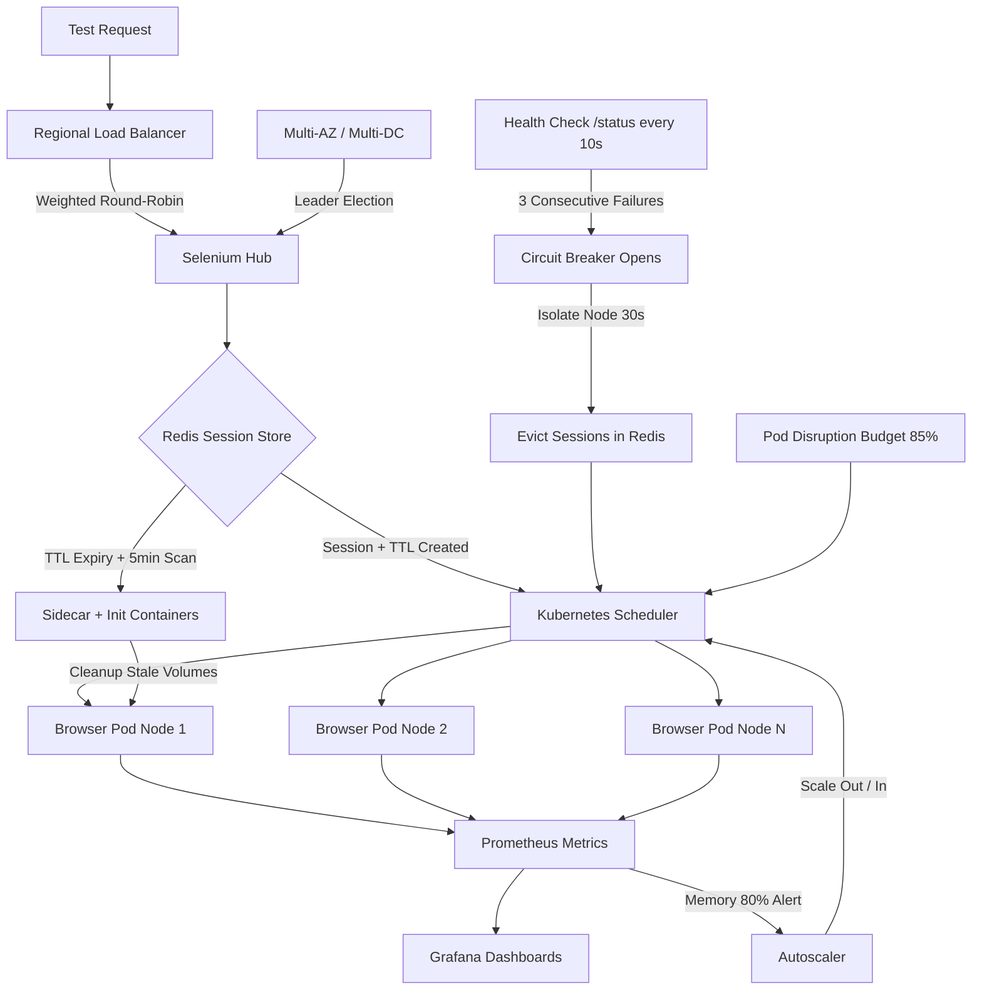

| Difficulty | Channel | Tags |
|---|---|---|
| advanced | system-design | selenium, webdriver, grid |

Picture this: 9,000 UI tests grinding across 350+ Jenkins jobs, stale browsers hanging like unflushed cache entries, and jobs that stretch into hours — all of it choking your release train. That was Expedia Group's reality until 2014, when they set a radical goal: run ALL UI automated tests within the time of the single slowest test [1]. The journey from that bottleneck to 150,000+ tests a day on a Kubernetes-powered grid is more than a case study — it's the blueprint for anyone staring down 10,000 concurrent sessions and a 99.9% uptime commitment.

---

> ### Real-World Case — Expedia Group
>
> Until 2014, Expedia ran ~9,000 UI automation tests across 350+ Jenkins jobs directly on executors, with stale browsers hanging and jobs taking hours—choking the company's release velocity. Their stated goal became radical: run ALL UI automated tests within the time taken by the single slowest test case.
>
> | | |
> |---|---|
> | **Challenge** | Scale Selenium-based UI testing to thousands of concurrent sessions across dozens of independent microservice CI/CD pipelines, while keeping cloud costs controlled and handling the operational pain of static hubs, slow node provisioning (2-4 minutes), overlapping private IP ranges across multiple AWS accounts, and resource over-allocation at the instance level. |
> | **Solution** | First they built SeleniumGridScaler (Selenium Grid + AWS EC2 API) that auto-provisioned and terminated nodes per test run, running 15 browser sessions per c5.xlarge box with per-second billing and on-demand hub shutdown. When microservices and shift-left testing outgrew EC2, they rebuilt it as DA-Kube: an EKS-based Kubernetes architecture using Docker, Helm, and Traefik, where each Git branch gets its own ephemeral Selenium Grid spun up and destroyed on demand, with Guaranteed QoS pods (one browser per pod) and warm worker node pools for reliability. |
> | **Outcome** | Scaled from 9,000 tests on Jenkins to 150,000+ tests per day across 100+ hubs, creating and terminating ~4,500 EC2 nodes daily; achieved the goal of running 1,000 UI tests in ~5 minutes; cut infrastructure cost from a projected $2.41 million/year (1,000 parallel connections from third-party cross-browser vendors) to about $80,000/year for the internal solution—a 97% savings. |
> | **Lesson** | Two counterintuitive findings: (1) Dockerizing the Selenium Hub caused stability/communication failures at high concurrency (hundreds of parallel tests)—running the hub as a plain Java process made the problem disappear, likely due to Docker's extra networking layer; (2) at scale, Kubernetes/AWS private IP reservation 'bleeds' addresses—a c5.2xlarge reserves 30 IPs but only runs 19 browser pods, wasting 234+ IPs across 26 instances and causing silent pod-creation failures. The deeper lesson: pay only for what you use with ephemeral, per-pipeline grids instead of static capacity or expensive vendor seats. |

---

## Hook — The Night the Browsers Never Died

It was the kind of morning every developer dreads: the release pipeline stalled, not because of a failing test, but because a browser from three days ago was still holding a session hostage. Sound familiar? Stale Chrome processes, orphaned WebDriver connections, a Jenkins executor queue that looks more like a waiting room at the DMV. Here is the tension — every minute a zombie session lingers, it burns memory you budgeted for real tests, and every leaked container is a tiny withdrawal from your 99.9% uptime account [2]. The stakes aren't abstract. Miss your concurrency target and features ship late; leak enough memory and the whole grid collapses under its own weight. So the question becomes: what does it actually take to run 10,000 concurrent Selenium sessions without turning your cluster into a bonfire?

## Problem — The Anatomy of a Grid That Doesn't Scale

Many developers discover the hard way that Selenium Grid scaling is not a 'throw more nodes at it' problem. The core challenge splits into four intertwined pains, and each one compounds the others:

- **Session sprawl**: 10,000 concurrent sessions mean 10,000 chances for a browser to hang, leak, or outlive its test. Without automatic lifecycle management, memory usage creeps up until nodes start OOM-killing mid-test [3].
- **Failure blast radius**: One flaky node shouldn't fail 200 sessions. Yet without circuit breakers and health checks, a single degraded host takes down everything routed to it [4].
- **Multi-datacenter complexity**: Distributing sessions across availability zones sounds great until a network partition leaves two halves of your grid each believing they're the leader [5].
- **Cost gravity**: Left unchecked, the instinct is to over-provision 'just in case' — the exact trap Expedia avoided by going internal instead of paying for 1,000 third-party parallel connections [1].

You might think the hard part is Selenium itself. It isn't. The hard part is everything around it: lifecycle, isolation, and recovery. What would it look like to treat a browser session like a cloud-native workload instead of a process that 'probably' exits?

## Real-World Case — Expedia's 97% Cost Gamble

Expedia Group's story is the clearest documented proof that grid architecture is a business decision, not just an infrastructure one. Until 2014, roughly 9,000 UI automation tests ran across 350+ Jenkins jobs directly on executors — stale browsers hung, jobs took hours, and release velocity paid the price [1].

Their stated goal was almost absurd on purpose: run ALL UI automated tests within the time taken by the single slowest test case. The transformation was staggering. They scaled from 9,000 tests on Jenkins to **150,000+ tests per day** across 100+ hubs, creating and terminating approximately **4,500 EC2 nodes daily**. The goal of running 1,000 UI tests in about **5 minutes** was met — and the financial twist? A projected **$2.41 million/year** for third-party cross-browser vendors collapsed to roughly **$80,000/year** for the internal solution: a **97% saving** [1].

The plot twist worth stealing: Expedia didn't win by buying bigger machines. They won by making session lifecycle disposable — spin up nodes, run tests, tear them down, repeat. That ephemeral mindset is exactly what the architecture below operationalizes at 10,000-session scale.

## Deep Dive — Four Pillars of a Leak-Proof Grid

Building on Expedia's ephemeral philosophy, the architecture rests on four pillars. Let's take them in order, because each one exists to contain the failure mode of the previous.

**1. Kubernetes as the scheduling brain.** A central Selenium hub pairs with browser nodes managed as StatefulSets across multiple availability zones [6]. Horizontal pod autoscaling reacts to queue depth, so when test demand spikes, nodes appear — and when it drops, they vanish [7]. Resource quotas and per-pod limits (2GB RAM, 1 CPU per node) prevent any single runaway browser from starving its neighbors [3].

**2. Redis as the session source of truth.** Sessions live in a Redis cluster with TTL-based expiration and connection pooling [8]. This is the counterintuitive move: instead of trusting processes to clean up after themselves, you let a key's TTL expire as the ultimate garbage collector. Redis scans for expired keys every five minutes, so even a crashed hub can't resurrect a ghost session [8].

**3. Prometheus for memory truth-telling.** Memory leaks don't announce themselves — they whisper. Prometheus scrapes metrics that feed Grafana dashboards tracking memory trends and session duration, with alerts firing at 80% usage before the OOM killer gets involved [9]. Weekly rolling restarts act as a belt-and-suspenders backstop.

**4. Circuit breakers and health checks for blast-radius control.** Nodes expose an HTTP /status endpoint polled every 10 seconds; three consecutive failures remove the node immediately. For the messy middle — nodes that are slow but not dead — a circuit breaker isolates them for 30-second recovery windows rather than letting requests pile up [4][10].

⚠️ **Watch Out**: The most common battle scar here is trusting a single health signal. A node can return HTTP 200 while its browser process is wedged. Correlate status checks with actual session success rates, or you'll be debugging 'healthy' nodes that fail every test.

Here's the real tradeoff, side by side:

| Approach | Pros | Tradeoff |
|---|---|---|
| Static Jenkins executors | Simple to set up | Zombie sessions, hours-long jobs, exactly Expedia's pre-2014 pain [1] |
| Kubernetes + Redis + circuit breakers | Auto-scaling, leak-proof, multi-AZ resilient | Operational complexity, needs observability from day one |

🔥 **Hot Take**: Most teams over-invest in the browser layer and under-invest in the session layer. The grid isn't the browser farm — it's the lifecycle contract around it.

## Workflow — From Queue Depth to Healthy Session in Five Steps

However, architecture diagrams don't run themselves. Here's the actual lifecycle a session travels, and it's worth tracing end to end because every step is a failure-containment boundary:

1. **A test request hits the regional load balancer**, which uses weighted round-robin based on node capacity and response time — not naive round-robin, which happily overloads the fastest-looking node [11].
2. **The hub checks the Redis session store.** If capacity allows, a session key is created with a TTL; if not, the request waits in the queue, and queue depth becomes the autoscaling signal [7].
3. **Kubernetes schedules a browser pod** with init containers that scrub stale Docker volumes before the browser ever starts — cleaning before allocating, not after leaking [3].
4. **During the test, Prometheus scrapes** memory and duration metrics every scrape interval; Grafana surfaces trends, and alerts fire at the 80% threshold [9].
5. **On completion or TTL expiry, the session is destroyed** — sidecar containers handle cleanup, and if a node fails mid-test, Pod Disruption Budgets guarantee at least 85% of capacity stays online while circuit breakers reroute traffic [5][12].

The Mermaid diagram below maps this flow visually — follow it from request to cleanup and notice how each checkpoint can fail independently without taking the grid down.

🎯 **Key Point**: Leader election across data centers is what prevents split-brain during a partition. Without it, two hubs can each believe they own the same sessions [5].

## Code Example — Building the Circuit-Breaking Health Probe

To make this concrete, here's a production-shaped Python probe that wraps Selenium node health checks with a circuit breaker — the exact mechanism that keeps one flaky node from poisoning your whole queue. It uses a rolling failure count, a 30-second recovery window, and integrates with a Redis TTL registry.

```python
import time
import redis
import requests
from dataclasses import dataclass, field
from enum import Enum
from typing import Dict, List

# --- Circuit breaker states: closed = healthy, open = isolated, half-open = probing ---
class State(Enum):
    CLOSED = "closed"
    OPEN = "open"
    HALF_OPEN = "half_open"

@dataclass
class NodeHealth:
    state: State = State.CLOSED
    failures: int = 0
    opened_at: float = 0.0
    history: List[bool] = field(default_factory=list)

class GridHealthProbe:
    """Watches Selenium nodes and isolates failures before sessions pile up."""

    FAILURE_THRESHOLD = 3   # remove node after 3 consecutive failures
    RECOVERY_WINDOW = 30    # seconds before a tripped breaker lets traffic back
    PROBE_INTERVAL = 10     # /status poll cadence

    def __init__(self, nodes: Dict[str, str], redis_client: redis.Redis):
        self.nodes = nodes  # {node_name: status_url}
        self.redis = redis_client
        self.health: Dict[str, NodeHealth] = {
            name: NodeHealth() for name in nodes
        }

    def _is_open(self, name: str) -> bool:
        """Return True if the breaker is still isolating this node."""
        h = self.health[name]
        if h.state is State.OPEN:
            if time.time() - h.opened_at >= self.RECOVERY_WINDOW:
                h.state = State.HALF_OPEN  # probe once to see if it recovered
                return False
            return True
        return False

    def _record(self, name: str, healthy: bool) -> None:
        h = self.health[name]
        h.history.append(healthy)
        if not healthy:
            h.failures += 1
            if h.failures >= self.FAILURE_THRESHOLD:
                h.state = State.OPEN
                h.opened_at = time.time()
                h.failures = 0
                # Evict live sessions routed to the bad node via TTL = 0
                self._evict_sessions(name)
        else:
            h.failures = 0
            if h.state is State.HALF_OPEN:
                h.state = State.CLOSED  # node proved itself again

    def _evict_sessions(self, node: str) -> None:
        """Kill sessions bound to a dead node so retries happen elsewhere."""
        pattern = f"session:{node}:*"
        for key in self.redis.scan_iter(match=pattern, count=500):
            self.redis.delete(key)  # delete now; TTL would also reap it later

    def check_node(self, name: str) -> bool:
        if self._is_open(name):
            return False  # circuit open: skip without even sending a request
        try:
            resp = requests.get(self.nodes[name], timeout=2)
            healthy = resp.status_code == 200
        except requests.RequestException:
            healthy = False
        self._record(name, healthy)
        return healthy

    def run(self) -> None:
        """One full sweep across the grid; schedule this every 10 seconds."""
        for name in self.nodes:
            ok = self.check_node(name)
            status = "PASS" if ok else "SKIP/FAIL"
            print(f"[{time.strftime('%H:%M:%S')}] {name}: {status} "
                  f"(state={self.health[name].state.value})")

# --- Wire it up: point at your hub nodes and Redis session store ---
if __name__ == "__main__":
    nodes = {
        f"grid-node-{i}": f"http://selenium-node-{i}.grid.svc:5555/status"
        for i in range(1, 201)  # 200 nodes = 10,000 sessions @ 50/node
    }
    r = redis.Redis(host="redis-session-store", port=6379, decode_responses=True)
    probe = GridHealthProbe(nodes, r)
    while True:
        probe.run()
        time.sleep(probe.PROBE_INTERVAL)
```

**Walking through it:**

- `State` and `NodeHealth` model the classic circuit-breaker lifecycle — closed, open, half-open — which is the pattern that isolates a failing node for a 30-second recovery window instead of hammering it with retries [4][10].
- `_is_open()` is the guard clause: while the breaker is open, requests are refused *locally*, so a dead node never adds latency to your queue.
- `_record()` implements the 'three consecutive failures' rule: after three bad checks the breaker trips, and — critically — it immediately evicts that node's live sessions rather than waiting for TTL expiry.
- `_evict_sessions()` deletes Redis keys matching `session::*`, the key-to-node mapping that makes session ownership explicit [8]. The TTL policy remains your safety net for anything missed here.
- `run()` is the loop: a full sweep every 10 seconds, exactly the health-check cadence the architecture specifies.

The reason this pattern matters operationally: it converts a slow, cascading failure into a fast, contained one. Instead of 50 sessions timing out one by one, the node is pulled from rotation in under 30 seconds.

## Lessons Learned — What to Do Differently Tomorrow

So what does Expedia's 97% saving and this 10,000-session architecture mean for the grid you're running right now? The journey comes full circle:

- **Treat every session as disposable.** Ephemeral nodes, TTL-bound keys, and init-container cleanup mean nothing needs to be 'fixed' — it just needs to expire [1][8].
- **Contain failures before they cascade.** Circuit breakers plus a 10-second /status probe with a three-failure removal rule shrink your blast radius from 50 sessions to zero [4].
- **Budget memory like money.** 200 nodes × 2GB = 400GB baseline, add 30% buffer for 520GB, and alert at 80% before the OOM killer becomes your incident response [3][9].
- **Design for the partition, not just the outage.** Leader election and Pod Disruption Budgets (85% minimum capacity) are what keep a multi-AZ grid honest when the network misbehaves [5][12].
- **Observe what you promise.** A 99.9% uptime target is only real if Prometheus is watching session duration and memory trends continuously [9].

⚠️ **Battle Scars**: The three most common mistakes are trusting a single health signal, skipping TTLs because 'cleanup code handles it,' and scaling nodes while ignoring queue depth as the autoscaling signal. Avoid all three and your grid inherits Expedia's superpower: speed without the invoice shock.

One memorable insight to take back to your team: **the grid isn't the browsers — it's the lifecycle contract around them.** Get the contract right, and 10,000 sessions is just an autoscaling parameter.

---

## 10K-Session Selenium Grid Architecture Flow



<details>
<summary><strong>Original Interview Question</strong></summary>

**Q:** Design a scalable Selenium Grid architecture to handle 10,000 concurrent test sessions with 99.9% uptime, ensuring zero memory leaks through automatic session lifecycle management, real-time monitoring, and graceful node failure recovery across multiple data centers?

**A:** Deploy Kubernetes cluster with auto-scaling node pools, Redis session store with TTL policies, Prometheus metrics for memory monitoring, circuit breakers for node isolation, and sidecar containers for session cleanup. Implement health checks, resource quotas, and rolling updates.

</details>

## Conclusion

The journey from Expedia's 350 choking Jenkins jobs to 150,000 tests a day wasn't about finding a faster browser — it was about adopting a lifecycle contract where every session is disposable, every node is observable, and every failure is contained before it cascades [1]. Tomorrow, pick the single highest-leverage change: audit whether your sessions have TTLs and your nodes have circuit breakers. If either answer is no, you're one stale Chrome process away from Expedia's pre-2014 bottleneck. The memorable insight to share with your team: **the grid isn't the browsers — it's the lifecycle contract around them.** Get that right, and 10,000 concurrent sessions stops being a scary number and becomes an autoscaling parameter.

---

## References

1. [Expedia Group incident report](https://medium.com/expedia-group-tech/da-kube-selenium-grid-using-kubernetes-docker-helm-and-traefik-856b802d1d08) — article
2. [Selenium (software) — Wikipedia](https://en.wikipedia.org/wiki/Selenium_(software)) — documentation
3. [Kubernetes — Resource Management for Pods and Containers](https://kubernetes.io/docs/concepts/configuration/manage-resources-containers/) — documentation
4. [Circuit breaker design pattern — Wikipedia](https://en.wikipedia.org/wiki/Circuit_breaker_design_pattern) — documentation
5. [Kubernetes — Maintaining Availability and Consistency](https://kubernetes.io/docs/concepts/architecture/consistency/) — documentation
6. [Kubernetes — StatefulSets](https://kubernetes.io/docs/concepts/workloads/controllers/statefulset/) — documentation
7. [Kubernetes — Horizontal Pod Autoscaling](https://kubernetes.io/docs/tasks/autoscaling/horizontal-pod-autoscaler/) — documentation
8. [Redis — Key expiration](https://redis.io/docs/latest/develop/use/key-expiry/) — documentation
9. [Prometheus — Overview](https://prometheus.io/docs/introduction/overview/) — documentation
10. [SeleniumHQ/selenium — GitHub repository](https://github.com/SeleniumHQ/selenium) — documentation
11. [Kubernetes — Service discovery and DNS](https://kubernetes.io/docs/concepts/services-networking/service/) — documentation
12. [Kubernetes — Pod Disruption Budgets](https://kubernetes.io/docs/concepts/workloads/pods/disruptions/) — documentation

---

**Author:** Satishkumar Dhule — [GitHub](https://github.com/satishkumar-dhule) · [LinkedIn](https://linkedin.com/in/satishkumar-dhule) · [Website](https://satishkumar-dhule.github.io)
