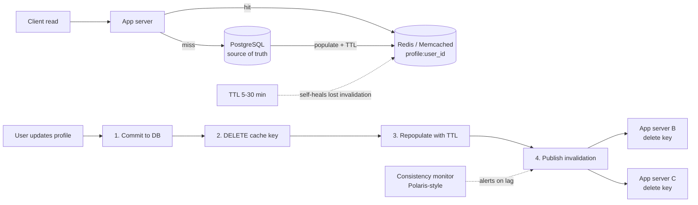

| Difficulty | Channel | Tags |
|---|---|---|
| beginner | backend | redis, memcached, cache-invalidation |

Picture a single profile update that never quite lands: one user changes their name, one cache node never hears about it, and the old data sticks around forever. Meta's Global Consistency team chased exactly these 'permanent' staleness bugs through weeks of code archaeology before building Polaris, which instantly flagged a version-check handler silently dropping invalidations and pushed cache consistency to 99.99999999% of writes within five minutes [1]. That is fewer than 1 in 10 billion writes left inconsistent. If trillion-dollar infrastructure can trip on this, your user profile service certainly will — which is why cache invalidation deserves far more respect than it usually gets.

---

> ### Real-World Case — Meta (Facebook)
>
> Meta's core caching layer (TAO + Memcache) serves social-graph and profile data to billions of users, where every read populates the cache and every write must invalidate it concurrently. The Global Consistency team suspected rare 'permanent' staleness bugs that were nearly impossible to reproduce — historically taking weeks of expert code archaeology to root-cause.
>
> | | |
> |---|---|
> | **Challenge** | Guaranteeing distributed cache invalidation correctness across regions: detecting when a stale value survives indefinitely after the latest invalidation event, rather than just transient replication/invalidation lag. |
> | **Solution** | Meta built Polaris, a shadow service that pretends to be a cache server and consumes real cache-invalidation events, so it can distinguish transient inconsistency from permanent staleness and alarm immediately. This operationalized the write-through/invalidate-on-write pattern with measurable consistency SLOs. |
> | **Outcome** | Achieved 99.99999999% of cache writes consistent within five minutes (fewer than 1 in 10 billion inconsistent after 5 minutes). Polaris instantly flagged a real bug where a version-check error handler silently dropped invalidations, leaving stale data forever — a bug that would previously have taken weeks to find. |
> | **Lesson** | Cache invalidation isn't just 'delete the key on write' — at scale you need active consistency verification, because silent permanent-staleness bugs hide behind healthy-looking hit rates and throughput metrics. |

---

## Hook — One Forgotten Key, Billions of Wrong Answers

Cache invalidation is one of the two hard problems in computer science, and the joke lands hardest when it is your production pager going off. Consider the simplest possible feature: a user edits their profile bio. Somewhere between the database commit and the cache, a race, a dropped message, or a forgotten key leaves millions of readers staring at a stale version of that person's name, avatar, or status. The read path is fast. The write path is where the bodies are buried. Every extra cache layer you add to hit a latency target multiplies the number of places a write can quietly fail to propagate, and unlike a crash, staleness does not announce itself — the system keeps serving wrong answers while dashboards stay green [1]. So before writing a single line of cache code, the real question becomes: what is your strategy for making sure every read that matters sees the write that just happened?

## Problem — Why Your Profile Cache Will Betray You

A profile service is a textbook caching candidate: reads dwarf writes, profiles are small, and a miss means a database round trip you would rather avoid. The temptation is to treat the cache as a dumb speed layer and let the database stay the single source of truth. However, that optimism breaks down the moment more than one application server writes to the same key. The core challenge has three faces: correctness (readers must not see pre-update data), coordination (multiple nodes must agree on when a key is dead), and cost (TTLs, memory, and invalidation traffic all have price tags). Many developers assume a TTL of 30 minutes 'handles it' — but a user who just changed their password or display name will absolutely notice up to 30 minutes of stale data, and support tickets do not scale with your cache hit rate. Therefore the design question is not whether to cache, but exactly which consistency guarantee you are promising, and what happens when the invalidation message gets lost between the database commit and the cache delete.

## Real-World Case — Meta (Facebook) and the Bug That Lived Forever

Meta's core caching layer — TAO plus Memcache — serves social-graph and profile data to billions of users, where every read populates the cache and every write must invalidate it concurrently across the fleet [1]. The Global Consistency team suspected rare 'permanent' staleness bugs that were nearly impossible to reproduce; historically, root-causing one took weeks of expert code archaeology. The impact of getting it right is staggering: 99.99999999% of cache writes consistent within five minutes, fewer than 1 in 10 billion writes left inconsistent. The plot twist is what the fix looked like — Polaris, a consistency checker, instantly flagged a real bug where a version-check error handler silently dropped invalidations, leaving stale data forever. Notice the shape of that failure: no crash, no error log, just an exception path that skipped the invalidation step entirely [1]. That is the same failure mode waiting in your profile service every time you wrap a delete call in a try/except or fire-and-forget a cache update. What Meta proved is that you cannot reason your way to consistency at this scale — you have to observe it, continuously, because the bugs hide in the paths nobody thinks to test.

## Deep Dive — Write-Through, TTLs, and the Redis vs Memcached Fork

Building on Meta's lesson, the practical strategy for a profile service starts with a write-through pattern: on profile update, delete the cache key, write the new row to the database, and write the fresh object to the cache in the same logical operation [2]. Deleting rather than updating is deliberate — it eliminates the classic race where a concurrent reader repopulates the key with old data between your read and your write. TTL then becomes a safety net rather than the primary mechanism: 5–30 minutes for profiles is a sensible window, because it bounds the blast radius of any invalidation that does go missing. For reads, cache-aside (lazy loading) keeps the hot path simple: the application checks the cache first and only touches the database on a miss. Here is where the tooling choice gets interesting, and where many teams pick wrong. Redis gives you pub/sub for automatic distributed invalidation, persistence, and advanced data structures [3], while Memcached offers a simpler architecture, lower memory overhead, and no persistence to slow it down [4]. The trade-off table tells the real story:

| Dimension | Redis | Memcached |
|---|---|---|
| Distributed invalidation | Built-in pub/sub channels [3] | Manual coordination across nodes |
| Data structures | Hashes, sorted sets, Lua scripting | Flat key-value blobs only |
| Persistence | RDB/AOF snapshots | None — restart means cold cache |
| Memory overhead | Higher (per-key overhead) | Lower, multithreaded, lean |
| Scaling model | Cluster with sharding | Simple consistent-hash horizontal scaling |
| Best for | Complex invalidation, durability, rich logic | Pure, dumb, fast caching [4] |

🔥 Hot Take: if your invalidation needs are just 'delete a key everywhere,' Memcached's simplicity is genuinely attractive — but the moment you want cross-node fan-out without hand-rolled coordination, Redis pays for its extra memory on day one. Moreover, Redis pub/sub is fire-and-forget: no delivery guarantee, no persistence of messages [3]. If a subscriber is disconnected during an invalidation event, it never gets the memo — which is precisely the silent-drop bug class Meta's checker caught [1]. Consequently, pairing pub/sub with a TTL remains non-negotiable; the TTL is your backstop for the messages that fall on the floor.

## Workflow — The Invalidation Path, Step by Step

Here is the sequence that keeps readers and writers honest, whether you choose Redis or Memcached. Follow it exactly, because the order is the whole point:

1. **Read (cache-aside):** the app asks the cache for `profile:{user_id}`; a hit returns in sub-millisecond time, a miss triggers a database query and a population write with a TTL.
2. **Write:** the app begins the profile update and writes the new row to the database first — the database is always the source of truth.
3. **Invalidate:** delete `profile:{user_id}` from the cache immediately after the commit; deleting beats updating because it removes the repopulation race entirely.
4. **Republish (optional but fast):** write the fresh object back to the cache so the next read is a hit, still stamped with a TTL.
5. **Fan out:** publish the invalidation event on a channel so other app servers and cache shards drop their local copies [3].
6. **Observe:** track hit rate, invalidation lag, and staleness alerts — the Polaris lesson is that unmeasured consistency decays silently [1].

The Mermaid diagram below maps this flow end to end — trace it once and the whole story clicks into place.

## Code Example — A Write-Through Profile Cache in Python

The snippet below implements the workflow with Redis: cache-aside reads, write-through updates, explicit invalidation, and a pub/sub fan-out for other nodes. Every comment marks the exact spot where a real-world bug tends to hide.

```python
import json
import redis
import time

r = redis.Redis(host="localhost", port=6379, db=0, decode_responses=True)
PROFILE_TTL = 900  # 15 minutes: bounds staleness if an invalidation is lost

def get_profile(user_id: int, db) -> dict:
    """Cache-aside read: check cache first, populate on miss."""
    key = f"profile:{user_id}"
    cached = r.get(key)
    if cached:
        return json.loads(cached)  # hot path: no database round trip

    row = db.fetch_user(user_id)          # miss -> hit the source of truth
    if row:
        # Set with TTL so a lost invalidation self-heals within PROFILE_TTL
        r.setex(key, PROFILE_TTL, json.dumps(row))
    return row

def update_profile(user_id: int, fields: dict, db) -> None:
    """Write-through: database first, then invalidate, then repopulate."""
    key = f"profile:{user_id}"

    # 1) Database commit BEFORE touching the cache.
    #    Inverting this order lets a reader cache the pre-update row.
    row = db.update_user(user_id, fields)

    # 2) Delete, do not overwrite: removes the read-modify-write race
    #    where a concurrent reader repopulates stale data mid-update.
    r.delete(key)

    # 3) Repopulate so the next read is a hit, with a fresh TTL.
    r.setex(key, PROFILE_TTL, json.dumps(row))

    # 4) Fan out to other app servers. Wrap this: Meta's bug was an
    #    error handler that silently swallowed invalidations [1].
    try:
        r.publish("cache:invalidate", key)
    except redis.RedisError as exc:
        # Log loudly. The TTL above still self-heals within 15 minutes.
        print(f"invalidation publish failed for {key}: {exc}")

def watch_invalidation(worker_id: int) -> None:
    """Run on every app server: drop local copies when told to."""
    pubsub = r.pubsub()
    pubsub.subscribe("cache:invalidate")
    for msg in pubsub.listen():
        if msg["type"] == "message":
            r.delete(msg["data"])  # belt and braces: delete is idempotent
```

Walking through it: `get_profile` is pure cache-aside — sub-millisecond on a hit, database only on a miss, and every population carries a TTL as a safety net. `update_profile` enforces the sacred ordering: commit to the database first, then delete the key, then repopulate, then publish. The `try/except` around the publish call is not defensive paranoia; it is the exact seam where Meta's silently dropped invalidation lived [1], and here it is forced into the open with a log line instead of a swallowed exception. Finally, `watch_invalidation` runs as a listener on every node, deleting keys on demand — note that the delete is idempotent, so a duplicate or missed message degrades gracefully toward the TTL rather than toward permanent staleness. In production you would swap the print for structured logging and add a metrics counter on publish failures, because the number that matters is not your hit rate — it is how often invalidation fan-out fails unnoticed.

## Lessons Learned — Battle Scars and What to Do Tomorrow

The journey from Meta's 1-in-10-billion consistency target down to your profile service comes down to a handful of hard-won rules. Here is what actually matters:

- **Delete, don't overwrite.** Deleting the key on update eliminates the stale-repopulation race; overwriting invites it.
- **TTL is not optional.** Treat it as the backstop for every lost invalidation — 5–30 minutes is a sane profile window [2].
- **Never let an exception eat an invalidation.** Wrap fan-out calls in explicit error handling and log them loudly [1].
- **Redis for coordination, Memcached for pure speed.** Choose Redis when you need pub/sub fan-out or rich data structures [3]; choose Memcached when you want lean, dumb, horizontal caching [4].
- **Measure consistency, not just hit rate.** A 99% hit rate with a permanently stale key is a failure, not a win. Alert on invalidation lag and publish failures.
- **Order your writes deliberately.** Database commit → cache delete → cache repopulate → publish. Reordering any step reintroduces a race.

⚠️ Watch Out: the most dangerous bugs are silent ones. A cache that returns wrong data does not throw — it simply erodes trust until a user screenshots their old name to your support team. Many developers discover this only after the incident review.

So what should change tomorrow? Audit every place your service writes to the cache and confirm three things: the delete happens after the commit, a TTL exists on every key, and invalidation failures are visible in your logs and dashboards. Do that, and you have already eliminated the bug class that took Meta weeks of archaeology to root-cause.

---

## Write-Through Cache Invalidation Flow



<details>
<summary><strong>Original Interview Question</strong></summary>

**Q:** You're building a user profile service that caches frequently accessed profiles. How would you implement cache invalidation when a user updates their profile, and what trade-offs would you consider between Redis and Memcached?

**A:** Implement write-through caching with TTL-based expiration. On profile update, invalidate the cache by deleting the key and writing new data to both the database and cache. Redis offers pub/sub for automatic distributed invalidation, while Memcached requires manual coordination across nodes.

</details>

## Conclusion

The moral of Meta's story is not that caching at scale requires genius — it is that silent failures in invalidation are invisible until they are expensive [1]. You started with a bug that took weeks of archaeology to find and ended with a pattern any developer can ship this week: commit to the database first, delete the key, repopulate with a TTL, publish the invalidation with error handling, and measure consistency instead of assuming it. Tomorrow, audit your cache writes for those five properties and put an alert on invalidation failures — that single habit is what separates a cache that speeds your service up from one that quietly serves lies. The one insight worth repeating in your next design review: a TTL is not laziness, it is the backstop that turns 'permanent staleness' into a fifteen-minute problem.

---

## References

1. [Meta (Facebook) incident report](https://engineering.fb.com/2022/06/08/core-infra/cache-made-consistent/) — article
2. [Redis caching documentation](https://redis.io/docs/latest/develop/use/patterns/cache/) — documentation
3. [Redis publish/subscribe documentation](https://redis.io/docs/latest/develop/interact/pubsub/) — documentation
4. [Memcached — distributed memory object caching system](https://github.com/memcached/memcached) — documentation
5. [Redis source code repository](https://github.com/redis/redis) — documentation
6. [Wikipedia: Redis](https://en.wikipedia.org/wiki/Redis) — documentation
7. [Wikipedia: Memcached](https://en.wikipedia.org/wiki/Memcached) — documentation
8. [RFC 9111 — HTTP Caching](https://datatracker.ietf.org/doc/html/rfc9111) — documentation
9. [MDN: Cache-Control HTTP header](https://developer.mozilla.org/en-US/docs/Web/HTTP/Headers/Cache-Control) — documentation

---

**Author:** Satishkumar Dhule — [GitHub](https://github.com/satishkumar-dhule) · [LinkedIn](https://linkedin.com/in/satishkumar-dhule) · [Website](https://satishkumar-dhule.github.io)
