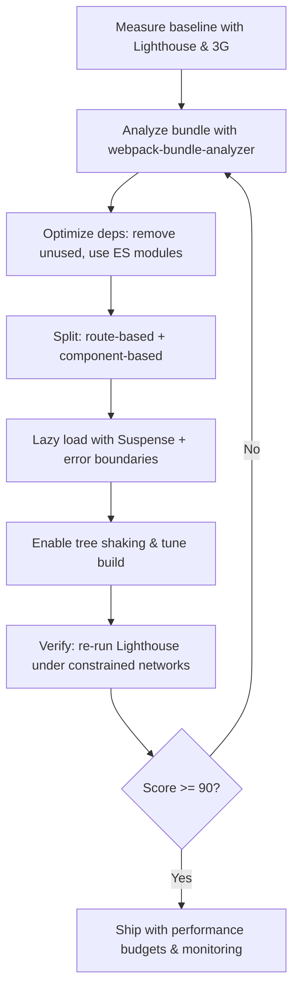

| Difficulty | Channel | Tags |
|---|---|---|
| intermediate | frontend | lighthouse, bundle, lazy-loading |

Picture millions of mobile users in emerging markets, tapping on links over sluggish 2G and 3G networks. For Twitter, every extra second meant lost engagement; a bloated React bundle stretched load times past five seconds, dragging Lighthouse scores into the basement. But a single code-splitting change flipped the script, proving that performance isn't just a metric — it's the difference between users sticking around or bouncing away [1].

---

> ### Real-World Case — Twitter
>
> Twitter needed its mobile web experience to work for hundreds of millions of users in emerging markets on 2G/3G networks and low-end devices, where over 80% of usage happened on mobile. The React + Redux + Webpack app had devolved into 3 massive JavaScript files totaling over 1MB (420KB gzipped), so the main bundle alone took over 5 seconds to load on a simulated 3G network and the Lighthouse score lagged badly behind native app performance.
>
> | | |
> |---|---|
> | **Challenge** | Reduce Time to Interactive and initial-load JavaScript payload for a huge, hundreds-of-components React app serving latency-sensitive users, without rewriting the app or hurting the experience for fast-network users. |
> | **Solution** | Twitter's team (led by Nicolas Gallagher and Paul Armstrong) used Webpack's CommonsChunkPlugin to implement granular route-based code splitting, breaking the monolithic bundle into 40+ on-demand chunks loaded via the PRPL pattern (Push, Render, Pre-cache, Lazy-load), paired with React.lazy-style lazy loading, service worker pre-caching of chunks and app shell, preload hints for critical resources, and later a CI 'build tracker' enforcing bundle-size performance budgets so regressions couldn't sneak back in. |
> | **Outcome** | The single code-splitting change cut main-bundle load from over 5 seconds to nearly 3 seconds on simulated 3G and visibly jumped the Lighthouse score. Overall Twitter Lite saw a 50% reduction in 99th-percentile time-to-interactive latency, a 30% reduction in average load time, a 600KB over-the-wire app (vs 23.5MB for the Android app), and engagement gains of 65% more pages per session, 75% more Tweets sent, and 20% lower bounce rate. |
> | **Lesson** | Code splitting can make the app larger in total bytes yet dramatically faster in practice: Twitter explicitly traded a bigger overall app spread across 40 lazy chunks for a much faster first render, amortizing download cost across the session. Performance budgets in CI are what keep those wins from eroding as a codebase grows. |

---

## Hook — When Every Second Counts

Imagine trying to read a tweet while watching a loading spinner spin endlessly on a low-end phone. That frustration is not hypothetical — it's the reality for billions of users accessing the web through constrained networks. Performance is no longer a luxury reserved for high-speed fiber; it's a gateway to inclusion. This reality forces developers to confront a simple question: how fast is fast enough? The stakes are massive — because when pages drag, users leave.

## Problem — The Crushing Weight of a Bloated Bundle

The core problem is familiar: an app that started small has grown unwieldy. What was once nimble code has become a 2.1MB JavaScript bundle dragging Time to Interactive to 4.2 seconds and Lighthouse to a dismal 65 [1]. With such numbers, users experience jank, delayed interactivity, and painful waits — especially on constrained devices. This leads to abandonment, lower engagement, and missed opportunities. The challenge is clear: shrink the bundle and make the app interactive sooner, without breaking features.

## Real-World Case — Twitter

Twitter faced this exact struggle at global scale. Their mobile web experience served hundreds of millions on 2G/3G networks, with over 80% of usage on mobile. The React + Redux + Webpack app had devolved into three massive JavaScript files totaling over 1MB (420KB gzipped); the main bundle alone took over 5 seconds to load on a simulated 3G network [1]. The impact was stark: a single code-splitting change cut main-bundle load from over 5 seconds to nearly 3 seconds, improving Lighthouse scores visibly. Overall Twitter Lite achieved a 50% reduction in 99th-percentile time-to-interactive latency, a 30% reduction in average load time, a 600KB over-the-wire app (versus 23.5MB for Android), and engagement gains of 65% more pages per session, 75% more Tweets sent, and a 20% lower bounce rate [1].

## Deep Dive — Cutting the Fat with Smart Splitting

To go from 65 to 90+, developers must think systematically about delivery. Code splitting breaks the monolith into smaller chunks delivered on demand [2]. Route-based splitting lets users download only what they need for the current view [3]; component-based splitting defers heavy UI (charts, modals, editors) until interaction [4]. Bundle analysis identifies the biggest offenders — tools like webpack-bundle-analyzer expose chunk sizes so you know what to attack first [5]. Tree shaking eliminates dead code when using ES modules with proper configuration [6]. Dynamic imports load non-critical libraries only when needed [4]. Finally, lazy loading paired with Suspense gives users a fallback while chunks load, keeping the UI responsive [3]. Each technique is powerful alone, but together they form a cohesive strategy for faster interactivity.

## Workflow — Step-by-Step Process to Reach 90+

Building on the principles above, the path is methodical: First, measure — establish baseline with Lighthouse and simulated 3G to confirm 65/4.2s [7]. Second, analyze — run bundle analysis to visualize chunk sizes and identify culprits [5]. Third, optimize dependencies — remove unused packages, swap heavy libs for lighter alternatives, and prefer ES module imports [6][8]. Fourth, split intelligently — apply route-based splitting for top-level views and component-based splitting for heavy, below-the-fold pieces [2][3][4]. Fifth, implement lazy loading with Suspense and error boundaries for resilience [3]. Sixth, tune build — enable tree shaking, configure splitChunks, and compress assets [6]. Seventh, verify — re-run Lighthouse and synthetic tests under constrained networks; iterate until hitting 90+. This process, visualized below, mirrors what Twitter did at scale [1].

## Code Example — Route and Component Splitting in Action

Practical implementation shows how straightforward it is to defer loading. The code below demonstrates route-based code splitting with React.lazy() and Suspense for main routes, plus component-based splitting for a heavy chart. Error boundaries (not shown but recommended) add resilience. This pattern reduces initial bundle size by delivering route/component code only when needed [2][3][4].

## Lessons Learned — The Journey to Lightning Speed

The transformation from 65 to 90+ is not magic — it's discipline. You must measure before cutting; bundle analysis prevents guesswork. Splitting must be strategic: routes first for biggest wins, then heavy components. Dead code removal and better imports compound savings. As Twitter proved [1], even a single well-placed splitting change can shave seconds and drive massive engagement gains. But the work doesn't end at 90 — performance is a habit. Guardrails (budgets, CI checks) and ongoing monitoring keep scores high. The takeaway is simple: optimize for the slowest networks your users actually use, and you will build faster, more inclusive experiences.

---

## Performance Optimization Workflow

<strong>Original Interview Question</strong>

**Q:** You're tasked with improving a React app's Lighthouse performance score from 65 to 90+. The bundle size is 2.1MB and Time to Interactive is 4.2s. What specific steps would you take to optimize the bundle and implement lazy loading?

**A:** Implement code splitting with React.lazy() and Suspense, analyze bundle composition with webpack-bundle-analyzer to identify largest chunks, remove unused dependencies and optimize imports, add dynamic imports for heavy components and third-party libraries, implement route-based splitting for better initial load times, and utilize tree shaking with proper ES module configuration.

## Conclusion

Performance isn't about chasing perfect scores — it's about respecting users' time and constraints. Twitter's story proves that smart splitting can slash seconds off load times and unlock massive engagement. The next step is clear: measure your app under real-world conditions, analyze what's bloating it, and start splitting strategically. Do it today, because every millisecond counts.

---

## References

1. [Twitter incident report](https://web.dev/case-studies/twitter) — article
2. [Code splitting](https://webpack.js.org/guides/code-splitting/) — documentation
3. [React.lazy and Suspense](https://react.dev/reference/react/lazy) — documentation
4. [Dynamic imports](https://developer.mozilla.org/en-US/docs/Web/JavaScript/Reference/Operators/import) — documentation
5. [webpack-bundle-analyzer](https://github.com/webpack-contrib/webpack-bundle-analyzer) — documentation
6. [Tree shaking](https://webpack.js.org/guides/tree-shaking/) — documentation
7. [Lighthouse documentation](https://developer.mozilla.org/en-US/docs/Web/Tools/Lighthouse) — documentation
8. [Reduce unused JavaScript](https://developer.mozilla.org/en-US/docs/Learn_web_development/Extensions/Performance/JavaScript) — documentation

---

**Author:** Satishkumar Dhule — [GitHub](https://github.com/satishkumar-dhule) · [LinkedIn](https://linkedin.com/in/satishkumar-dhule) · [Website](https://satishkumar-dhule.github.io)
